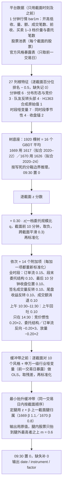

# 最终因子 1669 / 1670 详解（构造逻辑、经济含义、可解释性）

> 用途：因子赛道决赛研究报告的底稿，专讲两个私榜候选 1669 与 1670：每一个成分是什么、为什么有效、怎么组合、证据在哪里、哪里还说不清。篇幅较长，写报告时按需截取。
>
> 整理日期：2026-11-10。只读了仓库文件、项目记忆和评分机任务索引，没有连接任何机器，没有重算任何因子值。文中标"本文统计"的数，是 2026-11-10 在本机用 python3 对冻结文件和 `因子实验/models/*.json` 做的只读统计（例如数树的分裂次数、核对哈希），方法写在对应位置。
>
> 冻结提交不能改。本文所有关于代码的描述都以冻结文件为准；如果别的文档与代码不符，以代码为准，并在附录 B 里列出需要改正的地方。
>
> 2026-11-11 精简核对（只读、轻量）：重新核对了以下几项，结果与正文一致——两个冻结 `.py`／`.ipynb` 与 zip 的 SHA-256 前 16 位（冻结文件现只保留在 `因子代码/`，zip 包未收入公开仓库）；两个树 JSON 的树数（各 1920）、分裂／叶子数（32104／34024、33714／35634）、最大分裂层分布（1120 棵 0–3 层、800 棵 0–4 层）、按 2^−深度 加权的分裂重要性前十二与根节点计数；1626 的 14 个主特征各有 13 个分箱边界恰为 0、1617 只有 0～1 个（3.9 节）；`h2_robust.py` 第 226 行的拟合矩阵写法与 168 个 o21_ 任务的区间（全部 2021-01～2022-12）；任务索引 `rd_c6_q30L60buf110`、`rd_c6_q30L60buf80`、`rsrd_c6_q30L60buf80` 三行的五项；得分总表「公榜回报（10-28 上午…）」与登记表 5.1ab 的数字；1669 代码第 4969–4971 行参数、`_post_turnover` 中 14 个附加项的顺序与权重、`_resid_styles` 的前一交易日写法。另补了 3.2 节的"字段与经济含义"补表。其余数字沿用 2026-11-10 整理时的出处，未逐条重查。
>
> 公开版说明（2026-11-23）：本文是比赛期间的内部整理稿，公开前做过文字整理，实验数字与技术结论没有改动。因子赛道私榜名次已按 2026-11-13 更新后的最终结果改为总榜第二（1669 的私榜分与五项不变）。文中的 git 提交号指私有开发仓库的历史，公开仓库只有一次全新提交，无法按提交号检出。出处标为「内部……（未公开）」「内部记录」「项目记忆」「原料笔记」「素材笔记」的，是开发期间的任务书、交接文档、命令记录、工作笔记和撰写本文时整理的素材，不随公开仓库发布。决赛正式提交的报告与展示稿在 `文档/决赛材料/提交材料/`，与本文不一致时以提交材料为准。

## 0. 读法、口径与出处写法

### 0.1 指标与口径

- **五项指标的顺序**（全文统一）：IC 均值／IC_IR／多空夏普／压力稳定性／换手。换手越低越好，其余越高越好。
- **IC** 是平台口径的截面秩相关（RankIC，Spearman），在风格与行业剔除后的残差上算；IC_IR = IC 序列均值 ÷ 标准差，不年化；多空夏普 = 头尾各 10% 等权的多空收益均值 ÷ 标准差 × √(242×8)；压力稳定性 = 按截面标签离散度的中位数把截面分成高、低两半，取较弱一半的 IC_IR；换手 = 多头、空头两腿在**同一交易日相邻截面**之间的成分替换比例，跨日那一次不计（来源：`工具/评分机/engine.py` 的 `Core.series`、`Core.summarize`、`Core._turnover`；`工具/本地评分/localeval.py` 的 `evaluate`）。
- **本地**：自建评分机（部署在 personal），与平台同口径：官方标签、10 个官方风格 + 32 个申万一级行业剔除、常数截面跳过、换手只计同日。本地数据是 2020–2024 年。
- **公榜、私榜**：平台分数。公榜分是五项在全体有效提交里的百分位等权平均，会随别的队提交而漂移，只能在同一快照里比较分差；五项原始值不随别人变化（来源：`因子得分总表.md`「公榜回报（10-24 下午…）」"分数会随榜单漂移"）。私榜只在各队最终选定的提交里排名（来源：项目记忆 private-board-selection.md）。公榜、私榜区间的具体起止日期：未记录（主办方未公开）。本地数据与公榜区间不重叠，公榜对本地是样本外（来源：`因子得分总表.md` §二十五）。
- **树的样本内外**：1617 的树只在 2020-01-01～2022-12-31 拟合，2023、2024 两年对它是样本外；1626 拟合到 2024 年末，本地没有样本外年份（来源：`因子实验/models/h2_avg16.json`、`h2_avg16_f24.json` 的 `fit_span`；项目记忆 tree-eval-in-sample.md）。所以本文给 1669 的本地数都是 **2023–24（样本外）**，1670 只能用"1617 底座 + 同一套后处理"做对照。

### 0.2 出处简称

| 简称 | 指什么 |
|---|---|
| 1669 代码 | `因子代码/1669_1617加委托结构订单流收盘位置竞价惯性尾盘反向尾盘放量尾盘签名量与收益反转成交额消退上午回吐缓冲带前风格剔除缓冲带1.1最小抬升0.6.py`（`.ipynb` 是同一份代码去掉末尾 `if __name__ == "__main__":` 自测块） |
| 1670 代码 | `因子代码/1670_1626加…缓冲带0.8最小抬升0.6.py`（同上） |
| 说明29 | `公榜提交/新根第二十九批/公榜提交说明_新根第二十九批.md` |
| 任务索引 | `工具/评分机/任务索引/评分机全部任务索引_2026-10-31.csv`，后面跟任务名（例：任务索引 `rd_c6_q30L60buf110`），逐年数取该行的 `by_year` 列 |
| 登记表 5.1x | `文档/方向登记表.md` 第五部分对应小节 |
| 得分总表「标题」 | `因子得分总表.md` 中该标题下的小节（文件 822 KB，用标题 grep 定位） |
| 指南 | `文档/复现与消融指南.md` |
| 草稿 | 内部草稿《决赛增量解释》（未公开） |
| 项目记忆 名字 | 项目记忆目录下的 `名字.md`（一路记下的规则与结论，不在仓库里） |
| 用户提供 | 本次整理任务给出的最终成绩（公榜最终分、私榜分与五项、名次），仓库里没有记录 |

### 0.3 任务名里的后处理参数

评分机任务名里的 `q30` = 加 0.30 × z(一档委托规模比)；`L60` = 最小抬升间隔 m = 0.60；`buf110` = 缓冲带 β = 1.10。`rslag_`、`rd_`、`rc_`、`rsrd_`、`rsrob_` 等前缀的批次都在"缓冲带前风格剔除"口径下；`lm_`、`cd_`、`c4_`、`t14_`、`w14_` 不剔除（来源：`因子实验/c105j_turnover.py` 文件头；登记表 5.1y、5.1ab）。例：`rd_c6_q30L60buf110` = 1617 底座 + q 0.3 + 1663 的附加项 + c6 四项 + 缓冲前剔除 + m 0.6 + β 1.1，就是 **1669 的配方在 1617 底座上的本地值**。

---

## 1. 一句话概括与流程图

### 1.1 一句话

**1669** = 用 16 个浅层梯度提升树（共 1920 棵树，只在 2020–2022 年拟合）把 27 个分钟级与日级信号的截面排名组合成底座（1617），再在底座上依次线性叠加一档委托规模比（权重 0.30）和 14 个小权重附加项（其中 7 项只在 14:30 截面起作用），然后用前一交易日的 10 个官方风格暴露和申万一级行业剔除共同成分，最后用"最小抬升缓冲带"（β 1.1、间隔 0.6 个标准差）把同日相邻截面的多空腿粘住，09:30 截面输出 0。

**1670** = 同一套后处理，底座换成 1626（与 1617 同样的 16 个配置和种子，拟合区间延长到 2024 年末），缓冲带 β 改为 0.8。两份代码除文档字符串、内嵌的树和 `_POST_BUF`（1.1 对 0.8）以外逐字相同（来源：本文统计，去掉第 231 行内嵌 JSON 后 diff，只有第 2、4、5 行文档字符串和第 4971 行参数行不同；1669 代码、1670 代码）。

用一句话概括：**底座回答"在这一刻，按反转、资金流、季节性和收盘习惯，哪些股票之后 30 分钟会收在均价之上"；附加项补上底座没有的盘口结构、订单流、收盘竞价和关注度信息；风格剔除和缓冲带让信号按评测器看到的排名稳定下来，把换手从 0.52 压到 0.29，同时 IC 不降反升。**

### 1.2 流程图



如果阅读环境不渲染 mermaid，可以用下面的文字框图：

```
平台 1 分钟行情 + 股票池 + 前一日风格暴露
        │
        ▼
27 列根特征（截面排名）──► 1617/1626 树底座（1920 棵树）──► 逐截面 z 分数
                                                               │
        ┌──────────────────────────────────────────────────────┘
        ▼
+ q 一档委托规模比（0.30）
+ 14 个附加项（6 个全时段、1 个上午、7 个只在 14:30）
        │
        ▼
风格（10 个）+ 申万一级行业剔除（前一交易日暴露）
        │
        ▼
最小抬升缓冲带（β 1.1 / 0.8，m 0.6）──► 09:30 置 0 ──► 输出
```

### 1.3 计算流水线（逐步对应代码）

入口 `main(datasources, start_date, end_date)`（1669 代码第 1–105 行）。全部只用截面时刻及之前的数据。

| 步 | 做什么 | 代码位置 |
|---|---|---|
| 1 | 算 H1363：490 头部原始值 + 9 个分钟根的加权截面排名（平台上 Y_sd5、X_n5d 两根为零）。它是树的第 12 列（原始值），它的 (date, instrument) 键就是整个因子的键 | `_main_a`、`_head_impl`、`_root_impl` |
| 2 | 时段哑变量：10:00…14:30 七个截面时刻的 one-hot（第 14–20 列） | `main` 第 41–42 行 |
| 3 | 15 个根逐个按自然季度计算（根内部再按自然月分批），对齐到步骤 1 的键，逐截面百分位排名 − 0.5（只在有值的行上排），缺失记 0；L_lab10 先做同一股票跨截面 EWMA（过去权重 0.75）再排名 | `main` 里的 `_quarters`、`_rank_on_key`；`main_b1…main_b15` |
| 4 | 同时段季节性族 L_5、VSH20、PACE20、DOW10：1 分钟线聚成 30 分钟段，多日滚动后错开 1 日，同样对齐排名 | `_seas_impl` |
| 5 | 09:30 截面的 27 列全部置 0 | `main` 第 99 行 |
| 6 | 树推理：每列按内嵌分箱边界 `searchsorted` 成 0–31 的箱号，1920 棵树从根往下走（箱号 ≤ 切分点走左），叶子值 × 学习率 0.00375 累加到 base 上；09:30 输出置 0 | `_gbdt_score` |
| 7 | 进入换手后处理：树输出逐截面 z 分数，09:30 置 0 | `_post_turnover` 开头 |
| 8 | 加 q：z ← z(z + 0.3·z(q)) | `_q_late` |
| 9 | 依次加 14 个附加项：z ← z(z + w·z(附加项))，顺序固定；带 `@1430` 的两项先把 14:30 以外的截面置 0 | `_post_turnover` 里的 for 循环、`_addon_*` |
| 10 | 风格与行业剔除：逐截面对前一交易日的 10 个风格 + 申万一级行业哑变量（含截距）做 OLS 取残差；09:30 置 0；再 z 分数 | `_resid_styles` |
| 11 | 最小抬升缓冲带：按截面时间顺序，上一截面（同一交易日）在多头腿／空头腿的股票加／减 β 后排名定腿（> 0.9 多头，≤ 0.1 空头），输出用原值，腿内股票只抬到腿外最高者之上 m = 0.6 | `_post_turnover` 末段 |
| 12 | 09:30 再置 0，缺失补 0，按 (date, instrument) 排序返回三列 | 同上 |

两个"关着的开关"：`_POST_EW`（日内 EWMA）= 0、`_POST_ANCHOR_W`（时间锚点）= 0，这两条分支在 1669／1670 里不执行（1669 代码第 4971 行）。上午回吐信号是以附加项 `s10_am_drift` 的形式进入的（步骤 9）。

生成链：`因子实验/build_1630.py`（1617 原样 + `_post_turnover` 骨架、q）→ `build_1649.py`（缓冲带改为最小抬升）→ `build_1653.py`（把 `s1_sqlgen.py` 生成的附加项平台脚本改名为 `_addon_<名字>` 原样嵌入，并支持 `任务@HHMM` 时段限定）→ `build_1664.py`（在缓冲带之前插入 `_resid_styles`）。复现命令见指南 2.2：`python3 因子实验/build_1664.py 1669 "<名字>" 1.1 0.6 "<14 个附加项:权重>" 0.3`，1670 用环境变量 `BASE=1626`、β 0.8。

### 1.4 成绩总览

| | IC | IC_IR | 多空夏普 | 压力 | 换手 | 分数 | 来源 |
|---|---|---|---|---|---|---|---|
| 1669 本地 2023–24（1617 底座，样本外） | 0.0925 | 1.803 | 48.50 | 1.662 | 0.290 | — | 说明29；任务索引 `rd_c6_q30L60buf110` |
| 1669 本地 2023 | 0.1009 | 2.176 | 59.60 | 2.174 | 0.289 | — | 任务索引 `rd_c6_q30L60buf110` by_year |
| 1669 本地 2024 | 0.0842 | 1.541 | 40.82 | 1.386 | 0.291 | — | 同上 |
| 1669 公榜（10-28 页面） | 0.1028 | 2.0691 | 54.18 | 1.9532 | 0.2794 | 0.95050 | 得分总表「公榜回报（10-28 上午…）」 |
| 1669 公榜（最终显示） | 0.1028 | 2.0691 | 54.1828 | 1.9532 | 0.2794 | 0.94728 | 用户提供 |
| **1669 私榜** | **0.0790** | **1.5593** | **45.6269** | **1.4086** | **0.2662** | **0.92111** | 用户提供 |
| 1670 的 1617 对照（同配方 β 0.8） | 0.0933 | 1.813 | 50.23 | 1.666 | 0.356 | — | 说明29；任务索引 `rd_c6_q30L60buf80` |
| 1670 公榜（10-28 页面） | 0.1039 | 2.1020 | 56.50 | 1.9743 | 0.3471 | 0.94563 | 得分总表「公榜回报（10-28 上午…）」 |
| 1670 公榜最终分、私榜五项 | 未记录 | | | | | | 用户未提供 |

因子赛道公榜最终第二、私榜总榜第二，入围决赛（来源：用户提供；私榜名次为 2026-11-13 更新后的最终结果）。

---

## 2. 投资逻辑与问题定义

### 2.1 预测目标：截面之后 30 分钟"收在均价之上还是之下"

**官方标签** y_off = 截面之后 30 分钟窗口 (t, t+30] 的收盘价 ÷ 同窗口成交量加权均价（VWAP）− 1。含义是"截面之后 30 分钟内按 VWAP 买入，窗口结束时按收盘价卖出"。

- 2026-10-10 平台没有给出标签定义，团队先用公榜分数反推出一个"下一窗口 VWAP 比 VWAP"的口径，后来证明是错的；2026-10-11 用户在平台上跑了只读探测，导出官方标签表两段（2024Q1、2021-06），Claude 在本地逐行核对：`vwap_return = end_price / vwap − 1`，两段 100% 吻合，误差 < 1e-7。旧口径下的本地数值全部作废（来源：`e2e/reports/12_官方标签与09点30缺陷.md` §一；`本地评分系统说明.md` 第三节；项目记忆 label-and-local-scorer.md）。这一条是官方标签最早在端到端赛道的平台探测里查清、再用到因子赛道的，研究经验在两个赛道之间是共享的；共享的是"评测口径"的知识，不是任何模型输出（见 9.6）。
- 截面只有 8 个：09:30、10:00、10:30、11:00、11:30、13:30、14:00、14:30。11:30 截面的窗口是午后开盘的 13:01–13:30；**14:30 截面的窗口是 14:31–15:00，窗口末价就是 15:00 收盘集合竞价价**（来源：`e2e/reports/01_环境与数据标签审计.md` 标签节；`e2e/reports/12_官方标签与09点30缺陷.md` §一）。
- 平台的 1 分钟数据在 09:25 集合竞价 bar 之后直接是 09:31，没有 09:30:00 这一根，09:30 截面拿不到"当前价"，是最弱的截面；平台对全 0（常数）截面直接跳过、不计入 IC 序列（来源：`e2e/reports/12_官方标签与09点30缺陷.md` §三；`工具/评分机/README.md` §2）。1669 把 09:30 的输出置 0，所以每天实际只有 7 个截面参与评分，每天 6 次同日换手观测（来源：1669 代码 `z930`；按评分口径推得）。
- 10-10 的规则变更把基准收益改为"股票池每个截面的平均收益率"。IC、多空收益差和换手都只看截面排序或截面内差值，减去截面均值后不变，所以对因子设计没有影响（来源：`e2e/reports/04_规则更新与调整_2026-10-10.md` 表 R1）。

这个标签有一个重要的形状特征：它不是"30 分钟收益"，而是**窗口末价相对窗口均价的位置**。一只股票在窗口里先跌后涨，收在均价之上，标签就是正的；先涨后跌，就是负的。所以凡是能预测"未来 30 分钟里价格往哪个方向漂"的信号都有用，而"30 分钟内的价格路径形状"（例如收盘段总是收在均价之上的股票）本身也是可以预测的对象——这正是同时段季节性根 L_lab10、L_5、CLS20 的出发点（它们的统计量与标签同一个形式："段收盘 ÷ 段 VWAP − 1"）。

### 2.2 评测口径对设计的四个直接推论

评测器不是在原始因子上算指标。它先把因子逐截面标准化，对 10 个官方风格（SIZE、BETA、MOMENTUM、RESVOL、SIZENL、BTOP、LIQUIDTY、EARNYILD、GROWTH、LEVERAGE）加 32 个申万一级行业哑变量（含截距）做 OLS，取残差，然后 IC、多空两条腿、换手两条腿都在**残差的排名**上算（来源：`工具/评分机/engine.py` 的 `Core.residual`；`工具/本地评分/localeval.py` 的 `style_residual`）。主办方说明里写的是"不剔除行业"，但平台探测 02 导出的平台处理后因子值，只有回归里加入 32 个行业后才与本地相关 1.000000，不加行业只有 0.93–0.97，所以以平台实际为准（来源：`e2e/reports/12_官方标签与09点30缺陷.md` §六；项目记忆 competition-rule-updates-2026-10.md）。

由此得出四个设计推论，1669 的每一层都对应其中一条：

1. **只有排序有意义，绝对值没有意义。** 所以每个根进树前都做截面百分位排名，每个附加项都先 z 分数再叠加；输出保留 z 分数尺度而不是均匀排名，因为改成均匀排名会让多空夏普降约 3（来源：得分总表「1617 的批判与换手变换」）。
2. **风格和行业上的暴露会被评测器扣掉。** 因子里与风格、行业共线的部分不贡献 IC；更重要的是，评测器的"腿"是残差排名上的腿。这一条直接催生了第 5 节"缓冲带之前做同样的剔除"。
3. **换手只计同日相邻截面。** 跨日那一次不计，所以压换手只需要让腿边界附近的股票在一天之内"粘"一点，不必做跨日平滑，也不必降低信号本身的更新频率。这催生了第 6 节的缓冲带，并且缓冲带每天 10:00 重置。
4. **14:30 截面的标签含收盘集合竞价，与其他截面结构不同。** 这催生了 7 个只在 14:30 起作用的附加项（第 4.6–4.8 节）。

### 2.3 分钟级信号的来源（总表）

1669 的全部成分可以按"信号来自市场的哪一种行为"归成 11 类。下表是全局地图，后面各节逐个展开。

| 信号来源 | 1669 中的成分 | 观察尺度 | 用在因子里的方向 |
|---|---|---|---|
| 短期价格反转（同伴残差） | 队友头部 s139、s155、s161、H152；H1363 中的 490 头部 | 30 分钟到 1 日 | 反转：近期相对同伴涨多的偏弱 |
| 资金流与量价关系 | Z_mfr60、Z_mfr90、W_vdir、M_q_lin、W_zero | 当日至今、近 60／90 分钟 | 买方资金流和放量推动的价格回吐（取负）；"聪明钱"位置、零收益占比为正 |
| 委托结构（挂单的笔数与单笔规模） | q（一档委托规模比）、s20_ql_end、14:30 的 s40_q14_s1、s40_q14_end | 截面前 10 分钟、段末最后一分钟 | 买方单笔挂单越大越弱（取负）；后排档位笔数失衡为正；14:30 反向 |
| 订单流（主动买卖方向） | s35_of_l10_rel、14:30 的 s40_of14 | 截面前 10 分钟 | 给定反转之后延续；14:30 反向 |
| 收盘位置／价格位置 | s16_l10_clv、CLOSEPOS20 | 截面前 10 分钟；过去 20 日 | 短区间顶端回落（取负）；"惯常收在高点附近"为日内不变锚 |
| 集合竞价 | k1406（前日收盘竞价冲击）、s37_auc_m20／m5（收盘竞价惯性，14:30）、CLS20（收盘段季节性） | 前一交易日、过去 5／20 日 | 竞价溢价有惯性（延续） |
| 尾盘行为（截面前最后 10 分钟） | s25_ts_sv_l10、s16_l10_ret | 截面前 10 分钟 | 短时买卖压力推出的偏离回吐（取负） |
| 关注度与成交额消退 | s6_amt_5d20d；14:30 的 s5_c_abnvol、s18_abnamt_day；PACE20、VSH20 | 约一周对约一个月；当日 | 放量后关注度消退（取负）；但在 14:30，今天越放量收盘前越涨 |
| 日内锚定（上午回吐） | s10_am_drift | 10:00 到 10:30–11:30 | 开盘冲高或砸低在上午回吐 |
| 同时段季节性 | L_lab10、L_5、DOW10 | 过去 5／10 日、过去 10 个同星期几 | 个股在一天中某个半小时的"收盘相对均价"习惯会重复 |
| 收益分布形态 | k1381（日内峰度）、k1385（近 5 日偏度） | 当日至今、近 1200 分钟 | 尖峰厚尾、正偏度（彩票型）之后偏弱 |

### 2.4 为什么这些信号在 30 分钟尺度上有效（微观结构逻辑）

下面每一条都分成"仓库里的证据"和"解读"。解读是我们给出的经济解释，仓库里没有专门检验的地方会写明。

**（1）短期反转是给流动性提供者的报酬。** 一笔大的买（卖）需求在短时间里把价格推离均衡，提供流动性的一方要求补偿，价格随后部分回到原位。

- 证据：登记表 5.1t 把段收益分解成"订单流解释的部分（λ × 签名成交量之和）"和剩余部分，前者取负 IC 0.060、IC_IR 1.19，剩余部分取负 IC ≈ 0，并引用 Nagel（2012）"短期反转 = 提供流动性的报酬"作解释。
- 反证：登记表 5.1z 用同一分解做多尺度阶梯，订单流部分五年 IC 0.060，**普通段收益的同尺度阶梯反而是 0.087**，结论是"λ 估计噪声大，s41 的结论说过头了"。所以准确的表述是"反转与订单流推动的价格偏离有关"，而不是"反转全部来自订单流"。
- 在 1669 里：同伴残差头部（树的主干，见 3.6 的根节点统计）、W_vdir（放量推动的价格变动回吐）、Z_mfr60／90（近一小时买方资金流回吐）、s25_ts_sv_l10 与 s16_l10_ret（截面前 10 分钟的买压与价格偏离回吐）都是这一机制在不同尺度上的版本。

**（2）同伴（伪行业）残差让反转更干净。** 全市场的反转里混着行业、风格的共同运动；用"与自己走势最相关的一组股票"做基准，减掉同伴的共同涨跌，剩下的才是个股特有的冲击。

- 证据：队友头部的代码文档字符串写明依据是"行业内反转强于全市场反转"，引用 Da, Liu & Schaumburg（2014）（来源：1669 代码 `main_b8` 文档字符串）。得分总表「T4b」的单调约束消融发现，树的非单调价值集中在反转头部："极端涨跌与中等涨跌的回复方式不一样"。

**（3）挂单的"笔数"和"单笔规模"携带不同的信息。** 同样是"买一挂单量大"，由很多小单堆起来是真实需求，由少数大单堆起来更像压盘、诱多或做市挂单；只看挂单量的盘口失衡分不出这两种情况。

- 证据：五个窗口里，一档笔数失衡（买 − 卖）÷（买 + 卖）单独 IC +0.022～+0.051，**正向**；一档平均单笔挂单规模之比 log(买 ÷ 卖) 单独 IC −0.019～−0.036，**反向**，五个窗口方向都一致（来源：得分总表「盘口委托笔数」知识段，约第 8620–8632 行）。
- 在 1669 里：q（一档规模比取负，权重 0.30）是全部附加项里权重最大的一项；约 200 个五年候选逐个加到 1617 上，只有委托结构类"四项都升、换手不升"，是"相对 1617 唯一独特的信息"（来源：登记表 5.1h）。

**（4）订单流有持续性。** 在反转给定之后，截面前几分钟主动成交的方向倾向于延续（例如大单被拆成小单陆续执行）。

- 证据：截面前 10 分钟主动买卖失衡单独五年 IC 只有 0.0007，正负交替；但加到最小抬升底座上 +0.15，IC_IR +0.036、压力 +0.028（来源：登记表 5.1m；任务索引 `s35_of_l10_rel`）。单独看被反转淹没，给定底座之后才显出来。"拆单导致延续"是解读，仓库没有专门检验。

**（5）个股在一天中的同一个半小时有重复的"习惯"。** 流动性的日内周期、机构的固定交易时点、收盘段的竞价溢价，会让某只股票在某个半小时"收在均价之上还是之下"有持续性。

- 证据：L_lab10（下一个半小时段的"段收盘 ÷ 段 VWAP − 1"过去 10 日均值）五年逐年单独 IC +0.0119、+0.0122、+0.0157、+0.0216、+0.0169，对 490 头部的残差 IC +0.0276，与头部相关只有 +0.01（来源：得分总表「第 1、2 级（单独 IC 与对 490 的残差 IC…）」「第七轮 Q：逐年稳定性表」）。季节性类信号集中在 14:30：CLS20 在 14:30 的 IC 0.066，其余时段约 0（来源：得分总表「F4 弱时段（14:00）专项」）。

**（6）收盘集合竞价是一个独立的价格形成环节。** 14:30 截面的标签窗口末价就是收盘竞价价。把 14:30 的标签拆成"连续竞价漂移（14:57 收盘 ÷ 14:31–14:57 VWAP − 1）+ 收盘竞价跳动（15:00 ÷ 14:57 − 1）"，两部分与标签的秩相关分别是 0.73、0.38，竞价成交占窗口成交的中位数约 8%（来源：登记表 5.1x）。

- 由此产生 14:30 特有的三件事（第 4.6–4.8 节）：个股收盘竞价收益有惯性（延续）；截面前的盘口压力在连续竞价里延续，到收盘竞价回吐（反向）；今天受关注、资金流入多的股票到收盘竞价还在被买入。
- 对照实验支持"是竞价而不是别的"：午休没有集合竞价，"11:30 → 午后开盘"的惯性完全没有信息（登记表 5.1p）；放量和委托结构的时段专用副本在 10:00～14:00 六个时段共 108 组扫描全部在误差内，只有 14:30 特殊（登记表 5.1r、5.1w）。
- "收盘价是指数、基金净值与机构考核的基准，所以收盘竞价有稳定的不平衡来源"是解读，仓库没有专门检验。

**（7）关注度会消退。** 放量往往伴随注意力冲击和短期过度定价，之后关注度回落，价格把关注带来的溢价还回去（s6_amt_5d20d 取负）。但在 14:30，"今天放量"代表收盘前仍有资金在买，方向反过来（第 4.7 节）。两者不矛盾：前者是"约一周相对约一个月"的慢变量，后者是"当天相对常态"的当日变量，而且只在含竞价的窗口里成立。

**（8）当天早些时候的价格是锚。** 开盘冲高或砸低，在上午会被当天早些时候的价格拉回去（s10_am_drift：−ln(现价 ÷ 10:00 价)，只在 10:30–11:30）。单独五年 IC 0.0733、IC_IR 1.231，换手 0.378（来源：任务索引 `s10_am_drift`）。

### 2.5 为什么是 30 分钟这个尺度

- **日频信号在 30 分钟持有期上几乎没用。** 20 日最大日收益、日收益波动、偏度、5／20 日反转、60 日动量、换手波动、成交额趋势等日频经典异象，单独 IC 都 ≤ 0.015（来源：登记表 5.3）。昨日收盘位置、昨日最后半小时等"昨天的信息"也只有 ≤ 0.016；昨天全天的一档规模比 IC ≈ 0.003，"信息只在当天"（来源：登记表 5.3、5.1l）。
- **截面前最后 10 分钟的信息最值钱。** q、订单流、段末委托结构、收盘位置、签名成交量、尾盘收益，全部只看截面前 10 分钟或最后一分钟；它们单独的五年 IC 在 0.04～0.05 量级（收盘位置 0.0383、签名成交量 0.0461、尾盘收益 0.0469、段末委托结构 0.0438），但换手 0.66～0.86（来源：任务索引对应任务）。这说明 30 分钟标签对"刚刚发生的盘口与成交"非常敏感，而这种敏感也带来高换手——这就是为什么要用小权重、跨截面平滑和缓冲带来"用信息但不追噪声"。
- **慢变量负责稳定，快变量负责方向。** 日内不变的锚（CLS20、CLOSEPOS20、k1406）、多日季节性、成交额消退几乎不贡献换手（例如 s6_amt_5d20d 单独换手只有 0.047），在树里起"条件修正"的作用。`文档/方向登记表.md` 第九节（第十六轮，10-17）的机制结论大意是：降换手是机制性的，任何当日不变的分量加进合成都能钉住相邻截面的排序；但要提分，这个分量本身必须有 IC，当时只有尾盘族（CLS20、CLOSEPOS20）满足，所以应当挑"当日不变、单独有 IC、日间持续"的分量当锚，而不是堆一堆当日不变的分量。

---

## 3. 树底座（1617／1626）

### 3.1 定位与来历

树底座是 1669／1670 里信息量最大的一层：它把 27 个"各自讲一个微观结构故事"的信号，用浅层梯度提升树组合成一个分数。后面的附加项、风格剔除和缓冲带都是在它的输出上做的。

来历按时间（来源：得分总表「第七批公榜回分」「第九批公榜回分」「1626 公榜回分」；登记表 §八～§十五）：

| 日期 | 版本 | 做了什么 | 公榜 |
|---|---|---|---|
| 10-17 | H2（第十四轮远端任务） | 浅层直方图 GBDT（深度 3、100 棵、学习率 0.06），输入是线性定权解 1397 的 15 个分量 + 1363 + 队友头部 + 7 个时段 one-hot（+4 个季节性特征），目标 = 标签截面秩，只在 2020–22 拟合；相对同输入的线性解 1397 三个区间 IC +0.0029～+0.0043、IC_IR +0.064～+0.122，换手 +0.015～+0.027 | — |
| 10-17 | 1600 | H2 的平台代码版（28 列，含季节性族） | 0.87851，当时全队最高（0.0958／1.8618／56.74／1.8578／0.5103） |
| 10-18 | **1617** | 16 个配置平均、多期目标、H1363 按平台口径；相对 1600 平台口径五个窗口五项全好 | **0.90451**（0.0993／1.9671／57.74／1.9095／0.5029），对 1600 +0.0260 |
| 10-19 | **1626** | 1617 的 16 个配置与种子原样，拟合区间延长到 2024 年末 | 0.90287 |

H2 的想法和第一版实现来自第十四轮远端任务书（要求把模型导出成纯 numpy 可复现的 JSON），由远端的 codex 代理执行；10-18 之后远端停用，16 个配置的扩展、平台代码版与核对由 Claude 在 macstudio 上自己跑（来源：内部任务书（新根第十四轮，2026-10-17，未公开） 第 36–44 行；`因子实验/h2_stack.py` 文档字符串；登记表 §十四；项目记忆 remote-agent-loop.md）。

平台环境里没有 sklearn、lightgbm，所以树是纯 numpy 的直方图 GBDT（`因子实验/h2_stack.py`），训练好的 1920 棵树、分箱边界、特征顺序和 base 以 JSON 形式写死在因子代码第 231 行（`_GBDT`），推理时不重新拟合、不重算边界（来源：得分总表「第十四轮 H2」；`因子实验/models/README.md`）。本文核对：1669 代码内嵌的 `_GBDT` 与 `因子实验/models/h2_avg16.json` 的树、分箱边界、特征顺序、base 逐项相同；1670 代码与 `h2_avg16_f24.json` 逐项相同（本文统计）。

### 3.2 27 列输入总表

树对每列只用截面排名（H1363 除外，用原始值），方向由树自己学。下表"预期方向"取自该根单独交付或线性合成时的符号，不是树的约束。列序 = `feat_order`（来源：`因子实验/models/h2_avg16.json`；1669 代码 `main` 文档字符串）。

| 列 | 名字 | 组 | 一句话口径 | 时段／窗口 | 预期方向 |
|---|---|---|---|---|---|
| 0 | L_lab10 | 分钟根 | 下一个半小时段"段收盘 ÷ 段 VWAP − 1"的过去 10 日均值，先跨截面 EWMA（过去权重 0.75）再排名 | 过去 10 个交易日（至少 5 日），错开 1 日 | 正 |
| 1 | M_q_lin | 分钟根 | "聪明钱"：以 \|r\|/v 加权的当日至今 VWAP ÷ 当日至今 VWAP − 1 | 当日 09:31 至截面 | 正 |
| 2 | W_vdir | 分钟根 | 量价同向：Σ r·(ln 成交量 − 之前各分钟 ln 成交量均值) ÷ Σ\|r\| | 当日至今 | 负 |
| 3 | W_zero | 分钟根 | 零收益分钟占比 | 当日至今 | 正 |
| 4 | Z_mfr60 | 分钟根 | 上涨分钟成交量占比 Σv·1[r>0] ÷ Σv | 截面前 60 分钟（当日内） | 负 |
| 5 | Z_mfr90 | 分钟根 | 同上 | 截面前 90 分钟 | 负 |
| 6 | s155 | 队友头部 | 152 + 四个盘口／成交价锚点，56 列同伴残差反转 | 多窗口 | 正（反转） |
| 7 | s139 | 队友头部 | 首窗去重 + 四张同伴网络 + 同伴中位数基准的反转，16 列 | 多窗口 | 正（反转） |
| 8 | s161 | 队友头部 | 155 再加成交笔数加权价锚，60 列 | 多窗口 | 正（反转） |
| 9 | k1381 | 形态与竞价 | 日内已实现峰度 n·Σr⁴ ÷ (Σr²)²，取负 | 当日至今 | 正（取负后） |
| 10 | k1385 | 形态与竞价 | 近 5 日已实现偏度 √n·Σr³ ÷ (Σr²)^1.5，取负 | 最近 1200 分钟 | 正（取负后） |
| 11 | k1406 | 形态与竞价 | 前一交易日收盘竞价价格冲击：前日收盘 ÷ 前日 14:57 价 − 1 | 前一交易日，日内常数 | 正 |
| 12 | H1363 | 合成 | 490 头部原始值 + 9 个分钟根加权排名（原始值，不排名） | 多窗口 | 正 |
| 13 | H152 | 队友头部 | 6 个阶梯分量 + 4 个价格锚点，40 列同伴残差反转 | 多窗口 | 正（反转） |
| 14–20 | slot1000…slot1430 | 时段 | 截面时刻 one-hot | — | 由树学 |
| 21 | L_5 | 季节性 | 下一段 lab 过去 5 日均值（至少 3 日） | 过去 5 日 | 正 |
| 22 | VSH20 | 季节性 | 下一段成交额占全天比重的过去 20 日均值 | 过去 20 日 | 弱负 |
| 23 | PACE20 | 季节性 | 今天至本段累计成交额 ÷ 过去 20 日同一时刻累计成交额均值 | 当日 vs 过去 20 日 | 负 |
| 24 | DOW10 | 季节性 | 过去 10 个同星期几的下一段 lab 均值（至少 5 个） | 过去 10 周 | 正 |
| 25 | CLS20 | 收盘锚 | 最后半小时 (14:30,15:00] 的"段收盘 ÷ 段 VWAP − 1"过去 20 日均值，日内不变 | 过去 20 日 | 正 |
| 26 | CLOSEPOS20 | 收盘锚 | (当日收盘 ÷ 当日 8 个半小时段收盘价最高者 − 1) 的过去 20 日均值，日内不变 | 过去 20 日 | 正 |

前 12 个分量来自 `因子实验/d2_optimize.py` 的 CAND 列表（15 个分量去掉 N_dir、Y_sd5、X_n5d），对应关系：L_lab10 = 1232、M_q_lin = 1236、W_vdir = 1260、W_zero = 1263、Z_mfr60 = 1334、Z_mfr90 = 1342（来源：`因子实验/d2_optimize.py` 第 21–37 行）。

#### 3.2 补表：每列用到的数据字段与一句话经济含义

上表讲"怎么算"，这张补表讲"用了哪些原始字段、代表什么市场行为"。分两种来源，写法不同，不要混读：

- **分钟根、形态根、季节性族、收盘锚**：字段按统计量的定义列出（这些根共用一份"资金流窗口框架"SQL，SQL 会把很多列一起读进来，但每个根只用其中由 `STAT` 选中的统计量，所以按定义列更准确）（来源：1669 代码 `_root_impl_b1` 等文档字符串与 SQL；`_seas_impl`、`_close_impl_b14`、`_cp_impl_b15` 的 SQL）。
- **队友头部与 H1363 里的 490 头部**：列的是该函数 SQL **读取**的字段（本文统计：2026-11-11 对 1669 代码逐函数检索字段名）。读取不等于每个字段都进入最终统计量，例如 s139、H152 的 SQL 读了买一卖一价，但按文档字符串它们不含盘口锚点分量。

| 列 | 名字 | 用到的平台字段 | 一句话经济含义（"解读"表示仓库没有专门检验） | 方向 |
|---|---|---|---|---|
| 0 | L_lab10 | 开、收、量、额（1 分钟线聚成半小时段，段收盘与段 VWAP） | 个股在一天中"接下来这个半小时"惯常收在均价之上还是之下（同时段季节性），统计量与标签同形 | 正 |
| 1 | M_q_lin | 收、量、额 | 单位成交量价格冲击大的分钟（信息含量高）所成交的均价，相对全天均价的位置；解读：信息型交易推动的价格短期延续 | 正 |
| 2 | W_vdir | 收、量 | 价格变动是否由放量推动；放量推动的流动性需求冲击随后回吐 | 负 |
| 3 | W_zero | 收 | 价格黏滞、交易稀少；解读：流动性或关注度不足的补偿 | 正 |
| 4 | Z_mfr60 | 收、量 | 近 60 分钟买方资金流（上涨分钟成交量占比）；短期过度买压回吐 | 负 |
| 5 | Z_mfr90 | 收、量 | 同上，90 分钟 | 负 |
| 6 | s155 | SQL 读取：高、低、收、量、额、前收、买卖一价、买卖 1–3 档挂单量 | 相对同伴的短期超涨超跌回归，外加盘口／成交价锚点（中间价、三档挂单量加权价、微价格） | 正（反转） |
| 7 | s139 | SQL 读取：高、低、收、量、额、前收、买卖一价 | 相对同伴中位数的短期超涨超跌回归（四张同伴网络），不含盘口锚点 | 正（反转） |
| 8 | s161 | SQL 读取：同 s155，另加成交笔数 | 155 再加按成交笔数加权的价格锚 | 正（反转） |
| 9 | k1381 | 收 | 分钟收益尖峰厚尾（跳跃型波动）之后偏弱 | 正（取负后） |
| 10 | k1385 | 收（最近 1200 分钟，跨日） | 彩票偏好：正偏度股票被高估，随后回落 | 正（取负后） |
| 11 | k1406 | 收（前一交易日 14:57 与 15:00 两根 bar） | 前一日收盘集合竞价把价格推高（压低）的程度，是"竞价有惯性"的日频版本 | 正 |
| 12 | H1363 | 490 头部 SQL 读取：开、高、低、收、量、额、成交笔数、前收、买卖一价；九根按各自定义（收、量、额，N_dir 用单笔成交额 = 额 ÷ 成交笔数） | 我们自己的反转头部加九个分钟根的线性合成，给树一个"线性起点" | 正 |
| 13 | H152 | SQL 读取：高、低、收、量、额、前收、买卖一价 | 同伴残差反转的基础版（阶梯分量 + 区间中点、最低价等价格锚点） | 正（反转） |
| 14–20 | slot1000…slot1430 | 截面时刻 | 让树按时段调整各根的作用；14:30 的标签窗口含收盘集合竞价，是结构性特殊的截面 | 由树学 |
| 21 | L_5 | 开、收、量、额 | 同时段季节性的短窗版（5 日） | 正 |
| 22 | VSH20 | 量、额 | 下一段在全天成交里的常态占比（个股的日内成交节奏） | 弱负 |
| 23 | PACE20 | 额 | 今天到此刻的成交节奏相对常态（今天是否格外活跃） | 负 |
| 24 | DOW10 | 开、收、量、额 | 星期几维度的同时段季节性 | 正 |
| 25 | CLS20 | 收、量、额（最后半小时段） | 收盘段惯常收在 VWAP 之上的习惯，解读：与收盘集合竞价溢价有关 | 正 |
| 26 | CLOSEPOS20 | 收（当日 8 个半小时段收盘价） | 惯常收在日内高点附近还是远离高点，刻画个股的收盘强度 | 正 |

（方向与口径的来源同上表；经济含义的出处见 3.3 各条。H1363 中 N_dir 的定义来源：1669 代码 `_main_a` 文档字符串。）

### 3.3 分组详述

#### 3.3.1 分钟根（"资金流窗口框架"，代码 `_root_impl_b1…b6`）

**共同口径**：1 分钟 bar 按结束时刻标注，截面 T 取 (09:30, T] 的连续竞价分钟，不含 09:30 及之前的集合竞价 bar；"当日至今"统计按 (股票, 交易日) 分区，不跨日；分钟收益 r = ln(收 ÷ 上一分钟收)，当天第一分钟用开盘。同一段 SQL 被所有变体共用，变体只改一个统计量参数 STAT（来源：1669 代码 `_root_impl_b1` 文档字符串）。

- **L_lab10（同时段季节性，= 1232 的根）**：统计量"段收盘 ÷ 段 VWAP − 1"和标签同形。它问的是"这只股票过去 10 天，在**接下来这个**半小时里，通常收在均价之上还是之下"。五年逐年单独 IC +0.0119、+0.0122、+0.0157、+0.0216、+0.0169；单独换手 0.88，对 490 头部的残差 IC +0.0276，与头部相关只有 +0.01，是"新信息源"的典型（来源：得分总表「第 1、2 级（单独 IC 与对 490 的残差 IC…）」「第七轮 Q：逐年稳定性表」）。单独换手高，所以在进树前先做跨截面 EWMA（过去权重 0.75）。
- **M_q_lin（"聪明钱"，= 1236）**：给"单位成交量带来的价格变动大"的分钟（信息含量高、价格冲击大）更高的权重，算出一个加权 VWAP，看它相对全天 VWAP 的位置。单独 IC +0.0253、换手 0.26；逐年 +0.0263→+0.0211（来源：得分总表同上两表）。解读：信息型交易推动的价格位置之后短期延续；这一点仓库没有专门论证。
- **W_vdir（量价同向，= 1260）**：放量分钟的收益加正权、缩量分钟加负权，衡量"价格变动是不是放量推动的"。单独 IC −0.0395、换手 0.28，残差 IC −0.0375；逐年 −0.0616→−0.0352（来源：同上）。负方向 = 放量推动的价格变动会回吐，是"流动性需求冲击回吐"的直接度量。
- **W_zero（零收益分钟占比，= 1263）**：价格黏滞、最小变动价位约束、交易稀少。单独 IC +0.0257、换手 0.19；逐年 +0.0293→+0.0230（来源：同上）。解读：流动性溢价或关注度不足的补偿。
- **Z_mfr60／Z_mfr90（资金流，= 1334／1342）**：近 60／90 分钟里"上涨分钟的成交量"占总成交量的比例，即近一小时的买方资金流。Z_mfr60 逐年 IC −0.0760、−0.0719、−0.0597、−0.0617、−0.0451（逐年减弱）；Z_mfr90 在 2023–24 单独 IC −0.0532、IC_IR −1.0788、换手 0.4102、压力 −1.1408（来源：得分总表「第七轮 Q：逐年稳定性表」「第六轮 L：1334 家族 1341–1346」）。负方向 = 短期过度买压回吐。

#### 3.3.2 分布形态与竞价根（`_root_impl_b10…b12`）

- **k1381（日内峰度，取负）**：分钟收益尖峰厚尾（跳跃型波动）的股票随后偏弱。反向版单独 IC +0.0082、IC_IR 0.207、换手 0.164（来源：得分总表「1380–1385 反向版」表）。
- **k1385（近 5 日偏度，取负）**：正偏度（彩票型）股票被高估，随后回落。反向版单独 IC +0.0162、IC_IR 0.365、换手 0.044（来源：同上）。注意草稿把它写成"委托结构"，与代码不符（附录 B）。
- **k1406（前日收盘竞价价格冲击）**：前一交易日 15:00 收盘竞价价相对 14:57 最后一个连续竞价价的跳动。14:57 的 bar 收盘价是收盘竞价前最后一个连续竞价价，15:00 的 bar 含收盘竞价成交（来源：1669 代码 `_root_impl_b12` 文档字符串）。日内常数，换手低。单独 IC +0.00315、IC_IR 0.096，对底座的残差 IC +0.00278（来源：得分总表「第十轮」1406 行）。单独很弱，但它和 14:30 的收盘竞价惯性（第 4.6 节）是同一个"竞价有惯性"的故事的日频版本。

#### 3.3.3 队友的四个反转头部（`main_b7`、`main_b8`、`main_b9`、`main_b13`，原始代码未改动）

这四列由团队成员在 AI 编码代理早期代码的基础上开发，我们原样嵌入，是树里最重要的一组（第 3.6 节）。共同结构（据各自文档字符串）：

1. **反转分量**（只用过去数据）：r_30 = ln(上一窗口末价 ÷ 当前价)（首窗以昨收为基准）；r_rv4／r_rv8 = ln(滚动 4／8 个窗口清洗后成交 VWAP ÷ 当前价)；r_day = ln(昨收 ÷ 当前价)；以及"倍增阶梯"和多种价格锚点（区间中点中位数、最低价中位数、低振幅加权锚点等）。
2. **同伴（伪行业）残差**：每个自然月月初，用过去日收益的相关系数给每只股票选同伴（139 用相关最高的 30 只、60 个交易日），分量减去同伴中位数；四张同伴网络（原始／超额 × 日频／30 分钟）。依据是"行业内反转强于全市场反转"（Da, Liu & Schaumburg 2014）。
3. **四特征中性化**：因子截面排名对规模、特质波动、非流动性（Amihud）、低价四个特征的排名做逐截面回归取残差。文档字符串的理由是"反转信号天然偏向小盘、高波动股票，而这些暴露本身会拖累排序"。
4. **聚合**：全部"分量 × 网络"的列做 IQR 截尾均值；152／155／161 再与慢特征（低波动、小盘、低价）按截面排名 1 : 0.5 融合。
5. **数据清洗**：成交均价不在该分钟 [最低价 × 0.98, 最高价 × 1.02] 内的分钟不计入 VWAP 与成交额。
6. 09:30 截面没有当前价，整体补 0。

| 列 | 名字 | 与 152 的差别 | 队友自报表现（他们的验证段，非我们评分机） |
|---|---|---|---|
| 13 | H152 | 基础版：6 个阶梯分量 + 4 个价格锚点，10 分量 × 四网络 = 40 列 | 验证／保留 IC 0.08417／0.06863、ICIR 1.7965／1.1614、换手 0.3892／0.3850 |
| 6 | s155 | 152 + 四个盘口／成交价锚点（一档中间价锚、成交价相对当前价、三档挂单量加权价锚、成交 VWAP 相对微价格），56 列 | 验证段 IC 0.08401、ICIR 1.8031、换手 0.3813 |
| 8 | s161 | 155 再加按窗口成交笔数加权的价锚，60 列 | 未单独记录 |
| 7 | s139 | 不是 152 系：平台原始结构的"首窗去重 + 四网络 + 同伴中位数"版，4 个反转分量 × 4 网络 = 16 列 | 开发／验证／保留 IC 0.08863／0.07916／0.06639，换手约 0.59 |

（来源：1669 代码 `main_b13`、`main_b7`、`main_b9`、`main_b8` 文档字符串。）

我们自己评分机上的 s161 五年逐年（IC／IC_IR／多空／压力／换手）：2020 0.1004／1.415／47.78／1.421／0.397；2021 0.0938／1.735／55.74／1.727／0.387；2022 0.0830／1.486／50.70／1.452／0.388；2023 0.0833／1.827／53.11／1.828／0.385；2024 0.0680／1.173／36.09／1.148／0.379（来源：任务索引 `o20_s161`、`o21_s161`、`fm_s161` 的 by_year）。

一个公榜上的经验：以队友 161 头部为主的合成在公榜上兑现好（1610 0.891），以 490 头部为主的合成兑现差（1603／1612／1611／1624 ≤ 0.873）（来源：项目记忆 public-transfer-heads.md）。这是树的输入里同时放了四个队友头部、而 490 只以 H1363 一列出现的背景之一。

#### 3.3.4 H1363（第 12 列，原始值）

- H1363 = 490 头部原始值 + Σ w·rank(根)，权重 {L_lab10 +0.20, M_q_lin +0.10, N_dir −0.10, W_vdir −0.10, W_zero +0.10, Y_sd5 +0.10, X_n5d −0.10, Z_mfr60 −0.15, Z_mfr90 −0.10}（来源：1669 代码 `_main_a` 文档字符串与 `W` 字典）。N_dir 是"大单方向"：Σ r·(ln 单笔额 − 之前分钟均值) ÷ Σ|r|。
- 平台上 Y_sd5、X_n5d 两根为零：近 5 日跨日 1200 分钟窗口上的 STDDEV／LAG 写法在平台失效；10-18 用户在平台上跑自查脚本，确认 2020–2024 每个月有成交的分钟里成交笔数 `deal_number` 空值 0%，排除了"成交笔数字段缺失"的假设（来源：项目记忆 dai-platform-pitfalls.md；`工具/平台自查_成交笔数.py`）。树训练时用 `--h1363-pf --h1363-sub Y_sd5,X_n5d` 把这两根从 H1363 里扣掉，与平台一致（来源：`因子实验/过程记录/macstudio引擎/驱动脚本/fx_t1t2.sh` 第 6 行）。
- **490 头部**（`_head_impl`）：同伴加权（每月初，过去 240 个交易日日收益相关最高的 200 只，权重 = 相关度² × 同伴平均成交额，至少 120 个观测）的四个反转分量残差（r_30、r_rv4、r_rv8、r_day）等权排名合成"阶梯"，再与上影线占比（0.30）、平均单笔成交额（0.15）、r_rv16（0.20）、实体占比（0.15）排名加权，最后对 6 个特征（规模、特质波动、非流动性、低价、换手率代理、流通市值平方）+ 行业哑变量逐截面回归，减去 **2.5 倍**拟合值（"过度中性化"）。文档字符串写的是"1.5 倍"，代码是 `neutralize("signal", CHARS4, 2.5)`，以代码为准（来源：1669 代码 `_head_impl`，第 655–658 行）。流通市值、风格与行业一律取前一交易日。
- 在树里 H1363 只占 3.5% 的重要性（第 3.6 节），它的作用更像"把 1363 的线性结论交给树做起点"。

#### 3.3.5 时段哑变量（第 14–20 列）

slot1000…slot1430 是截面时刻的 one-hot，让树学"哪个时段该信哪根"。第十五轮稳健性检验去掉 one-hot 后，树的样本外增益还剩 1/3～1/2，说明树的增益不主要靠时段切分（来源：得分总表「第十五轮 J1」②）。但 14:30 例外：slot1430 是 1617 里排第 4 的特征（5.0%），见第 3.6 节。

#### 3.3.6 同时段季节性族（第 21–24 列，`_seas_impl`）

段口径同 1232：30 分钟段 (09:30,10:00] … (14:30,15:00] 由 1 分钟 bar 聚合；多日统计都按同一股票自己的交易日滚动再错开 1 日（来源：1669 代码 `_seas_impl` 文档字符串）。

| 列 | 名字 | 单独 2023 IC／IC_IR／换手 |
|---|---|---|
| 21 | L_5 | +0.0204／0.45／0.86 |
| 22 | VSH20 | −0.0064／−0.180／0.74 |
| 23 | PACE20 | −0.0172／−0.373／0.10 |
| 24 | DOW10 | +0.0104／0.286／0.87 |

（来源：得分总表「第十四轮 H1」表。）当时的判断：这一族单独都弱（没有一个 IC_IR ≥ 0.8），线性叠加 ΔIC ≤ +0.0003，PACE20 的信息已被 1334／1342 覆盖；**放进树里才有用**——L_5 在 1617 里是排第 3 的特征（5.3%）。这是"树能用好单独很弱、但在特定条件下有用的信号"的一个具体例子。

#### 3.3.7 收盘锚（第 25–26 列）

- **CLS20**（`main_b14`）：最后半小时 (14:30,15:00] 的"段收盘 ÷ 段 VWAP − 1"过去 20 个交易日均值（至少 10 日），同一天各截面同值。在 1610（同一批根的线性版）的各时段扫描里，季节性类集中在 14:30：CLS20 在 14:30 的 IC 0.066，其余时段约 0；1610 中全天权重 +0.048、14:30 再加 0.096（来源：得分总表「F4 弱时段（14:00）专项」；`因子代码/1610_*.py` 文档字符串）。
- **CLOSEPOS20**（`main_b15`）：(当日收盘价 ÷ 当日 8 个半小时段收盘价最高者 − 1) 的过去 20 日均值，错开 1 日，日内不变。第十六轮里它是唯一同时"单锚 IC +0.0255、日间持续性 0.983"的日内不变锚（来源：`文档/方向登记表.md` §九 K2 行）。
- 经济含义（解读）：CLS20 是"收盘段收在 VWAP 之上的习惯"，与收盘集合竞价溢价有关；CLOSEPOS20 是"惯常收在日内高点附近还是远离高点"，刻画收盘强度的个股特征。两者日内不变，几乎不贡献换手。

### 3.4 训练

| 项 | 值 | 出处 |
|---|---|---|
| 模型 | 纯 numpy 直方图 GBDT（平方损失、逐棵拟合残差）；叶子值 = Σ残差 ÷ (样本数 + reg) | `因子实验/h2_stack.py` 的 GBDT 类 |
| 训练目标 | y = 官方标签的逐截面秩 − 0.5，再加多期项 w·秩(同一交易日之后 2 个截面标签之和)（`--aux-n 2`）；深度 4 的 w = 0.25，深度 5 的 w = 0.40 | `因子实验/h2_robust.py` 第 188–189、234–250 行；`fx_t1t2.sh` |
| 拟合样本 | 拟合区间内、非 09:30、标签有值的全部 (截面, 股票) 行 | `h2_robust.py`、`h2_stack.mask_of` |
| 拟合区间 | 1617：2020-01-01～2022-12-31；1626：2020-01-01～2024-12-31 | 两个 JSON 的 `fit_span` |
| 分箱 | 每列 32 箱（31 个边界），边界 = 拟合区间特征的等分位数，写死在 JSON 里，推理时不重算 | `h2_stack.bin_edges`；`因子实验/models/README.md` |
| 每棵树 | 学习率 0.06（合并后 ÷16 = 0.00375）、行抽样 8%、每个节点列抽样 80%、叶子最少 3000 行、L2 正则 reg = 200 | JSON `params`：min_leaf 3000、sub 0.08、colsub 0.8、nbins 32、reg 200 |
| 16 个配置 | 深度 4、150 棵、多期 0.25 × 种子 7／11／23／42；深度 4、130 棵、多期 0.25 × 种子 7／11／23／42；深度 5、100 棵、多期 0.40 × 种子 7／11／23／42／3／5／13／17 | `fx_t1t2.sh` 第 12–15 行；JSON `merged_from` 的 16 个文件 |
| 合并方式 | 16 个模型的树直接拼接，学习率 ÷16，base 取平均；要求特征顺序与分箱边界完全一致 | `因子实验/merge_gbdt.py` |
| 树的总数 | 1920 = 4×150 + 4×130 + 8×100；其中 1120 棵深度 4（分裂层 0–3）、800 棵深度 5（分裂层 0–4） | 本文统计（读 JSON 每棵树最大分裂层） |
| 规模 | 1617：分裂 32104 个、叶子 34024 个；1626：分裂 33714、叶子 35634 | 本文统计 |
| base | 1617：0.0006180；1626：0.0006143 | JSON |
| 训练特征里去掉的根 | N_dir、Y_sd5、X_n5d（`--drop`） | `fx_t1t2.sh` 第 6 行 |

**多期目标的意义**：目标里加上"同日之后两个截面的标签和"，让树偏向"能持续一点"的信号，压低输出在相邻截面之间的变化（换手）。深度 5 + 多期 0.40 的四个种子单独都相对 1600 五项全好，换手 −0.009～−0.011（来源：得分总表「深度 5 的多种子 → 1616」）。这是在**训练目标**上做的事，不改变推理时的输入，推理时也不使用任何自身之前的输出。

**为什么深度 4 与 5 混合、16 个全平均**：深度 4 给 2022 年多空余量，深度 5 给更低换手；16 个全平均（不挑种子）相对 1600 平台口径五个窗口五项全好：IC +0.0029～+0.0033、IC_IR +0.026～+0.084、多空 +0.16～+1.97、压力 +0.028～+0.061、换手 −0.0064～−0.0080（来源：得分总表「深度 4 与深度 5 混合平均 → 1617」）。"用上了所有种子、不挑选"是刻意的：此前曾在同样五个窗口上试了 12 个变体、挑出过线的那个，得分总表当时就记了"有挑运气的成分"，之后改成全平均（来源：得分总表「树方向找到"五项全好"的版本」，约第 7705 行）。第九批提交说明的"风险"一节也写明：在同样五个窗口上一共试了 20 多个树的变体，配置（深度 4、多期目标 0.25）本身是在这五个窗口上选出来的（来源：`公榜提交/新根第九批/公榜提交说明_新根第九批.md` "风险"）。

**1626 = 1617 的同一 16 个配置，只把拟合区间延到 2024 年末**（10-19 深夜）。理由是用户指出公榜区间不与本地数据重叠，交付版可以全量拟合；依据是 F15b：同 16 个配置拟合到 2023 时，在 2024 年（两者都样本外）IC +0.0006、IC_IR +0.013、压力 +0.013、换手 +0.0025（来源：得分总表「F15b」「树：T1 全量拟合 → 1626」）。但这一步有一个事后才发现的实现问题，见第 3.9 节。

### 3.5 为什么用树：非线性与时段交互

**(a) 同一批输入，树比线性好，并且在样本外和公榜都兑现。**

- 1610 是同一批根的线性设计权重版（队友 161 头部 + 12 根，权重写在 `因子代码/1610_*.py` 文档字符串里）。在 2023、2024 两年（对 1617 是样本外），1617 相对 1610：2023 IC +0.0094、IC_IR +0.131、多空 +7.18、压力 +0.141，换手 +0.144；2024 IC +0.0086、IC_IR +0.127、多空 +4.01、压力 +0.074，换手 +0.141（来源：任务索引 `d_1610_2023`（by_year 的 2023）、`d_1610_2024`、`d_1617_2023`、`d_1617_2024`，本文相减；草稿第一节表里的 1610"2023"实际是 2020–2023 四年合计，见附录 B）。
- 公榜上（同一时刻上传）1617 对 1610：IC +0.0056、IC_IR +0.282、多空 +8.60、压力 +0.236、换手 +0.134，分数 +0.0134（来源：`因子实验/public_rows.json`；得分总表「第九批公榜回分」）。
- 树的增量"来自非线性，不只是多几个交互项"：同一切分下 15 个分量 + 4 个交互项的岭回归，2023／2024 相对线性解只有 IC_IR +0.0212／+0.0014，GBDT 是 +0.0482／+0.0078（来源：得分总表 §一百一十五）。

**(b) 非线性主要来自反转头部（单调约束实验）。** 这是目前"树学到了什么"最好的定量证据：

- 全部特征按拟合期相关符号做单调约束（T4，时段哑变量不约束）：相对不约束的同胞，2023 IC −0.0016～−0.0020、换手 −0.024～−0.027；结论"树比线性多出的 IC 里约一半来自非单调形状，而这部分形状也带来约 0.025 的换手"（来源：得分总表「T4：单调约束树」）。
- 分组消融（T4b，深度 4、150 棵、种子 7）：只放开反转头部、其余单调时，2023 IC −0.0008、IC_IR +0.005、压力 +0.010、换手 −0.005；2024 IC −0.0003、IC_IR +0.005、多空 +0.39、压力 +0.004、换手 −0.003。结论："非单调的价值集中在反转头部，极端涨跌与中等涨跌的回复方式不一样；各根和季节性特征按经济方向单调起作用时 IC 只小降，IC_IR、压力反而略升，它们在树里的非单调部分多半是噪声"（来源：得分总表「T4b」）。
- 所以对树的概括是：**树的主干是反转头部的非线性形状（大涨大跌与小涨小跌回复得不一样），其余根大体按经济方向单调地做条件修正。**

**(c) 时段交互：14:30 是树唯一明显"区别对待"的时段。** 1617 的分时段诊断：2024 年 14:30 IC 0.109，14:00 只有 0.061，其余 0.074～0.082（来源：得分总表「1617 的批判与换手变换」）。树的结构里 slot1430 是第 4 重要的特征，而且从不做根节点，只出现在第 1–4 层，与它直接相邻最多的特征是 W_vdir、L_5、CLS20、s139、Z_mfr60、PACE20、W_zero（本文统计，见 3.6）。解读：树在 14:30（标签含收盘竞价）单独调整量价同向、同时段季节性、收盘段季节性与成交节奏的作用，与第 4 节 14:30 附加项的发现方向一致。

**(d) 树的代价：换手。** 1617 换手 0.52（多头腿 0.50、空头腿 0.53），1610 是 0.38（来源：得分总表「1617 的批判与换手变换」）。T4 也说明非单调形状本身带来约 0.025 的换手。这是后面要用缓冲带解决的问题。

**(e) 训练目标剔除风格反而更差。** 把训练目标先剔除风格与行业（T7）：原目标约 15% 的方差是风格与行业成分，剔除后换手 +0.033，否决；"风格本身是慢变量，从目标里去掉后树更集中去学快变成分"（来源：得分总表「T7」）。

### 3.6 分裂重要性与敏感度

**单特征分裂重要性**（每次分裂按 2^−深度 加权，近似"经过这次分裂的样本占比"，再归一化）。本文用 python 读两个 JSON 的全部 1920 棵树重新统计，1617 一列与草稿的前十一致：

| 名次 | 1617（1669 的底座） | 1626（1670 的底座） |
|---|---|---|
| 1 | s139 15.3% | s139 14.2% |
| 2 | Z_mfr60 6.7% | PACE20 7.1% |
| 3 | L_5 5.3% | CLOSEPOS20 7.1% |
| 4 | slot1430 5.0% | slot1430 6.7% |
| 5 | W_vdir 4.9% | Z_mfr60 6.6% |
| 6 | s161 4.6% | L_5 6.3% |
| 7 | k1385 4.6% | CLS20 5.4% |
| 8 | CLOSEPOS20 4.5% | DOW10 4.3% |
| 9 | s155 4.5% | k1385 4.2% |
| 10 | M_q_lin 4.3% | W_vdir 4.1% |
| 其余 | CLS20 4.2%、W_zero 4.2%、H152 4.1%、PACE20 4.0%、DOW10 3.6%、H1363 3.5%、VSH20 3.1%、k1381 2.8%、Z_mfr90 2.6%、k1406 2.2%、L_lab10 2.1%、slot1130 1.6%、slot1400 1.1%，其余时段 ≤ 0.5% | s161 3.9%、VSH20 3.7%、H152 3.4%、W_zero 3.0%、s155 2.9%、M_q_lin 2.8%、H1363 2.7%、k1381 2.2%、slot1130 2.2%、Z_mfr90 1.9%、k1406 1.5%、L_lab10 1.4%、slot1400 1.2% |

按分裂次数（不加权），1617 前五是 s139 9.9%、slot1430 6.3%、Z_mfr60 6.1%、W_vdir 5.9%、L_5 5.8%（本文统计）。

**按组的重要性**（2^−深度 加权，本文统计）：

| 组 | 1617 | 1626 |
|---|---|---|
| 队友反转头部（s139、s155、s161、H152） | 28.5% | 24.4% |
| 1363 族分钟根（L_lab10、M_q_lin、W_vdir、W_zero、Z_mfr60、Z_mfr90） | 24.7% | 19.8% |
| 同时段季节性（L_5、VSH20、PACE20、DOW10） | 16.0% | 21.4% |
| 分布形态与竞价（k1381、k1385、k1406） | 9.6% | 7.9% |
| 时段哑变量（7 个） | 9.0% | 11.3% |
| 收盘锚（CLS20、CLOSEPOS20） | 8.8% | 12.5% |
| H1363 合成值 | 3.5% | 2.7% |

**根节点**（每棵树的第一刀）：1617 的 1920 棵树里，s139 做根 541 次，其后 s161 178、s155 153、Z_mfr60 127、H152 111、L_5 86、CLOSEPOS20 84、W_vdir 72（本文统计）。也就是说**树的主干是反转头部，其余根做条件修正**——这与 T4b"非单调价值集中在反转头部"的结论互相印证。

**14:30 的交互**：slot1430 在 1617 里从不做根节点，出现在第 1／2／3／4 层的次数是 233／500／935／364（本文统计）。

**单特征敏感度与偏依赖方向：未完成，没有定量结果。** 工具 `因子实验/c50_tree_explain.py`（在 2024 年随机 20 万行上把某特征排名 ±0.1，看输出变化与单调性，并按 7 个时段拆开）在 10-19 08:59 启动后于 09:01 被手动停掉，日志 `因子实验/过程记录/macstudio引擎/日志/c50.log` 为空；同时停掉的还有"深度 2 可解释树"实验（`fx_d2tree.sh`）（来源：内部命令记录，未公开）。若要补做，入口是 `python3 因子实验/c50_tree_explain.py 因子实验/models/h2_avg16.json`，需要在 personal 上用评分机的 `prepare_data.py` 重建特征面板（来源：指南 2.3、2.5）。在补做之前，以第 3.5(b) 节的单调约束实验作为"方向是否符合经济含义"的替代证据。

### 3.7 树的稳健性证据

| 检验 | 结果 | 出处 |
|---|---|---|
| 换种子（早期 100 棵深度 3 版，4 个种子 × 5 个窗口） | ΔIC、ΔIC_IR 18 个组合全部为正；2023 窗口四个种子 ΔIC 极差 0.00075 | 得分总表「第十五轮 J1」① |
| 去掉时段 one-hot | 五个窗口 ΔIC／ΔIC_IR 仍全正，增益缩到 1/3～1/2 | 同上 ② |
| 只用 2021–22 拟合（2020 也变成样本外） | 五个窗口全正，量级几乎不变；2020 从样本内变样本外后 ΔIC 从 +0.00460 降到 +0.00303、ΔIC_IR 从 +0.1014 降到 +0.0682（约 −1/3） | 同上 ③；得分总表 §一百一十八 |
| 树规模减半（50 棵）、深度 2 | 仍全正，增益随规模单调增 | 同上 ④ |
| 1617 半年稳健性（10 个半年，相对 1600 平台口径不差的次数） | IC／IC_IR／多空／压力／换手 = 10／10／9／10／10（前 6 个半年对树是样本内） | 得分总表「深度 4 与深度 5 混合平均 → 1617」 |
| 1617 平台代码 vs 训练参考 | 评分机跑 notebook 提取代码 2024：0.0799／1.3911／42.29／1.2730／0.5160，参考 0.0799／1.3913／42.32／1.2729／0.5159；逐截面秩相关 0.99226（1694 个截面里 16 个 < 0.98）；9.47 GB、126 分钟／年 | 得分总表「1617 核对通过」 |
| 1626 平台代码一致性 | 2024：0.0808／1.4085／42.13／1.2882／0.5173，参考 0.0808／1.4083／42.29／1.2880／0.5174；秩相关 0.9923；9.22 GB；124 分钟（2024 对它是样本内，只说明代码正确） | 得分总表「树：T1 全量拟合 → 1626」 |
| 深度 6、7 与更多种子 | 都是"换手 −0.003～−0.005 换 2023 年多空 −0.7～−1.3、IC_IR −0.002～−0.003"的交换，或 IC 更低；"1617 已在树方向的前沿上" | 得分总表「F7」「F8」 |
| 新后处理下更强的树（10-27） | 深度 5／6 八种子、委托笔数进树、附加项进树，经 1669 的后处理后都不如"1617 树 + 线性附加项"（见 4.10） | 登记表 5.1ac |

### 3.8 树与线性附加项的分工：为什么新信息不放进树

10-23 与 10-27 两次把新信息（订单流、收盘位置、竞价惯性、规模比，以及全部 14 个附加项）作为特征放进树：

- 原始（不加缓冲）时树很强：T12 相对同胞 2023 IC +0.0025、IC_IR +0.104，2024 IC +0.0024、IC_IR +0.080，五年每年都升；T-B（附加项与 q 全部进树）原始 IC 0.0933、IC_IR 1.791（来源：登记表 5.1u、5.1ac）。
- 但树把快信号学成更快的输出：T-B 原始换手从 0.52 升到 0.585；压回约 0.29 的换手后，T-B 只有 0.0908／1.758／46.77／1.606／0.291，而"1617 三配置 + 线性附加项"是 0.0920／1.801／48.03／1.659／0.289（来源：登记表 5.1ac；任务索引 `tz_tv_sib3_q30L60buf110`）。
- 登记表 5.1u 的总结："树从新信息里多拿到的 IC 是截面之间变化快的部分，缓冲带一压就没了；线性附加项是在缓冲带下筛出来的，变化慢，压换手后还在。"
- 所以 1669 的结构是"**小树底座 + 带时段约束的小权重线性附加项**"：树负责组合老信号里的非线性，附加项负责新信息，而且每个附加项是在最终后处理口径下逐个筛出来的。这也让附加项的贡献可以逐项消融、逐项解释。

### 3.9 【事后发现，需人工复核】1626（1670 的底座）全量拟合时，2023–24 年的 14 列特征是 0

**现象**（本文统计，只读两个 JSON 的 `edges`）：1626 的分箱边界里，L_lab10、M_q_lin、W_vdir、W_zero、Z_mfr60、Z_mfr90、s155、s139、s161、k1381、k1385、k1406、H1363、H152 这 14 列，每一列 31 个边界里都有 **13 个恰好等于 0**；1617 同样这 14 列只有 0～1 个。另外 6 列（L_5、VSH20、PACE20、DOW10、CLS20、CLOSEPOS20）在 1626 里没有一个 0 边界。边界是拟合样本的等分位数，13／31 ≈ 0.42 的边界为 0，说明拟合样本里这 14 列约有四成的行恰好是 0。

**原因（读代码推断，未重跑验证）**：
- `因子实验/h2_robust.py` 第 226 行构造拟合矩阵时写的是 `Xf = np.where((yr >= 2021)[:, None], Xs[1], Xs[2])`，即 2021 年及以后一律取第 1 号（`o21_` 折）的特征轴。
- 这 14 列来自评分机上按折跑的任务，`o21_` 折任务的区间都是 2021-01～2022-12（本文统计：任务索引里去重后 84 个 `o21_` 任务全部是 2021-01～2022-12，83 个 `o20_` 任务全部是 2020-01～2020-12），超出范围的行是 NaN，被 `np.nan_to_num` 变成 0。
- 6 个季节性／收盘锚特征来自全区间的 npy，时段哑变量直接由时刻生成，所以不受影响。T1 的驱动脚本 `fx_t1t2.sh` 只加了 `--fit 2020-2024`，没有改这一行。

**含义**：
1. 1626 在 2023–24 的样本上看到的是"14 个主特征都在截面中位（0）、只有季节性、收盘锚和时段在变"的行。所以"1626 = 同配置全量拟合到 2024"只对 13 列（6 个季节性／收盘锚 + 7 个时段）成立；14 个主特征实际只用了 2020–22 的信息（与 1617 相同），而且中位附近的分箱分辨率被压成"负／正"两档。
2. 这解释了第 3.6 节里 1626 的重要性画像：权重从反转头部和分钟根挪向 PACE20、CLOSEPOS20、CLS20、L_5、DOW10、slot1430——在那四成样本里只有这些列有信息。不能把它读成"多了两年数据之后树更依赖慢信息"。
3. 同一行代码也影响 F15／F15b（拟合到 2023，看 2024），所以 1626 的立项依据也不干净。
4. 公榜上 1626 系与 1617 系表现相当（1626 0.90287 对 1617 0.90451，不同快照；同配方 1662 比 1661 高 0.0046、1665 与 1664 打平、1668 比 1666 低 0.0013），说明这个缺陷没有让 1626 明显变差，但也意味着"用更新的数据拟合"的收益其实没有被真正检验过（来源：得分总表各次公榜回报）。
5. 冻结提交不能改。1670 底座的准确描述是：与 1617 同配置、同种子，拟合区间 2020–2024；其中 2023–24 年只有季节性、收盘锚与时段特征参与学习，主特征的学习区间实际是 2020–22。这是事后发现的实现问题。
6. 复核方法（不需要重算）：读两个 JSON 的 `edges`，数每列等于 0 的边界个数；或在因子引擎上对 `--fit 2020-2024` 打印 Xf 中 2023–24 行各列的非零比例。

---

## 4. 委托规模比 q 与 14 个附加项

### 4.1 总表

| 顺序 | 项（评分机任务名） | 有值的截面 | 权重 | 原始信号符号 | 跨截面平滑（过去权重） | 回看（自然日） | 首次进入交付 |
|---|---|---|---|---|---|---|---|
| q | 一档平均委托规模比（截面前 10 分钟） | 全部 | +0.30 | 取负 | 0.3 | 10 | 1642／1643（10-21） |
| 1 | s35_of_l10_rel 主动买卖失衡 | 全部 | +0.15 | 正 | 0.3 | 10 | 1653–1655（10-22） |
| 2 | s20_ql_end 段末委托结构 | 全部 | +0.10 | 正（内含取负的规模比） | 0.3 | 10 | 1653–1655 |
| 3 | s16_l10_clv 最后 10 分钟收盘位置 | 全部 | +0.10 | 取负 | 0.3 | 10 | 1653–1655 |
| 4 | s37_auc_m20 收盘竞价惯性（20 日） | 只有 14:30 | +0.20 | 正 | 0 | 40 | 1658（10-23） |
| 5 | s37_auc_m5 收盘竞价惯性（5 日） | 只有 14:30 | +0.20 | 正 | 0 | 40 | 1658 |
| 6 | s40_q14_s1 一档规模比（14:30 副本） | 只有 14:30 | −0.20 | 取负 | 0 | 10 | 1660–1662（10-23） |
| 7 | s40_q14_end 段末委托结构（14:30 副本） | 只有 14:30 | −0.20 | 正 | 0 | 10 | 1660–1662 |
| 8 | s40_of14 主动买卖失衡（14:30 副本） | 只有 14:30 | −0.20 | 正 | 0 | 10 | 1660–1662 |
| 9 | s5_c_abnvol@1430 本段放量 | 只保留 14:30 | −0.20 | 取负 | 0.3 | 45 | 1663（10-24） |
| 10 | s18_abnamt_day@1430 今天至今放量 | 只保留 14:30 | −0.20 | 取负 | 0 | 45 | 1663 |
| 11 | s25_ts_sv_l10 最后 10 分钟签名成交量 | 全部 | +0.10 | 取负 | 0.3 | 10 | 1669／1670（10-27） |
| 12 | s16_l10_ret 最后 10 分钟收益 | 全部 | +0.10 | 取负 | 0 | 10 | 1669／1670 |
| 13 | s6_amt_5d20d 成交额消退 | 全部 | +0.10 | 取负 | 0 | 45 | 1669／1670 |
| 14 | s10_am_drift 上午相对 10:00 的回吐 | 10:30、11:00、11:30 | +0.10 | 取负 | 0 | 10 | 1669／1670 |

（来源：1669 代码 `_post_turnover` 的 for 列表与各 `_addon_*` 的 `SMOOTH`、`LOOKBACK_DAYS`；`_POST_*` 参数行；"首次进入交付"是本文按 `公榜提交/` 下各批次 `.py`（公开仓库中这些文件只保留在 `因子代码/`）里出现的 `_addon_*` 函数名核对的：s37 最早出现在 `新根第二十一批/1658`、s40 最早在 `新根第二十二批/1660`、s5／s18 最早在 `新根第二十四批/1663`、c6 四项只在 `新根第二十九批`（及备选 `新根第三十批`）里。1658 曾把收盘位置调到 0.20、q 调到 0.20，1660 起恢复为 0.10／0.30。）

净方向的读法："权重 × 原始信号符号"。例如 q 是"规模比取负、再 +0.30"，净效果是"买方单笔挂单越大，因子越低"；14:30 的放量两项是"放量取负、再 −0.20"，净效果是"14:30 越放量，因子越高"。

### 4.2 共同写法与组合方式

**代码来源一致**：全部附加项来自生成器 `因子实验/s1_sqlgen.py`（10-20 夜起；用户当时指出评分机可以直接运行提交的脚本并评分）。每个候选是一份平台格式的因子脚本，评分机原样跑 2020–2024 五年；`build_1653.py` 把同一份脚本改名为 `_addon_<名字>` 原样嵌进交付代码。所以**交付代码里的附加项，与筛选时评分的是同一份代码**（来源：`因子实验/s1_sqlgen.py`、`build_1653.py` 文档字符串）。

**共用模板**（1669 代码中每个 `_addon_*` 都是展开后的模板，以 `_addon_s25_ts_sv_l10` 为例）：

1. 一段 SQL，对 1 分钟表按 (股票, 交易日, 半小时段) 做**一次 GROUP BY，不用窗口函数**（平台上宽 LAG 有过内存溢出，项目记忆 dai-platform-pitfalls.md）。段的划分含 (09:00, 09:30]（开盘集合竞价那几根 bar）和 (14:30, 15:00]，所以每股每天 9 行。分钟级派生量：
   - r = ln(收 ÷ 开)（分钟内收益）；
   - 签名成交量 sv = 量 ×（收 − 开）÷（高 − 低），高 = 低时记 0（用 K 线实体近似分钟内的买卖方向）；
   - 成交位置 tpos = clip((收 − 买一) ÷ (卖一 − 买一), 0, 1)（1 = 成交在卖一，主动买）；
   - 中间价 mid = (买一 + 卖一) ÷ 2；段末价 last_px = 段内最后一分钟的中间价（买一卖一有效时），否则收盘价；
   - 委托结构：一档、2+3 档委托笔数失衡 (买 − 卖)/(买 + 卖)；一档平均委托规模比 qs1 = ln[(买一量 ÷ 买一笔数) ÷ (卖一量 ÷ 卖一笔数)]；以及它们在段内"最后 10 分钟"的均值（后缀 L）和段末最后一分钟的快照（后缀 E）。
2. pandas 里做跨段运算，得到原始信号 x。
3. 对齐股票池表的 (截面, 股票)，逐截面百分位排名 − 0.5；缺失记 0；09:30 置 0。
4. 可选平滑 SMOOTH：同一股票按时间（跨日）做 EWMA，SMOOTH 是过去的权重；平滑后 09:30 再置 0。这是**对输入信号**的平滑，不是对因子输出的平滑。
5. LOOKBACK_DAYS：向前多取的自然日，用于多日统计与平滑的预热。

**进入因子的方式**（`_post_turnover`）：每一项先在截面内 z 分数；`@1430` 的两项把 14:30 以外的截面置 0；然后 `z ← z(z + w·z(附加项))`，**每加一项都重新标准化**，顺序就是总表的顺序。因为每一步都除以新的标准差，排在前面的成分实际载荷会被后面每一步略微缩小，所以名义权重 w 不等于最终的有效载荷；有效载荷没有做过实测分解（未记录）。

### 4.3 单独表现与条件增量：不能用单独 IC 判断附加项

评分机五年任务（平台代码原样跑，2020–2024）：

| 任务 | 五年 IC／IC_IR／多空／压力／换手 | 逐年 IC（2020→2024） |
|---|---|---|
| q 的同口径单独版 `s20_ql_s1only` | 0.0274／0.704／19.27／0.590／0.612 | 0.0394、0.0314、0.0254、0.0221、0.0188 |
| s35_of_l10_rel | 0.0007／0.021／0.45／−0.015／0.694 | +0.0045、−0.0011、+0.0016、−0.0017、+0.0003 |
| s20_ql_end | 0.0438／1.007／26.35／0.904／0.657 | 0.0606、0.0545、0.0389、0.0376、0.0274 |
| s16_l10_clv | 0.0383／0.931／28.00／0.907／0.748 | 0.0442、0.0463、0.0340、0.0360、0.0311 |
| s37_auc_m20（只 14:30） | IC 0.0494、IC_IR 1.424 | 0.0385、0.0482、0.0491、0.0604、0.0503 |
| s37_auc_m5（只 14:30） | IC 0.0447、IC_IR 1.244 | 0.0348、0.0457、0.0404、0.0562、0.0462 |
| s40_q14_s1（只 14:30） | IC 0.0029、IC_IR 0.076 | 0.0041、0.0043、0.0030、0.0005、0.0026 |
| s40_q14_end（只 14:30） | IC 0.0130、IC_IR 0.316 | 0.0119、0.0148、0.0179、0.0182、0.0023 |
| s40_of14（只 14:30） | IC −0.0136、IC_IR −0.406 | −0.0087、−0.0146、−0.0182、−0.0157、−0.0108 |
| s5_c_abnvol（全时段版） | 0.0197／0.360／8.86／0.240／0.433 | 0.0248、0.0206、0.0215、0.0162、0.0156 |
| s18_abnamt_day（全时段版） | 0.0229／0.414／10.83／0.320／0.129 | 0.0268、0.0251、0.0244、0.0192、0.0188 |
| s25_ts_sv_l10 | 0.0461／1.085／35.75／1.042／0.743 | 0.0569、0.0569、0.0425、0.0420、0.0323 |
| s16_l10_ret | 0.0469／0.929／32.01／0.928／0.859 | 0.0537、0.0551、0.0440、0.0439、0.0378 |
| s6_amt_5d20d | 0.0137／0.281／5.83／0.246／0.047 | 0.0149、0.0155、0.0160、0.0100、0.0121 |
| s10_am_drift（只 10:30–11:30） | 0.0733／1.231／43.38／1.233／0.378 | 0.0915、0.0821、0.0665、0.0693、0.0569 |

（来源：任务索引对应任务名。只在一个时段有值的任务，评分机写报告时因某项为空标记失败，但 IC、IC_IR 已产出；此时其余截面全为 0，作为常数截面被跳过，所以 IC 只反映那个时段——这一点是按评分规则推断的。q 的单独版与 `_q_late` 的 s1 模式是同一公式，未逐值核对。）

三个规律：

1. **单独 IC 高的（尾盘反转类）换手都高（0.74～0.86）；单独 IC 接近 0 的（订单流）却在组合里有用。** 附加项是"在 1617 + 缓冲带之上的条件增量"，筛选标准是"加进最终口径后五项是否变好"，不是单独 IC。
2. **14:30 的三个反向项，单独 IC 并不都是负的**（规模比 +0.0029、段末委托结构 +0.0130、订单流 −0.0136）。"14:30 反向"是组合里的条件效应（4.8 节）。
3. **委托结构、尾盘反转类的单独 IC 逐年下降**（2020→2024 约减半），这是局限一节要讲的衰减。

### 4.4 q：一档平均委托规模比（截面前 10 分钟，取负），+0.30

**口径**（`_q_late`）：每个半小时段最后 10 分钟内，逐分钟算 qs1 = ln[(买一量 ÷ 买一笔数) ÷ (卖一量 ÷ 卖一笔数)]（四个量都 > 0 才算），取均值 qs1l；x = −qs1l；在股票池内逐截面排名 − 0.5（缺失 0）；同一股票跨截面 EWMA（过去权重 0.3），向前多取 10 个自然日预热；09:30 置 0。`_POST_Q_MODE = "s1"` 表示只用规模比，不加深档笔数失衡（来源：1669 代码 `_q_late` 文档字符串与代码）。

**微观结构故事**：盘口上同样是"买一挂了很多量"，有两种完全不同的来源。一种是很多投资者各挂一小笔，这是分散的真实买入意愿，随后价格倾向上涨；另一种是少数几笔大单撑起来的，单笔规模大、笔数少，更像压盘、诱多或做市挂单，随后价格反而偏弱。只看挂单量的盘口失衡分不出这两种情况，看"平均每笔挂多少"就能分出来。所以买方平均单笔规模相对卖方越大，因子越低。

- 证据：五个窗口里一档笔数失衡单独 IC +0.022～+0.051（正向，5/5），一档单笔规模比单独 IC −0.019～−0.036（反向，5/5）（来源：得分总表「盘口委托笔数」，约第 8620–8632 行）。

**为什么是它**：约 200 个五年候选逐个以 0.1 加到 1617 上（c107），只有委托结构类"四项都升、换手不升"，"是相对 1617 唯一独特的信息"；其中对 1617 的价值主要来自一档规模比，深档笔数失衡几乎没有增量（来源：登记表 5.1h；得分总表「委托结构尾段附加项的优化」）。

**增量**：
- 1617 上（2023–24，不加缓冲带）：1617 0.0888／1.658／51.09／1.533／0.518；+0.25·规模比 0.0900／1.739／51.63／1.607／0.530；+0.3·规模比 0.0896／1.749／51.61／1.615／0.534（来源：得分总表「委托结构尾段附加项的优化」）。
- 公榜：同为旧缓冲带 β 0.7 时，1643（+ 规模比 0.3）对 1631：IC +0.0005、IC_IR +0.015、多空 +2.10、压力 +0.034、换手 +0.009，分数 +0.005（来源：得分总表「公榜回报（10-22 早…）」；`因子实验/public_rows.json`）。1643 当时 0.92047，是全队新高。

**参数**：平滑 0.3 与 0.5 加缓冲带后打平；权重 0.2～0.4 差别很小（来源：登记表 5.1i；得分总表「最小抬升缓冲带」）。剔除口径下把 q 升到 0.4、加当天至今规模比 0.1，都只是 IC 换 IC_IR，1664 的权重仍接近最优（来源：登记表 5.1y）。

**否决的相邻方向**：昨天全天的规模比 IC ≈ 0.003（信息只在当天）；当天至今规模比只是换手与 IC 的交换（来源：登记表 5.1l）；只看买一或只看卖一都弱（来源：登记表 5.1i）。

**衰减**：规模比五年 IC 逐年下降，2020 年 0.034～0.041，2024 年 0.017～0.020，"2024 年仍然显著，需要关注衰减"（来源：登记表 5.1i）；同口径单独版逐年 0.0394→0.0188（来源：任务索引 `s20_ql_s1only`）。

### 4.5 s35_of_l10_rel：截面前 10 分钟主动买卖失衡，+0.15，平滑 0.3

**口径**：最后 10 分钟内主动买量 vb = Σ 量 × tpos，主动卖量 vs = Σ 量 × (1 − tpos)（tpos 缺失按 0.5），x = (vb − vs) ÷ (vb + vs)（来源：1669 代码 `_addon_s35_of_l10_rel`）。主动方向按分钟收盘价落在买一卖一之间的位置判断：越接近卖一，越像主动买。用 tpos 的条件求和代替相邻分钟比较，是为了不用 LAG（平台上宽 LAG 有过内存溢出）。

**来历**：先发现"隐藏流动性"（截面前 10 分钟卖一隐藏吸收 − 买一隐藏吸收）加到底座上 IC_IR +0.033，再拆分发现有用的成分是主动买卖失衡，超出它的"真正隐藏"部分没用；无 LAG 写法 s35 与拆分版 s34 逐值相同（968 万行最大差 0）（来源：登记表 5.1l、5.1m）。

**故事**：1617 以反转为主；在反转给定之后，截面前 10 分钟主动成交的方向延续——订单流有持续性。单独看被反转淹没，单独五年 IC 只有 0.0007，正负交替（来源：登记表 5.1m；任务索引 `s35_of_l10_rel`）。

**增量**：加到最小抬升底座（1617 + 规模比 0.3 + m 1.0、β 1.5）上 +0.15，IC_IR +0.036、压力 +0.028、换手 +0.002（来源：登记表 5.1m）。5／15 分钟、整段、按深度标准化、加速、三窗口合成等变体都与 10 分钟版持平（来源：登记表 5.1n）。

### 4.6 s20_ql_end 与 s16_l10_clv：段末委托结构快照、最后 10 分钟收盘位置，各 +0.10，平滑 0.3

**s20_ql_end 口径**：x = rank(qn23E) + rank(−qs1E)。qn23E = 段末最后一分钟 2+3 档委托笔数失衡 (买 − 卖)/(买 + 卖)；qs1E = 段末最后一分钟的一档平均委托规模比；各自截面排名，缺失按 0.5（来源：1669 代码 `_addon_s20_ql_end`）。
- 故事：后排档位的笔数失衡比一档更有信息、换手更低——后排队伍不容易被成交和撤单打乱，更接近真实意愿（来源：得分总表「J2 委托结构延伸」）；再加上规模比的"小单堆积 = 真需求"。快照（而不是 10 分钟均值）给出与 q 不同的时间点。
- 单独：五年 0.0438／1.007，逐年 0.0606→0.0274（来源：任务索引 `s20_ql_end`）。

**s16_l10_clv 口径**：hi10、lo10 = 最后 10 分钟各分钟收盘价的最高、最低；x = −clip((2·段末价 − hi10 − lo10) ÷ (hi10 − lo10), −1, 1)（来源：1669 代码 `_addon_s16_l10_clv`）。
- 故事：截面前几分钟被推到短区间顶端（底端）的价格随后回落（回升），是最短尺度的反转。
- 单独：五年 0.0383／0.931，换手 0.748（来源：任务索引 `s16_l10_clv`）。

**三项（4.5–4.6）一起的增量**：最小抬升底座 + 订单流 0.15 + 段末委托结构 0.10 + 收盘位置 0.10，同换手 IC_IR +0.06～+0.07、压力 +0.06～+0.08，IC +0.0006～+0.0013，多空 −0.3～+0.7；两年都升（2023 IC_IR 2.12 对 2.02，2024 1.46 对 1.39）（来源：登记表 5.1m）。本地链上（1617 底座）1652 → 1655：IC +0.0006、IC_IR +0.062、多空 −0.10、压力 +0.057、换手 −0.010（来源：任务索引 `lm_q30L60buf100`、`cd_relce_q30L60buf115`，本文相减；两者 β 不同）。第二轮在这个组合上筛 255 个信号 ±0.10，最好的只多 0.003（误差内），结论是"现有信号的线性附加在这一档已经到顶"（来源：登记表 5.1n）——这是后来转向 14:30 的直接原因。

### 4.7 s37_auc_m20 与 s37_auc_m5：14:30 的收盘竞价惯性，各 +0.20

**口径**：每天算 ra = ln(15:00 收盘 ÷ 14:56 收盘)，取同一股票过去 20 天（至少 10 天）／5 天（至少 2 天）的均值，错开 1 天（只用之前的交易日）；只在 14:30 截面取值，其余截面为 0；回看 40 自然日（来源：1669 代码 `_addon_s37_auc_m20`、`_addon_s37_auc_m5`，`rolling(k, min_periods=max(1, k // 2))` 与 `shift(1)`）。15:00 那一行只用来算历史，不是评测截面。

口径细节：k1406 用的基准是 14:57（收盘竞价前最后一个连续竞价价），s37 用的是 14:56，所以 ra 实际包含"最后一分钟连续竞价 + 收盘竞价跳动"。写报告时不要写成"纯竞价收益"。

**为什么只在 14:30**：14:30 截面的标签窗口是 (14:30, 15:00]，末价就是收盘集合竞价价；其他截面的标签里没有竞价（来源：登记表 5.1o、5.1v）。

**方向是延续**：1／5／20 天三个版本一致，取负都变差（来源：登记表 5.1o）。

**增量**：权重 0.3 或"5 天 + 20 天各 0.2"时，14:30 时段 IC 0.105 → 0.110；整体 IC +0.0008、IC_IR +0.019、多空 +0.7、压力 +0.004、换手 +0.006；两年都升（IC 2023 0.0963 对 0.0957，2024 0.0797 对 0.0790）；权重 0.8 过头（14:30 IC 回到 0.105）（来源：登记表 5.1o）。

**五年稳健性**（1610 线性底座，附加项的筛选没有用到 2020–22）：加竞价惯性这一步，IC_IR 2020 1.58→1.64、2021 1.83→1.91、2022 1.73→1.77、2023 2.02→2.07、2024 1.37→1.41；14:30 IC 0.072→0.083（来源：登记表 5.1s）。

**对照实验支持机制**：午休没有集合竞价，"11:30 → 午后开盘"的惯性（s38）完全没有信息，11:30 时段 IC 0.085～0.088（组合 0.088）；竞价惯性的变体（涨跌天数一致性、按竞价成交占比加权、t 值近似、竞价份额本身，s39）都在误差内，"s37 的 5 天 + 20 天均值已经把信息拿完了"（来源：登记表 5.1p）。

**故事**（解读）：个股的收盘竞价溢价（折价）有持续性。收盘价是很多指数、基金净值和机构考核的基准，收盘竞价里有相对固定的买卖不平衡来源，所以"惯常在竞价里上涨"的股票今天大概率仍然在竞价里上涨，14:30 之后的标签就偏高。持续性的来源仓库里没有专门检验（未记录），这里只是解释性假说。

**公榜**：1658（首次加入）在 10-23 晚是 0.93427，对 1643 +0.014；但 1658 同时还有最小抬升和三个附加项的变化，不能单独归因（来源：得分总表「公榜回报（10-23 晚）」）。

### 4.8 s40 三项：14:30 的委托结构与订单流反向，各 −0.20

**口径**：s40_q14_s1 = 14:30 截面上的 −qs1L（与 q 同一信号，不平滑）；s40_q14_end = 14:30 上的 rank(qn23E) + rank(−qs1E)（与 s20_ql_end 同一信号，不平滑）；s40_of14 = 14:30 上的主动买卖失衡（与 s35 同一信号，不平滑）。都只在 14:30 有值（来源：1669 代码 `_addon_s40_*`；`s1_sqlgen.py` s40 注释"14:30 的标签含收盘竞价，截面前的盘口可能更有用"）。

**效果**：组合（1659）里这三类在所有截面同一权重；只在 14:30 加一份反向的（−0.2）：一档规模比让 14:30 IC 0.110 → 0.116，段末委托结构 → 0.113，订单流 → 0.113；正向（+0.2）都把 14:30 IC 拉低到 0.102～0.105。三项一起反向：14:30 IC 0.117～0.119，整体 IC 0.0881 → 0.0893，两年都升（2023 0.0977 对 0.0964，2024 0.0808 对 0.0797），IC_IR、压力持平，多空 +0.3～+0.6，换手 +0.002～+0.004（来源：登记表 5.1q）。

**排除"调参调出来的"**：在 10:00～14:00 六个时段，把四个附加项（规模比、订单流、段末委托结构、收盘位置）各加 ±0.2 的时段专用副本，共 48 组，全部在误差内（IC ±0.0004、IC_IR ±0.006），只有 14:30 结构性不同（来源：登记表 5.1r）。这 48 组的离散度可以当作"同一样本上小改动的自然晃动"：相对底座 IC 差的均值 −0.00019、标准差 0.00017、最大 +0.00015，IC_IR 差的标准差 0.0057（本文统计：任务索引里 48 个 `ss_*` 任务，减去底座 `t14_a_q30L60buf100`）；14:30 反向那一步在 1617 底座上 IC +0.0012，约为这个晃动的 7 倍。

**五年稳健性**（1610 底座）：加 14:30 反向这一步，IC_IR 2020 1.64→1.68、2021 1.91→1.96、2022 1.77→1.78、2023 2.07→2.07、2024 1.41→1.42；14:30 IC 0.083→0.091（来源：登记表 5.1s）。

**公榜**：1659 → 1660（同一快照）+0.008，IC +0.0009、IC_IR +0.034（来源：得分总表「公榜回报（10-24 下午…）」）。

**故事**：截面前的盘口压力（买一大单托底、主动买入）在连续竞价里延续，到收盘集合竞价时回吐（来源：登记表 5.1q、5.1x）。旁证：把 14:30 标签拆成"连续竞价漂移"与"竞价跳动"后，当天至今的委托规模结构对这两部分的 IC 方向相反（例：当天至今一档规模比 `s30_td_s1` 对漂移 IC −0.050、对竞价跳动 +0.045）（来源：登记表 5.1x，诊断性分析）。`s30_td_s1` 的定义是"一档委托规模比取负，当天至今各段均值"（来源：`因子实验/s1_sqlgen.py` 第 924 行），所以这组数的含义是：14:30 时买方挂大单的股票，最后半小时的连续竞价里偏强（漂移延续），到收盘竞价时偏弱（竞价回吐），两者在完整标签里大体抵消。

**按成分分开读更准确**（本文据 4.3 的单独 IC 与上面的拆分整理，属于解读）：
- 订单流（s35／s40_of14）：全时段单独 IC ≈ 0、给定底座后延续；在 14:30 单独 IC −0.0136，是真正的反向——截面前主动买入的股票，到收盘竞价被回吐。
- 一档规模比（q／s40_q14_s1）：在其他时段"买方大单 → 随后偏弱"（q 取负、单独 IC 为正）；在 14:30，漂移与竞价两部分方向相反、相互抵消，单独 IC 只有 +0.0029。所以 −0.2 的 14:30 副本主要是把全时段 q（0.30）在 14:30 带来的载荷撤掉，而不是"规模比在 14:30 反过来起作用"。
- 段末委托结构（s20_ql_end／s40_q14_end）：14:30 单独 IC 0.0130，弱于全时段的 0.0438，副本同样起"在 14:30 降低载荷"的作用。
- 登记表 5.1q 的那句"截面前的盘口压力（买一大单托底、主动买入）在其它时段延续"，对订单流成立，对规模比并不成立（规模比在其他时段是"买方大单 → 偏弱"），引用时要分开说（附录 B）。

**一个容易误读的细节**：三项的"单独 14:30 IC"分别是 +0.0029、+0.0130、−0.0136（4.3 节），只有订单流在 14:30 无条件为负。所以"14:30 反向"是**组合里的条件效应**：全时段版本（q 0.3、s20_ql_end 0.1、s35 0.15，都带跨截面平滑）在 14:30 已经给了正载荷，−0.2 的副本是把 14:30 的净载荷压低或翻过来，而不是说这些信号在 14:30 单独为负。这就是同一个信号用两个符号的原因，证据是 48 组时段扫描和五年逐年的结果。

### 4.9 s5_c_abnvol@1430 与 s18_abnamt_day@1430：14:30 的"今天放量 → 收盘前继续涨"，各 −0.20

**口径**：
- s5_c_abnvol：x = −(ln 本段成交量 − 同一股票同一时段过去 20 天 ln 成交量的均值（至少 8 天，错开 1 天）)，跨截面平滑 0.3，回看 45 自然日（来源：1669 代码 `_addon_s5_c_abnvol`）。在 1669 里只保留 14:30 截面（`_sl = '1430'`），即"14:00–14:30 这一段相对常态的放量"；由于平滑，14:30 的值里还带一点 14:00 的值。
- s18_abnamt_day：x = −(ln 今天至本段的累计成交额 − 同一时刻过去 20 天该量的均值（至少 8 天，错开 1 天）)，不平滑，回看 45 自然日（来源：`_addon_s18_abnamt_day`）。累计成交额从 (09:00, 09:30] 段（开盘竞价）开始算。
- 两者原始信号都是"放量取负"，权重 −0.20，所以在 14:30 的净方向是"越放量越高"。

**发现过程**：14:30 是因子当时与参照差距最大的时段（这一判断来自与端到端模型的逐时段对比，只作诊断，端到端的任何输出都没有进入因子代码，见 9.6）。于是把全部约 250 个五年信号只在 14:30 生效（±0.2）加到 1660 的组合上，共 511 组；排在最前面的都是"今天的成交活跃度相对常态"——本段成交量、本段笔数、今天至今成交额、一天比五天成交额、单笔成交额异常、非流动性——方向都一样：越放量，14:30 之后越涨到收盘（来源：登记表 5.1v）。

**增量**：14:30 时段 IC 0.118 → 0.126（单项），两项组合 0.128～0.130；同换手（β 1.2，换手 0.357 对 1661 的 0.356）IC 0.0899／0.0891、IC_IR 1.777／1.771、多空 48.2／47.8、压力 1.651／1.638；两年 IC 都升（2023 0.0982／0.0975，2024 0.0816／0.0807）（来源：登记表 5.1v）。

**五年稳健性**（1610 底座，在 14:30 反向之上再加）：IC 2020 0.1053 对 0.1052、2021 0.0984 对 0.0978、2022 0.0901 对 0.0888、2023 0.0929 对 0.0910、2024 0.0765 对 0.0749；IC_IR 五年都不降（来源：登记表 5.1v）。

**只在 14:30**：放量类五个信号在 10:00～14:00 六个时段各加 ±0.2，共 60 组，全部在误差内（来源：登记表 5.1w）。按方向拆开（放量 × 今天涨跌、× 最后 30 分钟方向）反而更差，"说明是关注度本身，不是方向"（来源：登记表 5.1v 的 s42）。

**故事**：今天受关注、资金流入多的股票，到收盘和收盘竞价还在被买入；其他截面的标签窗口里没有竞价，放量既不延续也不反转（来源：登记表 5.1v、5.1w）。

**要讲清的细节**：这两个信号的全时段单独版是正 IC（平均而言"放量 → 随后 30 分钟偏弱"，s5 五年 0.0197、s18 0.0229），而 1669 在 14:30 用的是相反方向。所以"放量 → 收盘前继续涨"是 14:30 特有、而且是组合中的条件效应；它来自 511 组扫描挑出的结果，有多重检验风险。抵消这一风险的证据是：五年逐年都升、同类五个活跃度信号方向一致、其他时段全部无效、有收盘竞价的机制解释。

### 4.10 最后四个附加项（c6，10-27 加入，1669／1670 与上一版的唯一区别）

这四项是在"1666 口径"（缓冲带前风格剔除、β 1.0、最小抬升 0.6）下把第三轮附加项库 255 个根逐个重筛、再组合出来的（来源：登记表 5.1ab；说明29）。

#### 4.10.1 s25_ts_sv_l10：最后 10 分钟签名成交量占本段，取负，+0.10，平滑 0.3

- **口径**：x = −Σ(最后 10 分钟的 sv) ÷ 本段（30 分钟）成交量，sv = 量 × (收 − 开) ÷ (高 − 低)（来源：1669 代码 `_addon_s25_ts_sv_l10`；代码里还算了平均单笔成交额 `ats`，未参与 x）。
- **故事**：尾盘短时的买（卖）压力推出的价格偏离会回吐（来源：说明29）。
- **增量**：在 1666 口径上单独加 0.10：0.0921／1.798／49.09／1.650／0.295（1666 为 0.0914／1.791／48.25／1.646／0.291）（来源：任务索引 `rb_s25_ts_sv_l10_q30L60buf100`）；按 β 曲线插值到同换手：IC +0.0006、IC_IR +0.0065、多空 +0.7、压力 +0.004，是 255 个里最好的（来源：登记表 5.1ab）。
- 单独：五年 0.0461／1.085／35.75／1.042／0.743（来源：任务索引 `s25_ts_sv_l10`）。

#### 4.10.2 s16_l10_ret：最后 10 分钟收益，取负，+0.10

- **口径**：x = −ln(段末价 ÷ p_l10)，p_l10 = 最后 10 分钟窗口里第一根 bar 的中间价（无则收盘价）（来源：1669 代码 `_addon_s16_l10_ret`；`s1_sqlgen.py` 的 p_l10 定义）。
- **故事**：同一机制的价格版本（来源：说明29）。
- **增量**：单独加 0.10：0.0921／1.803／49.16／1.654／0.305（来源：任务索引 `rb_s16_l10_ret_q30L60buf100`）；同换手 IC_IR、压力 +0.004～+0.010（来源：登记表 5.1ab）。

#### 4.10.3 s6_amt_5d20d：关注度消退，取负，+0.10

- **口径**：x = −ln[(最近 40 行成交额之和) ÷ (最近 160 行成交额之和) × 4]，行 = (股票, 半小时段)，包含当前段（来源：1669 代码 `_addon_s6_amt_5d20d`）。名字是"5 日／20 日"，但模板每股每天 9 行（含开盘竞价段和 15:00 段），所以实际约 4.4 个交易日对 17.8 个交易日（本文按 `s1_sqlgen.py` "每天 9 行"注释推算）。写报告时宜写"约一周对约一个月"。
- **故事**：放量之后关注度回落，价格把关注带来的溢价还回去（来源：说明29"关注度消退，放量之后的回落"）。
- 单独换手只有 0.047，几乎不增加换手（来源：任务索引 `s6_amt_5d20d`）。
- **增量**：单独加 0.10：0.0915／1.794／48.02／1.654／0.285（来源：任务索引 `rb_s6_amt_5d20d_q30L60buf100`）；同换手 IC_IR、压力 +0.004～+0.010（来源：登记表 5.1ab）。
- 与压力的关系（推断）：1617 的压力卡在高离散半（2024 年高离散半 IC_IR 1.273、低离散半 1.569），而慢信号（彩票、资金流、关注度）的"高离散半 IC_IR ÷ 低离散半"是 1.3～1.5，与 1617（0.81）互补（来源：得分总表「1617 的批判与换手变换」c106）。s6 属于这类慢信号，这可能是 c6 能抬压力的原因之一；没有单独测 c6 各项的高、低离散比（未记录）。

#### 4.10.4 s10_am_drift：上午相对 10:00 的回吐，+0.10（只在 10:30、11:00、11:30）

- **口径**：x = −ln(本段段末价 ÷ 10:00 段段末价)，段末价 = 段内最后一分钟中间价（无则收盘价），只在 10:30–11:30 截面有值（来源：1669 代码 `_addon_s10_am_drift`、`_am_drift` 文档字符串）。
- **故事**：开盘冲高或砸低在上午被回吐，以当天早些时候的价格为锚（来源：说明29；登记表 5.1e）。
- **历史**：在平台口径下剔除 1617 后的残差 IC 0.0226、换手 0.34，是当时对 1617 增量最大的信号（来源：得分总表「1617 的批判与换手变换」c104）；但早期直接以 0.05 加到 1617 上几乎无效（IC +0.0001）（来源：登记表 5.1f），作为缓冲带前的"时间锚点"也只是持平（来源：得分总表「最小抬升缓冲带」否决项）；到 1666 口径、与另外三项一起才进入交付。
- **增量**：单独加 0.10：0.0918／1.794／48.84／1.649／0.296（来源：任务索引 `rb_s10_am_drift_q30L60buf100`）。
- **风险**：只在三个截面有值，单时段 IC 尖峰会抬高逐截面 IC 序列的离散度、反而拉低 IC_IR（来源：项目记忆 slot-ic-spike-hurts-icir.md；登记表 5.2 对 s10_am_drift 的备注），所以权重只给 0.10。

#### 4.10.5 四项合起来

| 1617 底座，2023–24 | IC | IC_IR | 多空 | 压力 | 换手 | 来源 |
|---|---|---|---|---|---|---|
| 1666（β 1.0） | 0.0914 | 1.791 | 48.25 | 1.646 | 0.291 | 任务索引 `rslag_w14_q30L60buf100` |
| c6 β 1.0 | 0.0928 | 1.807 | 49.33 | 1.662 | 0.311 | 任务索引 `rc_c6_q30L60buf100` |
| **c6 β 1.1（= 1669）** | **0.0925** | **1.803** | **48.50** | **1.662** | **0.290** | 任务索引 `rd_c6_q30L60buf110` |
| c6 β 1.15 | 0.0924 | 1.801 | 48.13 | 1.661 | 0.280 | 任务索引 `rd_c6_q30L60buf115` |
| 1664（β 0.7） | 0.0921 | 1.799 | 50.44 | 1.650 | 0.357 | 任务索引 `rslag_w14_q30L60buf70` |
| c6 β 0.7 | 0.0935 | 1.814 | 50.61 | 1.665 | 0.381 | 任务索引 `rd_c6_q30L60buf70` |
| **c6 β 0.8（1670 的 1617 对照）** | **0.0933** | **1.813** | **50.23** | **1.666** | **0.356** | 任务索引 `rd_c6_q30L60buf80` |

- **1669 对 1666（同换手约 0.29）**：IC +0.0011、IC_IR +0.012、多空 +0.25、压力 +0.016、换手 −0.001，五项全好（本文据上表相减）。逐年：2023 IC +0.0011、IC_IR +0.008、多空 −0.29、压力 +0.004；2024 IC +0.0012、IC_IR +0.013、多空 +0.55、压力 +0.012（本文统计：任务索引 `rd_c6_q30L60buf110` 减 `rslag_w14_q30L60buf100` 的 by_year）。
- **1670 的 1617 对照对 1664（同换手约 0.356）**：IC +0.0012、IC_IR +0.014、压力 +0.016、换手 −0.001，但多空 −0.21（50.23 对 50.44）——本地 1617 底座上并非严格五项全好；公榜上 1670 对 1665 是五项全好（见下）。
- 1669 的 β 用 1.1 而不是 1666 的 1.0，是为了在加了 c6 之后把换手拉回约 0.29：c6 在 β 1.0 时换手 0.311，β 1.1 时 0.290。
- 组合的消融：c4（不含上午回吐）β 1.1：0.0922／1.803／48.20／1.662／0.285；c8（只有签名成交量 + 成交额）同向但小（来源：任务索引 `rd_c4_q30L60buf110`；登记表 5.1ab）。c1、c2、c3、c5、c7 的具体成分：未记录。

**五年稳健性**（1610 线性底座；c6 β 0.8 对不含 c6 的 β 0.7。c6 的筛选只用了 1617 底座上的 2023–24，2020–22 没有参与，所以这三年是干净的检验）：

| 年 | ΔIC | ΔIC_IR | Δ多空 | Δ压力 | Δ换手 |
|---|---|---|---|---|---|
| 2020 | +0.0036 | +0.032 | +1.19 | +0.035 | +0.009 |
| 2021 | +0.0042 | +0.048 | +0.20 | +0.063 | +0.010 |
| 2022 | +0.0030 | +0.030 | +1.30 | +0.047 | +0.008 |
| 2023 | +0.0026 | +0.043 | +0.37 | +0.049 | +0.008 |
| 2024 | +0.0025 | +0.037 | +1.26 | +0.035 | +0.005 |

（来源：任务索引 `rsrd_c6_q30L60buf80`、`rsrob_q30L60buf70` 的 by_year，本文相减。登记表 5.1ab 的文字写"压力 +0.035～+0.05"，按索引逐年算 2021 年是 +0.063，以本表为准。两边 β 不同，所以增量里含一点换手放宽；按 1610 链上 β 0.45 → 0.7 的斜率折算，换手只解释了 IC 增量的约 2%。）

**公榜兑现**（同一页面 10-28）：1669 对 1666 +0.0078，1670 对 1665 +0.0063。原始值差：1669 对 1666 IC +0.0023、IC_IR +0.0174、多空 +0.07、压力 +0.0254、换手 −0.0006；1670 对 1665 IC +0.0025、IC_IR +0.0205、多空 +0.33、压力 +0.0158、换手 −0.0024——**两组都是五项原始值全优**（来源：得分总表「公榜回报（10-28 上午…）」，本文相减）。IC 的公榜兑现约为本地的两倍（+0.0023 对 +0.0011）（来源：登记表 5.1ad）。

**事后检验（10-28，都否决）**：c6 四项权重放大 1.5 倍、2 倍（β 调到换手约 0.29），同换手下五项都不如 0.10，"公榜兑现得多，不等于权重该更大"；三个偏 IC 的附加项（价差、笔数爆发时段反转、波动比）同换手 IC +0.0004 但 IC_IR −0.018、多空 −1.2、压力 −0.025，是拿稳定性换 IC，私榜池里不划算（来源：登记表 5.1ad）。

**备选 1671／1672**：c6 + 买一隐藏吸收（−0.15），本地 0.0928／1.835／48.87／1.688／0.293（来源：登记表 5.1ad；`公榜提交/新根第三十批/`），但在平台上两次内存溢出，尽管本地模拟显示内存与 1669 相同，最终未选（来源：项目记忆 wrapup-2026-10-31.md；具体峰值与报错原文未记录）。

### 4.11 附加项之间的关系

1. **订单流延续与签名成交量反转同时存在。** s35（按成交价在买卖价之间的位置判主动方向，+0.15，延续）和 s25（按分钟 K 线实体判方向，取负，反转）都在度量"最后 10 分钟的买卖压力"，符号相反。一个可讲的解释（解读，仓库没有专门检验）：K 线实体法的签名成交量本质上是"价格已经被推动了多少"，被推开的价格回吐；按买卖价判断的主动方向是"订单本身的方向"，在反转给定之后延续。旁证与反证见 2.4（1）：订单流推动部分取负 IC 0.060、剩余部分 ≈ 0（登记表 5.1t），但多尺度检验认为这个结论"说过头了"（登记表 5.1z）。
2. **同一信号的全时段版与 14:30 副本符号相反**：见 4.8、4.9。
3. **反转类附加项都是"小权重、带平滑或带时段约束"**：这是它们能与缓冲带共存的原因（3.8 节）。
4. **q 与 s20_ql_end、s40_q14_s1 共享一档规模比**：同一个盘口信息以三种形态出现（截面前 10 分钟均值且平滑、段末快照且与后排笔数合成、14:30 不平滑的反向副本），对应"全天延续、收盘竞价回吐"两种作用。

---

## 5. 缓冲带之前的风格与行业剔除

### 5.1 为什么：让缓冲带作用在评测器看到的排名上

评分机（与平台同口径）先把因子逐截面对 10 个官方风格 + 申万一级行业做 OLS 取残差，IC、多空的腿、换手的腿都按**残差排名**算（来源：登记表 5.1y；项目记忆 buffer-on-residual-ranks.md；`工具/评分机/engine.py` 的 `Core.residual`）。

1663 及之前的版本，缓冲带是按**原始合成分**的排名定腿的。风格剔除会打乱一部分排名：我们"粘住"的那批股票，有一部分在评分机眼里根本不在腿里，迟滞白白浪费；而评分机眼里的腿边界附近的股票，我们又没有粘住（来源：`公榜提交/新根第二十五批/公榜提交说明_新根第二十五批.md`）。

解决办法很直接：在缓冲带之前，先用和评测器同样的方式剔除风格与行业，再在剔除后的 z 分数上做缓冲带。这样我们定的腿就是评测器看到的腿。

这是全程**最大的单步改进**之一，也是"结构优先于微调"的典型例子：它没有引入任何新的信息，只是把我们自己的处理流程与评测器对齐（来源：项目记忆 structure-over-tweaks.md）。

### 5.2 怎么做（`_resid_styles`）

- **风格**：官方暴露表的 10 个风格 SIZE、BETA、MOMENTUM、RESVOL、SIZENL、BTOP、LIQUIDTY、EARNYILD、GROWTH、LEVERAGE；**行业**：申万一级行业码做哑变量（取暴露表里出现过的全部行业码）（来源：1669 代码第 7470 行 `_STYLES` 与 `_resid_styles`）。
- **一律取该股票前一交易日的暴露**：按股票排序后 `shift(1)`，即上一条有暴露记录的交易日。暴露表第 t 天的值在当天收盘后才计算，盘中截面用当天的值就是未来信息（来源：`_resid_styles` 文档字符串；`数据/exposure/` 的口径说明见项目记忆 competition-rule-updates-2026-10.md）。查询向前多取 20 个自然日。
- **逐截面 OLS（含截距）**：因变量是当时合成好的 z 分数，自变量是 10 个风格 + 行业哑变量；有效样本少于 50 只的截面跳过；暴露缺失（含行业码缺失）的股票原值不动；09:30 截面跳过、之后置 0；残差再逐截面 z 分数（来源：1669 代码 `_resid_styles` 与 `_post_turnover` 的 `_POST_RESID` 分支）。
- 规则背景：暴露表 10-12 白天曾被禁止读取，当晚用户确认因子赛道可以读，但只能用前一交易日及更早的值（来源：内部规则复述（2026-10-12 晚，未公开） §2；项目记忆 dai-platform-pitfalls.md）。

### 5.3 效果

**本地，1617 底座，2023–24**（来源：登记表 5.1y）：

| | IC | IC_IR | 多空 | 压力 | 换手 |
|---|---|---|---|---|---|
| 1663（不剔除，β 1.2） | 0.0899 | 1.777 | 48.2 | 1.651 | 0.357 |
| 剔除 β 1.2 | 0.0908 | 1.787 | 47.0 | 1.642 | 0.254 |
| 剔除 β 0.8 | 0.0919 | 1.796 | 49.8 | 1.649 | 0.333 |
| **剔除 β 0.7（1664）** | **0.0921** | **1.799** | **50.4** | 1.650 | **0.357** |
| 剔除 β 0.6 | 0.0923 | 1.801 | 50.8 | 1.653 | 0.384 |
| 用当天暴露 β 1.2（拿不到，只作上界） | 0.0915 | 1.799 | 49.2 | 1.654 | 0.256 |

读法：

1. 同一 β 下换手大降（β 1.2：0.357 → 0.254），说明原来有大量迟滞浪费在评测器看不到的腿上。于是把 β 降到 0.7，把换手拉回 0.357，**多出来的余量全部换成 IC**。
2. 同换手比较（1663 → 1664，都是 0.357）：IC +0.0022、IC_IR +0.022、多空 +2.3，压力持平（−0.001）；两年 IC 都升约 0.002（2023 0.0982 → 0.1006，2024 0.0816 → 0.0836）（来源：任务索引 `w14_ad_q30L60buf120`、`rslag_w14_q30L60buf70` 的 by_year）。
3. 这个增量相对"同一样本上小改动的自然晃动"（48 组时段安慰剂扫描的 IC 差标准差 0.00017，见 4.8）约为 12 倍。

**五年稳健性**（1610 线性底座 + 同一套附加项）：剔除 β 0.3 对不剔除 β 0.7（换手 0.393／0.378），IC 每年 +0.0012～+0.0018，IC_IR 每年都升，多空 +0.5，压力 −0.004；1610 底座上的增益比 1617 底座小，多空、压力持平（来源：登记表 5.1y）。

**公榜**（10-24 夜同一快照）：1664 0.95920（0.1010／2.0724／56.71／1.9492／0.3465）、1665 0.95900（0.1014／2.0815／56.17／1.9585／0.3495）、1662 0.94061（0.0983／1.9833／52.84／1.9097／0.3462），分差 +0.019；本地估的增量只有 +0.004，公榜兑现 4～5 倍（来源：得分总表「公榜回报（10-24 夜…）」）。

**归因必须说清楚**：1662 → 1665（同为 1626 底座）之间同时变了四件事：加了 14:30 放量两项（1663 的内容）、加了剔除、β 从 1.15 改到 0.7、q 从 0.2 改回 0.3；1663 没有上过公榜。所以"+0.019"是这一组改动的合计，不能全部记在"缓冲带前风格剔除"名下。剔除一项的干净证据是本地同换手的 1663 → 1664（来源：各版本 `_POST_*` 参数行；得分总表「公榜回报（10-24 夜…）」）。草稿把 +0.019 写在剔除一项下，需要改口径（附录 B）。

**样本外兑现率的规律**（这是剔除"作用在评测器看得见的排名上"的最好证据）：用"公榜五项 ÷ 本地 2023–24 五项"看兑现率，加性缓冲越重，IC_IR、压力的兑现率越差——IC_IR 比值从无缓冲的 1.186（1617）一路降到 β 2.5 的 1.002（1648），压力比值从 1.245 降到 0.975；而缓冲前剔除之后，1664／1666／1667／1669 在换手 0.237～0.357 上 IC_IR 比值都是 1.141～1.152、压力 1.167～1.181，与无缓冲的 1617 接近（本文统计：`因子实验/public_rows.json` 的公榜五项 ÷ 任务索引 `t17_base`、`qx_q30buf250`、`rslag_w14_q30L60buf70／100／130`、`rd_c6_q30L60buf110` 的本地五项；得分总表「公榜回报（10-24 夜…）」也记了"剔除口径的兑现率比旧口径好"）。也就是说：旧缓冲带的一部分迟滞落在评测器看不到的腿上，样本外损失大；剔除后不再如此。

### 5.4 合规立场：只用前一交易日暴露，并主动放弃一个评测口径的漏洞

- 评分机（推测平台同样）用**当天**暴露剔除风格，而当天暴露的日变化与当天全天收益高度相关（SIZE 0.98、BTOP −0.78、SIZENL −0.66）（来源：登记表 5.1y）。
- 推论：因子在前一交易日风格上的残余载荷 b，经当天暴露剔除后变成大约 −b × k × 当天收益，会按 b 的符号加减 IC（当天收益包含标签窗口）。1664 用前一交易日暴露剔除，把 b 压到 0，也去掉了 1663 因残余载荷吃的那部分亏。
- 反过来，**故意在滞后风格上反向加载，可以从未来信息里拿 IC——"这是评测漏洞，不做"**（来源：登记表 5.1y 倒数第二条）。
- 表里"用当天暴露"的那一行（β 1.2 时 0.0915）只作上界，含未来信息，不追。
- "盘中更新暴露"（前一交易日暴露 + 斜率 × 当天至今收益，斜率取 2020–22 每日 Δ暴露对当天收益回归的中位）β 0.7 是 0.0920／1.796／50.5／1.646／0.358，略差于前一交易日版本，结论是"当天暴露的'上界'来自当天剩余收益（未来信息），不是对齐"（来源：登记表 5.1y）。

也就是说，我们发现了评测口径里一个可以用未来信息拿分的性质，记录下来但不利用。

### 5.5 其他试过的写法

- 底座与每个附加项各自剔除再组合（RESID_EACH，β 0.8）：与只剔除合成分相同（来源：登记表 5.1y）。
- 剔除口径下重调 1664 的参数（订单流 0.25、竞价惯性 ×1.5、14:30 反向 ×1.5、规模比 0.4、加当天至今规模比 0.1）：都是 IC −0.0004～−0.0011 换 IC_IR／压力 +0.005～+0.013，没有一项五项全好，"1664 的权重在新口径下仍接近最优"（来源：登记表 5.1y）。
- 剔除口径下"多加反转"（+ 普通多尺度阶梯 0.1）：同换手 IC +0.0007，但 IC_IR −0.023、压力 −0.027，否决（来源：登记表 5.1y）。

---

## 6. 最小抬升缓冲带

### 6.1 为什么需要缓冲带

- **评测器的换手** = 多头腿（排名 > 0.9）／空头腿（≤ 0.1）在**同一交易日相邻截面**之间的成分替换比例，跨日不计（来源：`工具/评分机/engine.py` 的 `Core._turnover`；`因子实验/c105j_turnover.py` 文档字符串）。1617 换手 0.52（1610 是 0.38），因子榜对换手罚得很重（来源：1669 代码 `main` 文档字符串"动机"）。
- 公榜池子里有大量高换手的弱因子（公榜换手中位约 0.50），所以公榜很看重换手（来源：项目记忆 private-board-selection.md）。第七批时实测"每降 0.01 换手约 +0.004 分"（1603 − 1601：换手 −0.043 → +0.0174 分）（来源：得分总表「第七批公榜回分」）。
- **压换手只需要让腿边界附近的股票"粘"一点，不必整体平滑。** 同一换手下，缓冲带损失的 IC、IC_IR、压力都比整体平滑少：缓冲 1.0 换手 0.359 时 0.0824／1.580／46.25／1.486，日内平滑 0.35 换手 0.367 时 0.0825／1.554／48.46／1.459——IC 持平，IC_IR 与压力缓冲带更好，多空日内平滑更好（来源：得分总表「1617 的批判与换手变换」换手变换表）。
- 也不能用"对因子输出做跨截面 EWMA"：10-17 的任务书写明"比赛规则不允许用因子自己之前的输出"，要求如果判断"树的输出逐股票做 EWMA"属于这一类就不要做，该做法因此被否决（来源：内部任务书（新根第十五轮，2026-10-17，未公开） 第 33 行；得分总表「第十五轮 J2」）。缓冲带是否也受这条约束，见 6.8。

### 6.2 机制（`_post_turnover` 末段；`因子实验/build_1649.py`）

对每个交易日，按截面时间顺序（09:30 跳过并清空记忆，所以 10:00 是每天第一个截面，没有迟滞）：

1. z0 = 当前截面（剔除风格后、再标准化的）z 分数。
2. vv = z0 + β × prev_leg。prev_leg = +1（上一截面同日在多头腿）、−1（在空头腿）、0（其他）。
3. rr = vv 的截面百分位排名；多头腿 L = rr > 0.9，空头腿 S = rr ≤ 0.1。**腿按缓冲后的排名定**：已经在腿里的股票要掉出去，原值需要比边界差出约 β 个标准差（迟滞）。
4. **输出用原值 z0**，只改腿内"不够格"的股票：多头腿里原值低于"腿外最高者 + m"的，抬到恰好"腿外最高者 + m"（再加 1e−6 × (z0 − 最小值) 保持它们原来的相对次序）；空头腿对称（压到腿外最低者 − m 以下）；腿外股票一律不动。
5. 用 rr 更新 prev_leg（记住缓冲后的腿）。

用伪代码写就是：

```
for 每个交易日:
    prev_leg = {}                       # 09:30 清空
    for 截面 t in 10:00, 10:30, …, 14:30:
        z0 = 当前 z 分数
        rr = 排名(z0 + β · prev_leg)      # 定腿
        L, S = rr > 0.9, rr ≤ 0.1
        out = z0
        out[L] = max(z0[L], max(z0[~L]) + m)   # 腿内只抬到腿外最高者之上 m
        out[S] = min(z0[S], min(z0[~S]) − m)
        prev_leg = +1 (L) / −1 (S) / 0
```

这样做的结果是：评测器在我们的输出上排名时，我们定的腿正好在头尾 10%（因为腿内股票都被抬到了腿外所有股票之上），而腿内、腿外的相对次序都保持原样，IC 几乎不受扭曲。

### 6.3 参数 β 与 m 的含义

- **β**（z 分数单位）：迟滞强度，越大越粘、换手越低。1669 用 β 1.1，1670 用 β 0.8（1669 代码与 1670 代码第 4971 行 `_POST_BUF`）。
- **m = 0.6**（标准差）：腿内股票与腿外最高者之间留出的间隔。解读：评测器还会对我们的输出再做一次（用当天暴露的）风格剔除并重新排名，留出间隔让我们定的腿在评测器那一侧大概率仍是腿；间隔太大则腿内股票变成极端值，扭曲 IC 与多空。这个机制解释是解读，没有单独做实验验证。实验结论：m 0.3～1.0 最好，1.5 以上开始掉，m 3.0 时 IC 0.0645（来源：得分总表「最小抬升缓冲带」）。

### 6.4 为什么是"最小抬升"，而不是直接加 β

原缓冲带对上一截面在腿里的股票一律加 β 个标准差（β = 2 时把它们推到最顶端），腿内外的排序都被扭曲，IC 和压力掉得多。同一换手下，最小抬升五项全面更好（来源：得分总表「最小抬升缓冲带」，2023–24，1617 代码输出 + 规模比 0.3）：

| 换手 | 原缓冲带：IC／IC_IR／多空／压力 | 最小抬升：IC／IC_IR／多空／压力 |
|---|---|---|
| 0.36 | β 1.0（1645）0.0837／1.666／47.4／1.574 | m 0.6、β 1.0（1652）0.0862／1.707／46.5／1.593 |
| 0.26 | β 2.0（1647）0.0766／1.555／40.2／1.506 | m 1.0、β 1.5（1649）0.0820／1.649／41.0／1.557 |
| 0.21 | β 2.5（1648）0.0734／1.494／36.4／1.459 | m 1.0、β 2.0（1650）0.0795／1.614／38.2／1.529 |
| 0.17～0.18 | β 3.0 0.0701／1.428／33.3／1.408 | m 1.0、β 2.5（1651）0.0771／1.580／35.4／1.512 |

换手 0.26 一档的逐年：2023 IC 0.0903 对 0.0840、IC_IR 2.02 对 1.92；2024 IC 0.0737 对 0.0693、IC_IR 1.39 对 1.30，两年都好。各时段除 10:00（每天第一个截面，没有上一截面的腿）外都收回 IC，14:30 从 0.092 回到 0.105（来源：同上）。

### 6.5 β 曲线：换手与质量的取舍

（来源：任务索引，2023–24，1617 底座。）

| 口径 | β | 换手 | IC | IC_IR | 多空 | 压力 | 任务 |
|---|---|---|---|---|---|---|---|
| 加性缓冲（q 0.3） | 0.7 | 0.402 | 0.0859 | 1.696 | 49.30 | 1.587 | `qs_q30buf70` |
| | 1.0 | 0.362 | 0.0837 | 1.666 | 47.40 | 1.574 | `qc_q30buf100` |
| | 1.5 | 0.305 | 0.0801 | 1.613 | 43.94 | 1.541 | `qc_q30buf150` |
| | 2.0 | 0.257 | 0.0766 | 1.555 | 40.18 | 1.506 | `qx_q30buf200` |
| | 2.5 | 0.214 | 0.0734 | 1.494 | 36.35 | 1.459 | `qx_q30buf250` |
| 剔除后最小抬升（1663 的附加项） | 0.7（1664） | 0.357 | 0.0921 | 1.799 | 50.44 | 1.650 | `rslag_w14_q30L60buf70` |
| | 1.0（1666） | 0.291 | 0.0914 | 1.791 | 48.25 | 1.646 | `rslag_w14_q30L60buf100` |
| | 1.3（1667） | 0.237 | 0.0905 | 1.784 | 46.37 | 1.640 | `rslag_w14_q30L60buf130` |
| 剔除后最小抬升 + c6 | 0.7 | 0.381 | 0.0935 | 1.814 | 50.61 | 1.665 | `rd_c6_q30L60buf70` |
| | 0.8（1670 对照） | 0.356 | 0.0933 | 1.813 | 50.23 | 1.666 | `rd_c6_q30L60buf80` |
| | **1.1（1669）** | **0.290** | **0.0925** | **1.803** | **48.50** | **1.662** | `rd_c6_q30L60buf110` |
| | 1.15 | 0.280 | 0.0924 | 1.801 | 48.13 | 1.661 | `rd_c6_q30L60buf115` |

读法（本文据上表计算）：

- 加性缓冲把换手从 0.402 压到 0.214（−0.188），IC 掉 0.0125，约每降 0.1 换手掉 0.0066 IC。
- 剔除后最小抬升把换手从 0.357 压到 0.237（−0.120），IC 只掉 0.0016，约每降 0.1 换手掉 0.0013 IC；同一组再延伸到 β 1.7（任务索引 `rslag_w14_q30L60buf170`：换手 0.181、IC 0.0889），从 0.357 到 0.181 共降 0.176，IC 掉 0.0032，约每降 0.1 换手掉 0.0018 IC——代价约为加性缓冲的四分之一。两组的附加项不同，这个比较不是纯消融。
- 多空对换手最敏感：剔除口径下每降 0.1 换手多空约掉 3～4。这就是从 1617 到 1669 全链"多空 −2.59"的来源（第 9.1 节）。
- 从 1617（换手 0.518）到 1669（0.290），换手降了 0.228，IC 反而 +0.0038、IC_IR +0.144、压力 +0.128。也就是说，附加项带来的信息，加上剔除与最小抬升把换手的代价降到很低，合起来实现了"换手大降、质量还升"（来源：任务索引 `t17_base`、`rd_c6_q30L60buf110`，本文相减）。

### 6.6 公榜怎么给换手定价，为什么停在 0.28～0.35

- **旧口径（按原始排名定腿）的教训**：1617 一族公榜换手曲线 0.48 → 0.903、0.46 → 0.909、0.39 → 0.920、0.35 → 0.919、0.29 → 0.882、0.24 → 0.817、0.20 → 0.742；1647（换手 0.24）崩到 0.81653（来源：得分总表「公榜回报（10-22 中午）」「公榜回报（10-22 下午）」）。原因是 IC_IR 1.6～1.9、多空 43～56、压力 1.5～1.9 这一段榜上队伍很密，重缓冲让这三项往下掉得很快；而且本地估分在重缓冲上方向反了（本地 1647 > 1645 > 1643，公榜正好相反），于是 10-22 重建了"两步估分"（来源：得分总表「公榜估分改做两步」；项目记忆 public-score-model.md）。
- **新口径（剔除之后定腿）**：1666（β 1.0，公榜换手 0.28）同一快照比 1664／1665（0.35）高约 0.003～0.004；1667（β 1.3，换手 0.227）对 1666 −0.010，"换手 0.28 以下不再加分"，往更低换手推的方向就此结束（来源：得分总表「公榜回报（10-25 晚）」「公榜快照（10-25 夜）」「公榜回报（10-26 上午…）」）。
- 1669 的 β 1.1（而不是 1666 的 1.0）是为了在加了 c6 之后把换手拉回约 0.29（c6 在 β 1.0 时换手 0.311，β 1.1 时 0.290）（来源：任务索引 `rc_c6_q30L60buf100`、`rd_c6_q30L60buf110`）。

### 6.7 否决过的其他压换手写法（都有记录）

| 写法 | 结果 | 来源 |
|---|---|---|
| 压扁（腿外股票压到腿下） | IC 崩到 0.03～0.05 | 得分总表「最小抬升缓冲带」 |
| 分时段 β（14:30 放松、上午收紧） | 同一换手下都不如统一 β | 同上 |
| 日内平滑 + 缓冲、时间锚点 + 缓冲 | 持平 | 同上 |
| 慢信号进底座（14 个） | 持平或更差 | 同上 |
| 两截面记忆（上一截面 β + 再上一截面 β2） | 与单截面在误差内一样 | 登记表 5.1y |
| 按股票自适应的缓冲宽度（信号抖的股票缓冲宽） | p = ±0.5 与统一缓冲在误差内一样，p = 1.0 更差；"抖动大的股票穿越腿边界并不更像噪声"，缓冲带结构就此收尾 | 登记表 5.1aa |

### 6.8 合规上的一个开放问题

- 缓冲带在截面 t 用到了"上一截面（同日）本因子缓冲后的腿归属"，也就是本因子自己在上一截面的排名信息。
- 规则里"推理时模型不可以使用自己对上一个截面的输出"的出处是**端到端赛道**的通知（来源：`e2e/reports/04_规则更新与调整_2026-10-10.md` R3）。10-17 的因子任务书把它类推到因子，否决了"树输出逐股票 EWMA"（同 6.1）。
- 1631 起的全部缓冲带版本（包括 1669／1670）都用了上一截面的腿。**仓库里没有找到"因子赛道的缓冲带是否属于使用自身之前输出"的主办方确认或内部论证记录。**
- 我们的依据：整个计算是同一次调用里、只用截面时刻及之前行情数据的确定性函数；每天从 10:00 重置，不依赖跨日存储的状态；与"把上一次提交的预测读回来"不同；而且它只决定腿边界附近的归属，输出值仍是当前截面的原值。但它与被我们自己否决过的"输出 EWMA"在形式上相近，这一点如实记录在此。

---

## 7. 1669 与 1670 的差异，以及两个私榜位置的对冲逻辑

### 7.1 全部差异

| 项 | 1669 | 1670 | 来源 |
|---|---|---|---|
| 树底座 | 1617：16 个配置，拟合 2020-01-01～2022-12-31 | 1626：同 16 个配置与种子，拟合 2020-01-01～2024-12-31（主特征实际只学到 2022，见 3.9） | 两个 JSON 的 `fit_span`；两份代码文档字符串 |
| 内嵌树 | 与 `因子实验/models/h2_avg16.json` 逐项相同 | 与 `h2_avg16_f24.json` 逐项相同 | 本文统计；说明29"树模型分别与 1666、1665 逐字节相同" |
| 分箱边界 | 2020–22 分位数 | 2020–24 分位数；14 个主特征各有 13 个边界恰为 0 | 本文统计 |
| base | 0.0006180 | 0.0006143 | JSON |
| 分裂／叶子数 | 32104／34024 | 33714／35634 | 本文统计 |
| 重要性画像 | 反转头部与分钟根为主 | 季节性、收盘锚、时段权重更大（受 3.9 的缺陷影响） | 本文统计（3.6） |
| 缓冲带 β | 1.1 | 0.8 | 第 4971 行 `_POST_BUF` |
| 本地换手 | 0.290 | 约 0.356（1617 底座同配方） | 说明29 |
| 其余后处理 | q 0.3、14 个附加项与权重、剔除、m 0.6、09:30 置 0 | 完全相同 | 去掉内嵌 JSON 后 diff 只有文档字符串与第 4971 行 |
| 文件 | `.py` 2357094 字节，SHA-256 前 16 位 31252f6cbca69287；`.ipynb` e2efeabdebb7f6da | `.py` 2443623 字节，5a615644670d717a；`.ipynb` ecbcd40b0504ec27 | 本文统计（`shasum -a 256`，2026-11-10） |
| 公榜（10-28） | 0.95050；0.1028／2.0691／54.18／1.9532／0.2794 | 0.94563；0.1039／2.1020／56.50／1.9743／0.3471 | 得分总表「公榜回报（10-28 上午…）」 |
| 私榜 | 0.92111；0.0790／1.5593／45.6269／1.4086／0.2662 | 未记录（用户未提供） | 用户提供 |
| 私榜位置定位 | 低换手位（接替 1666） | 高换手位（接替 1665） | 说明29 |

交付检查：两份 `check_ipynb.py` 都是"缺失 无"（顶层函数 50 个）；notebook 在评分机模拟平台上原样运行 2024-01，与本地值逐行一致（176000 行，最大绝对差 0）（来源：说明29）。1669 notebook 冒烟 `nb_1669`（2024-01 一个月）：0.0828／1.600／42.55／1.510／0.287；1670 冒烟 `nb_1670` 与本地参考 `ref1670_q30L60buf80` 逐位相同：0.0835／1.608／43.16／1.514／0.355（来源：任务索引）。这一个月的数只证明代码正确，不能当年度成绩引用。

### 7.2 为什么选两个，而且是这两个

**私榜的规则决定了选法**（用户 10-26 复述；来源：项目记忆 private-board-selection.md）：

- 私榜的百分位**只在各队最终选定的提交里**计算，不是全体公榜提交；因子赛道每队 2 个位置，队伍成绩取所选里最好的一个；看不到别队的五项原始值。
- 推论：公榜池子里有大量高换手的弱因子，所以公榜很看重换手；私榜池子是各队最强的因子，换手以外的四项竞争更激烈，而且名次是序数。一旦我们的换手已经低于所有入选者，再低也不加分。
- 所以两个位置**对冲两种换手画像**：一个约 0.28～0.29（低换手、靠换手拿分），一个约 0.35（四项更高、靠质量拿分）；**两个底座也错开**（1617 与 1626），不选两个几乎一样的因子；也不再往更低换手推（1667 的教训）。

**为什么是 1669 + 1670 替换 1666 + 1665**（10-28 决定）：公榜同一页面上，1669 对 1666、1670 对 1665 都是**五项原始值全优**（第 4.10.5 节）。五项原始值全优的版本，在任何池子里的百分位都不会更低，所以替换没有风险（来源：得分总表「公榜回报（10-28 上午…）」）。

**为什么不是 1671／1672**：它们是"若再次五项全优就替换"的备选（c6 + 买一隐藏吸收 −0.15），但在平台上两次内存溢出，放弃（来源：项目记忆 wrapup-2026-10-31.md；仓库提交说明里没有 OOM 的峰值、日期与报错原文）。

### 7.3 1670 的特别说明

- 1670 的底座 1626 在本地没有样本外年份，所以 1670 不报本地分，只能用"1617 底座同配方"（0.0933／1.813／50.23／1.666／0.356）作对照（来源：说明29）。
- 3.9 节的训练数据缺陷意味着：1670 的底座与 1617 的主要差别其实在季节性、收盘锚与时段特征的学习区间，而不在主特征上。公榜上两者表现相当（1670 公榜 IC 0.1039、IC_IR 2.1020 甚至略高于 1669 的 0.1028、2.0691，但换手也更高），说明这个缺陷没有让 1670 失效。
- 1670 的私榜五项用户没有提供，所以**两个底座在私榜上的差别无法比较**。

---

## 8. 数据处理细节

### 8.1 用到的平台数据

- 1 分钟行情表 `datasources["bar1m"]`：开高低收、成交量、成交额、成交笔数 `deal_number`、前收 `pre_close`、买卖 1–3 档价量、买卖 1–3 档委托笔数 `num_orders`（来源：1669 代码各 SQL）。平台有 5 档盘口，但本地数据只有 3 档（本地 4–5 档 100% 为空），所以全部代码显式只用 1–3 档，保证本地评分与平台一致（来源：`文档/交接与规则/盘口数据深度问题与处置_2026-10-12.md`）。
- 股票池表 `datasources["instruments"]`（每个截面的股票列表）、代码映射表 `all_instruments`。
- 官方风格暴露表（10 个风格 + 申万一级行业码），只取前一交易日（5.2）。
- **不读**官方标签表 `cpt_jyc_2026_vwap`（因子代码禁止读取，评分机把它列为违规表）（来源：`工具/评分机/scoring.py` 的 `FORBIDDEN_TABLES`）。

1 分钟数据的时间结构：每天 250 分钟，09:16–09:25（集合竞价）、09:31–11:30、13:01–15:00，**没有 09:30:00 这一根**（来源：`e2e/reports/01_环境与数据标签审计.md`）。09:16–09:24 的 bar 成交量为 0，收盘价是竞价虚拟撮合价；09:25 的 bar 是开盘集合竞价成交；15:00 的 bar 含收盘集合竞价成交；14:57 的 bar 收盘价是收盘竞价前最后一个连续竞价价（来源：1669 代码 `_root_impl_b12` 文档字符串）。

### 8.2 09:30 截面

平台 1 分钟数据没有 09:30:00 这一根，09:30 是最弱的截面（IC 约 0.045，其他截面约 0.07）；修好 09:30 反而让 104 号的 IC_IR 从 1.426 降到 1.364，因为常数截面会被跳过，而弱截面会拉低 IC_IR（来源：项目记忆 dai-platform-pitfalls.md；`e2e/reports/12_官方标签与09点30缺陷.md` §三）。所以因子赛道的默认做法是"不修 09:30，显式置 0"。1669 在**五处**把 09:30 置 0：树输入（27 列全部）、树输出、每个附加项、剔除之后、最终输出（来源：1669 代码 `main` 第 99、101 行与 `_post_turnover`）。队友头部在 09:30 也因为没有当前价而整体补 0（来源：`main_b13` 文档字符串）。

### 8.3 缺失值

- 平台规定任一截面缺失率超过 40% 直接报错（`v6.datachecker.DataValidationError: 截面因子缺失率不得高于 40%`），早期平台甚至只显示一个"报错"、没有说明；全 0 能通过（来源：项目记忆 dai-platform-pitfalls.md；`工具/评分机/README.md` §2）。所以每个函数最后都 `fillna(0.0)`，输出覆盖股票池在每个截面的全部股票。
- 根在对齐后"只在有值的行上排名，缺失记 0"（即中性）；附加项缺失记 0；q 缺失记 0；委托结构的两个子排名缺失按 0.5（中性）（来源：各函数代码）。
- 停牌或没有成交的股票：没有分钟数据就没有特征，各列记 0（中性），树输出与 z 分数落在中间，不会进腿。股票池是否包含停牌股：未记录。

### 8.4 极值与清洗

- 所有根进树前都是截面百分位排名（−0.5～0.5），天然不受极值影响；H1363 用原始值，但树按拟合期分位数分成 32 箱，等价于秩变换。
- 附加项先排名再 z 分数；规模比、放量、成交额比都取对数；收盘位置 clip 到 [−1, 1]。
- 成交均价落在 [最低价 × 0.98, 最高价 × 1.02] 之外的分钟不计入头部的 VWAP 与成交额。2021 年约 0.19% 的 bar 有这种异常，多为 15:00 bar，疑似计入了盘后或大宗成交；官方 VWAP 也做了同样的清洗（来源：`本地评分系统说明.md` 第二节；`e2e/reports/12_官方标签与09点30缺陷.md` §二；`main_b8` 文档字符串）。
- 评测器本身不做去极值：MAD、3σ、分位数几种方式对秩类指标几乎没有影响（来源：`e2e/reports/12_官方标签与09点30缺陷.md` §二、§六）。

### 8.5 标准化与输出尺度

后处理的每一步都是逐截面 z 分数（均值 0、标准差 1；标准差为 0 时记 0）；最终输出是 z 分数尺度，不是均匀排名（排名会让多空降约 3）（来源：得分总表「1617 的批判与换手变换」）。

### 8.6 只用过去数据（防未来信息）

- 多日统计一律错开 1 日（rolling 之后 `shift(1)`）；分钟统计只到截面那一分钟；"最后 10 分钟"是截面之前的 10 分钟；收盘竞价惯性只用之前交易日的竞价；暴露取前一交易日。
- 唯一跨截面依赖自身的是缓冲带（6.8）。
- 10-13 做过一次未来信息审计：发现"按整天聚合再广播到每个截面"的写法（上影线时点重心、日内高低点时段、全天成交额分母）会泄漏——最高价时段整天版 IC +0.019，因果版 −0.035；上影线重心 14:30 截面 IC +0.150，因为 15:00 的窗口正是标签窗口——约 240 个因子受影响，据此停用，并新增截断重跑工具 `因子实验/leak_check.py`（只给截断时刻之前的数据，看因子值是否与全量结果逐位相同）（来源：`文档/未来信息审计_2026-10-13.md`）。这一族在 10-13 的探索总结里一度被写成"本轮的决定性发现"，次日被截断检测推翻、整族废止（来源：`文档/因子探索总结与遗传图谱_2026-10-13.md` §0 第 1 条、§10）。
- 1669 的分钟根与竞价根做过截断检测，全部 CLEAN（例如 1350–1357、1381、1385、1406，`--lead-days 30／60`，不一致 0 行）（来源：得分总表 1350–1357 表、「截断检测（串行、--lead-days 30）」「合规（只对进最终建议的根）」）。**整份 1669／1670（含 14 个附加项与缓冲带）的截断检测：未记录。**

### 8.7 平台内存与分批

- 规则上限是 30 GB、单次 3 小时；但平台很可能一次调用整段区间，10-15 校准出一年区间的实际可承受峰值约 12～16 GB，交付门槛定为实测峰值 ≤ 12 GB；评分机的 SQL 缓存会让测量偏低，要在 SQL 里加注释避开缓存（来源：项目记忆 dai-platform-pitfalls.md；`提交须知.md` §二）。
- 1669 的做法：树的每个分量按自然季度循环、根内部按自然月分批、490 头部按季度，算完一项立即释放；附加项 SQL 只做一次 GROUP BY，不用窗口函数；树推理是纯 numpy。
- 1617 在评分机上 9.47 GB、126 分钟／年，1626 9.22 GB、124 分钟（来源：得分总表「1617 核对通过」「树：T1 全量拟合 → 1626」）。1669／1670 的峰值与耗时：未记录。同系列的 1671／1672 在平台上两次内存溢出，说明 1669 离平台上限不远。

### 8.8 预热与一个已知的小瑕疵

- 预热长度：490 头部回看 400 自然日（同伴相关需要 240 个交易日）；分钟根 12 自然日（1200 分钟窗口）；段统计 130 自然日；附加项 10／40／45 自然日；q 10 自然日；暴露 20 自然日（来源：各函数代码中的 LOOKBACK 与查询起点）。
- 小瑕疵：`main` 里 L_lab10 的 EWMA 是在 [start_date, end_date] 的结果上做的，没有向前预热（`_main_a` 里 H1363 内的 L_lab10 有预热），所以区间开头的几天 L_lab10 这一列比长区间运行时平滑得少。EWMA 过去权重 0.75，按 0.75^20 ≈ 0.003 估算，影响在约 20 个截面后可以忽略（这是本文的估算，未实测）。冻结提交不改，此处如实记录。

### 8.9 平台工程约束对写法的影响

- DAI 用的是旧版 DuckDB，宽 `LAG` 会爆内存（约 20 个滞后列 OOM，后来 2 列也 OOM），所以全部写法改成单次 GROUP BY + pandas 跨段运算（来源：项目记忆 dai-platform-pitfalls.md；得分总表 §三 第 12 条）。
- 平台没有 sklearn、lightgbm，所以树导出为 JSON、纯 numpy 推理（3.1）。
- 平台上 notebook 版要删掉自测块；10-19 曾因辅助函数写在自测块之后被截掉，1620、1622 在平台上 NameError，浪费两个名额，此后交付前强制 `check_ipynb.py` + 在评分机模拟平台上实跑 notebook 提取的代码（来源：项目记忆 factor-delivery-checks.md）。1669／1670 都过了这两步（7.1）。

---

## 9. 可解释性总结

### 9.1 增量贡献链表

**链 A：1617 底座，本地 2023–24（对树是样本外），配公榜**（本地来源：任务索引对应任务；公榜五项来源：`因子实验/public_rows.json`；公榜分来源：得分总表对应"公榜回报"小节。不同快照的分数不能直接相减。）

| 步骤 | 编号 | 本地任务 | 本地 2023–24 IC／IC_IR／多空／压力／换手 | 公榜五项 | 公榜分（快照） |
|---|---|---|---|---|---|
| 线性底座（对照） | 1610 | — | 2023：0.0882／1.915／58.51／1.908／0.376；2024：0.0713／1.264／38.27／1.199／0.375 | 0.0937／1.6849／49.14／1.6731／0.3687 | 0.89111（10-19） |
| 树底座 | 1617 | `t17_base` | 0.0888／1.658／51.09／1.533／0.518 | 0.0993／1.9671／57.74／1.9095／0.5029 | 0.90451（10-19） |
| + 缓冲带 0.7（加性） | 1631 | `y17_buf70` | 0.0847／1.609／48.34／1.504／0.396 | 0.0947／1.8470／53.71／1.8333／0.3820 | 0.91538（10-22 早） |
| + q 0.3 | 1643 | `qs_q30buf70` | 0.0859／1.696／49.30／1.587／0.402 | 0.0952／1.8623／55.81／1.8676／0.3909 | 0.92047（10-22 早） |
| 改最小抬升（m 0.6、β 1.0） | 1652 | `lm_q30L60buf100` | 0.0862／1.707／46.52／1.593／0.357 | 未上公榜 | — |
| + 订单流、段末委托、收盘位置 | 1655 | `cd_relce_q30L60buf115` | 0.0868／1.769／46.41／1.650／0.347 | 未记录 | — |
| + 收盘竞价惯性 | 1659 | `c4_a_q30L60buf100` | 0.0881／1.795／47.97／1.658／0.374 | 0.0968／1.9580／52.98／1.9095／0.3616 | 0.92582（10-24 下午） |
| + 14:30 反向 | 1660 | `t14_a_q30L60buf100` | 0.0893／1.792／48.32／1.655／0.378 | 0.0977／1.9918／53.83／1.9172／0.3654 | 0.93410（10-24 下午） |
| + 14:30 放量（β 1.2） | 1663 | `w14_ad_q30L60buf120` | 0.0899／1.777／48.16／1.651／0.357 | 未上公榜 | — |
| **+ 缓冲带前风格剔除**（β 0.7） | 1664 | `rslag_w14_q30L60buf70` | 0.0921／1.799／50.44／1.650／0.357 | 0.1010／2.0724／56.71／1.9492／0.3465 | 0.95920（10-24 夜） |
| β 0.7 → 1.0 | 1666 | `rslag_w14_q30L60buf100` | 0.0914／1.791／48.25／1.646／0.291 | 0.1005／2.0517／54.11／1.9278／0.2800 | 0.95604（10-25 晚）；0.94275（10-28） |
| **+ c6 四项**（β 1.1） | **1669** | `rd_c6_q30L60buf110` | **0.0925／1.803／48.50／1.662／0.290** | **0.1028／2.0691／54.18／1.9532／0.2794** | 0.95050（10-28）；最终 0.94728（用户提供） |
| + c6 四项（β 0.8，1670 的 1617 对照） | 1670 对照 | `rd_c6_q30L60buf80` | 0.0933／1.813／50.23／1.666／0.356 | 1670 本身：0.1039／2.1020／56.50／1.9743／0.3471 | 1670：0.94563（10-28） |

（1610 的 2023、2024 取自任务索引 `d_1610_2023` 的 by_year 与 `d_1610_2024`。）

**全链读法**（本文据上表计算）：从 1617 到 1669，IC +0.0038、IC_IR +0.144、压力 +0.128、换手 −0.228，只有多空 −2.59（多空在压换手时本来就掉，见 6.5）。按年拆：2023 IC +0.0032、IC_IR +0.130；2024 IC +0.0043、IC_IR +0.150——两年同向。关键的两步（缓冲前剔除、c6）都是**同换手**比较：1664 与 1663 都是 0.357；1669 与 1666 都是 0.290／0.291。

**同一快照的公榜分步兑现**（只用同一页面的分差）：

| 步骤 | 同快照比较 | 公榜分差 | 来源 |
|---|---|---|---|
| 树 vs 线性 | 1617 vs 1610（10-19，同时刻上传） | +0.0134 | 得分总表「第九批公榜回分」 |
| q（同一缓冲带下） | 1643 vs 1631（β 都是 0.7；1631 早两小时上传） | +0.005 | 得分总表「公榜回报（10-22 早…）」 |
| 加性缓冲过头 | 1645 → 1647 | −0.103 | 得分总表「公榜回报（10-22 中午）」 |
| 14:30 反向 | 1659 → 1660（10-24 下午） | +0.008 | 得分总表「公榜回报（10-24 下午…）」 |
| 底座 1617 → 1626（同配方） | 1661 → 1662 | +0.0046 | 同上 |
| 缓冲前剔除 **（混有其他改动）** | 1662 → 1665（10-24 夜，同为 1626 底座） | +0.0184 | 得分总表「公榜回报（10-24 夜…）」 |
| β 0.7 → 1.0 | 1664 → 1666（10-25 夜） | +0.0028 | 得分总表「公榜快照（10-25 夜…）」 |
| β 1.0 → 1.3 | 1666 → 1667（10-26 上午） | −0.0103 | 得分总表「公榜回报（10-26 上午…）」 |
| **c6 四项（低换手位）** | 1666 → 1669（10-28） | **+0.0078** | 得分总表「公榜回报（10-28 上午…）」 |
| **c6 四项（高换手位）** | 1665 → 1670（10-28） | **+0.0063** | 同上 |

**链 B：1610 线性底座，五年逐年**（同一套后处理按 1669 的顺序逐步加；附加项的筛选都在 1617 底座的 2023–24 上做，2020–22 没有参与，所以这三年是干净的检验；来源：任务索引 `f10_base`、`rb_*_q30L60buf70`（10-23～10-24 凌晨那一批）、`rsrob_q30L60buf30／70`、`rsrd_c6_q30L60buf80`；登记表 5.1s、5.1v、5.1y、5.1ab）：

| 步骤 | 五年合计 IC／IC_IR／多空／压力／换手 | IC 改善的年数 | IC_IR 改善的年数 |
|---|---|---|---|
| 1610 本身 | 0.0883／1.566／49.66／1.560／0.381 | — | — |
| + q 0.3 + 最小抬升 β 0.7 | 0.0865／1.580／46.09／1.588／0.326 | 0／5（换手每年降 0.05） | 3／5 |
| + 订单流、段末委托、收盘位置 | 0.0889／1.643／47.57／1.654／0.357 | 5／5 | 5／5 |
| + 收盘竞价惯性 | 0.0904／1.698／48.79／1.684／0.366 | 5／5 | 5／5 |
| + 14:30 反向 | 0.0916／1.725／49.37／1.700／0.368 | 5／5 | 5／5 |
| + 14:30 放量 | 0.0927／1.749／50.10／1.709／0.378 | 5／5 | 4／5 |
| + 缓冲前剔除（β 0.3） | 0.0942／1.762／50.62／1.705／0.393 | 5／5 | 5／5 |
| 同上 β 0.7 | 0.0934／1.745／47.70／1.690／0.284 | — | — |
| **+ c6 四项（β 0.8）** | **0.0966／1.780／48.52／1.734／0.292** | **5／5** | **5／5** |

（"改善的年数"是本文用任务索引相邻两步的 by_year 逐年相减数出来的。）从 1610 到全部后处理，IC 每年 +0.0078～+0.0086、IC_IR 每年 +0.196～+0.234、压力每年 +0.149～+0.209、换手每年 −0.080～−0.098，只有多空在四年里下降。**每一个附加项在五年里每一年都抬 IC。**

### 9.2 树模型的解释

建议按"四个角度、每个角度一张表"来讲：

**角度一：树在用什么（分裂重要性）。** 用 3.6 的单特征与按组重要性表。要点：1617 的重要性最大的是队友的反转头部 s139（15.3%），按组是"反转头部 28.5%、分钟资金流根 24.7%、同时段季节性 16.0%"；1920 棵树里有 541 棵的第一刀切在 s139 上。一句话：**树的主干是同伴残差反转，资金流、季节性、收盘习惯和时段做条件修正。**

**角度二：树的方向是否符合经济含义（单调约束）。** 单特征敏感度没有完成（3.6），但单调约束实验（3.5(b)）回答了同一个问题：把各根和季节性特征按经济方向约束成单调、只放开反转头部时，IC 只降 0.0003～0.0008，IC_IR、压力反而略升、换手降。也就是说，**除了反转头部，其余根在树里大体就是按我们预期的经济方向在起作用**；树真正"非线性"的地方在反转头部——大涨大跌与小涨小跌的回复方式不同。这是一个有经济含义的非线性。

**角度三：时段交互。** 1617 在 14:30 的 IC（0.109）远高于 14:00（0.061）；slot1430 是第 4 重要的特征，从不做根，只在第 1–4 层出现，与它直接相邻最多的是量价同向、同时段季节性、收盘段季节性、反转头部、资金流和成交节奏。这对应"14:30 的标签含收盘竞价"这一结构差异；后来 7 个 14:30 专用附加项又在树之外把这个差异做得更明确（第 4.7–4.9 节）。

**角度四：样本外。** 树只在 2020–22 拟合；在样本外的 2023、2024 两年，1617 对同一批输入的线性版 1610 每年 IC +0.009 左右、IC_IR +0.13 左右；在与本地不重叠的公榜区间，1617 对 1610 IC +0.0056、IC_IR +0.282、分数 +0.0134。换种子、去掉时段 one-hot、换拟合窗、树规模减半，样本外增益都不翻号；2020 从样本内变成样本外，增益约缩小三分之一但仍为正——这是"样本内虚高约三分之一"的直接测量（3.7）。

**一个补充**：树的可解释性仍是间接的。每个特征的偏依赖曲线目前没有；工具 `c50_tree_explain.py` 在库，需要重建面板才能跑，现有的替代证据是单调约束实验。

### 9.3 统计显著性要点

- **IC 本身的显著性没有悬念。** 评分机的 IC 序列是逐截面的，IC_IR 不年化，所以 IC 均值的 t 统计量 ≈ IC_IR × √N。2023–24 两年约 3388 个有效截面（来源：得分总表第 2683 行附近"改成当日末刻后 n=3388，与评测机逐位一致"），1669 的 t 约 105；同一天的 7 个截面不独立，按"每天一个观测"的保守口径 t ≈ IC_IR × √484 ≈ 40；最弱的 2024 年（1694 个截面）保守 t ≈ 24（本文计算）。同日相邻截面的 IC 自相关实测为负（−0.13～−0.33），所以"每天一个观测"确实偏保守（来源：登记表 5.1x 的 c123）。
- **公榜、私榜的 t 值**：区间长度未记录，只能给情景。即使私榜只有约 20 个交易日、按每天一个观测，t ≈ 1.5593 × √20 ≈ 7（本文计算）。
- **增量是否显著**：评分机原本对每个任务都算按 20 个交易日分块的自助法配对标准误（`工具/评分机/scoring.py` 的 `paired`），但这些结果写在各任务的 `result.json` 里，已随中间产物清理，任务索引没有导出（来源：指南第五节；`工具/评分机/export_jobs_index.py`）。现在能拿出的三类证据：
  1. **五年当作五次重复**（链 B）：c6 一步的五年 ΔIC 均值 +0.0032、年间 t ≈ 10，ΔIC_IR +0.038、t ≈ 11，Δ压力 +0.046、t ≈ 9，五年全部同号（本文计算：任务索引 `rsrd_c6_q30L60buf80` 减 `rsrob_q30L60buf70` 的逐年差，均值 ÷ (标准差 ÷ √5)，自由度 4，双侧 5% 临界值约 2.78；年与年之间并不独立，它回答的是"增量在不同年份里是否稳定同号"，不是严格的抽样检验）；
  2. **安慰剂扫描的噪声尺度**（4.8）：108 组"结构上不该有效果"的时段副本，IC 差标准差约 0.00017～0.00019；缓冲前剔除的同换手增量 +0.0022 约为它的 12 倍，c6 的 +0.0011 约为 6 倍；
  3. **公榜样本外兑现**：c6 在公榜上五项全部同向、IC 约为本地两倍。
- **多重检验**：附加项是从大量候选中筛出来的（约 200 个、255 个、511 组）。如果把 255 个候选都算上做最保守的 Bonferroni 校正（自由度 4 时临界 |t| ≈ 13），**c6 单步不过线**，整条链（1610 → 全部）过线。所以 c6 的主要证据是"2020–22 没参与筛选却每年同向（5／5）、公榜区间五项全部同向兑现"，而不是"统计上极显著"。

### 9.4 公榜 → 私榜（1669）

| | IC | IC_IR | 多空 | 压力 | 换手 |
|---|---|---|---|---|---|
| 本地 2023–24 | 0.0925 | 1.803 | 48.50 | 1.662 | 0.290 |
| 本地 2024 | 0.0842 | 1.541 | 40.82 | 1.386 | 0.291 |
| 公榜 | 0.1028 | 2.0691 | 54.1828 | 1.9532 | 0.2794 |
| 私榜 | 0.0790 | 1.5593 | 45.6269 | 1.4086 | 0.2662 |
| 私榜 ÷ 公榜 | 0.768 | 0.754 | 0.842 | 0.721 | 0.953 |
| 私榜 ÷ 本地 2023–24 | 0.854 | 0.865 | 0.941 | 0.848 | 0.918 |
| 私榜 ÷ 本地 2024 | 0.938 | 1.012 | 1.118 | 1.016 | 0.915 |

（本地：任务索引 `rd_c6_q30L60buf110`；公榜、私榜：用户提供；比值为本文计算。）

读法（只陈述数字，因果判断标明是推断）：

1. 私榜四项质量指标比公榜低 16%～28%，换手几乎不变（反而更低，0.2662）。换手由缓冲带机械控制，样本外不会反弹。
2. 私榜的水平与本地最弱的 2024 年几乎一样（IC_IR 1.559 对 1.541、压力 1.409 对 1.386），多空甚至更高。
3. IC 的波动几乎不变，掉的是 IC 的水平：IC ÷ IC_IR（即 IC 序列标准差）本地 2023–24 约 0.0513、公榜约 0.0497、私榜约 0.0507（本文计算）。私榜 IC_IR 的下降几乎完全来自 IC 均值下降，不是信号变得更不稳定。
4. 压力 ÷ IC_IR 本地 0.922、公榜 0.944、私榜 0.903（本文计算），较弱的一半没有在私榜上单独塌掉。
5. 同一私榜区间上，端到端赛道 E21 的私榜／公榜比率是 IC 0.777、IC_IR 0.775、压力 0.769（由用户提供的两组数字计算）。两条方法不同的链在同一区间同幅度回落，更像是私榜区间本身信号强度较低，而不是 1669 单独在公榜上过拟合（推断；这里只并列公开数字，不涉及两赛道方法的混用）。
6. 委托结构、尾盘反转类成分本地五年就在逐年衰减（4.3），如果私榜区间更晚，这也是一个合理的解释方向（推断）。公榜、私榜的具体区间未记录，所以无法确定是市场环境差异还是过拟合。

### 9.5 这两个因子里 AI 做了什么、人做了什么（简述）

- **AI（Claude Code，本机 Mac 上与用户对话协作，通过 ssh 在 personal、macstudio 上跑计算）**：写全部因子代码与构建脚本（`build_1630／1649／1653／1664.py`）、附加项生成器 `s1_sqlgen.py`、筛选与换手后处理评估器（`c107`、`c105j_turnover.py`）、两步公榜估分器 `c110_public_model.py`；在 personal 的评分机上以平台同口径跑了大量任务（任务索引共 13197 行，在线目录与硬盘归档各列了一次，按 job_id 去重后 6600 个：值任务 4317、平台代码任务 2280、端到端 3；本文统计）；在 macstudio 上训练树的 16 个配置；把每个结论写进方向登记表与得分总表（来源：指南第二、四节；项目记忆 batch-screening-workflow.md、macstudio-factor-engine.md）。
- **远端 codex 代理**：10-12～10-17 按 Claude 写的任务书做多轮探索，树堆叠 H2 就出自第十四轮任务；10-18 用户决定因子赛道不再交给远端代理，之后由 Claude 自己一轮接一轮做（来源：项目记忆 remote-agent-loop.md）。代理所在机器：personal（评分机所在的自建服务器；已确认，见仓库任务书与项目记忆 remote-agent-loop.md）。
- **人（用户）**：定方向与约束，上传平台，转贴公榜五项与分数，决定私榜候选。几次关键的人工纠偏直接塑造了 1669：要求五项指标每一项都要更好、不接受 IC 换换手（10-14）；要求对 1617 的逻辑做批判性审视、不急于下定论，并指出换手偏高（10-21，引出缓冲带与附加项）；要求不拘泥于小的微调、把重点放在结构和新信息上（10-23／10-24，与最小抬升、缓冲前剔除两次结构改动同期）；重申私榜规则（10-26，引出两种换手画像对冲）；提出在不违规的前提下可以尝试更强的树模型（10-27，引出 5.1ac 的检验）（来源：登记表第五部分各节标题；得分总表「1617 的批判与换手变换」；项目记忆 every-metric-better.md、structure-over-tweaks.md、private-board-selection.md）。
- **人工复核方式**：每次交付前 `check_ipynb.py` 静态检查 + 评分机模拟平台原样运行 notebook、与本地值逐行比对（1669／1670：176000 行最大差 0）；公榜分数回来后在同一快照里对比，写进得分总表；10-19 用户否决了一次把端到端预测混进 1617 的诊断性提议，明确两个赛道的输出不得混用，该诊断脚本删除、从未进入任何交付代码（来源：说明29；项目记忆 factor-delivery-checks.md、tracks-never-mix.md；得分总表「诊断：端到端样本外预测混进 1617」）。

### 9.6 两个赛道的边界

- **隔离的是输出与因子值**：1669／1670 的代码里没有任何端到端模型的预测；端到端模型的输入里也没有任何因子值或因子 notebook 的计算结果（来源：项目记忆 tracks-never-mix.md）。
- **研究经验与评测口径的知识是双向流动的**：官方标签定义、09:30 缺陷、32 个行业的剔除口径，都是在端到端的平台探测里先查清、再用到因子赛道的（来源：`e2e/reports/12_官方标签与09点30缺陷.md`；`文档/交接与规则/因子挖掘_来自端到端的经验.md`）。1617 的"多期目标"在 `h2_robust.py` 的注释里写作"端到端辅助目标的因子版"（只改训练目标，特征不变）。14:30 的诊断用过与端到端的逐时段对比，但只作诊断（登记表 5.1x）。
- 两个赛道并非互不相干：它们不共享任何模型输出和因子值，共享的是对评测口径和市场的理解。

### 9.7 常见问题速查

| 问题 | 要点 | 本文位置 |
|---|---|---|
| 标签是什么？14:30 有什么特别？ | 窗口末价 ÷ 窗口 VWAP − 1；14:30 窗口末价是收盘竞价价，标签可拆成连续竞价漂移 + 竞价跳动 | 2.1、2.4（6） |
| 为什么不直接用 30 分钟收益？ | 标签是"收在均价之上还是之下"，与收益不同；同时段季节性与标签同形 | 2.1 |
| 风格剔除用当天还是前一天的暴露？ | 前一天；当天暴露含当天收益信息，有一个可拿未来信息的评测性质，我们记录但不利用 | 5.2、5.4 |
| 树是不是黑箱？学到了什么？ | 重要性、根节点、单调约束、14:30 交互、样本外四个角度 | 3.5、3.6、9.2 |
| 为什么新信息不放进树？ | 进树原始更强，但被学成快信号，压回同换手后不如线性附加 | 3.8 |
| 过拟合怎么防？ | 树只看样本外年份、全平均不挑种子；附加项五年逐年、时段安慰剂扫描、整数小权重、公榜事后检验 | 3.7、4.8、9.1、9.3 |
| 为什么同一个信号在 14:30 用相反符号？ | 组合中的条件效应 + 收盘竞价机制 + 其他时段 108 组对照全无效 | 4.8、4.9 |
| 交易可行性？ | 换手 0.27～0.29 指同日相邻截面腿替换比例；只用截面之前的数据；没有做含成本回测与容量分析 | 6.1、第 10 节 |
| 缓冲带算不算用自己之前的输出？ | 同一次调用内、每日重置、只决定腿边界附近归属；没有主办方的书面确认 | 6.8 |
| 1670 的底座为什么拟合到 2024？ | 公榜区间不与本地重叠；但事后发现主特征 2023–24 为 0，实际学习区间是 2020–22 | 3.9、7.3 |
| 私榜为什么比公榜低？ | IC 水平下降、波动不变；与本地 2024 水平相当；同区间另一条方法链同幅度下降 | 9.4 |
| 怎么复现？ | 冻结文件哈希；生成链与命令；notebook 与本地逐行一致 | 1.3、7.1 |

---

## 10. 局限性

1. **树的可解释性仍是间接的。** 现有的是分裂重要性、按组重要性、根节点与 14:30 相邻关系（结构统计），以及单调约束消融（T4／T4b）。单特征敏感度、偏依赖方向、时段交互形状的定量分析没有完成（`c50_tree_explain.py` 在 10-19 启动两分钟后被中止，日志为空）。
2. **树的样本外年份只有两年。** 1617 的样本内区间是 2020–22，本地样本外只有 2023、2024；1626 名义上拟合 2020–24，本地没有样本外年份，1670 的本地数只能用 1617 底座同配方代替。而且 1626 的 2023–24 样本里 14 个主特征都是 0（3.9），"全量拟合"只对季节性、收盘锚和时段成立——这是事后发现的实现问题，冻结提交不能改。
3. **多重检验。** 附加项来自对大量候选的反复筛选（c107 约 200 个、第三轮 255 个、14:30 专项 511 组、时段扫描 48 + 60 组），被选中的单项增量都很小（同换手 IC +0.0003～+0.0012）。我们用五年逐年、同类信号方向一致、其他时段对照、机制解释、小权重和公榜事后检验来对冲，但没有做形式化的多重检验校正或自助法置信区间；按最保守的 Bonferroni，c6 单步不过线（9.3）。
4. **14:30 的条件效应依赖标签结构。** s40 三项与两个放量项在 14:30 的方向与它们的全时段版本相反或相抵，依赖"14:30 标签含收盘竞价"这一结构；如果私榜或实盘环境里收盘竞价的规则或参与结构变化，这部分可能失效。
5. **信号衰减。** 委托结构、尾盘反转类的单独 IC 在 2020→2024 约减半（q 的单独版 0.0394 → 0.0188，段末委托结构 0.0606 → 0.0274）；根因子普遍衰减，2024 相对五年均值只有 0.72～0.90（来源：得分总表 §八十五）。
6. **权重和 β 是在本地 2023–24 上选的。** β 曲线插值、c6 组合的选择都用了 2023–24；五年检验做在另一个底座（1610）上，不是同一个因子。
7. **名义权重不等于有效载荷。** 每加一个附加项都重新标准化，排在前面的成分载荷被后面每一步略微压缩；有效载荷没有分解。
8. **缓冲带的合规论证缺记录。** 缓冲带用到本因子上一截面（同日）的腿归属；仓库里没有主办方关于因子赛道这一点的确认（6.8）。
9. **整份代码的截断检测未记录。** 各个根做过截断检测，附加项与后处理作为整体没有查到记录。
10. **平台内存余量小。** 同系列 1671／1672 平台内存溢出；1669 的峰值未记录。
11. **公榜 → 私榜回落明显**（IC_IR ×0.754、压力 ×0.721）；公榜、私榜的具体区间未记录，无法区分是市场环境差异还是过拟合（9.4）。
12. **没有做交易层面的检验。** 没有含交易成本（佣金、印花税、冲击成本）的回测，没有容量分析，没有统计跨日换手（评测口径不算，缓冲带也每天重置）；空头腿在 A 股实际受融券约束；平台的多空夏普是"30 分钟 VWAP 买入、窗口末价卖出"的头尾 10% 等权组合，只是信号分离度指标，不等于可实现收益。另外，平台多空夏普按 √(242×8) 年化，而 1669 每天只有 7 个截面参与（09:30 置 0），所以年化值比按 7 个截面算高约 √(8/7) ≈ 1.07 倍；这是平台统一口径，对排名没有影响，但不能直接读成真实年化夏普（本文计算）。
13. **依赖队友代码与自报数字。** 四个队友头部是原样嵌入的，它们文档字符串里的验证段成绩是队友自己的口径，不是我们评分机的结果。
14. **本地评分与平台的差异。** 评分机用平台导出的处理后因子值时与平台自测"IC 相同、IC_IR／压力差 0.003 以内"；但本地股票池近似为"当日有行情的股票"，约 7% 的伪代码映射不到真实代码，本地只有 3 档盘口（来源：项目记忆 label-and-local-scorer.md；`工具/评分机/README.md` §6）。本地数字与平台之间有小的口径误差。

---

## 附录 A：时间线（只列与 1669／1670 直接相关的节点）

| 日期 | 事件 | 来源 |
|---|---|---|
| 2026-10-11 | 官方标签逐行核实；发现 09:30 缺陷；评分机在 personal 上线 | `e2e/reports/12_官方标签与09点30缺陷.md`；项目记忆 label-and-local-scorer.md |
| 10-12 | 暴露表规则：因子赛道只能用前一交易日 | 内部规则复述（2026-10-12 晚，未公开） §2 |
| 10-13 | 未来信息审计，新增截断检测工具 | `文档/未来信息审计_2026-10-13.md` |
| 10-14～10-16 | 新根挖掘：L_lab10、M_q_lin、W_vdir、W_zero、Z_mfr60／90 等分钟根进入 1363 | 得分总表 §六十五起；登记表 |
| 10-17 | 第十四轮 H2 树堆叠；第十六轮 CLS20、CLOSEPOS20；1600 上公榜 0.87851 | 登记表 §六～§十 |
| 10-18 | 远端停用，Claude 亲自做；1617 交付 | 项目记忆 remote-agent-loop.md；登记表 §十四、§十五 |
| 10-19 | 1617 公榜 0.90451；树只看 2023／2024 的规则；1626 全量拟合；跨赛道混合诊断被用户否决 | 得分总表「第九批公榜回分」「重要：树的评估口径」；项目记忆 tracks-never-mix.md |
| 10-20 夜 | `s1_sqlgen.py` 批量生成平台脚本，评分机直接跑 | 项目记忆 batch-screening-workflow.md |
| 10-21 | 1617 的批判；缓冲带；q 被选中；1643 | 得分总表「1617 的批判与换手变换」；登记表 5.1h、5.1i |
| 10-22 | 1643 公榜 0.92047；1647 崩到 0.81653；最小抬升；订单流、段末委托、收盘位置 | 得分总表 10-22 各节；登记表 5.1m |
| 10-22 晚～10-24 凌晨 | 14:30 三件事：竞价惯性、委托结构／订单流反向、放量 | 登记表 5.1o～5.1w |
| 10-24 上午 | 缓冲带前风格剔除 → 1664／1665，公榜 0.95920／0.95900 | 登记表 5.1y；得分总表「公榜回报（10-24 夜…）」 |
| 10-25～10-26 | 1666（β 1.0）0.95604；1667（β 1.3）−0.010；私榜规则 → 两种换手画像对冲 | 得分总表 10-25、10-26 各节；项目记忆 private-board-selection.md |
| 10-26 晚～10-27 | 1666 口径重筛 255 个根 → c6 → 1669／1670 交付 | 登记表 5.1ab；说明29 |
| 10-27 | 主办方允许 LightGBM 一类模型，决赛需解释增量；更强的树检验（否决） | 项目记忆 factor-interpretability-rule.md；登记表 5.1ac |
| 10-28 | 1669 0.95050、1670 0.94563，各自对前一版五项全优；私榜候选定为 1669 + 1670 | 得分总表「公榜回报（10-28 上午…）」 |
| 10-29／10-30 | 公榜截止／私榜候选截止 | `本地评分系统说明.md` 第一节 |
| 最终 | 因子公榜第二；1669 私榜 0.92111，私榜总榜第二，入围决赛 | 用户提供 |

---

## 附录 B：现有文档里需要改正或加限定的地方

以下是整理时发现的不一致（冻结提交不改，只影响说明性文档；其中「草稿」是未公开的内部稿，条目保留作更正记录）：

1. **草稿「树（1617／1626）在用什么」表**（内部草稿《决赛增量解释》（未公开））：
   - s139 写成"盘口锚点系列 139"——实际是"首窗去重 + 四网络 + 同伴中位数"的反转头部，不含盘口锚点（1669 代码 `main_b8` 文档字符串）；
   - L_5 写成"5 分钟级反转"——实际是"下一个半小时段 lab 的过去 5 日均值"（同时段季节性）（`_seas_impl` 文档字符串）；
   - k1385 写成"委托结构"——实际是"近 5 日已实现偏度（取负）"（`main_b11`）；
   - Z_mfr60 写成"60 分钟资金流反转"——口径是"近 60 分钟上涨分钟成交量占比"，在线性合成里取负号，可写"近 60 分钟买方资金流（反向使用）"；
   - 表头写"1617／1626"，但数字只对应 1617，1626 的排序不同（3.6）。
2. **草稿第一节步骤 1** 写"1920 棵、深度 5"：1617 实为 16 个模型（深度 4 八个、深度 5 八个）共 1920 棵树。
3. **草稿第一节步骤 0** 把 1610 的"2023"写成 0.0926／1.665／53.1／1.642／0.382，这是任务 `d_1610_2023` 的合计值，而该任务区间是 2020-01～2023-12；1610 的 2023 年实际是 0.0882／1.915／58.51／1.908／0.376。相应地步骤 1 的"2023 IC +0.005、IC_IR +0.38、多空 +12.6、压力 +0.41"应改为 IC +0.0094、IC_IR +0.131、多空 +7.18、压力 +0.141、换手 +0.144（3.5(a)）。
4. **草稿步骤 3** 的"公榜 +0.019（1662 → 1664）"不是缓冲带前剔除一项的效果，是一组改动的合计（5.3）。
5. **490 头部 `_head_impl` 的文档字符串**写"六特征 1.5 倍中性化"，代码是 2.5 倍。
6. **s6_amt_5d20d** 的"5 日／20 日"实际是 40／160 个段行（约 4.4／17.8 个交易日）。
7. **s37** 的竞价收益基准是 14:56 收盘，k1406 用的是 14:57；s37 实际含最后一分钟连续竞价。
8. **1669 的 L_lab10 EWMA 无预热**（影响只在区间开头几天）。
9. **1670 的 1617 对照**在本地相对 1664 多空 −0.21，不是严格五项全好；公榜上五项全好。
10. **登记表 5.1ab** 的五年"压力 +0.035～+0.05"按任务索引算 2021 年是 +0.063。
11. 凡写"1626／1670 的树拟合到 2024"的地方（1670 代码文档字符串、说明29、得分总表 T1、草稿），都要加上 3.9 的限定；F15／F15b"拟合到 2023 更好"的证据同样受影响。
12. **登记表 5.1q** 的"截面前的盘口压力（买一大单托底、主动买入）在其它时段延续"对订单流成立，对一档规模比不成立（4.8）。
13. **指南 2.4** 写"全部 13197 个评分任务"：这是任务索引的行数，按 job_id 去重后是 6600 个。
14. **远端 codex 代理所在机器**：已确认是 personal（内部任务书（新根因子探索，2026-10-14，未公开） 开头与项目记忆一致；整理时的任务说明误写为 macstudio，已更正）。

---

## 资料来源

**冻结提交与模型**
- `因子代码/1669_1617加委托结构订单流收盘位置竞价惯性尾盘反向尾盘放量尾盘签名量与收益反转成交额消退上午回吐缓冲带前风格剔除缓冲带1.1最小抬升0.6.py`（及同名 `.ipynb`）
- `因子代码/1670_1626加委托结构订单流收盘位置竞价惯性尾盘反向尾盘放量尾盘签名量与收益反转成交额消退上午回吐缓冲带前风格剔除缓冲带0.8最小抬升0.6.py`（及同名 `.ipynb`）
- `公榜提交/新根第二十九批/公榜提交说明_新根第二十九批.md`
- `因子实验/models/h2_avg16.json`、`因子实验/models/h2_avg16_f24.json`、`因子实验/models/README.md`
- 其他批次的提交说明：`公榜提交/新根第九批/公榜提交说明_新根第九批.md`、`公榜提交/新根第二十批/公榜提交说明_新根第二十批.md`、`公榜提交/新根第二十五批/公榜提交说明_新根第二十五批.md`；`公榜提交/新根第二十一批/`、`新根第二十二批/`、`新根第二十四批/`、`新根第二十七批/`、`新根第三十批/`（用于核对附加项首次出现的批次；各批次的 `.py` 现只保留在 `因子代码/`，批次目录里有提交说明和 `文件清单.md`）

**研究记录**
- `因子得分总表.md`（各"公榜回报"小节、「1617 的批判与换手变换」「最小抬升缓冲带」「盘口委托笔数」「T4：单调约束树」「T4b」「T7」「第十五轮 J1」「F15b」「树：T1 全量拟合 → 1626」「1617 核对通过」「深度 4 与深度 5 混合平均 → 1617」等）
- `文档/方向登记表.md`（§八～§十五；5.1e～5.1ad；5.2；5.3）
- `文档/复现与消融指南.md`
- `文档/未来信息审计_2026-10-13.md`、`文档/因子探索总结与遗传图谱_2026-10-13.md`
- `文档/交接与规则/盘口数据深度问题与处置_2026-10-12.md`、`文档/交接与规则/因子挖掘_来自端到端的经验.md`（各轮任务书、规则复述与命令记录为内部记录，未公开）
- `因子实验/过程记录/macstudio引擎/驱动脚本/fx_t1t2.sh`、`因子实验/过程记录/macstudio引擎/日志/c50.log`

**代码与工具**
- `因子实验/h2_stack.py`、`因子实验/h2_robust.py`、`因子实验/merge_gbdt.py`、`因子实验/d2_optimize.py`、`因子实验/c50_tree_explain.py`
- `因子实验/s1_sqlgen.py`、`因子实验/build_1630.py`、`因子实验/build_1649.py`、`因子实验/build_1653.py`、`因子实验/build_1664.py`、`因子实验/c105j_turnover.py`、`因子实验/leak_check.py`、`因子实验/public_rows.json`
- `工具/评分机/engine.py`、`工具/评分机/scoring.py`、`工具/评分机/README.md`、`工具/本地评分/localeval.py`、`工具/平台自查_成交笔数.py`
- `工具/评分机/任务索引/评分机全部任务索引_2026-10-31.csv`（本文引用的任务：`t17_base`、`d_1610_2023`、`d_1610_2024`、`d_1617_2023`、`d_1617_2024`、`f10_base`、`y17_buf70`、`qs_q30buf70`、`qc_q30buf100`、`qc_q30buf150`、`qx_q30buf200`、`qx_q30buf250`、`lm_q30L60buf100`、`cd_relce_q30L60buf115`、`c4_a_q30L60buf100`、`t14_a_q30L60buf100`、`w14_ad_q30L60buf120`、`rslag_w14_q30L60buf70／100／130／170`、`rc_c6_q30L60buf100`、`rd_c6_q30L60buf70／80／110／115`、`rd_c4_q30L60buf110`、`rb_s25_ts_sv_l10_q30L60buf100`、`rb_s16_l10_ret_q30L60buf100`、`rb_s6_amt_5d20d_q30L60buf100`、`rb_s10_am_drift_q30L60buf100`、`rb_base／ofc／auc／rev／vol_q30L60buf70`、`rsrob_q30L60buf30／70`、`rsrd_c6_q30L60buf80`、`tz_tv_sib3_q30L60buf110`、`nb_1669`、`nb_1670`、`ref1670_q30L60buf80`、`o20_s161`、`o21_s161`、`fm_s161`、`ss_*`（48 个）、`vs_*`（60 个）、以及 4.3 表中的各单独任务）

**口径与规则**
- `本地评分系统说明.md`、`提交须知.md`
- `e2e/reports/01_环境与数据标签审计.md`、`e2e/reports/04_规则更新与调整_2026-10-10.md`、`e2e/reports/12_官方标签与09点30缺陷.md`（只用于标签、评测口径与规则，不涉及端到端方法）

**项目记忆**（项目记忆目录，不在仓库里）
- label-and-local-scorer.md、tree-eval-in-sample.md、dai-platform-pitfalls.md、buffer-on-residual-ranks.md、private-board-selection.md、public-score-model.md、public-turnover-and-stability.md、public-transfer-heads.md、structure-over-tweaks.md、every-metric-better.md、slot-ic-spike-hurts-icir.md、factor-delivery-checks.md、factor-interpretability-rule.md、tracks-never-mix.md、remote-agent-loop.md、batch-screening-workflow.md、macstudio-factor-engine.md、competition-rule-updates-2026-10.md、wrapup-2026-10-31.md

**用户提供（仓库未记录）**
- 1669 最终公榜分 0.94728、私榜分 0.92111 与私榜五项；因子赛道公榜最终第二、私榜总榜第二（2026-11-13 更新后的最终名次）；端到端 E21 的公榜、私榜五项（仅用于 9.4 的数值并列）。
