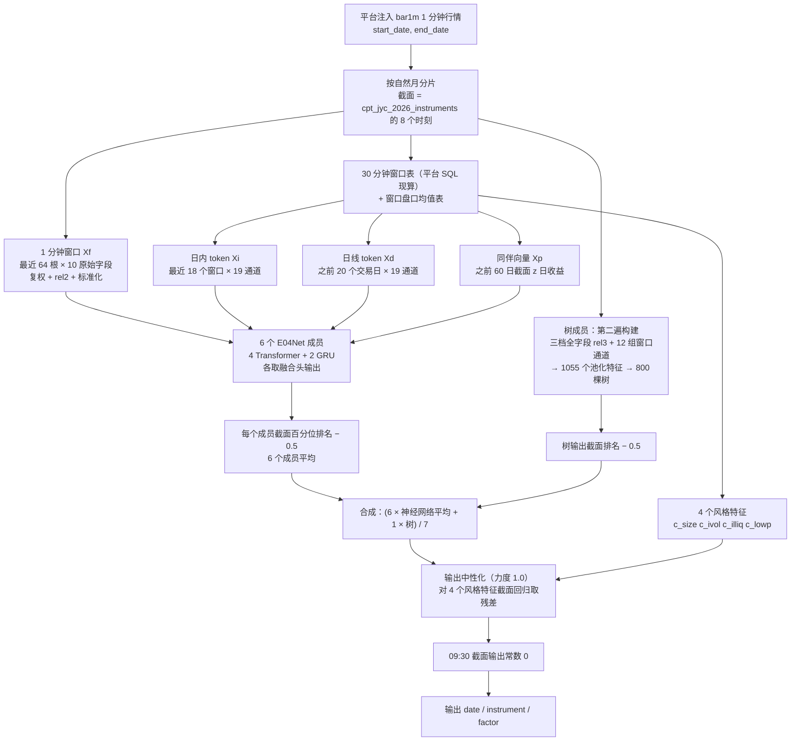
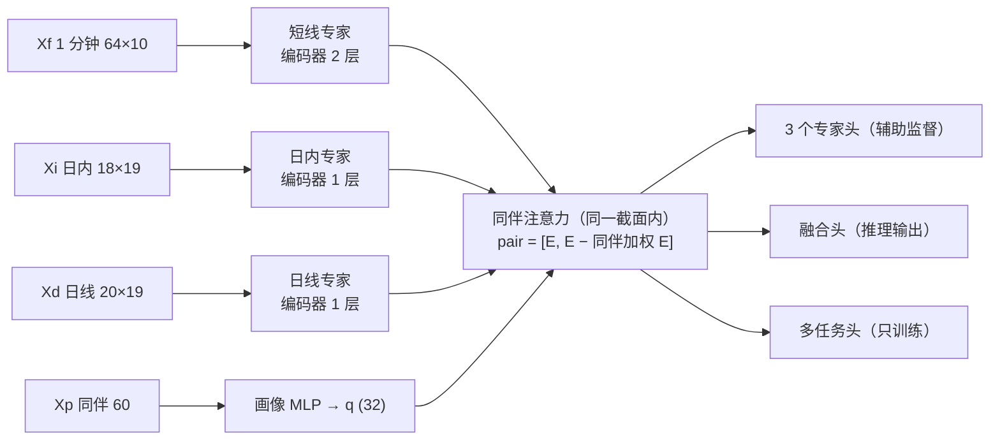

# 最终模型 E21 详解（结构、输入、目标、集成、可解释性）

> 用途：端到端赛道决赛研究报告的底稿，专讲私榜唯一候选 E21：它由哪些成员组成、每个成员看什么输入、学什么目标、怎样合成、证据在哪里、哪里还说不清。篇幅较长，按章节查阅。
>
> 整理日期：2026-11-10。只读了仓库文件、项目记忆和过程记录，没有连接任何机器，没有重新训练或推理。文中标「本文统计」的数，是 2026-11-10 在本机用 python3 对冻结文件（只读权重 JSON 的结构，不整文件打印）和过程记录里的 CSV、日志做的只读统计，方法写在对应位置。
>
> 冻结提交不能改。本文所有关于代码的描述都以冻结文件为准；其他文档与冻结代码不符的地方，以代码为准，并在正文里标出（例如第 9.5 节的校验范围、第 3.11 节的盘口通道）。
>
> 两个赛道的关系按事实表述：**隔离的是输出与因子值**——E21 的输入里没有任何因子赛道的因子值、因子输出或因子 notebook 的计算结果，因子代码里也没有任何端到端预测；**研究思路是双向流动的**——E21 树成员的几组手工窗口通道、推理端中性化的口径都受过因子赛道的启发，第 3.13 节与第 7.8 节如实交代。
>
> 公开版说明（2026-11-23）：本文是比赛期间的内部整理稿，公开前做过文字整理，实验数字与技术结论没有改动。文中的 git 提交号指私有开发仓库的历史，公开仓库只有一次全新提交，无法按提交号检出。出处标为「内部……（未公开）」「内部记录」「项目记忆」「原料笔记」「素材笔记」的，是开发期间的任务书、交接文档、命令记录、工作笔记和撰写本文时整理的素材，不随公开仓库发布。决赛正式提交的报告与展示稿在 `文档/决赛材料/提交材料/`，与本文不一致时以提交材料为准。

---

## 0. 读法、口径与出处写法

### 0.1 指标与口径

- **五项指标的顺序**（全文统一）：IC 均值／IC_IR／多空夏普／压力稳定性／换手。换手越低越好，其余越高越好。表格里常写成 `IC／IC_IR／多空／压力／换手`。
- **平台口径**：评测前先把模型输出逐截面对当日 10 个官方风格因子与 32 个申万一级行业哑变量回归取残差，IC 是残差与标签的截面秩相关（Spearman），IC_IR = 逐截面 IC 的均值 ÷ 标准差（不年化）；多空夏普 = 残差前 10% 减后 10% 的等权标签收益，按每年 242 × 8 个截面年化；压力 = 按截面标签离散度的中位数把截面分成两半，取较弱一半的 IC_IR；换手 = 多空两腿在**同一交易日内**相邻截面之间被替换的比例，跨日那一次不计（来源：`e2e/reports/12_官方标签与09点30缺陷.md` 第二、六节；`工具/本地评分/localeval.py` 的 `evaluate`；`e2e/交接文档.md` 1.2 节）。
- **总分**：五项各自在全体有效提交里排百分位，等权平均。同一份提交的五项原始值不变，但总分会随别的队提交而漂移，所以**只有同一时刻快照里的分差可比**（来源：`e2e/提交/提交记录.md` 10-14 快照段落末尾与「E13 公榜小分」）。
- **标签**：官方 `cpt_jyc_2026_vwap.vwap_return` = 截面之后 30 分钟窗口 (t, t+30] 的收盘价 ÷ 同窗口 VWAP − 1；11:30 截面对应 13:00–13:30，14:30 截面对应 14:30–15:00，同日有标签（来源：`e2e/reports/12_官方标签与09点30缺陷.md` 第一节）。
- **fold-A**：训练 2020–2022，2023 作验证、另外预测 2024，两年分别看。这是本地所有结构、目标、输入实验的主战场（来源：`e2e/reports/15_输入设计与测试流程.md` 第四节）。
- **全量模型**：交付用，训练 2020-01-01～2024-12-31。它的训练日志里有一段 2024-10～12 的"验证"，但这段**在训练区间里，是样本内**，只能说明训练正常收敛（来源：`e2e/过程记录/runs_local/F40_2020-24_E18_leg01_s42/config.json` 的 `val` 字段；`e2e/提交/提交记录.md` E09 行括注"全量模型的 2024Q4 验证在训练区间内，不作参考"）。
- 因此 **E21 交付包本身没有任何本地样本外指标**。本文给出的样本外证据全部来自"同配方、同成员结构、只训到 2022 的 fold-A 集成"，下文称为"E21 同结构 fold-A 集成"或"E21a"（成员定义见第 8.4 节）。
- **公榜、私榜**：平台分数。公榜、私榜区间的具体起止日期主办方没有公布（未记录）；本地数据是 2020–2024 年，与公榜、私榜评估区间不重叠（来源：仓库根目录 `本地评分系统说明.md` 第 106 行；项目记忆 competition-rule-updates-2026-10.md）。

### 0.2 出处简称

| 简称 | 指什么 |
|---|---|
| 训练脚本 | `e2e/提交/E21_E18g加两个GRU成员_2020-24/Transformer_modelsave_train.py`（冻结，2816 行），后面跟函数名、常量名或行号 |
| 推理 notebook | 同目录 `Transformer_modelsave_predict.ipynb`（冻结，2 个单元） |
| 权重 JSON | 同目录 `transformer_model.json`（冻结，约 29 MiB，本文只用 python 读结构） |
| 提交记录「标题」 | `e2e/提交/提交记录.md` 中该标题下的小节或表格行 |
| R15「标题」 | `e2e/reports/15_输入设计与测试流程.md` 中该标题下的小节（10-15 起全部 fold-A 实验） |
| R14「标题」 | `e2e/reports/14_E07训练记录.md` |
| R04、R09、R11、R12、R13 | `e2e/reports/04_规则更新与调整_2026-10-10.md`、`09_官方风格暴露表.md`、`11_E04网络说明与合规核对.md`、`12_官方标签与09点30缺陷.md`、`13_风格暴露表线上下线.md` |
| 交接文档 | `e2e/交接文档.md` |
| cmp_X | `e2e/过程记录/analysis_macstudio/cmp_X.csv`（`e2e/scripts/cmp_runs.py` 按平台口径输出的两折对比表，列为 IC 均值、IC_IR、多空夏普、压力、换手） |
| 半年表 | `e2e/过程记录/analysis_macstudio/metrics_half_ens_*.csv`（10-29 半年度稳健性检查的 20 个输出文件） |
| 成员日志 F40…F43 | `e2e/过程记录/runs_local/F40_2020-24_E18_leg01_s42/` 等目录下的 `log.txt`、`config.json`、`metrics.json` |
| 成员日志 F70、F71 | `e2e/过程记录/4090/runs/F70_2020-24_E21_gru_leg01_s46/`、`F71_..._s47/`（GBK 编码，需 `iconv -f GBK` 读） |
| 树日志 | `e2e/过程记录/runs_local/E17b_gbdt.out`（树成员全量训练日志） |
| 打包链 | `e2e/scripts/e21_pack.sh`、`merge_members.py`、`package.py`、`verify_package.py`、`leak_check.py` |
| 本地数据后端 | `e2e/src/feather_data.py` |
| 内部记录（未公开） | 开发期间的内部工作记录（远端命令记录、交接文档、草稿等），未随公开仓库发布；只在仓库里没有对应文字时引用 |
| 指南 | `文档/复现与消融指南.md` 第三节 |
| 草稿 | 内部草稿《决赛增量解释》第二节（未公开，属于上面的内部记录） |
| 项目记忆 名字 | 项目记忆目录下的 `名字.md`（一路记下的规则与结论，不在仓库里） |
| 用户提供 | 本次整理任务给出的最终成绩（公榜最终显示分、私榜分与五项、名次）；同样记在项目记忆 finals-prep-2026-11.md，仓库里没有对应文件 |
| 本文统计 | 2026-11-10 用 python3 对冻结文件与过程记录做的只读统计 |

### 0.3 编号约定

| 前缀 | 含义 | 例子 |
|---|---|---|
| E | 正式交付包（通常 2020–24 全量训练），交付后不再修改，改动发新编号 | E18g、E21、E22 |
| P | 公榜探针：fold-A（2020–22）单模型、种子 42，同训练区间同种子成对比较 | P13、P16、P17 |
| F | 全量训练（2020–24）的单成员 run | F40–F43（Transformer）、F70、F71（GRU） |
| S、R | fold-A 实验臂（10-12～10-18 为 S 系列，10-18 起为 R 系列） | R22a、R37a、R41o |
| G | 树模型成员原型（10-24 起） | G8 |
| X22a | R22a 配方在 4090 上的复跑，用来扣除机器差 | — |

（来源：`e2e/提交/提交记录.md` 第 11 行附近的编号说明；项目记忆 e2e-delivery-format.md）

### 0.4 冻结文件与指纹

| 文件 | 字节 | SHA-256（本文统计，`shasum -a 256`） |
|---|--:|---|
| `Transformer_modelsave_train.py`（2816 行） | 171,254 | 87a012a8c3676a69ee2cac8919956b33b1c08aa86dc7bca58fb68e4e30610f0b |
| `Transformer_modelsave_predict.ipynb` | 3,823 | 2101cddeff56a3da4116acc1d4fa232be8be7a949cde17bc9908732f6209e243 |
| `transformer_model.json` | 30,412,456（约 29.0 MiB，低于平台 50 MB 上限） | e5b4d7b8a35c855d296e3a2775385cbe2f9f5a6743c5a1a4d90a97f60bc53885 |
| 上一级目录的 `E21_E18g加两个GRU成员_2020-24.zip` | 12,603,908 | 12c544f2b8a2df01da5e5b32af8acff8101951f92e044bf359e800d93c31aac1 |

- 三个文件的修改时间都是 2026-10-27 19:51，入库提交 d82432d（2026-10-27 20:04，"E20、E21 交付包"）（来源：`ls -la`；`git log`）。
- 这四个哈希可以用来核对：决赛材料里引用的代码、权重与冻结文件逐字节一致。

---

## 1. 一句话概括与数据流图

### 1.1 一句话

**E21 是一个"6 个神经网络 + 1 个梯度提升树"的混合集成：6 个神经网络成员共用同一个"三尺度专家 + 同伴注意力 + 融合头"的小网络（其中 4 个用 Transformer 编码器、2 个用 GRU 编码器），只看 1 分钟原始行情和由它聚合出的 30 分钟／日线窗口；树成员在同一套原始行情上做通用池化后分裂；所有成员用同一个"截面秩目标 + 多周期辅助 + 行情代理风格残差"训练，神经网络再加多任务辅助头和只在训练时起作用的"腿换手损失"；推理时每个成员逐截面排名、等权平均，再对 4 个行情风格特征做一次截面中性化，09:30 截面输出常数 0。**

用一句更口语的话讲：它在每个 30 分钟截面上回答"接下来半小时，这只股票的收盘会不会站在这半小时均价之上、而且比同类股票更明显"，并且尽量让前后两个截面的头尾名单别来回换。

### 1.2 成员构成

| 部分 | 成员（run） | 种子 | 编码器 | 每个成员参数量 | 训练机器与时间 | 在最终打分里的权重 |
|---|---|---|---|--:|---|--:|
| Transformer ×4 | F40、F41、F42、F43（即 E18 的四个成员） | 42、43、44、45 | `nn.TransformerEncoder` | 201,830 | macstudio（MPS），2026-10-26 16:14 起依次训练，22:08 训完 | 各 1/7，合计 4/7 ≈ 57.1% |
| GRU ×2 | F70、F71 | 46、47 | 单向 `nn.GRU` | 167,782 | 4090（CUDA），2026-10-27 19:01–19:24、19:24–19:50 | 各 1/7，合计 2/7 ≈ 28.6% |
| 梯度提升树 ×1 | E17b 的树（run `F30-33G8_2020-24_E17b_gbdt_win12`） | 树内抽样用 42 | 自写 torch 直方图 GBDT，800 棵、深度 8 | 800 棵树、119,411 次分裂 | macstudio（MPS），2026-10-25 21:15–22:44（树部分 6477 秒） | 1/7 ≈ 14.3% |

来源：权重 JSON 的 `member_cfgs`、`gru_members = [4, 5]`、`gbdt.cfg.weight = 1.0`；训练脚本 `e04_predict_range`（`factor = (n_m × 神经网络平均 + w × 树) / (n_m + w)`，n_m = 6、w = 1）；成员日志 F40…F43、F70、F71；树日志；`e2e/过程记录/4090/q4090.log`；`e2e/过程记录/runs_macstudio/live.log`。权重百分比与参数合计是本文统计：6 个神经网络合计 4 × 201,830 + 2 × 167,782 = 1,142,884 个参数。

### 1.3 推理数据流图



同一张图的文字版（便于在不渲染 mermaid 的地方使用）：

```
平台注入 (datasources["bar1m"], start_date, end_date)
 └─ 推理 notebook main()
     ├─ load_model → configure_from_ckpt：从权重 JSON 恢复字段集合、回看长度、结构、成员、树
     ├─ build_models：按 member_cfgs 建 6 个 E04Net（成员 4、5 是 GRU）
     ├─ load_stats：三组 (均值, 标准差)：1 分钟 10 通道、日内 19 通道、日线 19 通道
     └─ predict_range → e04_predict_range
         ├─ 逐月：截面、1 分钟 bar（向前多取 7 个自然日）、30 分钟窗口表（向前 130 个自然日）、
         │        窗口盘口表 → Xf (N,64,10)、Xi (N,18,19)、Xd (N,20,19)、Xp (N,60)、4 个风格特征
         ├─ 用 JSON 里的统计量标准化 Xf、Xi、Xd（NaN/inf → 0），Xp 原样
         ├─ e04_predict_array：逐截面前向；每个成员取融合头 → 截面排名 − 0.5；6 个成员平均
         ├─ gbdt_predict：按树的字段集合第二遍逐月构建 1055 个平铺特征 → 分箱 → 800 棵树 → 截面排名 − 0.5
         ├─ factor = (6 × 神经网络平均 + 1 × 树) / 7
         ├─ neutralize(factor, 4 个风格特征, 1.0)
         └─ zero_0930：09:30 截面 = 0
     → 与 cpt_jyc_2026_instruments 内连接，去 inf/NaN、去重 → [date, instrument, factor]
```

来源：推理 notebook 的 `main`；训练脚本 `configure_from_ckpt`、`build_models`、`load_stats`、`e04_iter_chunks`、`e04_predict_array`、`gbdt_predict`、`e04_predict_range`、`neutralize`、`zero_0930`；`E04_BUFFER_DAYS = 7`、`WIN_LOOKBACK_DAYS = 130`（训练脚本第 1284–1285 行）。

### 1.4 训练数据流（平台私榜重训与本地训练是同一份代码）

```
train_and_save({"bar1m": ...}) → ARCH = "e04" → e04_train_and_save
 ├─ 股票池 = 2020-01-01～2024-12-31 区间内出现过的全部股票
 ├─ e04_build_dataset：逐月切窗（特征同推理），只保留有标签的行；
 │     标签读官方 vwap_return；多任务目标 rv、lv 由截面之后的 1 分钟 bar 计算（只在训练时）；
 │     标准化统计量在 200,000 个随机样本上计算（RandomState(42)）
 ├─ ya = rank_gauss(rv), rank_gauss(lv)                         多任务目标
 ├─ y  = rank_gauss(标签) + 0.5 × rank_gauss(同日之后 2 个截面标签之和)   主目标
 ├─ y  = 逐截面 OLS 残差(y | 8 个行情代理 + 规模平方 + 30 类伪行业)
 ├─ 去掉 09:30 截面（剩 8,461,813 个样本）
 ├─ for k in 0..5：_e04_train_one(种子 42 + k，k ∈ {4,5} 时 seq_enc = "gru")
 │     每批 2 个配对单元（同日相邻两截面），6 轮，Adam 1e-3，梯度裁剪 1.0，权重滑动平均 0.995
 │     损失 = 四个头的 MSE + (1 − 风格残差后 IC) + 融合头 IC 项 + 0.1 × 腿换手 + 0.5 × 多任务
 ├─ 释放数据 → gbdt_train：按树的字段集合重新逐月构建，同一目标，800 棵树
 └─ save_model：6 个成员的滑动平均权重 + 树 + 统计量 + 全部配置 → transformer_model.json
```

来源：训练脚本 `e04_train_and_save`（第 2674 行起）、`e04_build_dataset`、`_e04_train_one`、`gbdt_train`、`save_model`；样本数见成员日志 F40 "训练样本 samples=8461813"。

### 1.5 成绩总览

| 口径 | IC | IC_IR | 多空夏普 | 压力 | 换手 | 总分／名次 | 来源 |
|---|--:|--:|--:|--:|--:|---|---|
| 公榜（2026-10-28 同页） | 0.1143 | 2.0186 | 56.33 | 1.8995 | 0.5081 | 0.91551（当时端到端新高，同页高于 E18g 0.91023） | 提交记录「E21 公榜」 |
| 公榜最终显示 | 同上 | 同上 | 56.3285 | 同上 | 同上 | 0.88171，公榜第四 | 用户提供 |
| 私榜 | 0.0888 | 1.5635 | 44.9779 | 1.4601 | 0.5002 | 0.77284，私榜第六（前六入围决赛） | 用户提供 |
| 公榜 → 私榜变化（本文统计） | −22.3% | −22.5% | −20.2% | −23.1% | −1.6% | — | 由上两行计算 |
| E21 同结构 fold-A 集成，2023（训练只到 2022） | 0.1106 | 2.057 | 64.0 | 2.028 | 0.534 | — | cmp_GRU4 的 `E21a` 行 |
| 同上，2024 | 0.0933 | 1.583 | 47.6 | 1.402 | 0.534 | — | 同上 |

读法（详见第 10.5 节）：
- 公榜到私榜，IC、IC_IR、多空、压力四项都掉了约 20%～23%，换手几乎不变。逐截面 IC 的标准差（= IC ÷ IC_IR）公榜 0.0566、私榜 0.0568，几乎没变——衰减来自信号均值整体下移，不是信号变"抖"（本文统计）。
- 本地 fold-A 上同一结构从 2023 到 2024 也掉了相近的幅度（IC −15.6%、IC_IR −23.0%），私榜五项的水平与本地 2024 年非常接近（本文统计，由 cmp_GRU4 计算）。
- 因子赛道 1669 同期从公榜到私榜 IC −23.2%、IC_IR −24.6%（由用户提供的数值计算）。两个输出与因子值互相隔离、模型各自独立的赛道同幅度衰减，更像私榜区间整体行情更难；这是推断，不是证明（项目记忆 finals-prep-2026-11.md 记录了同一判断）。

### 1.6 E21 是怎样一步步来的（只列成立的增量）

| 日期 | 增量 | 本地证据（fold-A） | 公榜证据（同快照差） |
|---|---|---|---|
| 2026-10-10 | 官方 demo 原样学不到信号（IC −0.012～−0.020）→ rel 相对化 + 截面目标 | IC 约 0.06–0.08 | E01 0.33857 |
| 2026-10-11 | E04 骨架：三尺度专家 + 同伴注意力；官方标签；修 09:30 窗口 SQL | — | E05 0.67783 |
| 2026-10-12 | 训练改用行情代理 + 伪行业剔除（暴露表下线）；09:30 输出置零；中性化 1.0 倍 | 09:30 置零两折五项全好 | E07 − E05 = +0.154 |
| 2026-10-13 | shape、盘口窗口通道；多周期辅助目标 0.5 | 辅助目标换手 −0.04 | P04 − P02 五项全好；P05 − P04 +0.031 |
| 2026-10-15 | 跨尺度融合头 | IC +0.0046／+0.0044 | P08 对 P05 IC +0.0013、IC_IR +0.063 |
| 2026-10-16 | 全区间训练、种子集成 | — | E12 − E11 +0.014；E13 − E12 +0.044 |
| 2026-10-17 | 权重滑动平均 0.995、当前时段 token | 种子间相关 0.878 → 0.941；时段 IC +0.0038 | P10 − P11 +0.031 |
| 2026-10-18 | 秩 → 正态分位数目标 | IC +0.004、IC_IR +0.09 | P13 − P10 +0.054 |
| 2026-10-20／21 | 6 轮、多任务辅助头 0.5 | 三种子 IC 全为正 | P16 − P13 +0.0174 |
| 2026-10-24／25 | 树成员 | 集成 IC +0.0014～+0.0018 | E17b − E16 +0.0022 |
| 2026-10-25／26 | 配对单元 + 腿换手损失 0.1 | 换手 −0.06 | P17 − P16 +0.020；E18g 0.91414 |
| 2026-10-27 | 2 个 GRU 成员 | 换手 −0.008，其余持平 | E21 − E18g +0.0053 |

来源：`e2e/reports/02_基线实验.md`；提交记录对应各行与快照段；R14「S1」「S2」；R15「十一」「二十」「二十一」「二十七」「R24 结果」「G8／G9」「R36／R37」；cmp_GRU。

这张表本身就是一个故事：**几乎所有站得住的增量都来自"对齐评测口径"（秩目标、09:30 置零、风格残差、腿换手对准评测换手）和"训练监督与集成"（多周期目标、多任务头、权重平均、种子与异族成员），网络结构上真正留下来的只有融合头和时段 token。** 加宽、加深、截面 Transformer、注意力池化、跨尺度注意力、SAM、市场门控都试过，单独变差或换种子后持平（R15「十一」「R20 结果」「R21 结果」「R23 结果」）。R15「当前配方与 E15 之后确认有用的两项」里的原话是"提升来自监督信号，不来自结构"。

---

## 2. 端到端模型捕捉的行为模式（投资逻辑）

> 本节回答评审维度"投资逻辑与问题定义"里的"端到端模型捕捉的行为模式"。神经网络成员没有做过逐通道归因（积分梯度、SHAP 等都没做），所以本节关于"模型学到了什么"的判断，**凡标「推断」的，都是从输入设计、目标设计、消融结果和树的分裂统计推出来的，不是归因结论**。第 10.6 节列出了可以补做的归因分析。

### 2.1 预测目标的含义：接下来半小时，收盘会不会站在均价之上

- 标签 = 截面之后 30 分钟窗口的**收盘价 ÷ 窗口 VWAP − 1**。它衡量的不是"涨没涨"，而是**这半小时里价格是一路向上漂（收盘高于均价）还是向下漂（收盘低于均价）**。以 VWAP 买入、窗口末以收盘价卖出，就是这个标签的收益含义（来源：R12 第一节）。
- 这类"窗口内漂移"在分钟级上主要由三类力量驱动（经济逻辑，属于通常的市场微观结构解释，下面再用仓库证据逐条对上）：
  1. **短期价格压力的回补或延续**：刚刚被大单推离均衡的价格会部分回补（反转），或者信息慢慢扩散造成延续（动量）；
  2. **交易活跃度与关注度**：成交突然放大、波动变大的股票，后续价格的方向性更强、也更不确定；
  3. **流动性提供者的位置**：盘口挂单的厚薄与不平衡，决定了下一段价格往哪一侧更容易走。
- 14:30 截面特殊：它的标签窗口是 14:30–15:00，跨过了收盘集合竞价。端到端报告把它拆成"连续竞价漂移（14:57 收盘 ÷ 14:31–14:57 VWAP − 1）"与"收盘竞价跳动（15:00 ÷ 14:57 − 1）"两段：R22a（E21 神经网络成员的同配方前身）在 14:30 对完整标签 IC 0.156，对漂移部分 0.135，对竞价跳动只有 0.030——**模型的强项是连续竞价里的漂移，弱项是收盘竞价**（来源：R15「R31、R32 结果与 14:30 诊断」）。

### 2.2 评测口径怎样塑造了模型（设计上的五个直接推论）

| 评测事实 | 对设计的推论 | E21 里的对应做法 | 来源 |
|---|---|---|---|
| IC 是残差上的**秩**相关 | 只需要排对序，不需要预测幅度；极端收益不应主导损失 | 秩 → 正态分位数目标（第 5.2 节） | R15「二十七」 |
| 评测前剔除 10 个风格 + 32 个行业 | 模型花容量去学风格／行业收益是浪费 | 训练目标与损失里的 IC 都在"行情代理 + 伪行业"残差上算（第 5.4 节）；推理端再做一次 4 特征中性化（第 8.3 节） | R14「S2」；R15「批判性审视」 |
| 换手只看前后 10% 两腿、只看同日相邻截面 | 中间股票排序怎么变不重要，腿边界附近的进出才要紧 | 腿换手损失只在腿边界附近有梯度、只配对同日相邻截面（第 5.7 节） | 训练脚本 `_batch_loss`；`本地评分系统说明.md` 第 56、58 行 |
| 压力 = 较弱一半截面的 IC_IR | 要稳住高离散（行情剧烈）的那一半 | 保留同伴注意力与输出中性化（去掉它们 IC 略升，但压力、IC_IR 下降）（第 10.2 节） | R15「R25」；R25 日志 |
| 平台对常数截面不计 IC、不计换手；09:30 是最弱的截面 | 与其在最弱的截面上冒险，不如交白卷 | 09:30 截面不参与训练、推理输出常数 0 | R14「S1」；训练脚本 `zero_0930` |

这一节对应"问题定义"：**我们先把评测口径一项项反推清楚，再让训练目标和损失尽量对准它**。端到端赛道里分数涨得最多的几步（09:30 置零 +0.154、秩目标 +0.054、腿换手 +0.020）全是这一类（见第 1.6 节）。

### 2.3 从输入设计与树的分裂统计推断的行为模式

下面每一条先给"模型能看到什么"（事实），再给"它可能在用什么"（推断），最后给支撑证据。

**(1) 相对均价的短期偏离（推断，证据较强）**
- 事实：神经网络的所有价格输入都写成"相对当前价的对数"（rel2，第 3.4 节）；日内、日线 token 的第 2 个通道直接就是"窗口 VWAP 相对当前价"（第 3.5 节）。
- 证据：树成员 800 棵树里，**第一刀（根节点）用得最多的特征就是"当前窗口 VWAP 相对现价"（37 次）**；按"2^−深度"加权的使用份额，它也排第一（1.29%）（本文统计，第 7.6 节）。
- 含义：价格离当前窗口均价越远，下一段越可能回到均价附近或延续偏离——这正是标签"收盘 ÷ VWAP"所度量的东西。

**(2) 成交活跃度与关注度（推断）**
- 事实：相对成交额（当前窗口成交额 ÷ 18 个窗口均值、日成交额 ÷ 20 日均值）是基础 4 通道之一；多任务头要求共享表示同时预测"之后 30 分钟的已实现波动"和"量能变化"（第 5.6 节）。
- 证据：树里"当前窗口相对成交额"是根节点第三常用（27 次）、深度加权第二（1.11%）；多任务头在三个种子、两年上 IC 全部为正（+0.0014～+0.0031），压力全部为正（R15「R24 结果」）。
- 含义：模型很可能在用"放量与否"判断下一段漂移的强度与可靠程度（推断）。

**(3) K 线形态：冲高回落的抛压（推断）**
- 事实：shape 组给了窗口与日 K 线的上影线占比、实体占比、平均单笔成交额（第 3.5 节）。
- 证据：树的根节点里，"日内 18 个窗口上影线占比的均值"（30 次）、"前一日上影线占比"（19 次）、"20 日上影线占比均值"（17 次）都排在前列（本文统计）。
- 含义：长上影线意味着盘中冲高后被卖回，可能对应有持续卖压或获利了结（推断）。shape 通道单独在公榜上的增量没有同快照对照（未记录）。

**(4) 相对同伴的异常（推断，有消融支撑）**
- 事实：同伴注意力让每只股票的打分输入是"自己的表示"和"自己 − 走势相似同伴的加权表示"（第 4.3 节）。
- 证据：把同伴注意力换成"减去截面平均表示"（R25b），2023 年 IC 0.1089 → 0.1098、多空 62.92 → 64.65，但压力 2.063 → 2.021、IC_IR 2.079 → 2.068、换手 0.574 → 0.580（R25 日志）。
- 含义：同伴对比不怎么提高平均 IC，但在压力（较弱一半截面）上有帮助，说明它在行情剧烈、板块共振的时候稳住了排序——把"整个板块一起动"的那部分减掉，只看个股相对同类的异常（推断）。

**(5) 时段依赖（事实 + 推断）**
- 事实：当前时段 one-hot 拼在每个日内、日线 token 上（第 3.7 节）；E21 同结构 fold-A 集成各时段 IC 差别很大：2023 年 14:30 为 0.175，14:00 只有 0.087，其余 0.098～0.108（cmp 的逐时段文件 `metrics_cmp_GRU4_E21a_2023_2023-01_2023-12.csv`）。
- 证据：时段 token 的公榜探针 P10 对 P11 同快照 +0.031（IC +0.0025、IC_IR +0.089、压力 +0.050），只是换手 +0.037（提交记录「P10／P11」）。
- 含义：同样的形态在上午开盘后、午后、尾盘的含义不同，模型需要知道"现在是几点"（推断）。

**(6) 挂单结构与每笔挂单规模（只在树里；推断）**
- 事实：树成员的 1 分钟输入是三档全字段 + 成交笔数 + 三档委托笔数，用 rel3 归一化（保留"买一量是卖一量几倍"这类相对水平）（第 7.2 节）。
- 证据：树里 1 分钟量类字段（量、额、成交笔数、三档挂单量、三档委托笔数）的深度加权使用份额 20.0%，在所有通道组里最高；"最后一根买一量""最后一根卖一量""64 根卖一委托笔数的标准差"都是常见的根节点（本文统计）。端到端诊断 c127 显示，神经网络预测与"每笔挂单规模"类信号几乎不相关（相关 0.03～0.07），控制端到端预测后这些信号仍有约 0.01 的偏 IC；Transformer 即使换成 rel3、给了委托笔数（R35）也学不出来（R15「E16 公榜与 R34／R35」）。
- 含义：树补上了神经网络学不出的一块订单簿信息（推断）；这是第 7.5 节"为什么要树"的核心理由。

**(7) 尾盘与收盘竞价的习惯（只在树里；推断）**
- 事实：树的 cls 通道 = 窗口收盘 ÷ 窗口 VWAP（日线取当日最后一个窗口，即尾盘段）；auc 通道 = 前一交易日及更早的收盘竞价收益、竞价成交占比（第 7.2 节）。
- 证据："前一日 收盘÷VWAP"深度加权排第 7（0.75%）；"20 日竞价收益均值"排第 15（0.66%）；cls、auc 两组合计深度加权份额 9.3%（本文统计）。
- 含义：股票的尾盘习惯有一定持续性（推断）。注意 cls 的思路来源于因子赛道的研究发现（第 7.8 节）。

**(8) 前一日的截面强弱（只在树里明显；推断）**
- 事实：同伴向量的最后一维 = 前一交易日日收益的截面 z 分数。
- 证据：树里"同伴向量第 60 维"（即前一交易日）深度加权排第 13（0.67%）（本文统计）。
- 含义：前一天的相对涨跌对今天的分钟级漂移仍有影响，常见解释是隔日反转（推断）。

### 2.4 从目标设计推断的行为偏好

- **只学排序、不学幅度**：秩 → 正态分位数目标让每个截面的目标分布都是标准正态，少数极端收益不再主导梯度（第 5.2 节）。模型因此偏向"大多数股票上排得对"，而不是"抓住少数大波动"（推断）。
- **偏向更持久的信号**：多周期辅助目标让模型同时预测"接下来 30 分钟"与"之后 1 小时"的相对表现（第 5.3 节）。去掉它（R25h），2023 年 IC 0.1089 → 0.1119 反而升，但换手 0.574 → 0.654（R25 日志）——**它是在用一点点 IC 换来明显更持久的排序**。
- **只学个股特异部分**：目标先对 8 个行情代理 + 规模平方 + 30 类伪行业取残差（第 5.4 节）。诊断显示，即使这样，R22a 的输出里仍有约 21%（2023）／22%（2024）的截面方差能被官方 10 风格 + 32 行业解释；但训练时剔得更狠（直接用官方暴露，R38a，只能本地做）反而更差（R15「批判性审视」）。
- **头尾名单要稳**：腿换手损失只惩罚"在前后 10% 边界附近来回进出"（第 5.7 节）。模型被推着去依赖变化更慢的信息，代价是 IC 略降（第 5.7 节证据表）。

### 2.5 从消融推断的多尺度分工（单种子、只有 2023 年，噪声内的差别不下结论）

R25 在 R22a（E21 神经网络成员配方的前身，无腿换手、单种子 42，fold-A）上每次做一处减法，2023 年第 6 轮的平台口径验证结果如下（来源：`e2e/过程记录/runs_local/R22a_ep6_mtl05/log.txt` 与 `R25*/log.txt` 的 "[val] … 平台口径" 行）：

| 臂 | 改动 | IC | IC_IR | 多空 | 压力 | 换手 |
|---|---|--:|--:|--:|--:|--:|
| R22a | 对照 | 0.1089 | 2.079 | 62.92 | 2.063 | 0.574 |
| R25a | 三个专家头不计损失 | 0.1078 | 2.077 | 61.81 | 2.039 | 0.580 |
| R25b | 同伴注意力 → 减截面平均 | 0.1098 | 2.068 | 64.65 | 2.021 | 0.580 |
| R25d | 去掉日线专家 | 0.1072 | 2.116 | 61.38 | 2.063 | 0.589 |
| R25e | 去掉日内专家 | 0.1042 | 2.132 | 62.20 | 2.023 | 0.586 |
| R25f | 1 分钟专家只用 1 层 | 0.1085 | 2.065 | 62.53 | 2.042 | 0.571 |
| R25h | 去掉多周期辅助目标 | 0.1119 | 2.139 | 63.87 | 2.075 | 0.654 |

读法（推断）：
- **日内（30 分钟）尺度贡献最多的 IC**：去掉它 IC −0.0047，是所有减法里降得最多的。
- **日线尺度主要贡献稳定性**：去掉它 IC −0.0017、换手 +0.015；日线 token 只用截面之前的完整交易日，同一天内几乎不变，像一个"日内不变的锚"（这也与 S23 只推理的"日线专家头作锚"实验一致，R15「二十三」）。
- **去掉日内或日线专家后 2023 年 IC_IR 反而升**（+0.04～+0.05）。这一项单种子、单年，没有在 2024 年和别的种子上复核，不足以得出"去掉更好"的结论；当时的判定是"前四项减法更差"，结构不简化（git 提交 ac4da1d，2026-10-21 16:21 的提交说明"R25 前四项减法更差"；项目记忆 e2e-transformer-status.md "first four … are worse on 2023"）。这条记录没有单独讨论 IC_IR 的上升（未记录）；它只是单年单种子的读数。
- **专家头的辅助监督有用**：去掉后 IC −0.0011、压力 −0.024、多空 −1.1。

### 2.6 时段上的信号强度

E21 同结构 fold-A 集成（09:30 置零不计）的逐时段 IC（来源：`e2e/过程记录/analysis_macstudio/metrics_cmp_GRU4_E21a_2023_2023-01_2023-12.csv`、`…_2024_2024-01_2024-12.csv`）：

| 年 | 10:00 | 10:30 | 11:00 | 11:30 | 13:30 | 14:00 | 14:30 |
|---|--:|--:|--:|--:|--:|--:|--:|
| 2023 | 0.102 | 0.098 | 0.102 | 0.108 | 0.102 | 0.087 | 0.175 |
| 2024 | 0.091 | 0.091 | 0.083 | 0.090 | 0.089 | 0.069 | 0.139 |

半年表（E21 同结构，`metrics_half_ens_T4G1R2_*`）显示同样的形状：每个半年 14:30 都最强（0.131～0.194），14:00 都最弱（0.065～0.096），14:30 约为其他时段平均的 1.4～1.9 倍（本文统计，由半年表 4 个文件汇总）。

- 14:30 强的原因：它的标签窗口跨过收盘集合竞价，而模型对连续竞价段的漂移把握很好（第 2.1 节）。
- 14:30 强也有代价：一个时段的 IC 尖峰会抬高逐截面 IC 的标准差，对 IC_IR 不利。想再加强收盘竞价的两次尝试（R32 竞价通道进 Transformer、R33 只在 14:30 有值的辅助目标）都因 IC_IR 下降被否决（R15「R31、R32 结果与 14:30 诊断」；项目记忆 slot-ic-spike-hurts-icir.md）。
- 14:00 最弱：原因仓库里没有专门分析（未记录）。

### 2.7 没有证据支持的说法

- "神经网络看到了窗口级盘口均值"不成立：这 4 个通道在 E21 里恒为 0（第 3.11 节）。
- "神经网络学到了 X 因子"没有依据：没有做过归因；第 2.3 节的判断以树的分裂统计和消融为主。
- "模型用了因子赛道的因子"不成立：输入里没有任何因子值；"与因子赛道毫无关联"同样不准确，树成员的部分通道受过因子赛道研究的启发（第 3.13、7.8 节）。
- "私榜衰减证明没有过拟合"不成立：只有一个私榜点，"行情更难"是推断（第 10.5 节）。

---

## 3. 输入设计

> 本节逐组讲 6 个神经网络成员的输入（树成员的输入在第 7.2 节）。原则来自 R15「一、合规边界」：**新输入的每一个通道，都必须能写成"原始字段在某个时间粒度上的简单聚合"，并且和已有通道用同一套定义**——这样决赛归因时能说清"模型看了什么"，而不是"我们替它算好了什么"。

### 3.1 数据源与清洗

| 数据 | 平台上 | 本地训练（FeatherBackend） | 用到它的地方 |
|---|---|---|---|
| 1 分钟行情 | `datasources["bar1m"]`（`cpt_jyc_2026_stock_bar1m`），单位元，5 档盘口 | 按月 feather，价格、成交额单位为"分"需 ÷100，只有 3 档盘口，没有 `pre_close`（由前一日收盘与复权因子推算） | 1 分钟窗口、多任务目标、30 分钟窗口表的来源 |
| 截面 | `cpt_jyc_2026_instruments`（每天 8 个截面时刻 09:30、10:00、10:30、11:00、11:30、13:30、14:00、14:30） | 由行情推出每日股票 × 8 个时刻 | 样本主键与输出对齐 |
| 标签 | `cpt_jyc_2026_vwap.vwap_return`，**只在训练时读** | 由 1 分钟数据按官方定义重建的标签缓存，与官方截面秩相关约 0.97 | 训练目标 |
| 30 分钟窗口表 | 训练脚本里的 `_WIN30_SQL` 在 1 分钟表上现算 | 本地 30 分钟文件，与 SQL 核对一致 | 日内／日线 token、同伴向量、风格特征、代理风格与伪行业 |
| 窗口盘口表 | `_BOOK30_SQL` 现算 | 本地缓存（由同一段 SQL 在本地 1 分钟数据上生成，逐行核对最大差 1e-7） | book 通道（见 3.11 节） |

来源：交接文档 3.1–3.4 节；`e2e/reports/01_环境与数据标签审计.md`；R12 第一、三节；R14「S7」；训练脚本 `DaiBackend`、`_WIN30_SQL`（第 193 行）、`_BOOK30_SQL`（第 285 行）、`e04_iter_chunks`（第 1848–1851 行：标签只在 `with_label=True` 时读取）。

**30 分钟窗口表 `_WIN30_SQL` 的口径**（训练脚本第 193–275 行）：
- 窗口按结束时刻命名：09:30（含 09:25 集合竞价）、10:00、10:30、11:00、11:30、13:30、14:00、14:30、15:00。
- **剔除异常成交**：只累加"成交额 ÷ 成交量落在 [最低价 × 0.98, 最高价 × 1.02] 之内"的 1 分钟 bar 进 `sum_amt`、`sum_vol`。官方 VWAP 也做了同类清洗：在含异常分钟的窗口里，不清洗的 VWAP 偏离官方 7 倍以上，按此规则清洗后中位相对差约 1e-4（R12 第二节）。
- **窗口末价 `last_px`**：买一卖一有效时取中间价，否则取收盘价。09:30 窗口取 09:25 竞价 bar——这是 2026-10-11 修复的缺陷：平台 1 分钟数据在 09:25 之后直接是 09:31，没有 09:30:00 的 bar，原写法（末价取"时刻 = 窗口终点"）使 09:30 窗口末价永远缺失；修复后用 DuckDB 0.9.2 在本地原样执行，与本地 30 分钟表 100% 一致（R12 第三节；训练脚本 `_windows30_dai` 文档串）。
- 另有窗口开（首个有效开盘）、高、低、收（末个有效收盘）、原始成交额 `raw_amt`、成交笔数 `w_deals`、昨收 `pre_close`。
- 这段 SQL 的注释写着"SQL 源自传统因子赛道 104 号"——它是数据清洗与聚合的写法，不是预测公式（训练脚本第 262 行附近 `_windows30_dai` 文档串）。

### 3.2 复权

- **1 分钟窗口**：价格字段 × `adjust_factor`（前向填充），量字段 ÷ `adjust_factor`，成交额、笔数不变（训练脚本 `build_windows`）。
- **窗口／日线 token**：用"当日昨收 ÷ 前一交易日收盘"得到每天的除权缺口，累加成对数缺口 G，把历史价格换算到当前交易日口径：`L = ln(价格) − G`（训练脚本 `_e04_window_feats` 第 1446–1449 行）。

### 3.3 截面与样本

- 一个样本 = (截面时刻, 股票)。训练集构建出 9,669,458 个样本，去掉 09:30 截面后 8,461,813 个参与训练（成员日志 F40 "train 集构建完成 samples=9669458"、"训练样本 samples=8461813"）。
- 每个截面只用截面时刻（含）及之前的数据；取 1 分钟窗口和 30 分钟窗口时，代码里各有一道"特征时点泄漏"断言，一旦取到截面之后的数据就直接报错（训练脚本 `build_windows` 第 737–738 行、`_e04_window_feats` 第 1507–1508 行）。

### 3.4 1 分钟窗口（短线专家的输入）Xf：(N, 64, 10)

- **取窗**：在当月分片的全局分钟网格上，取时间 ≤ 截面时刻的最近 64 根（约 1 小时，开盘后不久的截面会跨到前一交易日；09:30 截面的窗口是前一交易日 14:07 至当日 09:25）；某只股票某分钟没有 bar 就记 NaN（训练脚本 `build_windows`；`e2e/reports/01_环境与数据标签审计.md`「切窗」，`scripts/window_check.py` 抽 300 个截面 0 处不一致）。
- **字段**：demo 的 10 个原始字段——开、高、低、收、成交量、成交额、买一价、卖一价、买一量、卖一量（训练脚本 `FIELDS["base"]`；权重 JSON `field_set = "base"`）。
- **变换 rel2**（训练脚本 `transform`）：
  - 价格类（开高低收、买一卖一价）：`ln(价格 ÷ 窗口内最后一个有效收盘价)`，即相对当前价的对数；
  - 量额类（量、额、买一量、卖一量）：`log1p(值 ÷ 该字段在这 64 分钟里的均值)`，与计量单位无关。
  - 副作用：每个量类字段各自除以自己的均值，"买一量是卖一量的几倍"这种相对水平在 1 分钟层面被抹掉。诊断：变换后"买一量 − 卖一量"与原始对数不平衡的相关只有 −0.16（rel3 可恢复到 0.93）；但把神经网络改成 rel3（R35a）、再加委托笔数（R35b）或三档全字段（R35c）都没有实质提升，所以 E21 的神经网络仍用 rel2；rel3 只给树成员用（R15「E16 公榜与 R34／R35」）。
- **标准化**：每个通道减训练集均值、除以标准差（权重 JSON `stats[0]`、`stats[1]`），NaN／inf 置 0，以 float16 存储（训练脚本 `fit_stats`、`_standardize_inplace`）。本文读出的均值：价格类在 −0.001～+0.0011 之间、量额类 0.56～0.58；标准差：价格类约 0.011、量额类 0.43～0.45（本文统计，读权重 JSON 的 `stats`）。

### 3.5 日内 token（日内专家的输入）Xi：(N, 18, 19)

- **取窗**：截面时刻（含）之前的最后 18 个 30 分钟窗口（每天 9 个窗口，约 2 个交易日）（训练脚本 `_e04_window_feats`，`intra_len = 18`）。
- **19 个通道** = 基础 4 + shape 3 + book 4 + tod 8（`WIN_GROUPS = "shape,book,tod"`；`WIN_GROUP_DIM`；`n_win_feat() = 4 + 3 + 4 + 8 = 19`，训练脚本第 1320–1342 行）：

| 序号 | 通道 | 计算（全部只用窗口表的原始聚合量） | 组 |
|--:|---|---|---|
| 0 | 窗口末价相对现价 | L(该窗口) − L(截面所在窗口)，复权对数价差 | 基础 |
| 1 | 窗口 VWAP 相对现价 | ln(sum_amt ÷ sum_vol) − G − L(截面所在窗口) | 基础 |
| 2 | 相对成交额 | log1p(窗口成交额 ÷ 这 18 个窗口成交额的均值) | 基础 |
| 3 | 窗口收益 | L 的一阶差分 | 基础 |
| 4 | 上影线占比 | (高 − max(开, 收)) ÷ (高 − 低) | shape |
| 5 | 实体占比 | \|收 − 开\| ÷ (高 − 低) | shape |
| 6 | 平均单笔成交额 | ln(原始成交额 ÷ 成交笔数) − 这 18 个窗口的均值 | shape |
| 7 | b_imb | 窗口内 1 分钟的 1–3 档挂单量不平衡 (买 − 卖)/(买 + 卖) 的均值 | book（**在 E21 里恒为 0，见 3.11**） |
| 8 | b_spr | 相对价差 (卖一 − 买一)/中间价 的均值 | book（同上） |
| 9 | b_conc | 一档挂单量占 1–3 档的比例的均值 | book（同上） |
| 10 | b_oimb | 1–3 档委托笔数不平衡的均值 | book（同上） |
| 11–18 | 当前时段 one-hot | 截面时刻属于 09:30、10:00、10:30、11:00、11:30、13:30、14:00、14:30 中的哪一个；每个 token 相同 | tod |

- 09:30 窗口（含集合竞价）的开高低收设为 NaN，形态通道不用它：1 分钟竞价 bar 的开高低是竞价过程中的价格，平台 SQL 与本地 30 分钟数据在这里不一致（训练脚本 `_e04_window_feats` 第 1431–1433 行；R14「窗口 SQL 扩展核对」）。
- 标准化用 `stats[2]`、`stats[3]`。tod 各通道的均值在 0.124～0.126、标准差 0.32～0.34（≈ 1/8 的 one-hot）。统计量是在去掉 09:30 之前的数据上算的，所以训练样本里 09:30 那一位（序号 11）恒为 (0 − 0.1259) ÷ 0.3377 这个常数，相当于一个偏置（本文统计，读权重 JSON；训练脚本 `e04_train_and_save` 先建数据集算统计量、后去 09:30）。
- 来历：基础 4 通道是 E04 骨架起就有的（R11 第一节）；shape 3 通道于 2026-10-12 以"H4 窗口 7 通道"进入（R14「S3／S4」：H4 两折最好，相对 H1 IC +0.002、IC_IR +0.05）；book 4 通道于 2026-10-13 进入（R14「S7」：S7b 两折五项全好；公榜 P04 对 P02 五项全好，IC +0.0004、IC_IR +0.034、换手 −0.003、多空 +1.31、压力 +0.006，提交记录 P04 行）。

### 3.6 日线 token（日线专家的输入）Xd：(N, 20, 19)

- **取窗**：截面所在交易日**之前**的 20 个完整交易日，不含当天（训练脚本 `idd = Dt − 20 + arange(20)`，第 1531 行）。
- **通道定义与日内 token 一一对应**：日收盘相对现价、日 VWAP 相对现价、log1p(日成交额 ÷ 20 日均值)、日收益 ln(收盘 ÷ 昨收)；日 K 线的上影线占比、实体占比（当日开盘取第一个连续竞价窗口的开盘）、平均单笔成交额；book 4 个（当日各窗口均值，同样恒为 0）；tod one-hot（截面时段，每个 token 相同）（训练脚本第 1531–1560 行）。
- 标准化用 `stats[4]`、`stats[5]`。
- 因为只用之前的完整交易日，日线 token 在同一个交易日内的 7 个截面上**内容几乎不变**（只有 tod 与"相对现价"里的现价在变）。这是第 2.5 节"日线尺度主要贡献稳定性"的结构原因（推断）。

### 3.7 当前时段 one-hot（tod）

- 走法 `tod_route = "token"`：拼在每个日内、日线 token 的最后 8 个通道上（权重 JSON `model_cfg.tod_route`）。
- 本地证据：在"融合头 + 权重平均"的低噪声底座上（S21），时段 token 两年 IC +0.0038，2024 年 IC_IR +0.077、压力 +0.071，换手 +0.02（R15「二十一」）。
- 公榜证据：P10 对 P11 同快照 +0.031（IC +0.0025、IC_IR +0.089、多空 +1.4、压力 +0.050，换手 +0.037）（提交记录「P10／P11」）。
- 尝试过的替代走法：只拼进融合头（S22a）与本地持平；按时段调制融合头（film，S22b）保留约 70% IC 增益、换手代价减半，但它的公榜探针 P12 同时加了推理端日线锚，结果掉分，最终没有采用（R15「二十二」；提交记录「P12」）。

### 3.8 同伴向量 Xp：(N, 60)

- **计算**：每个交易日把所有股票的日收益 ln(收盘 ÷ 昨收) 做截面 z 分数（减截面均值、除截面标准差）；取截面所在交易日之前的 60 个交易日，组成 60 维向量；缺失置 0（训练脚本 `_e04_window_feats` 中的 `zr` 与 `Xp`，`peer_len = 60`，第 1458、1680 行）。
- 不再标准化，本身已是截面 z 分数（训练脚本 `e04_predict_range` 中 Xp 原样传入）。
- **用途**：经一个小 MLP 编码成 32 维"走势画像"，只用来计算同一截面里股票之间的相似度（第 4.3 节）。"相似"是什么由训练目标决定，不是事先定义的相关系数（R11 第一节第 3 条）。
- 早期试过把画像加长到 240 日（H5），持平（R14「S3／S4」）。

### 3.9 四个风格特征（只用于推理端的输出中性化，不进网络）

在 30 分钟窗口表上，用截面时刻及之前最近 40 个窗口（约 4.4 个交易日）计算（训练脚本 `_e04_window_feats` 末尾第 1690–1709 行，`_roll(k=40, min_n=10)`）：

| 特征 | 定义 | 含义 |
|---|---|---|
| c_size | −ln(1 + 近 40 窗成交额之和) | 规模（以成交额代替市值） |
| c_ivol | −近 40 窗残差收益的标准差；残差 = 窗口收益 − β × 截面平均收益，β 为 40 窗滚动回归、截断到 [−1, 4]、不足时取 1 | 特质波动 |
| c_illiq | 近 40 窗 \|收益\| ÷ 成交额（亿元）的均值 | 非流动性 |
| c_lowp | −ln(窗口末的名义价格) | 低价 |

- 代码注释写"与因子赛道 neutral4 同口径"（训练脚本第 614、1690 行）——这是风险控制操作的口径借鉴，不是信号。
- 单成员（R46c，fold-A，2023）与这四个特征的平均截面秩相关：未中性化时 0.087／0.166／0.030／0.144；做 1.0 倍中性化后 0.012／0.018／0.005／0.012；1.5 倍后变成反向（−0.031／−0.062／−0.010／−0.057）（`e2e/过程记录/4090/runs/R46c_leg01_s45.out` 的"风格暴露"行）。1.0 倍正好把暴露压到接近 0。

### 3.10 训练单元：截面与配对单元

- **截面是最小单元**：E04Net 的同伴注意力、损失里的 IC、腿换手损失都在"同一截面的全部股票"上算，所以一批数据必须由若干个完整截面组成（训练脚本 `_e04_train_one`，`groups` 是按时间排列的截面）。
- **配对单元（`PAIR_UNITS = True`）**：每个训练单元 = 同一交易日的两个相邻截面，按轮次奇偶交替配对——偶数轮 (10:00, 10:30)、(11:00, 11:30)、(13:30, 14:00)、(14:30 单独)；奇数轮 (10:00 单独)、(10:30, 11:00)、(11:30, 13:30)、(14:00, 14:30)。两轮合起来覆盖了同一天里所有相邻的截面对。09:30 在训练前已去掉（训练脚本 `_pair_units`，第 2303–2312 行）。
- **每批 2 个配对单元**（`per = SECS_PER_BATCH // 2 = 2`），即最多 4 个截面；单元在批与批之间随机打乱（用同种子的 `torch.Generator`），所以同一批里的两个单元通常来自不同的日子（训练脚本第 2313–2315、2328、2350 行）。按每个截面约 1,000 只股票估算，一批约 4,000 个样本（每截面股票数为估算：2024-03 截断检测时每个截面 1,000 只，见第 9.6 节）。
- 配对的唯一目的，是让腿换手损失能在"同日相邻两截面"之间计算（第 5.7 节）。配对本身有代价：只配对、不加腿换手损失时（R36c），换手 +0.023、IC −0.001～−0.002（R15「R36／R37」）。

### 3.11 【事后发现，需人工复核】窗口盘口通道在 E21 里恒为 0

这是 2026-11-10 整理材料时检查冻结权重 JSON 发现的问题，比赛期间没有被识别出来。

**现象**（本文统计，读权重 JSON）：
1. `stats[2]`～`stats[5]`（日内、日线 token 的均值与标准差）的第 7–10 位——正好是 book 组的 b_imb、b_spr、b_conc、b_oimb——全是 NaN。标准化公式 (x − NaN) ÷ NaN 得 NaN，再被 `nan_to_num` 置 0，所以**不论原始值是什么，这 4 个通道进网络时都是 0**，训练和推理都一样（训练脚本 `_standardize_inplace`、`_std_into`）。
2. 佐证：6 个成员的输入投影 `p_i.weight`、`p_d.weight`（64 × 19）在第 7–10 列上的最大绝对值都 ≤ 0.2294，等于 1/√19，正是 PyTorch 线性层默认初始化的上界；其他通道的最大绝对值普遍在 0.25～0.66（日线投影的 tod0 列达 0.95）。12 个矩阵无一例外。输入恒为 0 时这几列权重收不到梯度，与现象吻合。
3. 树成员同样：1055 个特征里有 167 个分箱边界全为 0（训练时 400,000 个抽样里这一列全是缺失才会这样），其中 150 个正是 book、book2、book3 的窗口特征（第 7.7 节）。

**从什么时候开始**（本文统计：逐个读 `e2e/提交/` 下全部交付包权重 JSON 的 `stats` 字段，数 NaN 个数）：

| 交付包 | 训练时间（大致） | book 统计量 |
|---|---|---|
| P04、P05、E08～E15、P10～P13、E14、E14b | 2026-10-13～10-19 | 正常 |
| P16（R22a，fold-A） | 2026-10-21 | 正常 |
| E16（F30–F33，2026-10-23 15:29 开训） | 2026-10-23～24 | 16 个 NaN（4 个通道 × 4 组统计量） |
| E17、E17b、E18、E18g、E20、E21、E22 | 2026-10-24～28 | 同上 |
| P17、P18、P19、P21、P22、P23（fold-A 探针） | 2026-10-25～27 | 同上 |

也就是说，在 2026-10-21（R22a）之后、2026-10-23（E16）之前，macstudio 与后来的 4090 上新建的训练数据里，窗口盘口列全部缺失。

**可能的原因（推断，未核实）**：本地数据后端 `e2e/src/feather_data.py` 的 `book30()` 在找不到盘口缓存文件时返回一张空表、不报错；训练脚本 `e04_iter_chunks` 用左连接把它并进窗口表（第 1876–1877 行），于是这几列静默地变成全 NaN。仓库里没有缓存目录在那几天被移动或改名的记录，`live.log`、树日志里也没有相关报错；合并脚本 `merge_members.py` 比对统计量时用的是"NaN 位置按相等处理"，说明当时见过 NaN，但没有被识别为通道失效（未记录）。核实方法：在任一台有数据的机器上用冻结脚本对一个月数据跑 `e04_iter_chunks`，看合并 `book30` 之后 b_imb 是否全为 NaN。本文按规则不连远端，没有做。

**含义**：
- **E21 的神经网络没有看到窗口级盘口均值。** 神经网络成员的盘口信息只来自 1 分钟层面的买一价、卖一价、买一量、卖一量（且 rel2 抹掉了买卖相对水平）；树成员的盘口信息只来自 1 分钟层面的三档全字段与委托笔数（rel3）。
- **冻结模型的推理不受影响**：神经网络这几列恒为 0；树从未在这些特征上分裂（训练时它们全在同一个缺失箱里，分裂要求左右两侧各 ≥ 1000 个样本，不可能分裂）。所以平台推理时即使盘口表有值，冻结模型的输出也不变（推断，依据训练脚本 `_gb_binize`、`_GBTrees.fit_tree`）。
- **私榜重训可能不一样**：平台上 `_BOOK30_SQL` 应能取到数（间接证据：2026-10-13 用模拟 dai 在本地数据上执行同一段 SQL，与本地缓存逐行一致；P04 在平台推理时用上盘口通道后公榜五项全好）。若平台重训，重训出来的模型会真正用上这 4 个通道，与冻结权重不是同一份"输入"（推断）。
- **10-21 之后的几项比较里混有这个因素**（推断）：E16 对 E15、P17 对 P16、R37a 对 R22a 这几对，前者都没有盘口通道、后者都有；R40a"Transformer 加 book2／book3／pos／state 通道两年 IC 都降"时 book 类通道其实全为 0；4090 复跑的 X22a 比 macstudio 的 R22a 低 IC 0.0007／0.0022，当时归因于换机器（R15「第二台训练机」），也可能部分来自盘口通道失效。反过来看，E16 在少了盘口通道的情况下公榜仍对 E15 五项全好（R15「E16 公榜与 R34／R35」），说明这 4 个通道在那时的配方里贡献不大（推断）。这些都只是可能性，确认需要重跑。
- 小结：这个问题是整理材料时发现的。最终模型的窗口盘口通道因数据缓存问题恒为 0，实际只用了 1 分钟层面的买一卖一与三档盘口；这不影响合规与推理一致性，但说明盘口窗口均值不是 E21 的信息来源。

### 3.12 输入里没有什么

| 不在输入里的东西 | 依据 |
|---|---|
| 官方风格暴露表 | 2026-10-12 主办方通知端到端线上环境不再提供；E07 起训练改用行情代理；`package.py` 断言提交代码里不含 `cpt_jyc_2026_exposure`（R13；`e2e/scripts/package.py`） |
| 标签表作输入 | 标签只在训练时读（训练脚本 `e04_iter_chunks` 的 `with_label`） |
| 模型自己对之前截面的输出 | 主办方规则"推理时模型不可以使用自己对上一个截面的输出"（R04 的 R3）；10-10 曾做过的输出 EMA 平滑已删除代码（R12 第五节）。代码里唯一的"EMA"是训练时的权重滑动平均（第 6.1 节），不是对输出做时间平滑 |
| 任何因子赛道的因子值、因子输出 | 交付代码只读 `bar1m`、`instruments`、`vwap`（训练时）三张表 |
| 神经网络的 pos、state、mkt、lead、slot、cls、dow、auc、book2、book3 通道 | 这些只给树成员用（第 7.2 节）；把其中 book2／book3／pos／state 加给 Transformer 的 R40a 两年 IC −0.0019／−0.0013（R15「R40a」） |

### 3.13 合规边界与两个赛道的关系

- **主办方明确允许的端到端特征**（2026-10-10 问答 R2）：买卖笔数／量不平衡比、价差、深度、微观价格、相对 VWAP 偏离、日内高低位置、逐截面标准化或排名、原始三档量价（R04 表格 R2 行）。
- **我们自定的四类**（R15「一、合规边界」，2026-10-15）：允许（原始字段的简单聚合）；**灰色**（"因子赛道设计并验证过的预测公式（聪明钱、量价同向、大单方向、零收益占比、领先滞后、季节性均值等）；用历史标签直接构造的输入；伪行业编号作为输入"，**不用**）；禁止（自身上一截面输出、推理读暴露表、读 vwap 表、截面之后的数据）；训练专用（代理与伪行业中性化标签、辅助目标、损失设计）。同一节自查："pos（日内高低位置）在 R2 名单里，合规；lead（大票组收益 − 本股）是我们设计的公式，属于灰色；slot（成交额 ÷ 同时段历史均值）是简单比值，偏灰。"
- **神经网络成员**完全落在"允许"类里：1 分钟原始 10 字段；窗口的基础 4 + shape + tod（book 实际为 0）；同伴日收益。
- **树成员**用了 12 组窗口通道，其中 pos、lead、cls、auc 等是人工设计的通道，代码注释写着它们"对应因子赛道 F 方向（1133、1200）""对应 B 方向"；cls 的来源在 R15「二十五」里写明是"因子赛道 M2 发现尾盘段习惯在 14:30 截面单独 IC 0.075"。这几组从 E17b（2026-10-25，G8 配置"全部通道"）起进入树成员，与 10-15 那条"灰色不用"的自定规则有出入——**这是早期内部规则后来发生的变化**（详见第 7.8 节）。它们都在推理时由原始行情现场计算，不读取任何因子值。
- **推理端的口径借鉴**：输出中性化 `OUT_NEUTRAL` 的注释写"参照因子 104 号取 1.5"（E21 实际取 1.0），4 个风格特征注释写"与因子赛道 neutral4 同口径"，`neutralize` 注释写"与因子赛道 factor_lib.neutralize 一致"，`zero_0930` 文档串写"因子赛道已验证"（训练脚本第 65、614、656、2806 行）。这些是风险控制做法与平台行为经验的借鉴，不是信号。
- **跨赛道的输出从没混进交付**：2026-10-16 做过一次只推理的诊断，把评分机上的因子输出按秩混入端到端预测，结论是"不符合端到端只喂原始行情的规矩，不作交付"（R15「十六」）；2026-10-19 用户叫停了把端到端预测混进因子 1617 的诊断，之后两个方向都没有再混过（项目记忆 tracks-never-mix.md）。交付包里没有任何因子值。

---

## 4. 网络结构：E04Net（6 个神经网络成员共用）

> 名字的来历：这个骨架在第 4 个交付包 E04（2026-10-11）首次出现，之后所有交付都沿用它，只在上面加融合头、多任务头、时段通道，换编码器（R11 第一节；提交记录 E04 行）。

### 4.1 总体

E04Net 的 forward 输入是"按截面连续排列"的一批样本和每个截面的样本数 `counts`；输出 (B, 4)：三个尺度专家各自的打分 + 融合头打分（训练脚本 `class E04Net`，第 2085–2206 行）。

```
Xf (B,64,10) ─ Linear(10→64) + 可学习位置编码(64×64) ─ 编码器 enc_s（2 层）─ 均值池化 ─ E_s (B,64)
Xi (B,18,19) ─ Linear(19→64) + 可学习位置编码(18×64) ─ 编码器 enc_i（1 层）─ 均值池化 ─ E_i (B,64)
Xd (B,20,19) ─ Linear(19→64) + 可学习位置编码(20×64) ─ 编码器 enc_d（1 层）─ 均值池化 ─ E_d (B,64)
Xp (B,60)    ─ Linear(60→64) → GELU → Linear(64→32) ─ q (B,32)        同伴画像
同一截面内： A = softmax_row( q qᵀ / √32，对角置 −∞ )；ctx_k = A · E_k，k ∈ {s, i, d}
pair_k = [ E_k , E_k − ctx_k ]  (B,128)
专家头 k：LayerNorm(128) → Linear(128→1)                                    3 个，训练时作辅助监督
融合头： concat(pair_s, pair_i, pair_d) (B,384) → LayerNorm → Linear(384→64) → GELU → Linear(64→1)   推理只用它
多任务头：同一个 384 维输入 → LayerNorm → Linear(384→64) → GELU → Linear(64→2)                      只在训练时计损失
```



### 4.2 三个尺度专家与两种编码器

| 专家 | 输入 | 编码器层数 | Transformer 成员（0–3） | GRU 成员（4、5） |
|---|---|--:|---|---|
| 短线（1 分钟） | 最近 64 根 1 分钟 bar × 10 字段 | 2 | `nn.TransformerEncoder`：d_model 64、4 头、前馈 128、dropout 0.1、GELU、batch_first，PyTorch 默认的后置 LayerNorm，无因果掩码 | 单向 `nn.GRU(64, 64, 2 层, dropout 0.1)`，取全部时间步的输出 |
| 日内（30 分钟） | 最近 18 个窗口 × 19 通道 | 1 | 同上，1 层 | `nn.GRU(64, 64, 1 层)`（单层不加 dropout） |
| 日线 | 之前 20 个交易日 × 19 通道 | 1 | 同上，1 层 | 同上 |

- 两种编码器都接在"线性投影 + 可学习位置编码（初始化为 0）"之后，输出都是 (B, L, 64)，都做均值池化。**GRU 成员除了编码器之外，结构、输入、目标、损失、轮数与 Transformer 成员完全相同**（训练脚本 `_GRUEnc` 文档串"接口与 nn.TransformerEncoder 相同"，第 2074–2082 行；`E04Net.__init__` 的 `enc()`，第 2099–2103 行；权重 JSON 的 `member_cfgs` 6 个成员只差 `seq_enc`）。
- 代码注释写明加 GRU 的用意是"作为集成里不同模型族的成员"（训练脚本第 1247 行）。
- 位置编码对 GRU 来说是冗余的（GRU 本身按顺序读），但为了"除编码器外完全相同"保留了下来（事实：两种成员都有 `pos_s/pos_i/pos_d` 张量，见权重 JSON；"冗余"是本文的判断）。

### 4.3 同伴注意力（数学）

对同一截面内的 n 只股票（训练脚本 `E04Net.forward` 中 `peer_mode == "attn"` 的分支，第 2180–2188 行）：

```
画像：          q_j = MLP(Xp_j) ∈ ℝ³²
注意力权重：    a_jl = exp(q_j·q_l / √32) ÷ Σ_{m≠j} exp(q_j·q_m / √32)，  l ≠ j（自己被屏蔽）
同伴背景：      ctx_k(j) = Σ_l a_jl · E_k(l)
专家 k 的输入： pair_k(j) = [ E_k(j) , E_k(j) − ctx_k(j) ]
```

- 每个专家既看"自己"，也看"自己相对走势相似的同伴偏离了多少"。
- 画像编码器与注意力一起端到端学习，"相似"由训练目标决定（R11 第一节第 3 条）。
- 直觉（推断）：把同一截面里走势相似的股票（同行业、同主题、同风格）的共同部分减掉，模型打分更多依赖个股相对同伴的异常，这与评测"剔除风格和行业后再排序"的口径一致。
- 消融：换成"减截面平均表示"（R25b）IC 略升、压力 −0.042；不做同伴对比的 R25c 在仓库里没有留下结果（未记录）（第 2.5 节表格）。

### 4.4 三种头

- **三个专家头**：LayerNorm(128) → Linear(128→1)。训练时每个都计损失（辅助监督），推理不用。去掉它们的损失（R25a）：2023 IC 0.1089 → 0.1078、压力 2.063 → 2.039、换手 0.574 → 0.580（R25 日志）。
- **融合头**（2026-10-15 的 S12 A2 引入，代码开关 `fuse = True`）：384 → 64 → 1，**推理只用它**（训练脚本 `e04_predict_array`：融合模型只取第 4 列，第 2230–2235 行）。
  - 本地证据：相对当时底座三种子均值，2023 年 IC +0.0046、IC_IR +0.145、多空 +2.0、压力 +0.130、换手 +0.036；2024 年 +0.0044／+0.133／+2.6／+0.071／+0.027，"IC、IC_IR、压力两年都远超 2.3σ（3–5σ），第一次明确的架构收益"（R15「十一、S11／S12 结果」）。
  - 公榜证据：P08 对 P05 IC +0.0013、IC_IR +0.063、压力 +0.018、换手 −0.003、多空 −1.4（提交记录 P08 行）。
- **多任务头**（2026-10-21 的 R22 引入，`mtl = True`，`mtl_n = 2`）：384 → 64 → 2，预测之后 30 分钟的已实现波动与量能变化（目标见第 5.6 节）。只在训练时计损失；推理时虽然也算出了 `aux_out`，但不进打分（训练脚本第 2190–2191 行注释"返回值不变"）。

### 4.5 维度、层数与参数量

| 超参数 | 取值 | 来源 |
|---|---|---|
| d_model（隐层宽度） | 64 | 权重 JSON `model_cfg` |
| 注意力头数（Transformer） | 4 | 同上 |
| 前馈层宽度（Transformer） | 128 | 同上 |
| 短线专家层数 / 日内与日线专家层数 | 2 / 1 | 同上 `n_layers_short`、`n_layers_long` |
| 序列长度：1 分钟 / 日内 / 日线 | 64 / 18 / 20 | 同上 `seq_len`、`intra_len`、`daily_len` |
| 同伴画像长度 / 维度 | 60 / 32 | 同上 `peer_len`、`peer_dim` |
| 窗口通道数 | 19 | 同上 `n_win_feat` |
| dropout | 0.1 | 同上 |
| 池化 | 平均 | 同上 `pool = "mean"` |
| 其余开关 | `fuse_hidden 0`、`fuse_peer False`、`tod_route token`、`xscale False`、`mgate False`、`peer_mode attn`、`drop ""`、`slot_len 0`、`patch_len 0`、`xs_layers 0` | 同上 |

参数量（本文统计：读权重 JSON 的 `state_dicts`，按张量 shape 相乘求和；与训练日志 `n_params` 一致）：

| 模块 | Transformer 成员 | GRU 成员 |
|---|--:|--:|
| 短线编码器 enc_s（2 层） | 66,944 | 49,920 |
| 日内编码器 enc_i（1 层） | 33,472 | 24,960 |
| 日线编码器 enc_d（1 层） | 33,472 | 24,960 |
| 位置编码（(64 + 18 + 20) × 64） | 6,528 | 6,528 |
| 输入投影（10→64、19→64、19→64） | 3,264 | 3,264 |
| 同伴画像 MLP | 5,984 | 5,984 |
| 三个专家头 | 1,155 | 1,155 |
| 多任务头 | 25,538 | 25,538 |
| 融合头 | 25,473 | 25,473 |
| **合计** | **201,830** | **167,782** |

- 日志核对：成员日志 F40 "n_params=201830"，F70 "n_params=167782"。
- 6 个成员合计 1,142,884 个参数；全部以 float32 写在 JSON 文本里。权重 JSON 约 29 MiB 的构成（用 `json.dumps` 长度近似）：6 个神经网络成员的 `state_dicts` 合计约 24.7 MB（Transformer 各约 4.36 MB、GRU 各约 3.61 MB），树成员 `gbdt` 约 5.7 MB，标准化统计量约 1.8 KB（素材整理时的统计，出自对权重 JSON 各字段的重新序列化）。
- 这是一个**很小**的模型。小的理由都有实验：宽度加到 128（S12 的 A5）两年 IC −0.0015／−0.0021、IC_IR −0.058，"大模型过拟合"（R15「十一」）；宽度 96（R27c／R28c）无提升（R15「R26、R27 结果」「R28 结果」）；1 分钟专家加深到 3 层三个种子平均持平、4 层 2024 年 IC_IR −0.017（R15「R23 结果」）；反过来减到 1 层（R25f）IC −0.0004、压力 −0.021（R25 日志）。

### 4.6 结构上试过、没有留下的东西

| 尝试 | 时间 | 结果 | 来源 |
|---|---|---|---|
| 截面 Transformer（股票之间互相注意，取代同伴注意力） | 10-15、10-17 | 变差 | R15「十一」A1；「二十一」 |
| 加宽到 96／128 | 10-15、10-19、10-22 | 变差或持平 | R15「十一」A5；R5；R27c |
| 加深 1 分钟专家到 3／4 层 | 10-20、10-21 | 换种子后持平 | R15「R21 结果」「R23 结果」 |
| 注意力池化、"平均 + 最近 token"池化、跨尺度注意力 | 10-20 | 2024 年 IC_IR −0.02～−0.06 | R15「R20 结果」 |
| SAM、市场门控（MASTER 风格） | 10-20 | 否决 | R15「R21 结果」 |
| 全天 5 分钟 patch（日内专家再接当日开盘至截面的 5 分钟 token） | 10-15～16 | 本地两年为正，公榜 P09 IC −0.0033，E10 公榜退步 | R15「十一」「十四」；提交记录 E10、P07–P09 |
| 同时段 token（过去 20 日同一时段的窗口） | 10-15、10-17 | IC 升但换手 +0.025，否决 | R15「十一」T1、「二十一」 |
| 日线 60 天、截面排名通道 | 10-15 | 无效 | R15「十一」T3、T5 |
| 融合头加宽、拼同伴画像、专家头权重 0.5 | 10-16 | 噪声内或一年明显变差 | R15「十五、S17」 |
| 推理时把日线专家头当"锚"混进来（0.1） | 10-17～18 | 本地降换手几乎免费，公榜 P12 掉分 | R15「二十三」；提交记录 P12 |

这张表就是第 1.6 节那句结论的证据：在这个任务、这个数据量下，**网络结构上的"花样"几乎全部不成立，真正起作用的是监督信号和集成**（R15「当前配方与 E15 之后确认有用的两项」：提升来自监督信号，不来自结构）。

---

## 5. 训练目标与损失

### 5.1 损失要对准的东西

评测五项的定义见第 0.1 节。对训练目标最关键的三点：
1. IC 是**残差上的秩相关**；
2. 换手只看**前后 10% 两腿、同日相邻截面**；
3. 平台对 09:30 这种常数截面不计分。

E21 的训练目标与损失就是围绕这三点设计的：秩目标（5.2）+ 多周期辅助（5.3）+ 风格残差（5.4）构成"目标 y"；每个头的 MSE + (1 − 残差 IC)（5.5）构成主损失；多任务头（5.6）与腿换手损失（5.7）是两项附加损失。

### 5.2 秩目标（`TARGET = "cs_rank"`）

**公式**（训练脚本 `rank_gauss`，第 945–952 行）：同一截面内，标签的平均秩为 r，有效样本数为 n，

```
p = clip( (r − 0.5) / n , 1e-6 , 1 − 1e-6 )
目标 = Φ⁻¹(p) = √2 · erfinv(2p − 1)        （标准正态分位数；缺失记 0）
```

**直觉**：评测的 IC 是秩相关；原来的"截面 z 分数（截断 ±5）"目标会让少数极端收益主导均方损失。秩 → 正态分位数让每个截面的目标分布完全相同、只保留排序信息（R15「二十七」）。

**证据**：
- 本地（fold-A，单种子 R2a 对底座 S21b）：2023 年 IC +0.0042、IC_IR +0.097、多空 +2.5、压力 +0.10、换手 +0.020；2024 年 IC +0.0039、IC_IR +0.089、多空 +2.7、压力 +0.044、换手 +0.024；增益在各截面普遍存在（14:30 只 +0.009）；换种子 43 增益不变，两种子集成后不缩水。报告原话"今天第一个明确的大改进"（R15「二十七」）。
- 公榜：P13（秩目标 + 4 轮）对 P10 +0.054：IC +0.0068、IC_IR +0.193、多空 +3.9、压力 +0.204、换手 +0.028；"单个 fold-A 模型已超过四种子 E13"（提交记录「P13」；R15「P13 公榜」）。公榜兑现比本地还大（本地 IC_IR +0.09～+0.14，公榜 +0.19）。
- 反证：把一个集成成员换回 cs_z 目标（R34b），单独 IC −0.004，进集成也拉低（R15「E16 公榜与 R34／R35」）。

### 5.3 多周期辅助目标（`TARGET_AUX_W = 0.5`，`TARGET_AUX_N = 2`）

**公式**（训练脚本 `aux_target`，第 2482–2496 行；`e04_train_and_save` 第 2689–2691 行）：

```
a_{i,t} = 同一只股票、同一交易日、t 之后 2 个截面的原始标签之和
          （只剩 1 个就用 1 个；14:30 之后没有，记缺失）
y_{i,t} = rank_gauss(标签_{i,t}) + 0.5 × rank_gauss(a_{i,t})     （逐截面；缺失记 0）
```

**直觉**：让模型同时预测"接下来 30 分钟"和"之后 1 小时"的相对表现，偏向更持久的信号，相邻截面的预测更连贯，从而降换手。它只改训练目标，推理不变，不使用模型之前的输出。注意它是"**标签层面**的多周期"，和第 5.6 节的"多任务头"是两回事。

**证据**：
- 本地（S8c，2026-10-13）：换手 −0.041～−0.045，IC 不降反升（+0.0004～+0.0009），IC_IR +0.04，压力 +0.03～+0.05（R14「S8 结果」）。
- 公榜：P05 对 P04 +0.031：IC 持平、IC_IR +0.041、换手 −0.046、压力 +0.030、多空 −0.40，与本地预测几乎一致（提交记录 P05 行）。
- 剂量：去掉它（R25h，2023 单种子）IC 0.1089 → 0.1119，但换手 0.574 → 0.654（R25 日志）；加重到 1.0（R30a）换手 −0.04 但 IC −0.006、IC_IR −0.13，否决（R15「R30 结果」）；看 4 个截面、衰减 0.5（S9c）与 2 个截面持平（R14「S9 结果」）。

### 5.4 训练时的风格剔除：行情代理 + 伪行业（`TRAIN_NEUTRAL = "proxy_ind"`）

**为什么要有**：评测会剔除 10 个风格和 32 个行业。2026-10-11 主办方答复训练阶段可以用官方暴露做标签中性化，E04、E05 就这样训练；但 2026-10-12 主办方通知端到端线上环境不再提供暴露表，私榜重训会失败，于是 E07 起改用**只由行情算出来的代理**（R09、R13；R14 文首"代码改动"）。

**设计矩阵 B**（39 列，不含截距；训练脚本 `proxy_table`、`neutral_matrix`，第 1974–2071 行）：

| 列 | 定义（全部右移一天，只用前一交易日及更早） |
|---|---|
| p_size | ln(近 20 日日均成交额) |
| p_size2 | p_size 截面标准化后的平方，再标准化 |
| p_vol | 近 20 日日收益标准差 |
| p_beta | 近 60 日对截面平均收益的 beta，截断 [−1, 4] |
| p_illiq | ln(近 20 日 \|日收益\| ÷ 成交额 × 10⁸ 的均值) |
| p_mom20 | 近 20 日累计收益 |
| p_mom120 | 第 21–120 日累计收益 |
| p_rvol | ln(近 20 日 ÷ 近 240 日日均成交额) |
| p_lowp | −ln(收盘价) |
| 伪行业 × 30 | 30 类哑变量 |

（8 个代理逐截面 z 分数、截断 ±5、缺失记 0；日线面板由 30 分钟窗口表逐月汇总，向前多取 400 个自然日；日收益 |r| ≥ 0.5 视为异常剔除。）

**伪行业**（训练脚本 `proxy_table` 第 2007–2027 行、`_spherical_kmeans` 第 1948–1971 行）：
- 每个月第一个交易日，取**严格早于该日**的 120 个交易日的超额日收益（减截面均值），要求该股有效天数 ≥ 72（60%）；
- 逐股标准化、单位化后做球面 k-means：余弦相似度，k-means++ 初始化，种子 = 42 + 年 × 12 + 月，最多 25 轮迭代，k = 30；
- 该月每天沿用这一分类；有效股票不足 150 只或历史不足 60 天的月份不分类。

**目标残差化**：`y ← 逐截面 OLS(y | 1, B)` 的残差（训练脚本 `style_residual_np`）；损失里的 IC 也在同一口径的残差上算（第 5.5 节的 `resid`）。

**覆盖率**：代理特征覆盖 0.9834，伪行业覆盖 0.8737（成员日志 F40 "训练剔除特征 mode=proxy_ind cov=0.9834 pind_cov=0.8737"）。

**它能替代多少官方风格**（2023 年，代理 + 伪行业对官方风格的平均截面 R²，R14「S0」）：BETA 0.79、RESVOL 0.73、LIQUIDTY 0.69、MOMENTUM 0.64、BTOP 0.54、SIZE 0.44、LEVERAGE 0.36、EARNYILD 0.34、SIZENL 0.33、GROWTH 0.17、行业 0.24；伪行业与申万一级行业的调整兰德指数 0.31。量价类风格大部分能补上，规模（成交额 ≠ 市值）与财务类补不全。

**为什么是这个强度**（三面验证，"在最优点附近"）：
- 合规三方案（不剔除／只代理／代理 + 伪行业）里"代理 + 伪行业"两折都最好，与当时用官方风格训练的 E06A IC 基本持平（R14「S2 合规对比」）。
- 剔得更狠：直接用官方 10 风格 + 行业（R38a，只能本地做上界）——2023 年 IC 0.1079、多空 60.7、压力 2.024，2024 年 0.0902／44.2／1.384，都比 R22a（0.1089／63.1／2.062；0.0926／46.6／1.436）差（R15「批判性审视」）。
- 剔得更少：不剔伪行业（R39a）、完全不剔（R39b）也都更差（R15「第二台训练机」中 R39a／b 段）。

**直觉**：评测会把风格和行业收益剔掉，模型花容量去学这部分是浪费；但完全对齐官方口径反而更差，说明训练目标里保留一点"评测会剔掉"的东西，对学习个股信号并不构成拖累，甚至有帮助（推断）。

### 5.5 每个截面的主损失

对批内每个截面 g（n_g 只股票），网络输出 S_g ∈ ℝ^{n_g × 4}（3 个专家头 + 融合头），目标 y_g（已风格残差化），风格矩阵 B_g（训练脚本 `_batch_loss`，第 2366–2403 行；`_resid_t`、`_corr_t`，第 2256–2267 行）：

```
resid(f)  = f − [1, B_g] · β̂ ，  β̂ = (XᵀX + 1e-4·I)⁻¹ Xᵀ f        可导的截面残差（小矩阵在 CPU 上解）
IC(f)     = Pearson 相关( resid(f) , y_g )
ℓ_k       = mean( (S_{g,k} − y_g)² ) + 1 × (1 − IC(S_{g,k}))         k = 短线、日内、日线、融合，四个头
L_heads   = (ℓ_s + ℓ_i + ℓ_d + ℓ_fuse) / 4                           E04_HEAD_W = 1
comb      = z(S_{g,fuse})                                           融合头的截面标准化输出
L_g       = L_heads + 1 × (1 − IC(comb))
L_main    = (1 / #截面) Σ_g L_g
```

- 融合头的 IC 项总权重因此是 1/4 + 1 = 1.25（相关对缩放不敏感，z 分数不改变 IC）。
- 直觉：MSE 稳定训练、给出量级；"1 − 风格残差后的截面相关"直接对准评测指标；三个专家头作辅助监督，保证每个尺度的表示本身都有预测力（去掉后变差，第 4.4 节）。
- 权重：`E04_IC_WEIGHT = 1.0`（训练脚本第 1267 行）。

### 5.6 多任务辅助头（`E04_MTL_W = 0.5`，`E04_MTL_SET = "rv,lv"`）

**目标**（只在训练时用，由截面之后的 1 分钟 bar 计算；训练脚本 `_future_aux`，第 1787–1839 行）：

```
rv = ln( Σ r² + 1e-10 )      r 为截面之后 30 个连续竞价分钟的对数收益（11:30 之后接 13:01）；有效分钟 ≥ 10
lv = ln(1 + 之后 30 分钟成交量) − ln(1 + 之前 30 分钟成交量)
两者各自逐截面 rank_gauss；09:30 截面没有（覆盖率 0.875 = 7/8）
```

**损失**：`0.5 × mean( (多任务头输出 − [rv, lv])² )`，对批内全部样本、两个输出取平均（训练脚本第 2369、2431–2432 行）。覆盖率见成员日志 F40、F70 "多任务辅助目标 w=0.5 cover=[0.875, 0.875]"。

**直觉**：让共享表示同时编码"接下来会不会活跃、会不会波动"，这类状态与收益排序的可靠程度有关（推断）。

**证据**：
- 三个种子、两年，IC 全部为正（+0.0014～+0.0031），压力全部为正（+0.011～+0.067），换手持平；三种子平均 2023 IC +0.0020、IC_IR +0.009、多空 +1.08、压力 +0.031，2024 IC +0.0024、IC_IR +0.020、多空 +0.73、压力 +0.030（R15「R24 结果」）。
- 权重 1.0 不如 0.5（同上）；再加之后 60／10 分钟收益、最高最低、签名成交量都在种子范围内（R15「R26、R27 结果」）；加只在 14:30 有值的竞价跳动／漂移目标反而变差（R15「R31、R32 结果与 14:30 诊断」中的 R33）。
- 公榜：P16（E15 配方 + 6 轮 + 多任务头）对 P13 +0.0174：IC +0.0020、换手 −0.030，IC_IR −0.006、多空 −1.0、压力 −0.023（提交记录「P16 公榜」；两项改动合在一起）。

### 5.7 配对单元与腿换手损失（`PAIR_UNITS = True`，`E04_LEG_TURN = 0.1`，`E04_LEG_TAU = 0.15`）

这是 E21 里最"量身定做"的一个设计，也是端到端赛道最后阶段公榜涨分最多的一步。

**问题**：端到端换手天然偏高（10-25 时约 0.56，因子赛道约 0.35，R15「批判性审视」第 3 条）。根本原因是规则："推理时模型不可以使用自己对上一个截面的输出"——每个截面都是独立推理，不能像因子那样做输出平滑或缓冲带，只能靠"学到更慢的信息"来降换手（R04 的 R3；项目记忆 e2e-transformer-status.md 10-26 段："The leg-turn loss is the legal lever, since the model may not use its own previous outputs"）。

**数学形式**（训练脚本 `_batch_loss` 第 2398–2428 行）。对批内每一对"同一交易日的相邻截面" (a, b)：

```
c_a = z( resid( comb_a ) )         融合头输出先对风格矩阵取残差，再截面标准化（评分机按残差排名定腿）
h_a = c_a 的第 90 百分位，l_a = 第 10 百分位        用排序取，不回传梯度（MPS 不支持 torch.quantile）
对两个截面都在的股票 j（≥ 20 只才计）：
    m⁺_a(j) = σ( (c_a(j) − h_a) / τ )             软多头成员（接近 1 = 在前 10%）
    m⁻_a(j) = σ( (l_a − c_a(j)) / τ )             软空头成员
    τ = 0.15
L_leg(a, b) = mean_j[ (m⁺_a(j) − m⁺_b(j))² + (m⁻_a(j) − m⁻_b(j))² ]
附加损失 = 0.1 × 所有相邻对的平均 L_leg
```

**直觉**：评测换手只看前后 10% 两腿在同日相邻截面的进出。sigmoid 只在腿边界附近有斜率，所以这个损失**只惩罚"在边界附近来回进出"**，不惩罚腿内部或中间股票的排序变化——它在梯度上精确对准了评测的换手定义。它只在训练时作用；推理时每个截面仍独立预测，不使用模型之前的输出（草稿第二节 E18g 行）。

**与早先"全局换手惩罚"的区别**：早先的换手惩罚是"相邻截面同一股票标准化得分之差的平方"，惩罚所有股票的任何变动；它是一条线性的 IC↔换手交换曲线（每损失 0.001 IC 换 0.013 换手，R14「S5 结果」），公榜 P06 对 P04 −0.019（换手 −0.10，但 IC −0.006、多空 −4.8），被否决（提交记录 P06 行）；10-23 的极小惩罚 0.01（R31）也否决（R15「R31、R32 结果与 14:30 诊断」）。

**证据一：本地强度曲线**（fold-A，单种子，cmp_LG 与 cmp_R41）：

| 腿换手权重 | 机器 | 2023：IC／IC_IR／压力／换手 | 2024：IC／IC_IR／压力／换手 |
|--:|---|---|---|
| 0（R22a） | macstudio | 0.1089／2.078／2.062／0.5735 | 0.0926／1.616／1.435／0.5694 |
| 0.1（R37a） | macstudio | 0.1065／2.068／2.003／0.5351 | 0.0894／1.554／1.367／0.5341 |
| 0.3（R37b） | macstudio | 0.0997／1.972／1.915／0.4372 | 0.0838／1.472／1.343／0.4388 |
| 1.0（R36a） | macstudio | 0.0884／1.789／1.721／0.3570 | 0.0733／1.275／1.239／0.3567 |
| 0（X22a） | 4090 | 0.1082／2.058／2.049／0.5809 | 0.0904／1.586／1.401／0.5785 |
| 0.1（L01 = R41o） | 4090 | 0.1060／2.056／2.008／0.5324 | 0.0890／1.557／1.384／0.5315 |
| 0.15（L015） | 4090 | 0.1044／2.025／1.972／0.4963 | 0.0875／1.524／1.356／0.4984 |
| 0.2（L02） | 4090 | 0.1028／2.004／1.944／0.4737 | 0.0865／1.513／1.360／0.4765 |

- 机制有效：换手可以从 0.57 一路压到 0.36；代价是 IC、IC_IR 随之下降——"模型拿不到自己上一截面的输出，只能靠更慢的信息换来稳定"（R15「R36／R37」）。
- 相对"只配对、不加损失"的对照 R36c：R37a（0.1）换手 −0.062，IC −0.0016／−0.0014、IC_IR −0.03、多空 −1.1／−1.8（R15「R36／R37」）。

**证据二：公榜价格曲线**（都是 fold-A 单模型、种子 42；提交记录「P18／P19 公榜」）：

| 探针 | 腿换手 | 公榜 | IC | IC_IR | 换手 | 多空 | 压力 |
|---|--:|--:|--:|--:|--:|--:|--:|
| P16 | 0 | 0.84776（10-26 同页） | 0.1085 | 2.0202 | 0.5507 | 53.11 | 1.859 |
| P17 | 0.1 | **0.86791** | 0.1070 | 1.9897 | 0.5148 | 52.73 | 1.863 |
| P18 | 0.3 | 0.75527 | 0.0989 | 1.7857 | 0.4273 | 47.90 | 1.724 |
| P19 | 1.0 | 0.62255 | 0.0896 | 1.6070 | 0.3472 | 43.02 | 1.627 |

- 原话："端到端榜对 IC_IR、压力、多空的定价比换手陡得多：0.1 几乎不伤这几项所以加分，0.3 起 IC_IR −0.2、压力 −0.14 直接掉出对手密集区。最优在 0.1 附近。"
- 0.15 + 树（P21）不如 0.1 + 树（P22）：0.86736 对 0.87190（提交记录「E18g、P21、P22 公榜」）。
- 温度：τ = 0.08 换手再低约 0.008，其余持平（单种子，噪声内）；τ = 0.3 换手略高。四种子集成 + 树时 τ 0.08 对 0.15 几乎无差（2023：0.1105／2.064／64.1／2.020／0.538 对 0.1107／2.067／64.4／2.029／0.542），交付保留 0.15（R15「R41–R44」；cmp_R46 的 `t08x4g`、`t15x4g` 行）。

**证据三：全量**：E18g（E18 四个腿换手成员 + 树）公榜 0.91414，对 E17b 约 +0.03：IC −0.002、IC_IR −0.07、压力 −0.05，换手 −0.05——"分数全部来自换手，信号没有变强（不像泄漏）"（提交记录「E18g、P21、P22 公榜」）。

**一个流程上的教训**：2026-10-26 在 P18 还没出分时就排了腿换手 0.3 的全量训练（E19），P18 崩盘后取消；用户指出这违反"fold-A → 公榜探针 → 全量"的规则，要求先确认改动确有提升再做全量训练（项目记忆 e2e-essential-gate.md；git 提交 9d3e9a4）。E19 从未开训。

**与第 3.11 节的关系（推断）**：P17、R37a 的盘口窗口通道已经失效，P16、R22a 还在。所以 P17 − P16 的 +0.020、R37a − R22a 的差里混有"盘口通道消失"这个因素；不过 R37a 对同期对照 R36c 的 −0.062 换手是同一条件下的比较，腿换手损失本身的作用不受影响。

### 5.8 总损失与关掉的开关

```
L = L_main + 0.1 × L_leg + 0.5 × L_mtl
反向传播 → 梯度范数裁剪到 1.0 → Adam 一步 → 更新权重滑动平均（衰减 0.995）
```

（训练脚本 `_e04_train_one`，第 2434–2457 行）

E21 里**关闭**的损失项与采样开关（训练脚本常量；权重 JSON 同名字段）：全局换手惩罚 `TURN_WEIGHT = 0`、IC 稳定性 `ICIR_WEIGHT = 0`、尾部加权 `E04_TAIL_WEIGHT = 0`、ListNet `E04_LISTNET_WEIGHT = 0`、SAM `E04_SAM_RHO = 0`、离散度加权 `DISP_W = 0`、按年 `YEAR_W = {}`、按时刻 `SLOT_W = {}`、按日抽样 `DAY_BAG = 0`、中间时刻截面 `EXTRA_TIMES = []`、两阶段残差提升 `BOOST_BETA = 0`、日线锚 `E04_DAILY_MIX = 0`。每一个都在 fold-A 上试过并否决（R15 对应小节；第 4.6 节）。

一句话的直觉：**主损失让每个头"排对序"，多周期目标与多任务头让表示"看得更远、更懂状态"，腿换手损失让头尾名单"别来回换"，风格残差让模型"只学评测会留下的那部分"。** 这四件事里，只有主损失对推理输出直接负责；其余三件都只在训练时改变梯度，推理路径上不留任何痕迹（推理只用融合头输出，见第 9 节）。

---

## 6. 训练设置

> 本节讲 6 个神经网络成员怎样训练（树成员见第 7 节）。所有取值以冻结训练脚本的常量和权重 JSON 的同名字段为准；两者由打包脚本 `package.py` 改写成一致，`verify_package.py` 第一步逐项断言（第 9.5 节）。

### 6.1 优化器与权重滑动平均（`E04_WEIGHT_EMA = 0.995`）

- **优化器**：Adam（`WEIGHT_DECAY = 0`，所以不走 AdamW 分支），学习率 0.001，常数学习率（`LR_SCHEDULE = "none"`），每步梯度范数裁剪到 1.0（训练脚本第 66–68 行常量、`_e04_train_one`）。
- **权重滑动平均**：每做一步 Adam，就更新一份"影子权重" θ̄ ← 0.995 · θ̄ + 0.005 · θ；训练结束时保存、推理时加载的都是 θ̄，不是最后一步的 θ（训练脚本第 2277、2452–2456 行；权重 JSON `weight_ema = 0.995`）。按 1/(1 − 0.995) 估算，θ̄ 大约相当于最近 200 步权重的指数平均（本文统计，按公式换算）。
- **为什么要它**（2026-10-17，S20）：同一配方两个种子的预测相关从 0.878／0.871（2023／2024）升到 0.941／0.934，"种子噪声（1 − 相关）减半"；单种子对比的噪声底从"IC ±0.0025、换手 ±0.03"降到"IC ±0.0003、换手 ±0.003"。报告把它称为"相当于便宜的集成"（R15「二十」）。
- **公榜证据**：P11（加权重平均）对 P08 换手 −0.016，IC 持平，IC_IR +0.014（提交记录「P10／P11」；本地→公榜配对见第 10.3 节）。
- **试过的其他取值**：0.997、0.998 与 0.995 相比在噪声内或更差，保留 0.995（R15「二十」及其后 R5、R13 段）。
- **与"输出平滑"的区别**：主办方规则是"推理时模型不可以使用自己对上一个截面的输出"（R04 的 R3）。权重滑动平均是**训练时对参数的平均**，训练一结束就固定成一份权重；推理时每个截面独立前向，不保存、不读取任何之前截面的输出。2026-10-10 曾经做过的"输出 EMA 平滑"（对每只股票的预测按时间做指数平滑）在规则公布当天撤回，相关代码 `src/postproc.py`、`scripts/ema_sweep.py` 已删除（R12 第五节）。`verify_package.py` 还专门断言推理 notebook 的代码里不出现 "ema" 字样（`e2e/scripts/verify_package.py` 第 3 步）。

### 6.2 区间、样本、轮数与批

| 项 | 取值 | 来源 |
|---|---|---|
| 训练区间 | 2020-01-01～2024-12-31 23:59:59，写死在脚本里（demo 注释："切勿用测试区间训练"） | 训练脚本第 58 行；权重 JSON `train_range` |
| 股票池 | 区间内 `cpt_jyc_2026_instruments` 出现过的全部股票（平台）；本地为区间内有行情的全部股票的并集 | 训练脚本 `DaiBackend.pool`；`e2e/src/feather_data.py` 的 `pool`；提交记录 E01 行（曾因只取 2020-01 成分而少了约 24% 样本，后修复） |
| 构建出的样本 | 9,669,458 个（股票 × 截面，只保留有标签的） | 成员日志 F40 第 62 行附近 "train 集构建完成" |
| 参与训练的样本 | 8,461,813 个（去掉 09:30 截面） | 成员日志 F40、F70；树日志 |
| 训练截面 | 10:00、10:30、11:00、11:30、13:30、14:00、14:30；09:30 不参与（`LOSS_SKIP_0930 = True`），推理输出 0 | 训练脚本第 1297、1299 行 |
| 中间时刻截面 | 不用（`EXTRA_TIMES = []`） | 训练脚本第 1309 行；权重 JSON `extra_times` |
| 轮数 | 6，固定，不按验证集早停 | 训练脚本 `EPOCHS`；`e2e/过程记录/runs_macstudio/queue_E18.txt`；`e2e/过程记录/4090/q_e21.bat` |
| 批 | 2 个配对单元（最多 4 个截面），`per = SECS_PER_BATCH // 2` | 训练脚本 `_e04_train_one`；训练命令 `--secs-per-batch 4` |
| dropout | 0.1（Transformer 每层；GRU 只在 2 层的短线编码器层间） | 权重 JSON `model_cfg`；训练脚本 `_GRUEnc` |
| 标准化统计量 | 训练集随机 200,000 个样本，`RandomState(42)` | 训练脚本 `STATS_SAMPLE`、`e04_build_dataset` |

几个由上表推出的量（本文统计，均为估算，只用于给出量级）：
- 每个截面约 1,000 只股票：8,461,813 ÷ 7 个截面 ÷ 约 1,210 个交易日（5 年 × 每年约 242 个）≈ 999；与第 9.6 节截断检测的行数（每个截面 1,000 行）吻合。
- 每轮约 2,400 步：按第 3.10 节的配对方式，每个交易日恰好 4 个训练单元（偶数轮 3 对 + 1 个单独截面，奇数轮 1 个单独截面 + 3 对），每批 2 个单元，约 1,210 × 4 ÷ 2 ≈ 2,420 步；6 轮合计约 14,500 步。权重滑动平均的约 200 步窗口因此只覆盖一轮的不到 10%。
- 吞吐：F40 每轮约 833 秒，折合约 10,160 个样本／秒（8,461,813 ÷ 833，`e2e/过程记录/runs_local/F40_2020-24_E18_leg01_s42/log.txt`）。

`BATCH = 512` 与 `LOSS = "mse"` 这两个常量只属于旧结构 v1 的训练路径，E04 路径不引用它们（E04 的批由截面数决定）；冻结脚本里保留它们是为了与 demo 接口兼容（训练脚本第 66 行；`_e04_train_one` 不引用 `BATCH`）。

### 6.3 种子 42～47 与全部随机性来源

| 随机性来源 | 怎样固定 | 来源 |
|---|---|---|
| 成员 k 的权重初始化、dropout | 每个成员开始时 `torch.manual_seed(42 + k)`、`np.random.seed(42 + k)`，k = 0…5，即种子 42、43、44、45（Transformer）、46、47（GRU） | 训练脚本 `_e04_train_one` 第 2270–2271 行；`N_MODELS = 6`、`SEED = 42` |
| 训练单元的打乱顺序 | 用同种子的 `torch.Generator` | 训练脚本第 2313–2315、2328 行 |
| 哪些成员用 GRU | `E04_GRU_MEMBERS = [4, 5]`：`seq_enc = "gru" if k in E04_GRU_MEMBERS` | 训练脚本第 1313、2748 行 |
| 标准化统计量的抽样 | `RandomState(42)`，200,000 个样本 | 训练脚本 `e04_build_dataset` |
| 伪行业球面 k-means | 种子 = 42 + 年 × 12 + 月，k-means++ 初始化 | 训练脚本 `proxy_table` |
| 树成员的行列抽样 | `RandomState(42 + 1000 × 袋号)`（E21 只有 1 袋） | 训练脚本 `gbdt_train` |

- **本地交付与平台重训的种子是对得上的**：合并脚本 `merge_members.py` 要求成员种子依次为 SEED + k，所以把 macstudio 上的 F40–F43（42–45）与 4090 上的 F70、F71（46、47）拼成一个集成后，冻结脚本在平台上按 `SEED + k` 一次训完 6 个成员时，第 5、6 个成员的种子正好也是 46、47、编码器也正好是 GRU（`e2e/scripts/merge_members.py`；`e2e/scripts/e21_pack.sh` 文件头）。
- **固定种子不等于逐位复现**：MPS／CUDA 上的浮点运算有少量非确定性。训练结束时的自检把 JSON 重新加载，在训练设备和 CPU 上分别重建模型，对前 2 万个验证样本比较预测，最大差 Transformer 成员约 1.0e-3、GRU 成员约 3.0e-3（成员日志 F40、F70 的 `reload_maxdiff`）；同一配方换一台机器（torch 版本、CUDA 与 MPS 不同），IC 相差约 0.001～0.002（R15「第二台训练机」：X22a 对 R22a −0.0007／−0.0022）。所以复现的含义是"同一份代码、同一配置、同一组种子从零训练，得到统计上等价的模型"，不是逐位相同的权重（第 9.7 节）。

### 6.4 机器、时长与内存

| 成员 | 机器与环境 | 训练时间（2026） | 每轮 | 单成员总耗时（含建数据、验证、导出） | 进程内存峰值 |
|---|---|---|--:|--:|--:|
| F40（Transformer，42） | macstudio：Apple M2 Ultra、192 GB 内存、MPS，torch 2.14.1 | 10-26 16:14 起 | 833–844 秒 | 5,686 秒（首个成员含建数据约 10 分钟） | 65.5 GB |
| F41（Transformer，43） | 同上 | 依次 | 832–844 秒 | 5,176 秒 | 60.3 GB |
| F42（Transformer，44） | 同上 | 依次 | 同上 | 5,184 秒 | 60.3 GB |
| F43（Transformer，45） | 同上 | 22:08 训完 | 同上 | 5,179 秒 | 60.2 GB |
| F70（GRU，46） | 4090：RTX 4090 24 GB、64 GB 内存、CUDA，torch 2.11.0+cu128 | 10-27 19:01–19:24 | 138–149 秒 | 1,338 秒（读数据缓存） | 53.8 GB |
| F71（GRU，47） | 同上 | 10-27 19:24–19:50 | 未逐轮摘录 | 1,524 秒 | 51.3 GB |
| 树成员 | macstudio，MPS | 10-25 21:15–22:44（树部分） | — | 6,477 秒（800 棵，每 100 棵约 11 分钟） | 未记录 |

来源：成员日志 F40…F43、F70、F71 与同目录 `metrics.json`、`config.json`（torch 版本、设备、`max_rss_gb`）；`e2e/过程记录/runs_macstudio/live.log`（E18 四个成员 10-26 16:14:54 → 22:08:44，约 5.9 小时）；`e2e/过程记录/4090/q4090.log`；树日志；机器配置见交接文档第 2 节与 R15「第二台训练机」。

- **为什么一个集成要用两台机器训**：4090 快（同配方 fold-A 臂每轮 127 秒，macstudio 492 秒，快 3.9 倍），但只有 64 GB 内存；Transformer 全量成员峰值 60–66 GB，放在 192 GB 的 macstudio 上；GRU 全量成员读的是预先构建好的数据集缓存，峰值 51–55 GB，放得进 4090（R15「第二台训练机」；本节表格）。把 GRU 成员放到 4090 上训，是机器内存与速度上的安排，不是方法上的需要（推断：仓库里没有写明这一安排的理由，只能从内存峰值与训练时间看出它可行）。
- **macstudio 的运维纪律**：2026-10-10 三个 MPS 训练并行（合计约 120 GB 常驻内存）导致远端崩溃重启，之后一律用队列脚本串行，实时日志写进 `live.log`；2026-10-22 意外重启后，用 `train_local.py --resume` 从每轮存档续训（交接文档第 2 节；R15「R29」）。
- **全部成员加起来的本地耗时**：7 个部分顺序相加约 30,564 秒，约 8.5 小时（本文统计：5,686 + 5,176 + 5,184 + 5,179 + 1,338 + 1,524 + 6,477）。这是两种硬件混合的数，**不能用来推算平台重训耗时**。
- **平台重训的耗时与内存：未记录**。2026-10-12 准备过在官方 A100 环境测速的脚本（`e2e/platform/a100_probe.py`、`a100_full.py`），"当晚线上环境开不出来，未运行"（R14「A100 官方环境」；git 提交 f742990"A100 全量重训脚本（未运行）"）。问答原文有"3 小时、30 GB"（R04 的 R4）；30 GB 已由用户在 2026-10-12 更正为因子赛道的限制（R04 文首更正）；3 小时是否严格适用于端到端，R04 写"待用户确认"，R14 文首写"平台已有 GPU，时间不是主要约束"，最终是否确认：未记录（见第 11 节局限）。

### 6.5 训练日志里的"验证"只是健康检查

全量成员训练时，`train_local.py` 会在 2024-10-01～2024-12-31 上每轮做一次平台口径评估。这段区间**在训练区间之内，是样本内**，只能说明每个成员都正常收敛、水平接近，不能当作样本外证据（提交记录 E09 行括注"全量模型的 2024Q4 验证在训练区间内，不作参考"）。第 6 轮的读数（427 个截面 = 61 个交易日 × 7 个非 09:30 截面）：

| 成员 | 编码器 | 种子 | IC | IC_IR | 多空 | 压力 | 换手 |
|---|---|--:|--:|--:|--:|--:|--:|
| F40 | Transformer | 42 | 0.1161 | 1.789 | 55.41 | 1.543 | 0.5194 |
| F41 | Transformer | 43 | 0.1154 | 1.763 | 53.46 | 1.498 | 0.5042 |
| F42 | Transformer | 44 | 0.1169 | 1.787 | 52.98 | 1.525 | 0.5060 |
| F43 | Transformer | 45 | 0.1160 | 1.761 | 52.63 | 1.494 | 0.5172 |
| F70 | GRU | 46 | 0.1158 | 1.828 | 56.82 | 1.584 | 0.5127 |
| F71 | GRU | 47 | 0.1163 | 1.817 | 56.59 | 1.612 | 0.5050 |

来源：各成员目录的 `metrics.json`。

- 合并后的集成 run（`e2e/过程记录/runs_local/F40-43_70-71_2020-24_E21_tf4_gru2/metrics.json`）里的 `history` 与 F40 逐项相同，只是成员 0 的复制，**没有全量集成的独立验证指标**（素材整理时逐项核对 E16、E18、E18g、E21、E22 五个合并 run 得出）。
- 训练后还有两项自检：一是上面说的 JSON 重载回归（最大差 1e-3～3e-3）；二是用推理入口 `predict_range` 对验证区间重新预测，与训练路径的预测比对。后一项的最大差在 0.042～0.496 之间（F40 为 0.186），不为 0；训练路径只保留有标签的行（F40：487,456 行），推理路径保留全部行（488,000 行）。一个合理的解释是两条路径的截面成员不完全相同，而同伴注意力与截面排名都依赖同一截面的其他股票——**这个解释没有专门核实（待核实）**，答辩时不要当作结论讲。真正保证"平台推理 = 我们评估的推理"的，是第 9.5、9.6 节用同一个推理入口做的校验与截断检测。

### 6.6 轮数、学习率、批大小为什么是这些

- **6 轮**（2026-10-20）：在 4 轮底座上，三个种子、两年都显示 6 轮换手 −0.014～−0.015、IC +0.0007～+0.0008、压力 +0.015～+0.030；8 轮过头（R15「当前配方与 E15 之后确认有用的两项」）。P13 配方训 8 轮的验证曲线：第 6 轮 IC 0.1074、IC_IR 2.091，第 8 轮 0.1060、2.068，轻微回落（`e2e/过程记录/runs_local/R15c_P13_ep8/metrics.json`）。之后固定 6 轮，不按验证集挑轮数。
- **学习率与批大小**（2026-10-25，R39 收尾）：学习率 0.0005、0.002，以及每批 8 个截面，三臂都不比基准好，"学习率、批大小在现行值附近，不再调"（R15「第二台训练机」中 R39c／d／e 段）。余弦学习率衰减 IC −0.002～−0.003，否决（R15「二十」）。
- **不细调的原则**：用户 2026-10-23／24 决定优先做结构性和引入新信息的改动，不做细调，参数扫描只作副业，或作为回答结构问题的单次探针（项目记忆 structure-over-tweaks.md）。所以 E21 的超参数大多是"默认值 + 一次确认"，而不是网格搜索出来的；这也是第 10 节解释"哪些增量可信"时的一个前提。

### 6.7 一份脚本、两种数据后端

- 冻结训练脚本是训练与推理共用定义的唯一事实来源：配置常量、网络结构、数据构建、`train_and_save`、JSON 存取都在里面。平台上它走 `DaiBackend`（直接对平台表执行 SQL），本地走 `FeatherBackend`（读本地 feather 文件，接口相同）（交接文档第 3 节；`e2e/src/feather_data.py`）。
- 本地训练入口 `e2e/scripts/train_local.py`（430 行，85 个命令行参数）只做三件事：改写模块常量（例如 `T.E04_CFG.update(...)`、`T.EPOCHS`）、把数据构建换成带缓存的版本、挂上逐轮验证的回调，然后**直接调用冻结脚本里的同一个 `train_and_save`**。平台上这两个回调为空，代码路径与私榜重训相同（`train_local.py` 文件头）。
- 本地与平台的数据口径差异（交接文档 3.1–3.4 节）：本地 1 分钟数据只有 3 档盘口（平台 5 档），价格和成交额单位是"分"需 ÷ 100，没有 `pre_close`（由前一日收盘与复权因子推算）。E21 的神经网络只用一档、树成员只用 1–3 档，所以 5 档与 3 档的差异不影响它。
- **标签来源不同**：本地训练读的是用 1 分钟数据按官方定义重建的标签缓存（与官方标签截面秩相关约 0.97，交接文档 3.2 节；R12 第一节写 0.94～1.0）；平台重训读官方表 `cpt_jyc_2026_vwap.vwap_return`（训练脚本 `DaiBackend.labels`，第 97、181 行）。冻结权重是用重建标签训出来的，这是第 9.7 节"重训不会逐位相同"的原因之一。

---

## 7. 树成员：E17b 的那一棵梯度提升树

> 树成员在 E21 里只占 1/7 的权重，却是"信息上与神经网络最不同"的成员（截面秩相关约 0.76，第 8.5 节）。它在 2026-10-24 夜到 10-25 作为"用户选定的结构性方向"做出来（R15「树模型成员」），E17b、E18g、E20、E21、E22 用的都是同一棵：E17b、E18g、E21 三个包里 `gbdt.models` 的内容逐字节相同（公开仓库只保留 E21 的权重，E17b、E18g 的权重未收入；素材整理时对三个包的 `gbdt.models` 取 md5，开头都是 986edee56f61）。

### 7.1 配置

```
E04_GBDT = {bags 1, trees 800, depth 8, lr 0.03, rows 0.5, cols 0.7, min_leaf 1000,
            lam 1.0, bins 64, fields "full", norm "rel3", rich True, weight 1.0,
            win "shape,book,book2,book3,tod,pos,state,cls,mkt,lead,dow,auc"}
```

（训练脚本第 1311 行；权重 JSON `gbdt.cfg`）

| 参数 | 含义 |
|---|---|
| bags 1 | 只训 1 袋（G5 试过三袋平均，进集成与单袋一样，R15「树模型成员」） |
| trees 800、depth 8 | 800 棵树，每棵逐层生长到深度 8（G9 试过深度 10、1000 棵，与 G8 几乎相同） |
| lr 0.03 | 每棵树叶子值乘 0.03 |
| rows 0.5、cols 0.7 | 每棵树随机抽 50% 的样本行、70% 的特征 |
| min_leaf 1000、lam 1.0 | 分裂后左右两侧都至少 1,000 个样本；L2 正则 λ = 1 |
| bins 64 | 每个特征按训练样本分位点分成 64 个 uint8 箱（0 号箱 = 缺失） |
| fields "full"、norm "rel3" | 1 分钟输入用三档全字段 + 委托笔数，rel3 归一化（第 7.2 节） |
| rich True | 用更丰富的池化方式（第 7.2 节） |
| weight 1.0 | 推理时按"一个成员"的权重并入，E21 中占 1/7 |
| win | 12 组 30 分钟窗口通道（神经网络只用其中 shape、book、tod 3 组） |

### 7.2 输入：1055 个通用池化特征

树看到的原始张量与神经网络同源（同一个 `e04_iter_chunks` 逐月切窗），但字段更多、归一化不同，而且被"压平"成固定长度的特征向量（训练脚本 `_gb_flatten`、`_gb_chunks`）。素材整理时按 `_gb_flatten` 的拼接顺序逐块核对，总数等于权重 JSON 里 1055 组分箱边界：

| 块 | 原始张量 | 池化方式 | 特征数 |
|---|---|---|--:|
| 1 分钟 | 最近 64 根 × 25 个字段：三档买卖价（6）、三档买卖量（6）、三档买卖委托笔数（6）、开高低收（4）、成交量、成交额、成交笔数 | 最近第 1、2、3、5、10、20、30 根的值；最近 5、15、64 根的均值；64 根的标准差（11 种 × 25） | 275 |
| 日内 token | 最近 18 个 30 分钟窗口 × 48 个通道 | 最近 8 个 token 的值 + 18 个 token 的均值（9 种 × 48） | 432 |
| 日线 token | 之前 20 个交易日 × 48 个通道 | 最近 5 天的值 + 20 天均值（6 种 × 48） | 288 |
| 同伴向量 | 之前 60 个交易日的截面 z 日收益 | 原样 | 60 |
| **合计** | | | **1055** |

**rel3 归一化**：与 rel2 相同，价格类写成相对当前价的对数；不同之处是买卖各档挂单量**共用一个参照**（6 个字段各自均值的平均），买卖各档委托笔数也共用一个参照，于是"买一量是卖一量的几倍""买方委托笔数比卖方多多少"这类相对水平被保留下来（训练脚本 `transform`、`NORM_SHARE`）。诊断：rel2 变换后"买一量 − 卖一量"与原始对数不平衡的相关只有 −0.16，rel3 可恢复到 0.93（R15「E16 公榜与 R34／R35」）。

**48 个窗口通道**（训练脚本第 1314–1338 行的注释与 `WIN_GROUP_DIM`；日内 token 与日线 token 定义一一对应）：

| 组 | 通道数 | 内容 | 神经网络是否也用 |
|---|--:|---|---|
| 基础 | 4 | 收盘（末价）相对现价、VWAP 相对现价、相对成交额、收益 | 用 |
| shape | 3 | 上影线占比、实体占比、平均单笔成交额 | 用 |
| book | 4 | 窗口内 1 分钟盘口的均值：1–3 档挂单量不平衡、相对价差、一档占 1–3 档的比例、1–3 档委托笔数不平衡 | 用（但在 E21 里恒为 0，第 3.11 节） |
| book2 | 4 | 一档挂单量不平衡、窗口内 1–3 档不平衡的变化（末减初）、相对价差在窗口内的波动、每笔委托平均挂单量（对数） | 不用 |
| book3 | 2 | 微观价格偏离、深度 ÷ 成交量 | 不用 |
| tod | 8 | 当前时段 one-hot | 用 |
| pos | 6 | 每个 token：窗口（当日）最高、最低价相对现价（2）；每个 token 相同、逐截面排名的：当日至今最低价、最高价、累计 VWAP 相对现价，与 3 日区间位置（4） | 不用 |
| state | 5 | 股票状态，每个 token 相同、逐截面排名：价位、20 日均成交额、20 日日收益波动、20 日非流动性、20 日平均单笔成交额 | 不用 |
| cls | 1 | 尾盘段习惯：日内 token 用该窗口 收盘 ÷ VWAP（对数），日线 token 用当日最后一个窗口（14:30–15:00，含收盘集合竞价）的 收盘 ÷ VWAP | 不用 |
| mkt | 2 | 市场状态，同一截面相同：当日至今收益、最近一个窗口收益各自的截面离散度（对数） | 不用 |
| lead | 2 | 全市场成交额前 20% 的股票上一／上两窗口的平均收益 − 本股，同一截面计算 | 不用 |
| dow | 5 | 星期 one-hot | 不用 |
| auc | 2 | 收盘集合竞价：竞价收益 ln(15:00 ÷ 14:56)、竞价成交量占全天比例；**只用截面所在交易日之前的交易日**（当天的竞价发生在收盘后） | 不用 |
| **合计** | **48** | 4 + 3 + 4 + 4 + 2 + 8 + 6 + 5 + 1 + 2 + 2 + 5 + 2 | |

- **只做通用池化，不加人工公式**：池化方式对所有通道一视同仁（末值、几个窗口的均值、标准差、最近几个 token），不针对某个通道写特定组合（训练脚本 `_gb_flatten` 注释；R15「树模型成员」）。窗口通道本身的定义都是"原始字段在 30 分钟或日粒度上的简单聚合"（比值、差、截面排名、截面离散度）；其中几组的选题受过因子赛道研究方向的启发，第 7.8 节单独交代。
- **不做标准化**：树对单调变换不敏感，缺失值单独占 0 号箱（训练脚本 `_gb_binize` 注释）。
- **为什么树能用这么多通道，而神经网络不用**：同样的通道（book2、book3、pos、state）加进 Transformer（R40a），两年 IC −0.0019／−0.0013（R15「R40a」）；同样的三档全字段 + 委托笔数给 Transformer（R35），也学不出来（R15「E16 公榜与 R34／R35」）。树直接在原始数值上切分，不需要先学一个"把这些数映射到同一个表示空间"的投影，对这类稀疏、量纲杂乱的通道更友好（推断）。

### 7.3 算法：自写的 torch 直方图梯度提升

- **为什么自写**：平台默认工作空间只有 torch、numpy、pandas、structlog，自装的库要通知主办方（R04 的 R11）。树成员用 torch 写成直方图梯度提升，在 CUDA、MPS、CPU 上都能跑，不依赖 LightGBM 或 sklearn（训练脚本 `_GBTrees` 第 2533 行起；提交记录 E17 段落末尾）。
- **分箱**：每个特征在训练样本上取 62 个分位点，分成 64 个 uint8 箱，0 号箱留给缺失；分箱后的训练矩阵约 8.46M × 1055 字节 ≈ 8.3 GiB，全部放进设备内存（训练脚本 `_gb_binize`；矩阵大小为素材整理时的估算）。
- **生长**：平方损失，逐层生长到深度 8。对一个候选分裂，梯度和 G、样本数 C（平方损失下二阶导恒为 1，计数即 Hessian 和）：

```
增益 = G_L² / (C_L + λ) + G_R² / (C_R + λ) − G² / (C + λ)，  λ = 1
约束：C_L ≥ 1000 且 C_R ≥ 1000
叶子值 = 0.03 × ΣG / (C + λ)
```

- **抽样**：每棵树随机抽 50% 的行、70% 的特征（`RandomState(42 + 1000 × 袋号)`）。
- 来源：训练脚本 `_GBTrees`、`gbdt_train`；提交记录「E17」。

### 7.4 目标与训练过程

- **目标与神经网络成员完全相同**：rank_gauss(标签) + 0.5 × rank_gauss(同日之后 2 个截面标签之和)，再对 8 个行情代理 + 规模平方 + 30 类伪行业逐截面取残差；09:30 不参与；只用官方 8 个时刻（训练脚本 `gbdt_train`、`_gb_chunks`）。"同一目标"是 G4 的关键改动：G3 用单截面秩目标时换手代价 +0.015／+0.019，G4 换成与 Transformer 完全相同的目标后，换手代价减半（R15「树模型成员」）。
- **训练顺序**：在冻结脚本的 `e04_train_and_save` 里，6 个神经网络成员训完、释放数据之后，按树的字段集合重新逐月构建一遍数据，再训树（第 1.4 节数据流）。
- **训练日志**（树日志 `e2e/过程记录/runs_local/E17b_gbdt.out`）：8,461,813 个样本 × 1055 个特征；训练集均方误差从 0.9971（100 棵）降到 0.9780（800 棵）；耗时 6,477 秒。目标经过 rank_gauss 和残差化，方差约为 1，所以 0.978 意味着树在训练集上解释了约 2% 的方差（本文统计，按 1 − 0.978 换算）——分钟级收益本来就以噪声为主，这个量级正常。
- **不按验证集挑棵数**：固定 800 棵。fold-A 的 G8 训练日志里，验证 IC 随棵数单调上升（100 棵 0.1019 → 800 棵 0.1089；这是训练脚本自己的验证口径，与 cmp 口径不同）（`e2e/过程记录/runs_local/G8_win12/log.txt`、`e2e/过程记录/runs_local/G8.out`）。

### 7.5 为什么要树、为什么是这一棵（G1→G9）

**动机**：2026-10-24 的诊断 c127 显示，端到端预测与"每笔挂单规模"类信号几乎不相关（相关 0.03～0.07），控制端到端预测之后这些信号仍有约 0.01 的偏 IC；而 Transformer 即使换成 rel3、给了委托笔数（R35），也学不出来（R15「E16 公榜与 R34／R35」「批判性审视」第 4 条）。树直接在原始字段上分裂，能补上一部分。诊断 c127 只读端到端预测，不进任何代码。

**G 系列**（fold-A；"进集成"指加进四成员 Transformer 集成、树占 1/5 权重后的变化，两年分别列出；R15「树模型成员」「G8／G9」）：

| 版本 | 改动 | 树单独（2023）IC／IC_IR／多空／压力／换手 | 进集成的变化 | 判定 |
|---|---|---|---|---|
| G1 | 约 260 个池化特征、深度 6、600 棵 | 0.0900／2.056／55.9／1.926／0.660 | IC 持平、换手 +0.013～+0.018 | 不加分 |
| G2 | 约 450 个特征、深度 8、1000 棵 | 0.0918／2.067／57.0／1.931／0.677 | IC +0.0003／−0.0002、换手 +0.015／+0.019 | 不加分："同样输入上的树学到的基本是同一类信息" |
| G3 | 三档全字段 + 委托笔数、rel3，约 620 个特征 | 0.0948／2.113／58.4／2.014／0.679 | 2023 IC +0.0010、IC_IR +0.024、压力 +0.015；换手 +0.015／+0.019 | 第一次四项都升 |
| G4 | G3 + 与 Transformer 同一训练目标 | 0.0962／2.070／57.7／1.947／0.629 | IC +0.0008／+0.0005、换手 +0.005／+0.009 | 换手代价减半，好于多训两个 Transformer（IC +0.0003） |
| G5 | G4 三袋平均 | 单独更强（IC 0.0979） | 与单个 G4 一样 | 集成里不需要袋装 |
| G6 | + book2、book3、pos、state（约 875 个特征） | 0.1004／2.071／60.9／1.964／0.598 | IC +0.0010／+0.0006、多空 +0.4／+0.8、换手 +0.001／+0.002 | 进 E17 |
| G7 | G4 + 树单独用辅助权重 1.0 | — | 比 G4 差 | 否决 |
| **G8** | 全部 12 组通道，约 1055 个特征 | 0.1048／2.005／61.6／1.961／0.602（2024：0.0875／1.512／45.2／1.331／0.609） | 2023 IC +0.0017、IC_IR −0.017、多空 +0.7、压力 −0.007、换手 +0.004；2024 IC +0.0014、IC_IR −0.005、多空 +1.0、压力 −0.002、换手 +0.005 | **进 E17b，之后一直沿用** |
| G9 | 深度 10、1000 棵 | 与 G8 几乎相同 | — | 不再加深 |

读法：
- **信息比容量重要**：G1→G2 加特征、加深、加棵数都不加分；G3 换成三档全字段 + rel3 才第一次加分。树的价值在于"看到 Transformer 看不到或用不上的信息"，而不是"又一个更强的模型"。
- **目标对齐比特征更省换手**：G4 只改目标，换手代价减半——与神经网络一样，"对准评测"的改动最划算。
- **树单独比神经网络弱、换手高**（G8 单独换手 0.60，神经网络单成员约 0.53），但与神经网络截面秩相关只有约 0.76，作为集成成员有用（提交记录「E20、E21」）。
- **树在腿换手模型上增益更大**：在腿换手 0.1 的 Transformer 上加树，IC +0.0024～+0.0028、多空 +1～+2、换手 +0.013（R15「R41–R44」）；腿换手 0.3 的 L3 加树：2023 IC 0.0997 → 0.1044（cmp_LG；提交记录「P18／P19 公榜」）。一个合理的解释是：腿换手损失让神经网络更依赖慢信息，树补回的快信息因此更"新"（推断）。
- **公榜**：E17b 对 E16 同快照 +0.0022（IC +0.0015，与本地 G8 的 +0.0014～+0.0017 一致）；P22（P17 + fold-A 树）对 P17 +0.004（提交记录「同一快照对比」「E18g、P21、P22 公榜」）。
- **树权重**：在两个腿换手 Transformer（各权重 2）+ G8（权重 w）上扫描，w 从 0.5 到 2，2023 IC 0.1087 → 0.1110、换手 0.540 → 0.556，越重 IC 越高、换手越高（cmp_TW）；在 E21 结构上树权重 0.5 比 1 换手低 0.004～0.005，但 IC 低 0.0007～0.0008（cmp_GRU4 的 `E21a_t05` 行）。交付用 1。
- **与第 3.11 节的关系（推断）**：G6、G8 都训练于 2026-10-24／25，即窗口盘口通道失效之后，所以 G6"加 book2、book3"那一步里，book2、book3 实际上是死特征；G6→G8 的增益应来自 pos、state、cls、mkt、lead、dow、auc 这些窗口通道与更丰富的池化。

### 7.6 树在用什么：分裂统计（本文统计）

方法：读权重 JSON 里 800 棵树的全部内部节点（共 119,411 次分裂），按 `_gb_flatten` 的拼接顺序（1 分钟 11 种池化 × 25 个字段 → 日内 9 种 × 48 → 日线 6 种 × 48 → 同伴 60）把特征序号映射成名字；内部节点按层序编号，深度 = ⌊log₂(序号 + 1)⌋；"深度加权"按 2^−深度 给每次分裂加权，近似"这次分裂影响的样本占比"。**这些都是分裂次数类的代理指标，不是增益重要性，也不是 SHAP**，只能说明"树在哪些特征上切得多"，不能说明"哪些特征贡献了多少预测力"。

**按块**：

| 块 | 分裂次数占比 | 深度加权占比 |
|---|--:|--:|
| 1 分钟 | 34.9% | 33.8% |
| 日内 token | 28.8% | 32.2% |
| 日线 token | 21.8% | 22.3% |
| 同伴向量 | 14.5% | 11.7% |

**按通道组（深度加权）**：1 分钟量类字段（量、额、成交笔数、三档挂单量、三档委托笔数）20.0%，基础 4 通道 16.9%，1 分钟价格类 13.8%，pos 12.1%，同伴 11.7%，shape 7.7%，cls 4.8%，auc 4.5%，state 3.7%，lead 2.8%，mkt 1.2%，tod 0.6%，dow 0.3%。book、book2、book3 为 0（第 7.7 节）。

**根节点（每棵树的第一刀）最常用的特征**（800 棵中的次数）：

| 排名 | 特征 | 次数 |
|--:|---|--:|
| 1 | 当前窗口 VWAP 相对现价 | 37 |
| 2 | 日内 18 个窗口上影线占比的均值 | 30 |
| 3 | 当前窗口相对成交额 | 27 |
| 4 | 第 8 个最近窗口的收益 | 20 |
| 5 | 前一日上影线占比 | 19 |
| 6 | 1 分钟最后一根买一量 | 18 |
| 7 | 1 分钟最后一根卖一量 | 17 |
| 7 | 20 日上影线占比均值 | 17 |
| 9 | 最近 15 分钟收盘均值 | 15 |
| 9 | 1 分钟买一价 | 15 |
| 11 | 第 10 根 1 分钟的开盘价 | 13 |
| 12 | 64 分钟卖一委托笔数的标准差 | 12 |

**深度加权最常用的前 10 个特征**：当前窗口 VWAP 相对现价 1.29%、当前窗口相对成交额 1.11%、日内上影线均值 0.96%、前一日收盘相对现价 0.93%、前一日上影线 0.81%、1 分钟买一量 0.78%、前一日尾盘 收盘 ÷ VWAP 0.75%、1 分钟卖一量 0.71%、第 8 个窗口收益 0.70%、最近 15 分钟收盘均值 0.69%。

读法（推断）：
- 树的"第一刀"最喜欢的是**价格相对均价的位置**和**成交是否放量**，这与标签"收盘 ÷ VWAP"直接相关（第 2.3 节第 1、2 条）。
- **K 线上影线**在三个时间尺度（日内均值、前一日、20 日均值）都排在前面，说明"冲高回落"的形态信息在树里被反复使用（第 2.3 节第 3 条）。
- **1 分钟买一量、卖一量与委托笔数的波动**是常见的根节点，这正是第 7.5 节"补上神经网络学不出的订单簿信息"的直接体现（第 2.3 节第 6 条）。
- "第 8 个最近窗口的收益"是 18 个日内窗口里倒数第 8 个，对多数截面来说大致落在前一交易日的某个时段；它为什么常被用作第一刀，仓库里没有分析（未记录）。

### 7.7 167 个"死特征"

- 1055 个特征里有 167 个的分箱边界全为 0——训练时 400,000 个抽样里这一列全是缺失（或全是同一个值）才会这样（本文统计，读权重 JSON 的 `gbdt.edges`）。
- 构成：
  - 150 个是 book、book2、book3 三组窗口通道：(4 + 4 + 2) 个通道 × (日内 9 种池化 + 日线 6 种池化) = 150，与第 3.11 节"窗口盘口列全部缺失"一致；
  - 15 个是 tod 的 09:30 那一位（1 个通道 × 15 种池化）：训练不含 09:30 截面，这一位恒为 0；
  - 另有 2 个恒为常数的特征，具体是哪两个没有细查（未记录）。
- **它们对冻结模型的推理没有影响**：分裂要求左右两侧各 ≥ 1,000 个样本，全在同一个箱里的特征不可能被选中，800 棵树里这些特征的分裂次数为 0（本文统计）。所以平台推理时即使盘口表有值，树的输出也不变。
- **对平台重训有影响**（推断）：平台上 `_BOOK30_SQL` 应能取到数（第 3.11 节），重训出来的树会在这 150 个特征上分裂，与冻结的树不是同一份"输入"。

### 7.8 树的通道与因子赛道的关系

**事实**（出处都是冻结代码的注释或团队报告原文）：
- 训练脚本第 1320–1323 行的注释写着：pos"对应因子赛道 F 方向（1133、1200）"，lead"对应 B 方向"，slot"对应 C 方向"（E21 没有用 slot）。
- R15「二十五」写明 cls 的来源："因子赛道 M2 发现尾盘段习惯在 14:30 截面单独 IC 0.075"。
- R15「一、合规边界」（2026-10-15）把"因子赛道设计并验证过的预测公式（聪明钱、量价同向、大单方向、零收益占比、领先滞后、季节性均值等）"列为**灰色、不用**，并自查："pos（日内高低位置）在 R2 名单里，合规；lead（大票组收益 − 本股）是我们设计的公式，属于灰色；slot 偏灰"。
- 2026-10-25 树成员接入时，G8 配置启用了"全部通道"，lead、cls、auc 进入 E17b，之后一直在 E18g、E21 的树里（R15「G8／G9」；权重 JSON `gbdt.cfg.win`）。接入时的说法是"端到端自己设计、Transformer 用不上的 30 分钟通道"（R15「树模型成员」）。
- 这几组在树里的分量：lead 深度加权 2.8%、cls 4.8%、auc 4.5%、pos 12.1%（第 7.6 节）；树本身在 E21 里占 1/7 权重。4 个 Transformer 和 2 个 GRU 成员不含这些通道。
- 所有这些通道都在推理时由原始 1 分钟行情现场计算，**不读取任何因子值、因子输出或因子 notebook 的计算结果**。

**这意味着**：10-15 那条"灰色不用"的自定规则，到 10-25 树成员启用全部通道时发生了变化，而当时没有留下书面的重新判定记录（未记录）。这一变化在此如实记录。

**归纳**：
1. 边界：E21 的输入里没有任何因子值或因子输出；6 个神经网络成员只用原始 10 个字段和 30 分钟窗口的 K 线形态、盘口均值（实际恒为 0，第 3.11 节）、时段通道。
2. 树：树成员额外用了 12 组窗口通道，都是原始字段在 30 分钟或日粒度上的简单聚合（比值、差、截面排名、截面离散度），推理时由原始行情现算。其中日内高低位置、价差、深度、不平衡、截面排名属于主办方 2026-10-10 答复里明确允许的类型（R04 的 R2）；lead（大票组收益 − 本股）没有在答复清单中逐项列出，团队把它理解为由原始行情计算的截面特征。
3. 来历：这几组通道的选题受过因子赛道研究方向的启发，例如尾盘段习惯来自因子赛道的诊断。10-15 自定的内部规则曾把 lead 这类"我们设计的公式"列为灰色，10-25 为了补上神经网络学不出的信息，树成员启用了全部窗口通道，这条内部规则在这一点上发生了变化。
4. 量级：这几组只在占 1/7 权重的树成员里，树里 lead 的深度加权分裂份额约 2.8%。

与此相关的另外几处"口径借鉴"（不是信号）：30 分钟窗口 SQL 注释"SQL 源自传统因子赛道 104 号"（数据清洗写法）；推理端 4 个风格特征"与因子赛道 neutral4 同口径"；`neutralize`"与因子赛道 factor_lib.neutralize 一致"；`OUT_NEUTRAL`"参照因子 104 号取 1.5"（E21 实际取 1.0）；`zero_0930`"因子赛道已验证"（训练脚本第 65、262、614、656、2806 行）。第 3.13 节已列出，这里不重复展开。

---

## 8. 集成：成员构成、秩平均、相关性与多样性

> 本节的故事线：**集成的收益来自"成员看到的信息或归纳偏置不同"，而不是成员个数**。E21 的 7 个成员是三种模型族（Transformer、GRU、树）的组合，最后一步加 GRU 只为降换手、不为提 IC。

### 8.1 成员与权重

| 成员 | 个数 | 种子 | 编码器／算法 | 单个权重 | 合计权重 |
|---|--:|---|---|--:|--:|
| Transformer 神经网络 | 4 | 42–45 | E04Net + `nn.TransformerEncoder` | 1/7 | 4/7 ≈ 57.1% |
| GRU 神经网络 | 2 | 46、47 | E04Net + 单向 `nn.GRU` | 1/7 | 2/7 ≈ 28.6% |
| 梯度提升树 | 1 | 抽样种子 42 | 800 棵、深度 8 | 1/7 | 1/7 ≈ 14.3% |

合成公式（训练脚本 `e04_predict_array`、`e04_predict_range`，第 2214、2776 行起）：

```
对每个截面 t：
  神经网络成员 m（m = 1…6）：s_m = 融合头输出；r_m = 截面百分位排名(s_m) − 0.5
  f_nn = (r_1 + … + r_6) / 6
  树：g = 树输出；r_g = 截面百分位排名(g) − 0.5（缺失记 0）
  factor = (6 × f_nn + 1 × r_g) / (6 + 1)          （n_m = 6，w = E04_GBDT["weight"] = 1.0）
  factor ← neutralize(factor, 4 个风格特征, 1.0)
  若 t 是 09:30：factor = 0
```

- `E04_DAILY_MIX = 0`：不把日线专家头混进输出（第 4.6 节的"日线锚"没有采用）。
- 同一规则下，E17b、E18g（4 个神经网络 + 树）中树占 1/5，E22（8 个神经网络 + 树）中占 1/9（提交记录 E17、E22 行）。也就是说，树的相对权重随神经网络成员个数变化，这一点在比较 E18g 与 E21 时要记得：E21 的树权重从 1/5 降到了 1/7。

### 8.2 为什么用"截面排名后等权平均"

- **评分对逐截面单调变换不敏感**：2026-10-23 把同一个模型（R22a）的输出分别写成 z 分数和均匀排名交评分机，五项逐位相同（R15「输出形式与集成多样性」）。所以先排名再平均不损失任何评测相关的信息。
- **不同模型族的输出尺度不同**：神经网络融合头输出的尺度由训练目标决定，树的输出是 800 棵树叶子值之和（尺度小得多）。先排名把它们拉到同一尺度，等权平均才有意义（推断）。
- **等权而不是学权重**：成员之间的相关很高（第 8.5 节），学出来的权重很难稳定地优于等权；项目里扫描过的只有树的权重（0.5、1、2），交付用 1（第 7.5 节）。没有做过对神经网络成员的权重优化（未记录）。

### 8.3 输出后处理：4 特征中性化（1.0 倍）与 09:30 置零

**中性化**（训练脚本 `neutralize` 第 655 行起、`_style_chars` 第 613 行起）：
```
y = 截面百分位排名(factor) − 0.5
X = [各风格特征的截面百分位排名 − 0.5]（c_size、c_ivol、c_illiq、c_lowp，缺失记 0）
逐截面 OLS（含截距）：y = a + X·β + e
输出 = y − 1.0 × X·β        （不扣截距；力度 OUT_NEUTRAL = 1.0）
```

- 4 个风格特征的定义见第 3.9 节，全部由 30 分钟窗口表现算，不读官方暴露表。
- **为什么要做**：评测会先剔除 10 个风格 + 32 个行业。训练时已经对行情代理取了残差（第 5.4 节），但模型输出仍带有可观的风格暴露：单成员 R46c 与 4 个特征的平均截面秩相关在未中性化时是 0.087／0.166／0.030／0.144，1.0 倍中性化后降到 0.012／0.018／0.005／0.012（`e2e/过程记录/4090/runs/R46c_leg01_s45.out` 的"风格暴露"行）。
- **为什么是 1.0 倍**：1.5 倍会把暴露压成反向（−0.031／−0.062／−0.010／−0.057，同上）；本地 2.0 倍 IC 约 −0.006（R14「S1」）；公榜 E07b（2.0 倍）比 E07 低 0.010（提交记录 E07b 行）；0 倍与 0.5 倍本地 IC_IR、压力 −0.02～−0.05（R14 公榜结果段）。
- **为什么保留**：在四成员集成上去掉中性化，IC +0.0027／+0.0028、换手 −0.007，但 IC_IR −0.015／−0.042、压力 −0.006／−0.051；端到端榜对 IC_IR、压力的定价比 IC 陡，所以保留（R15「批判性审视」第 2 条）。
- 这是只改推理的对比（同一份权重），没有种子噪声，单次就能下结论（R15「八」表格）。

**09:30 置零**（训练脚本 `zero_0930` 第 2805 行起）：
- 平台对常数截面不计 IC、不计换手（`zero_0930` 文档串；R14「S1」）。09:30 是最弱的截面：早期模型上 09:30 IC 约 0.05，其余截面 0.07～0.10（`zero_0930` 注释；R14「S1」）；单成员 R46c 的 09:30 IC 为 0.0497（R46c 日志尾部 `s930`）。
- 本地两折五项全部变好：换手 −0.035、IC +0.003～0.005（R14「S1」）；在 E06A 的预测上只改推理，2023 年换手 −0.036、IC_IR +0.13、压力 +0.20（`e2e/过程记录/analysis_macstudio/s1_infer_sweep.csv`；提交记录 E07 行）。
- 公榜：E07 相对 E05 +0.154（09:30 置零、代理 + 伪行业、1.0 倍中性化三项合在一起，提交记录 E07 行）。
- 配套的训练改动：09:30 截面也不参与训练（`LOSS_SKIP_0930 = True`）；09:30 参与训练时换手 +0.015～0.018（R14「S5」）。

### 8.4 本地样本外证据从哪里来：E21 同结构 fold-A 集成（E21a）

交付包训练到 2024 年底，本地没有它的样本外指标（第 0.1 节）。所有本地样本外证据都来自"同配方、同成员结构、只训到 2022 的 fold-A 集成"。成员定义如下（出处为内部记录（未公开）；评估脚本见 `e2e/scripts/m1_eval.sh`）：

| 本地代理（cmp 里的名字） | 成员（fold-A 臂） | 对应交付包 |
|---|---|---|
| `t4`（E16 类） | R22a、R24c（多任务头，种子 42／43）+ R27a、R28a（加 7 个中间时刻，42／43），macstudio | E16 |
| `t4g`（E17b 类） | t4 + 树 G8（权重 1） | E17b |
| `t15x4`（E18 类） | 腿换手 0.1 的 4 个 Transformer：R41o（42）、R43a（43）、R43c（44）、R46c（45），4090 | E18 |
| `T4G`（E18g 类） | t15x4 + G8 树 | E18g |
| **`E21a`**（= `T4GR2`，E21 类） | T4G + GRU 成员 R47a（42）、R47b（43） | **E21** |
| `E22a`（E22 类） | T4G + 4 个 GRU（R47a–d，42–45） | E22 |

与交付包的差别：代理里 GRU 的种子是 42、43，交付包是 46、47；代理里腿换手 Transformer 在 4090（CUDA）上训，交付包的 4 个 Transformer 在 macstudio（MPS）上训；同配方换机器 IC 差约 0.001～0.002（R15「第二台训练机」）。

**E21a 的两年成绩，与相邻结构对照**（平台口径，`e2e/scripts/cmp_runs.py` 输出：先 1.0 倍中性化、再 09:30 置零；cmp_GRU、cmp_GRU4、cmp_R46）：

| 集成 | 2023：IC／IC_IR／多空／压力／换手 | 2024：IC／IC_IR／多空／压力／换手 |
|---|---|---|
| 单个 Transformer（R41o，42） | 0.1060／2.056／61.3／2.008／0.532 | 0.0890／1.558／45.3／1.384／0.532 |
| 单个 GRU（R47a，42） | 0.1047／2.018／61.7／1.996／0.524 | 0.0885／1.551／44.3／1.376／0.522 |
| 4 Transformer（t15x4） | 0.1079／2.064／63.12／2.014／0.5286 | 0.0909／1.563／46.40／1.387／0.5276 |
| 4 Transformer + 树（T4G，≈ E18g） | 0.1107／2.067／64.41／2.029／0.5421 | 0.0931／1.581／47.34／1.400／0.5422 |
| **4 Transformer + 2 GRU + 树（E21a，≈ E21）** | **0.1106／2.057／64.01／2.028／0.5344** | **0.0933／1.583／47.55／1.402／0.5340** |
| 4 Transformer + 4 GRU + 树（E22a，≈ E22） | 0.1103／2.048／64.21／2.025／0.5288 | 0.0931／1.574／46.90／1.395／0.5282 |

（E21a 两年的逐位数字 0.11059／2.05676／64.0079／2.02825／0.53436 与 0.09328／1.58292／47.5526／1.40184／0.53396 在素材整理时已与 cmp_GRU4.csv 逐项核对一致。）

读法：
- **集成相对单成员**：4 Transformer 相对单个 Transformer，2023 IC +0.0019、多空 +1.8；加树之后 IC 再 +0.0028、多空 +1.3（本文统计，由上表相减）。
- **E21a 相对 T4G**：两年换手 −0.0077／−0.0082，IC −0.0001／+0.0001，IC_IR −0.011／+0.002，压力 −0.001／+0.002，多空 −0.40／+0.21。提交记录的概括："两年换手 −0.008，IC、IC_IR、压力持平"（提交记录 E21 行）。

### 8.5 成员之间的相关性（多样性）

**主矩阵**：fold-A 2024 年预测，非 09:30 截面，逐截面百分位排名后的相关取均值（逐格数字的原始输出未入库，出处为内部记录（未公开）；仓库里记下的是概括数"GRU 与 Transformer 约 0.90，树约 0.76"，提交记录 E21 行）：

| | TF42（R41o） | TF43（R43a） | GRU42（R47a） | GRU43（R47b） | 树（G8） |
|---|--:|--:|--:|--:|--:|
| TF42 | 1.000 | 0.937 | 0.903 | 0.892 | 0.764 |
| TF43 | 0.937 | 1.000 | 0.896 | 0.900 | 0.760 |
| GRU42 | 0.903 | 0.896 | 1.000 | 0.926 | 0.756 |
| GRU43 | 0.892 | 0.900 | 0.926 | 1.000 | 0.749 |
| 树 | 0.764 | 0.760 | 0.756 | 0.749 | 1.000 |

- **同族不同种子**：Transformer 之间 0.937，GRU 之间 0.926——即使有权重滑动平均，换种子仍带来约 6%～7% 的排名差异。
- **跨族**：GRU 与 Transformer 0.89～0.90，比同族低约 0.03～0.04；树与神经网络 0.75～0.76，低得多。
- **对照：不同"视角"的树**：只看盘口细节的树（F1，`GB_VIEW=fine`）与 Transformer 的相关只有 0.512，与 G8 树 0.614；只看慢信息的树（S1，`GB_VIEW=slow`）与 Transformer 0.731、与 G8 树 0.839（同一口径；原始输出未入库，出处为内部记录（未公开））。

**多样性的来历**（早期参照）：
- 2026-10-17（旧配方，`scripts/ens_analysis.py`）：同一配方、不同种子的融合头模型之间只有 0.878／0.871，"单模型约 12% 的排名差异纯粹来自种子（权重初始化和数据顺序）"；这直接促成了权重滑动平均（第 6.1 节）（R15「十九」；`e2e/过程记录/analysis_macstudio/ens_analysis_corr.csv`）。
- 2026-10-21（fold-A）：多任务头成员 1 → 2 → 3 个，2023 IC 0.1089 → 0.1107 → 0.1112，"1 → 2 个成员提升最大，2 → 3 还有一点，混进 3 个底座凑到 6 个不再提升"（R15「集成规模」）。
- 2026-10-23（cmp_ensdiv）：3 个普通成员与 3 个加中间时刻的成员混成 6 个，相对 3 个普通成员两年 IC +0.002、IC_IR +0.02～+0.03；"以前 3 个底座 + 3 个多任务 = 6 个不比 3 个多任务好，所以这里的提升来自两种训练方式的多样性，不是成员数"（R15「输出形式与集成多样性」）。这条结论是后来"加不同模型族（树、GRU）而不是加种子"的思路来源。

**但"越不相关越好"不成立**：盘口细节树 F1 最不相关（0.51），加进 E21 结构后 IC +0.0009／+0.0006、IC_IR +0.028／+0.021、压力 +0.024／+0.015，但换手 +0.019／+0.020，净效果约为 0，没有交付（cmp_FINE）。慢信息树 S1 加进 T4G 后 IC_IR −0.038／−0.034、压力 −0.038／−0.031（cmp_SLOW）。成员既要"不同"，也要"够强"且"不推高换手"。

### 8.6 剂量反应：GRU 个数与树权重

| 集成 | 2023：IC／IC_IR／多空／压力／**换手** | 2024：IC／IC_IR／多空／压力／**换手** | 来源 |
|---|---|---|---|
| T4G：4 TF + 树，0 个 GRU | 0.1107／2.067／64.41／2.029／**0.5421** | 0.0931／1.581／47.34／1.400／**0.5422** | cmp_GRU |
| T4GR1：+ 1 个 GRU | 0.1107／2.062／64.47／2.029／**0.5380** | 0.0933／1.582／47.35／1.400／**0.5379** | cmp_GRU |
| **E21a：+ 2 个 GRU** | 0.1106／2.057／64.01／2.028／**0.5344** | 0.0933／1.583／47.55／1.402／**0.5340** | cmp_GRU4 |
| E22a：+ 4 个 GRU | 0.1103／2.048／64.21／2.025／**0.5288** | 0.0931／1.574／46.90／1.395／**0.5282** | cmp_GRU4 |
| E21a，树权重 0.5 | 0.1098／2.056／63.99／2.024／0.5299 | 0.0926／1.578／47.45／1.399／0.5291 | cmp_GRU4 |
| T2：2 个 Transformer | 0.1068／2.054／63.02／2.002／0.5306 | 0.0898／1.558／45.21／1.378／0.5280 | cmp_GRU |
| R2：2 个 GRU | 0.1058／2.019／62.11／2.003／0.5200 | 0.0896／1.562／45.65／1.391／0.5174 | cmp_GRU |
| T2R2G：2 TF + 2 GRU + 树 | 0.1107／2.048／64.37／2.024／0.5379 | 0.0934／1.586／47.55／1.401／0.5379 | cmp_GRU |

- **换手随 GRU 个数单调下降**：0 → 1 → 2 → 4 个 GRU，2023 年 0.5421 → 0.5380 → 0.5344 → 0.5288，2024 年 0.5422 → 0.5379 → 0.5340 → 0.5282。两年、四个剂量点完全单调，说明换手下降是结构效应，不是某个种子的偶然。
- **其余四项在 0～2 个 GRU 之间几乎不动**（IC ±0.0001），到 4 个开始降（IC_IR 2023 年 2.067 → 2.062 → 2.057 → 2.048）。提交记录对 E22 的原话："GRU 加多后单模型偏弱开始显出"（提交记录 E22 行）。**2 个 GRU 是"换手降、其余不伤"的折中点**，这是 E21 结构的依据。
- **为什么 GRU 降换手**（推断）：单个 GRU 成员本身换手就比 Transformer 低约 0.011～0.013（四个种子均值 2023 年 0.5192 对三个种子 0.5304，素材整理时由 cmp_R43、cmp_GRU、cmp_GRU4 计算）。GRU 按顺序读序列、隐状态逐步累积，对窗口末端几根 bar 的短期变化可能没有自注意力那么敏感，于是相邻截面的打分更平滑。这一解释没有做过专门验证（待核实）。
- **种子噪声对照**：GRU 单成员换手的种子标准差约 0.0033～0.0035，Transformer 约 0.0018～0.0032（素材整理时由 cmp CSV 计算）；E21a 相对 T4G 的 −0.008 是这个噪声的两倍以上，再加上剂量单调，可以认定为真实效应。

### 8.7 半年度稳定性：E21 对 E18g 的增量逐半年同向

2026-10-29 做了一次半年度稳健性检查：对各 fold-A 代理集成，2023 用验证预测、2024 用测试预测，每个半年先 1.0 倍中性化、09:30 置零，再按平台口径算五项（输出为 `e2e/过程记录/analysis_macstudio/metrics_half_ens_*.csv` 共 20 个文件）。E21 类（`ens_T4G1R2`）减 E18g 类（`ens_T4G1`）：

| 半年 | ΔIC | ΔIC_IR | Δ多空 | Δ压力 | Δ换手 |
|---|--:|--:|--:|--:|--:|
| 2023H1 | −0.0000 | −0.0150 | −1.23 | +0.0023 | −0.0074 |
| 2023H2 | −0.0002 | −0.0050 | +0.24 | +0.0055 | −0.0081 |
| 2024H1 | +0.0000 | −0.0009 | +0.05 | +0.0022 | −0.0088 |
| 2024H2 | +0.0003 | +0.0051 | +0.31 | +0.0036 | −0.0077 |

（素材整理时由 20 个半年 CSV 汇总相减。）

- **换手 4／4 同向下降**（−0.0074～−0.0088），**压力 4／4 小幅为正**（+0.002～+0.006），IC 在 ±0.0003 以内；IC_IR 前三个半年略低、2024H2 略高，多空 3 正 1 负。与全年口径的结论"换手降、其余持平"一致。
- 同一组半年表里，E22 类对 E21 类四个半年都略差（IC −0.0002～−0.0003、IC_IR −0.005～−0.013，压力 3／4 为负），换手再降约 0.0055。这也支持"2 个 GRU 是折中点"。
- E21 类本身四个半年的五项见第 10.5 节的稳定性讨论；逐时段 IC 见第 2.6 节。

### 8.8 没有进集成的候选成员

| 候选 | 单独（2023）IC／IC_IR／换手 | 加进集成的效果 | 结论 | 来源 |
|---|---|---|---|---|
| MLP 成员 M1（用树的同一套 1055 个特征） | 0.0984／1.982／0.584 | t4g + M1：2023 IC 0.0000、IC_IR −0.012、压力 −0.023；2024 IC −0.0002、IC_IR −0.027、压力 −0.028 | 否决 | cmp_M1；项目记忆 e2e-transformer-status.md 10-26 段 |
| 慢信息树 S1（只用日线 token 与同伴） | 0.0949／1.773／0.545 | T4G + S1：IC_IR −0.038／−0.034、压力 −0.038／−0.031 | 否决 | cmp_SLOW |
| 盘口细节树 F1（只用三档全字段，另算逐档不平衡与每笔挂单规模的买卖对比） | 0.0769／1.850／0.723 | E21 结构 + F1：IC +0.0009／+0.0006、IC_IR +0.028／+0.021、压力 +0.024／+0.015，换手 +0.019／+0.020 | 净效果约 0，未交付 | cmp_FINE |
| F2（F1 + 慢目标） | 0.0747／1.749／0.705 | 比 F1 差 | 否决 | cmp_FINE2 |
| 第二棵树（G6 或 G9）或 MLP 叠加 | — | 相对单树：IC +0.0006～+0.0014，换手 +0.005～+0.009 | 未交付 | cmp_TW2 |
| 中间时刻成员（E20 方向：腿换手 0.1 + 7 个中间时刻，配对只在正式时刻之间） | — | fold-A 集成 IC +0.001、IC_IR +0.03、压力 +0.02～+0.04、换手 +0.006；公榜探针 P23 方向相反（IC_IR −0.007、压力 −0.037） | E20 已打包、截断检测 CLEAN，公榜分未记录，私榜没选 | 提交记录 E20 行、「P23」 |
| 再加 2 个 GRU（E22） | — | 相对 E21：换手 −0.006，IC −0.0003、IC_IR −0.009、压力 −0.003～−0.007 | 已打包，公榜分未记录，私榜没选 | 提交记录 E22 行；cmp_GRU4 |

- 盘口细节树为什么没进交付，仓库里没有写明的决定记录（复现指南第三节只写"`GB_VIEW=slow／fine` 两种未采用的视角"）。可供参考的已有依据：按 2026-10-26 的粗略价格"换手 −0.01 ≈ +0.004 分，IC +0.001 ≈ +0.0012 分"（提交记录 10-26 同快照对比段），换手 +0.019 约等于 −0.008 分，而 IC +0.0009 只值约 +0.001 分；另外它显式计算买卖不平衡与每笔规模比，R15「R35」段曾说"按买卖分开的每笔规模……就接近因子公式，需用户定"。以上两条是推断，需与用户核实。

### 8.9 私榜为什么只放 E21

- **规则**：私榜只在各队最终勾选的作品之间排名，端到端每队 1 个位置（因子 2 个），别的队的五项原始值看不到；公榜 2026-10-29 关闭，勾选 2026-10-30 截止（项目记忆 private-board-selection.md，用户 2026-10-26 重申；提交记录「私榜规则」）。
- **选择原则**（项目记忆原文）："E2E has one slot, so it can't hedge. Pick the most robust all-round model, not a turnover-traded probe."——只有一个位置，没法对冲，选五项整体最稳的一个，而不是用换手换来分数的探针。
- **支撑 E21 的已记录事实**：
  1. 公榜同页最高：2026-10-28 同一页面 E21 0.91551、E18g 0.91023（提交记录「E21 公榜」）。
  2. 不是交换来的分：相对 E18g 只有换手 −0.006，IC +0.0001、IC_IR −0.008、多空 +0.19、压力 +0.002，与 fold-A 预期一致；提交记录写"本地价格估 +0.003"，实际 +0.0053（提交记录「E21 公榜」）。
  3. 每个组成部分都过了"fold-A → 公榜探针"的闸门：秩目标（P13）、6 轮与多任务头（P16）、腿换手 0.1（P17）、树成员（E17b − E16 同页；P22）、GRU 成员（E21 − E18g 同页）（提交记录各节）。
  4. 本地两年、四个半年、公榜三方面都同向（第 8.4、8.7 节）。
  5. 合规证据完整：截断检测 0 差异（第 9.6 节）。
- **备选为什么没选**：E20 的机制（中间时刻成员）在 P23 上方向相反，公榜分未记录；E22 相对 E21 正是"其余小降、只降换手"的方向，公榜分未记录。**仓库里没有一条单独写明"为何不选 E22"的记录**，以上是按已记录规则的归纳。
- 结果：公榜最终第四（最终显示 0.88171），私榜 0.77284、第六，前六入围决赛（用户提供）。

---

## 9. 推理流程、训练与推理分离、私榜重训、截断泄漏检测

### 9.1 运行入口与三个文件的分工

| 文件 | 平台什么时候用 | 入口 | 做什么 |
|---|---|---|---|
| `Transformer_modelsave_train.py` | 私榜重训（也被推理 notebook 导入） | `python Transformer_modelsave_train.py` → `train_and_save({"bar1m": "cpt_jyc_2026_stock_bar1m"})` | 全部共享定义：配置常量、数据构建、E04Net、树、损失、训练循环、JSON 存取、推理函数 |
| `Transformer_modelsave_predict.ipynb` | 公榜、私榜推理 | `main(datasources, start_date, end_date)` | 只有 2 个单元（说明 + `main`）；从训练脚本导入 `load_model`、`configure_from_ckpt`、`build_models`、`load_stats`、`pool`、`pick_device`、`predict_range`；**不训练** |
| `transformer_model.json` | 推理时加载；私榜重训时被重新写出 | — | 6 个成员的权重、树、标准化统计量、全部配置（47 个顶层键） |

来源：推理 notebook；训练脚本末尾 `__main__`；`e2e/scripts/package.py`（打包时 `nb["cells"] = nb["cells"][:2]`，只保留前两个单元）；交接文档 1.1 节；主办方官方 demo 脚本（未收入公开仓库）（官方 demo 的转录：文件名固定、权重必须是文本 JSON 且不超过 50 MB）。

- **权重文件是纯文本 JSON**：每个张量存成 `{dtype, shape, data}`（扁平列表），读写不依赖 pickle（训练脚本 `save_model`、`load_model`）。这是 demo 的要求，也便于用任何语言检查权重结构。
- **推理从 JSON 恢复一切**：字段集合、回看长度、网络结构、每个成员的编码器类型、树、标准化统计量、中性化力度都从 JSON 读（`configure_from_ckpt`），所以即使训练脚本里的常量被改动，推理行为也由 JSON 决定（训练脚本 `configure_from_ckpt`、`build_models`）。
- **输出列**：`date / instrument / factor`。demo 写 `factor`、规则文字写 `score`，最终按 demo 与平台实测用 `factor`（内部记录（未公开）；`verify_package.py` 断言三列；项目记忆 e2e-transformer-status.md）。

### 9.2 推理一步步

1. **股票池与设备**：`pool(start_date, end_date)` 取区间内全部股票；设备优先 CUDA，其次 MPS，最后 CPU；CPU 推理时用满全部核心（训练脚本 `pool`、`pick_device`、`e04_predict_array`）。
2. **逐月分片**（`e04_iter_chunks`）：每个自然月读一次截面、1 分钟 bar（向前多取 7 个自然日，`E04_BUFFER_DAYS = 7`）、30 分钟窗口表（向前 130 个自然日，`WIN_LOOKBACK_DAYS = 130`）、窗口盘口表（向前 45 个自然日，`BOOK_LOOKBACK_DAYS = 45`），构建 Xf (N,64,10)、Xi (N,18,19)、Xd (N,20,19)、Xp (N,60) 和 4 个风格特征。`with_label=False`：推理路径不读标签表（训练脚本第 1284–1285、1338、1848–1851 行）。主办方允许推理读预测日之前约 1 年的历史（R04 的 R9），130 个自然日在这个范围内。
3. **标准化**：用 JSON 里的三组 (均值, 标准差) 标准化 Xf、Xi、Xd，NaN 与 inf 置 0；Xp 原样（第 3.4–3.8 节）。
4. **神经网络前向**（`e04_predict_array`）：逐截面前向（同伴注意力需要一个截面的全部股票）；每个成员只取融合头输出 → 截面百分位排名 − 0.5 → 6 个成员平均。
5. **树**（`gbdt_predict`）：按树的字段集合（三档全字段、rel3、12 组窗口通道）**第二遍**逐月构建 1055 个平铺特征 → 用 JSON 里的分箱边界分箱 → 800 棵树求和 → 截面百分位排名 − 0.5。
6. **合成、中性化、09:30 置零**：第 8.1、8.3 节。
7. **对齐与清洗**：与 `cpt_jyc_2026_instruments` 内连接，去 inf／NaN、去重，按 `date, instrument` 排序输出（推理 notebook `main`）。

- **每个截面独立计算**：上面每一步只用当前截面时刻及之前的行情，以及冻结的权重；没有任何状态跨截面传递（训练脚本 `e04_predict_range`）。这是"推理不使用自己对上一个截面的输出"（R04 的 R3）在代码上的落实。
- **推理成本**：数据要构建两遍（神经网络一遍、树一遍）；E21 在平台上的推理耗时**未记录**。可参照的旧数据：E01（demo 结构）在 8 核 32 GB 的平台机器上推理两个月约 11.5 分钟（`e2e/reports/06_E01平台自测.md`）；用户说明公榜 CPU 够用、私榜有 GPU，之后不再测速（交接文档第 4 节）。

### 9.3 训练与推理分离：哪些东西只在训练里出现

| 只在训练时出现的东西 | 推理时怎样 | 来源 |
|---|---|---|
| 官方标签 `vwap_return` | 不读（`with_label=False`） | 训练脚本第 1848–1851 行 |
| 多周期辅助目标（之后 2 个截面的标签） | 不存在 | 训练脚本 `aux_target` |
| 多任务目标 rv、lv（截面之后 30 分钟的 1 分钟 bar） | 不存在；多任务头的输出虽然算出来了，但不进打分 | 训练脚本 `_future_aux`、第 2190–2191 行 |
| 行情代理 + 伪行业的目标残差化 | 不存在 | 训练脚本 `proxy_table`、`neutral_matrix` |
| 配对单元与腿换手损失 | 不存在；每个截面独立预测 | 训练脚本 `_pair_units`、`_batch_loss` |
| 三个专家头的辅助监督 | 专家头不进打分，只用融合头 | 训练脚本 `e04_predict_array` 第 2230–2235 行 |
| 权重滑动平均的更新 | 只加载平均后的固定权重 | 训练脚本第 2277、2452–2456 行 |
| dropout | 关闭（`eval()`） | 训练脚本 `e04_predict_array` |
| 标准化统计量的计算 | 只读 JSON 里存好的统计量 | 训练脚本 `fit_stats`、`load_stats` |

只在推理时出现的东西：输出排名、成员平均、4 特征中性化、09:30 置零。它们都只用当前截面的数据。

### 9.4 依赖与环境

| 项 | 内容 | 来源 |
|---|---|---|
| 交付代码 import | 标准库、numpy、pandas、torch、structlog（无 structlog 时退回 logging）、平台提供的 dai | 训练脚本第 25–46 行 |
| 不依赖的库 | LightGBM、sklearn 等：树成员是自写的 torch 实现 | 提交记录 E17 段落末尾 |
| 平台默认工作空间 | torch、numpy、pandas、structlog；自装的库要通知主办方 | R04 的 R11；交接文档 1.3 节 |
| macstudio 训练环境 | Python 3.11、torch 2.14.1（MPS）、pandas 3.0、numpy 2.4、DuckDB 0.9.2；锁定文件 `e2e/configs/requirements-quant-e2e.lock.txt` | 交接文档第 2 节；成员 F40 `config.json` |
| 4090 训练环境 | Python 3.11、torch 2.11.0+cu128、pandas 3.0.6、numpy 2.4.6；安装命令 `e2e/过程记录/4090/install.bat` | 成员 F70 `config.json`；R15「第二台训练机」 |
| 兼容检查 | 另用 Python 3.8 环境对提交脚本做 `py_compile` | 交接文档第 2 节 |
| 平台上的 Python 与 torch 版本 | **未记录** | — |

### 9.5 打包与校验链（含一处记录与代码不符）

固定流程（`e2e/scripts/e21_pack.sh`）：

1. 从 macstudio 取回 F40–F43，从 4090 取回 F70、F71（每个 run 的 `transformer_model.json`、`config.json`、`metrics.json`、`log.txt`）。
2. `merge_members.py`：把 6 个单成员的 state_dict 拼成一个集成。断言：种子依次为 SEED + k、训练区间一致、除 `seq_enc` 外结构一致；GRU 成员序号写进 `gru_members`，各成员结构写进 `member_cfgs`。标准化统计量统一用成员 0（F40）的，其余成员逐项比对，容差 0.02，**NaN 位置按相等处理**（`equal_nan=True`）——这正是第 3.11 节的盘口统计量 NaN 没有被拦下的原因之一（`e2e/scripts/merge_members.py`）。
3. 把 E17b 的 `gbdt` 字段原样接进 JSON（`e21_pack.sh` 中的内联 python）。
4. `package.py`：把训练脚本的配置常量逐个改写成 JSON 里的值（训练区间、成员数、轮数、学习率、种子、结构、窗口通道组、训练剔除方式、配对单元、腿换手、树、GRU 成员、多任务等），断言代码里不含官方暴露表名 `cpt_jyc_2026_exposure`、`CKPT_DIR = None` 这一行存在，生成三件套与 zip（`e2e/scripts/package.py`）。
5. `verify_package.py`，在模拟 dai 上运行（`e2e/scripts/fake_dai/dai.py`：窗口 SQL 用 DuckDB 0.9.2 真正执行，读暴露表直接报错）：
   - ① 训练脚本常量推出的结构、字段、目标、成员数、训练区间、中性化力度与 JSON 一致；
   - ② 推理 notebook 只有 2 个单元、`main` 的代码里不含 "ema"；用交付的 JSON 跑 2024-03 一个月，检查输出三列、8 个截面、无重复、无 inf／NaN、每个截面缺失率 ≤ 0.4；
   - ③ `train_and_save` 在 2020-02、150 只股票、1 轮上极小规模跑通，写出的 JSON 结构与交付一致。
6. `leak_check.py` 截断检测（第 9.6 节）。

**记录与代码不符之处（需人工复核）**：提交记录 E21 行与 `e21_pack.sh` 文件头写的是"verify_package 通过（含 6 成员极小规模重训）"，但 `verify_package.py` 的第 ③ 步在内存里把 `T.N_MODELS` 改成了 1（同一行还改了区间、股票数、轮数），所以极小规模重训实际只训了成员 0（Transformer）和树成员（`e2e/scripts/verify_package.py` 第 2 步代码）。冻结脚本里"按成员序号切换到 GRU"（`seq_enc = "gru" if k in E04_GRU_MEMBERS`，第 2748 行）这一分支，在 verify 中没有被执行；F70、F71 是用 `--seq-enc gru --n-models 1` 训练的（`e2e/过程记录/4090/q_e21.bat`），走的是"全局编码器设为 GRU"的路径，也不是这一分支。这一分支的代码只有一行条件判断，出错的可能很小，但"6 成员重训冒烟"这句话不准确，答辩时应说"平台路径极小规模重训覆盖了 Transformer 成员与树成员"。

### 9.6 截断泄漏检测（未来信息审计）

**原理**（`e2e/scripts/leak_check.py`，2026-10-27）：同一个打包模型做两次预测。一次用全量数据；一次用"截断后端"——1 分钟 bar、30 分钟窗口表、盘口窗口表只保留时间 ≤ 截断时刻的行，收盘集合竞价表只保留截断日之前的交易日，并同时截断底层的 `feather_data.read_range`——推理路径原样运行（神经网络成员 + 树成员 + 输出中性化 + 09:30 置零）。比较截断时刻及之前的全部截面，差值 > 10⁻⁶ 的行数必须为 0。若模型在任何环节用到了截断时刻之后的数据（包括通过截面排名、同伴注意力、中性化间接用到），截断前后的预测就会不同。

**结果**：

| 包 | 时间 | 起始日 | 截断时刻 | 比较行数 | 差 > 1e-6 的行 | 结论 | 来源 |
|---|---|---|---|---|--:|---|---|
| E18g | 2026-10-27 | 2024-03-04 | 2024-03-06 10:30／14:30、2024-03-07 09:30 | 19,000／24,000／25,000 | 0 | CLEAN | 提交记录「E18g、P21、P22 公榜」 |
| E20 | 2026-10-27 | 2024-03-04 | 2024-03-06 10:30／14:30 | — | 0 | CLEAN | 提交记录 E20 行 |
| **E21** | **2026-10-27** | **2024-03-04** | **2024-03-06 10:30／14:30** | 19,000／24,000（内部记录（未公开）） | **0** | **CLEAN** | 提交记录 E21 行；`e21_pack.sh` 最后一行；复现指南 3.3 节 |
| E22 | 2026-10-28 | 2024-03-04 | 2024-03-06 10:30／14:30 | — | 0 | CLEAN | 提交记录 E22 行 |

- 行数与截面的对应（本文统计，由行数推算）：2024-03-04 起到 03-06 10:30 共 8 + 8 + 3 = 19 个截面，19,000 行即每个截面 1,000 只股票；到 14:30 共 24 个截面、24,000 行；到 03-07 09:30 共 25 个截面、25,000 行。截断时刻本身的那个截面（例如 03-06 14:30）也在比较之内——这是最容易泄漏的截面，因为它的特征窗口紧贴截断时刻。
- **代码内的运行时检查**：取 1 分钟窗口和 30 分钟窗口时，若最后取到的时间晚于截面时刻就直接报错（训练脚本 `build_windows` 第 737–738 行、`_e04_window_feats` 第 1507–1508 行，"特征时点泄漏"断言）。
- **设计上的防护**：日线 token 只用截面所在交易日之前的完整交易日；收盘竞价通道只用前一交易日及更早；训练代理特征右移一天；伪行业只用当月之前的数据；标签与多任务目标只在训练时读（第 3、5 节）。
- **更早的输入级检查**：每个新通道在训练前先做截断检测与平台路径模拟（`test_platform_path.py`），例如 2026-10-14 的 pos／slot／lead 通道、2026-10-15 的 T1–T5 都记为"截断检测与平台路径通过"（R15「四」第 1 步；git 提交 5ab87cc、0648a67、3e85675）；`scripts/window_check.py` 随机抽 300 个截面与原始 bar 逐值对照，0 处不一致（`e2e/reports/01_环境与数据标签审计.md`「切窗」）。
- **检测的边界**：只抽了 4 个交易日、E21 只测了 2 个截断时刻（E18g 测了 3 个）；跑的是本地数据后端（FeatherBackend），不覆盖平台 DaiBackend 的 SQL 本身（平台 SQL 与本地数据的一致性另由第 3.1 节的逐行核对保证）；它检验的是"推理特征的时点"，不检验训练区间——训练标签本来就是截面之后 30 分钟的收益（这是监督学习的定义），训练区间写死在 2020–2024，公榜测试期不在这 5 年内（交接文档 1.3 节）。

### 9.7 私榜重训：会发生什么，与冻结权重有什么不同

**会发生什么**：平台调用冻结脚本的 `train_and_save`，在隔离环境从零重训。按冻结常量：股票池为 2020–2024 区间内全部股票 → 逐月构建数据集（标签读官方 `vwap_return`）→ 目标与残差化 → 依次训练 6 个成员（种子 42–47，成员 4、5 用 GRU，每个 6 轮）→ 释放数据 → 重新构建、训练 800 棵树 → 写出新的 JSON（训练脚本 `e04_train_and_save` 第 2674 行起；第 1.4 节）。

**私榜到底用哪份权重打分**：项目记录里两种说法并存——交接文档与 R04 写"私榜从零重训，主要用于检查违规（如未来数据），评分以提交的模型为主"（交接文档 1.3 节；R04 的 R4、R12）；项目记忆 e2e-transformer-status.md 有一句"The private leaderboard retrains on the platform via train_and_save (confirmed by the user)"。**本文整理时（2026-11-10），私榜分数来自冻结权重还是重训权重在项目记录里没有定论。** 决赛正式提交的研究报告写明私榜五项由平台按提交的训练脚本从零重训的模型评出（`文档/决赛材料/提交材料/端到端赛道/端到端赛道_策略研究报告.pdf`），以提交材料为准。

**重训模型与冻结权重不会逐位相同**（推断，原因逐条）：

| 原因 | 说明 | 来源 |
|---|---|---|
| 训练来源不同 | 冻结 JSON 是三次独立训练拼起来的（macstudio 上的 4 个 Transformer、4090 上的 2 个 GRU、macstudio 上更早训练的树）；平台是一个进程里顺序训练 | 第 1.2 节；`e21_pack.sh` |
| 标签来源不同 | 本地读重建标签（与官方截面秩相关约 0.97）；平台读官方表 | 交接文档 3.2 节；训练脚本 `DaiBackend.labels` |
| 硬件与 torch 版本不同 | MPS（torch 2.14.1）、CUDA（2.11.0+cu128）对平台 GPU；浮点非确定性 | 成员 `config.json`；`reload_maxdiff` |
| 窗口盘口通道 | 冻结权重里这 4 个通道恒为 0；平台重训时应会有值 | 第 3.11 节 |
| 统计量与伪行业 | 标准化统计量、伪行业聚类都在各自的训练集上计算 | 训练脚本 `e04_build_dataset`、`proxy_table` |

所以"可复现"的准确说法是：**同一份代码、同一组写死的配置与种子、只读平台的三张表（bar1m、instruments、vwap），从零训练出统计上等价的模型**；同配方换机器的差异量级可参照 IC 0.001～0.002（R15「第二台训练机」）。

**重训的时间风险**：见第 6.4 节；平台重训耗时未实测，如果主办方的 3 小时限制严格适用于端到端，6 个成员 + 树顺序训练能否在限时内完成没有证据（第 11 节局限）。

### 9.8 推理 notebook 里的文字残留

冻结推理 notebook 的 markdown 说明仍写着"1m + 30m 双尺度""平滑系数都从 JSON 读取"——这是早期 v1 结构的说明文字，没有随 E04 结构更新（推理 notebook 第 1 个单元）。"平滑"两个字容易被误读成输出 EMA。实际情况是：代码里唯一的"EMA"是训练时的权重滑动平均（第 6.1 节），推理时没有任何跨截面的平滑；`verify_package.py` 断言 `main` 的代码里不含 "ema"。冻结文件不能改，在此说明。

---

## 10. 可解释性：已有的消融证据，以及可以补做的分析

> 评审要求说明"端到端模型捕捉的行为模式"和"可解释性"。本节先把手里的证据按强弱分层，再逐个组件给出"去掉它会怎样"，然后讲公榜到私榜的差异与稳定性，最后列出不改模型、只做分析就能补上的归因工作。**所有归因层面的结论（"模型学到了什么"）都是推断**；仓库里没有对神经网络成员做过积分梯度、SHAP 或置换重要性。

### 10.1 证据分层：我们有什么，没有什么

| 层次 | 内容 | 能回答什么 | 强度 | 位置 |
|---|---|---|---|---|
| 1. 同快照公榜配对 | 同训练区间、同种子的 fold-A 单模型探针（P 系列），或同一页面的全量包对比（E 系列） | 某个组件在**未见过的公榜区间**上是否有用 | 强（但每天限额 5 次，配对有限） | 提交记录各节；第 10.3 节 |
| 2. fold-A 两年对比 | 2020–22 训练，2023、2024 分别评估；多种子或权重平均后的单种子 | 组件在本地样本外两年是否同向有用 | 中到强（需超出种子噪声带） | R14、R15；cmp_*.csv |
| 3. 单组件减法 | R25 在 R22a 上每次去掉一个组件（单种子、只有 2023） | 每个尺度、每个头大致贡献什么 | 中（单年单种子） | R25 日志；第 2.5 节 |
| 4. 定向诊断 | 14:30 标签拆分、c127 偏 IC、rel2 与 rel3 对比、风格暴露、成员相关 | 模型强在哪、弱在哪、缺什么信息 | 中 | R15 对应小节 |
| 5. 树的分裂统计 | 800 棵树的分裂次数与深度加权份额 | 树在哪些特征上切得多 | 弱（代理指标） | 第 7.6 节 |
| 6. 逐通道归因 | 积分梯度、SHAP、置换重要性 | 神经网络看重哪些输入、哪些时间位置 | **没有做** | 第 10.6 节列出补做方法 |

### 10.2 组件逐个说明：它做什么，去掉或替换会怎样

| 组件 | 它做什么 | 去掉／替换时的证据 | 来源 |
|---|---|---|---|
| 09:30 截面置零（推理） | 放弃最弱的截面，平台不计常数截面 | 加上后两折五项全好：换手 −0.035、IC +0.003～0.005；公榜 E07 − E05 +0.154（与另两项合在一起） | R14「S1」；提交记录 E07 行 |
| 4 特征输出中性化 1.0 倍（推理） | 剔除输出里的规模、特质波动、非流动性、低价暴露 | 去掉：IC +0.0027／+0.0028、换手 −0.007，但 IC_IR −0.015／−0.042、压力 −0.006／−0.051；2 倍公榜 −0.010 | R15「批判性审视」第 2 条；提交记录 E07b 行 |
| 同伴注意力 | 每个专家看"自己 − 走势相似同伴" | 换成"减截面平均"（R25b，2023）：IC +0.0009、多空 +1.7，但 IC_IR −0.011、压力 −0.042、换手 +0.006 | R25 日志 |
| 融合头 | 三个尺度的表示拼接后共同打分 | 加上：2023 IC +0.0046、IC_IR +0.145、压力 +0.130；2024 IC +0.0044、IC_IR +0.133（3–5σ）；公榜 P08 − P05 IC +0.0013、IC_IR +0.063 | R15「十一」；提交记录 P08 行 |
| 三个专家头的辅助监督 | 保证每个尺度的表示本身有预测力 | 去掉（R25a）：IC −0.0011、压力 −0.024、多空 −1.1、换手 +0.006 | R25 日志 |
| 日内（30 分钟）专家 | 最近 18 个窗口 | 去掉（R25e）：IC −0.0047（减法里降得最多），IC_IR +0.053，换手 +0.012 | R25 日志 |
| 日线专家 | 之前 20 个交易日 | 去掉（R25d）：IC −0.0017、多空 −1.5、换手 +0.015，IC_IR +0.037 | R25 日志 |
| 1 分钟专家 2 层 | 最近 64 根 1 分钟 bar | 减到 1 层（R25f）：IC −0.0004、压力 −0.021；加到 3～4 层：换种子后持平 | R25 日志；R15「R23 结果」 |
| 当前时段 token | 让同一形态按时段区别对待 | 加上：本地两年 IC +0.0038；公榜 P10 − P11 +0.031（IC +0.0025、IC_IR +0.089、压力 +0.050，换手 +0.037） | R15「二十一」；提交记录「P10／P11」 |
| 秩 → 正态分位数目标 | 只学排序，不让极端收益主导 | 加上：本地 IC +0.004、IC_IR +0.09；公榜 P13 − P10 +0.054；反向把一个成员换回 cs_z（R34b）IC −0.004 | R15「二十七」「E16 公榜与 R34／R35」；提交记录「P13」 |
| 多周期辅助目标 0.5 | 偏向更持久的信号 | 去掉（R25h）：IC +0.0030，但换手 +0.080；加上时公榜 P05 − P04 +0.031（换手 −0.046） | R25 日志；提交记录 P05 行 |
| 多任务头 0.5 | 表示里编码"之后的波动与量能" | 加上：三种子两年 IC 全正（+0.0014～+0.0031）、压力全正；公榜与 6 轮一起 P16 − P13 +0.0174 | R15「R24 结果」；提交记录「P16 公榜」 |
| 行情代理 + 伪行业目标残差 | 不花容量学评测会剔掉的风格／行业收益 | 剔得更狠（官方暴露，R38a）、更少（R39a）、完全不剔（R39b）都更差 | R15「批判性审视」「第二台训练机」 |
| 权重滑动平均 0.995 | 降低单模型噪声 | 加上：种子相关 0.878 → 0.941；公榜 P11 − P08 换手 −0.016 | R15「二十」；提交记录「P10／P11」 |
| 配对单元 + 腿换手 0.1 | 头尾名单别在边界附近来回换 | 相对只配对（R36c）：换手 −0.062，IC −0.0016／−0.0014；公榜 P17 − P16 +0.020；0.3、1.0 公榜崩盘 | R15「R36／R37」；提交记录「P18／P19 公榜」 |
| 树成员（1/7） | 补上订单簿与尾盘、竞价类信息 | 加上（G8）：IC +0.0017／+0.0014、多空 +0.7／+1.0，换手 +0.004／+0.005；公榜 E17b − E16 +0.0022 | R15「G8／G9」；提交记录「同一快照对比」 |
| 2 个 GRU 成员 | 不同模型族，降换手 | 加上：换手 −0.0077／−0.0082，其余持平；公榜同页 +0.0053 | cmp_GRU、cmp_GRU4；提交记录「E21 公榜」 |
| 窗口盘口通道（book） | 设计上：30 分钟窗口的盘口均值 | **在 E21 里恒为 0**（第 3.11 节）；E16 在少了这 4 个通道的情况下公榜仍对 E15 五项全好（但 E16 同时有其他改动，不能单独归因） | 第 3.11 节；R15「E16 公榜与 R34／R35」 |

（R25 各行为单种子、只有 2023 年，数值见第 2.5 节表格，差值为本文由该表相减；其他行的两个数字分别是 2023／2024。）

这张表可以概括为三句话：
1. **对齐评测口径的组件最值钱**：09:30 置零、秩目标、风格残差、腿换手——它们都不是"更聪明的网络"，而是"让损失函数和评分规则说同一种话"。
2. **增加监督信号与降低方差的组件其次**：多周期目标、多任务头、专家头辅助监督、权重平均、种子与异族集成。
3. **网络结构上真正留下来的只有融合头与时段 token**；同伴注意力和日线专家主要贡献稳定性（压力、换手），而不是平均 IC。

### 10.3 本地 → 公榜：增量能否迁移

把提交记录里"本地两年都有数、公榜也有原始五项"的 21 组配对拿出来，比较本地两年平均差与公榜差的方向（素材整理时由提交记录各行与 cmp 文件计算；P 系列两侧是同一个 fold-A 模型，E 系列的本地一侧用第 8.4 节的 fold-A 代理）。与 E21 来历直接相关的配对：

| 配对 | 改动 | IC：本地 → 公榜 | IC_IR | 换手 |
|---|---|---|---|---|
| P05 − P04 | 多周期辅助目标 0.5 | +0.0006 → 0.0000 | +0.040 → +0.041 | −0.0430 → −0.0464 |
| P08 − P05 | 融合头 | +0.0031 → +0.0013 | +0.104 → +0.062 | +0.0265 → −0.0031 |
| P11 − P08 | 权重滑动平均 | 0.0000 → 0.0000 | −0.006 → +0.014 | −0.0200 → −0.0160 |
| P10 − P11 | 当前时段 token | +0.0038 → +0.0025 | +0.035 → +0.089 | +0.0205 → +0.0371 |
| P13 − P10 | 秩目标 + 4 轮 | +0.0045 → +0.0068 | +0.110 → +0.193 | +0.0195 → +0.0279 |
| P16 − P13 | 6 轮 + 多任务头 | +0.0028 → +0.0020 | −0.010 → −0.006 | −0.0215 → −0.0302 |
| P17 − P16 | 腿换手 0.1 | −0.0028 → −0.0015 | −0.036 → −0.030 | −0.0370 → −0.0359 |
| P22 − P17 | + 树 | +0.0028 → +0.0032 | +0.014 → +0.035 | +0.0130 → +0.0112 |
| E17b − E16 | + 树（全量） | +0.0016 → +0.0015 | −0.011 → +0.002 | +0.0046 → +0.0030 |
| E18g − E17b | 腿换手 0.1（全量） | −0.0040 → −0.0020 | −0.066 → −0.074 | −0.0461 → −0.0497 |
| E21 − E18g | + 2 个 GRU | 0.0000 → +0.0001 | −0.004 → −0.008 | −0.0080 → −0.0062 |
| P09 − P05（反例） | 全天 5 分钟 patch | +0.0006 → −0.0033 | +0.013 → −0.033 | 0.0000 → −0.0117 |
| P23 − P17（反例） | 中间时刻成员 | −0.0002 → −0.0007 | +0.043 → −0.007 | +0.0047 → +0.0030 |

汇总（21 组全部配对）：
- **方向一致的比例**：换手 19／20，IC 15／18（不计任一侧为 0 的配对），IC_IR 16／21，压力 15／21，多空 14／21。
- **本地 |ΔIC| ≥ 0.002 的 11 组，公榜 IC 方向 11／11 一致**；本地 |ΔIC| < 0.002 的 10 组只有 4 组同向、3 组反向、3 组有一侧为 0，接近抛硬币。0.002 约等于 1.5 个单种子标准差（σ_IC = 0.0013，R15「八」）。这给了"本地小于噪声带的改动不要信"一个公榜上的直接证据。
- 本地差与公榜差的相关：IC 0.954、换手 0.986、IC_IR 0.898、多空 0.892、压力 0.790；去掉三个大幅降换手的臂（P06、P18、P19）后，IC 相关 0.791、换手 0.925。
- **系统性失败的方向**：日内细节类输入（全天 5 分钟 patch）和中间时刻样本，本地好、公榜不兑现或反向。

这组统计对可解释性的意义是：E21 里留下来的每一个组件，都是"本地大于噪声、公榜同向"的那一类；E21 最后一步（GRU）的增量正好落在"本地→公榜最可靠的一项"——换手（19／20 一致）。

### 10.4 树的分裂统计能说明什么，不能说明什么

- **能说明**：树在哪些输入上"切得多"——价格相对 VWAP 的位置、相对成交额、上影线、1 分钟买一卖一量与委托笔数的波动（第 7.6 节）。这与第 2.3 节从输入设计推出的几条行为模式一致，可以作为"树在用订单簿与 K 线形态信息"的旁证。
- **不能说明**：
  1. 分裂次数不等于预测贡献：一个特征可能被切很多次但每次增益很小；增益重要性在保存的模型里没有记录（权重 JSON 只存了分裂特征、阈值与叶子值，未记录增益）。
  2. 相关特征之间会"分票"：例如"当前窗口 VWAP 相对现价"与"最近 15 分钟收盘均值"高度相关，树在两者之间随意选择，分裂份额会被摊薄。
  3. 树只占 1/7 权重，且与神经网络相关约 0.76；树在用什么，**不能外推为神经网络在用什么**。
- 所以准确的表述是：树的分裂统计显示它主要在价格相对均价的位置、放量、K 线上影线和一档挂单上做决策；神经网络没有做逐通道归因，它的作用主要靠组件消融来说明。

### 10.5 稳定性与公榜到私榜的差异

**(1) E21 同结构 fold-A 集成的四个半年**（`metrics_half_ens_T4G1R2_*.csv`，素材整理时汇总）：

| 半年 | IC | IC_IR | 多空 | 压力 | 换手 |
|---|--:|--:|--:|--:|--:|
| 2023H1 | 0.1166 | 2.086 | 68.25 | 2.118 | 0.5328 |
| 2023H2 | 0.1049 | 2.054 | 61.05 | 1.947 | 0.5357 |
| 2024H1 | 0.0899 | 1.567 | 49.03 | 1.387 | 0.5398 |
| 2024H2 | 0.0964 | 1.601 | 46.75 | 1.449 | 0.5285 |

- 四个半年 IC 都 ≥ 0.0899、IC_IR 都 ≥ 1.567，最差都在 2024H1。
- 各项在四个半年里的波动幅度（最大 ÷ 最小）：IC 约 1.30，IC_IR 约 1.33，多空约 1.46，压力约 1.53，**换手只有 1.02**（本文统计，由上表计算）。换手是最稳的一项，它主要由模型结构（腿换手损失、成员组成）决定；其余四项随行情环境同涨同跌。
- 局限：这是代理集成的半年表，交付模型本身在 2023–24 上是样本内；只有四个半年，没有按月或按市场状态（涨跌、波动）细分，逐截面预测已在 2026-10-31 收尾时删除，无法再细分（复现指南第五节）。

**(2) 公榜 → 私榜**（用户提供；比率与百分比为本文统计）：

| 指标 | 公榜 | 私榜 | 私榜 ÷ 公榜 | 本地 E21a：2024 ÷ 2023 |
|---|--:|--:|--:|--:|
| IC | 0.1143 | 0.0888 | 0.777 | 0.844 |
| IC_IR | 2.0186 | 1.5635 | 0.775 | 0.770 |
| 多空夏普 | 56.3285 | 44.9779 | 0.799 | 0.743 |
| 压力 | 1.8995 | 1.4601 | 0.769 | 0.691 |
| 换手 | 0.5081 | 0.5002 | 0.984 | 0.999 |

观察（都是对上表的二次计算）：
1. **衰减是"均值下移"，不是"变抖"**：IC ÷ IC_IR 就是逐截面 IC 的标准差，公榜 0.0566、私榜 0.0568，几乎不变；IC、IC_IR 同比例掉约 22%。
2. **结构关系保持**：压力 ÷ IC_IR 公榜 0.941、私榜 0.934；多空夏普 ÷ IC 公榜 493、私榜 507。没有出现"IC 还在、头尾组合失效"或"压力单独崩"的情况。
3. **换手几乎不变**（−1.6%），与半年表里换手最稳一致。
4. **本地相邻两年也掉了同样幅度**：E21a 从 2023 到 2024，IC_IR ×0.770，与公榜→私榜的 ×0.775 几乎相同。进一步看，私榜五项与本地 2024 年非常接近（私榜 ÷ 本地 2024：IC 0.952、IC_IR 0.988、多空 0.946、压力 1.042、换手 0.937），公榜五项与本地 2023 年接近（公榜 ÷ 本地 2023：IC 1.034、IC_IR 0.981）。另有十个 fold-A 单模型探针（只训到 2022），公榜 IC ÷ 本地 2023 IC 全部落在 0.98～1.01（素材整理时由提交记录各行计算）。
5. **与因子赛道同幅度**：因子赛道 1669 同期 IC −23.2%、IC_IR −24.6%（由用户提供的数值计算）。两个输出与因子值互相隔离、模型各自独立的赛道同幅度衰减。

**解读（推断，不是证明）**：私榜区间对两个赛道都"更难"，E21 的私榜表现与本地样本外第二年的经验一致，没有看到过拟合公榜的特征（逐截面 IC 波动不变、结构比例不变、换手不变）。但只有一个私榜点，统计上无法把"行情环境"与"过拟合"完全分开；公榜、私榜的区间日期主办方没有公布（项目记忆 competition-rule-updates-2026-10.md："The exact train/test date ranges are not disclosed"），所以不能说私榜"就是"某一年。

**(3) 信号本身的显著性**（按公式换算，不是仓库里已有的计算）：IC_IR 是逐截面 IC 的均值 ÷ 标准差（不年化），在"截面之间相互独立"的假设下 t = IC_IR × √N。E21a 2023 年 IC_IR 2.057：若按 242 个交易日（日度保守下界，假设日内 7 个截面的 IC 不负相关）t ≈ 32.0，按 1,694 个截面 t ≈ 84.7；2024 年 IC_IR 1.583：t ≈ 24.6～65.2（本文统计）。两种口径都没有处理跨日自相关。量级上的结论：端到端的问题从来不是"信号是否显著不为 0"，而是"增量是否超出种子噪声"，所以项目把精力放在第 10.3 节的配对判定上。端到端没有做过因子赛道那样的分块自助法或 Newey–West 检验，这是一个可以如实承认的缺口。

### 10.6 可以补做的分析（只做分析，不改模型）

决赛规则不允许修改模型代码、参数、权重、种子与依赖；下面的分析都只读冻结文件或在本地重训 fold-A 代理，不改任何交付物。**都还没有做**。一个共同的前提：2026-10-31 收尾时各机器上的中间产物（包括所有 fold-A 臂的逐截面预测）已经删除，远端训练机已退役，原始 1 分钟数据只在 personal 上保留了唯一副本（项目记忆 wrapup-2026-10-31.md；复现指南第五节）。所以凡是需要逐截面预测的分析，都要先按复现指南重新生成。

| # | 分析 | 回答什么问题 | 做法要点 | 注意 |
|--:|---|---|---|---|
| 1 | 盘口通道失效的原因核实 | 第 3.11 节的 NaN 从哪里来 | 用冻结脚本对一个月数据跑 `e04_iter_chunks`，看合并 `book30` 之后 b_imb 是否全为 NaN；对照 `feather_data.book30` 读的缓存路径 | 轻量；需要原始数据 |
| 2 | 输入通道的置换／置零重要性 | 神经网络看重哪些通道 | 在 fold-A 代理成员上，逐个把 19 个窗口通道、10 个 1 分钟字段、同伴向量在截面内打乱或置零，看 2023／2024 五项变化；冻结权重也可以做，但 2020–24 对它是样本内，只能说明"依赖什么"，不能说明"样本外有用" | 不改权重；每个通道一次推理 |
| 3 | 积分梯度（Integrated Gradients） | 64 根 1 分钟 bar、18 个窗口、20 个交易日里，哪些时间位置最重要 | 对融合头输出相对 Xf、Xi、Xd 求积分梯度，以全零（即标准化后的均值）为基线，按时间位置、按通道汇总绝对值 | 同伴注意力让一只股票的输出依赖同截面其他股票，需要固定截面后对单只股票求导 |
| 4 | 同伴注意力权重的检查 | "走势相似的同伴"到底是谁 | 导出每个截面的注意力矩阵 A，取每只股票权重最大的同伴，与申万一级行业对照（可比较：伪行业与申万的调整兰德指数 0.31，R14「S0」） | 只读权重与数据 |
| 5 | 专家层面的贡献 | 三个尺度各贡献多少 | 推理时把某个专家的表示 E_k 替换成截面均值（不重训），看融合头输出与五项的变化；与 R25 的"去掉后重训"对照 | 不重训，与 R25 互补 |
| 6 | 树的增益重要性与路径分解 | 树的每个特征贡献多少预测 | 按冻结树的结构，用训练数据重新累计每个分裂的增益；或做 Saabas／TreeSHAP 式的逐样本路径分解 | 自写树没有现成的 SHAP 接口，需要自己实现 |
| 7 | 成员留一法 | 7 个成员各自对集成的边际贡献 | 在 fold-A 代理（E21a）上每次去掉一个成员，看两年五项 | 需要各成员的逐截面预测 |
| 8 | 分市场状态的稳定性 | 涨跌、高低波动、高低成交额环境下是否都有效 | 按截面离散度、市场收益、成交额分组算 IC 与压力 | 需要逐截面预测 |
| 9 | 增量的分块自助法检验 | E21 对 E18g、树、腿换手等增量的统计显著性 | 用因子赛道评分机的口径：五项之差 + 20 个交易日分块的自助法标准误（`工具/评分机/README.md` 第 92 行） | 需要两侧的逐截面预测 |
| 10 | 最终输出的官方风格暴露 | E21 输出里还剩多少评测会剔除的成分 | 对 E21a 的输出做官方 10 风格 + 32 行业的截面回归，看平均 R²（R22a 是 21%／22%，R15「批判性审视」） | 只在本地评估侧读暴露表，不进模型 |

建议的优先顺序（推断）：1（轻量，且关系到盘口通道的结论）→ 4、5（只读冻结权重，直观）→ 2、3（最能回答"模型看了什么"）→ 6、7、9（需要较多重算）。

### 10.7 要点小结

**有出处的结论**：
- E21 学的是"接下来半小时收盘会不会站在均价之上、且比同类股票更明显"；它在连续竞价段的漂移上强，在收盘集合竞价上弱（第 2.1 节）。
- 分数涨得最多的几步都来自让损失和评测规则对齐：09:30 置零、只学排序、剔除风格、只惩罚头尾名单的进出（第 1.6、10.2 节）。
- 判定用"本地两年 + 种子噪声带 + 公榜同快照配对"三层，本地 IC 增量超过 0.002 的 11 个改动，公榜方向 11 个全对（第 10.3 节）。
- 公榜到私榜 IC 掉了约 22%，但逐截面 IC 的波动没变、换手没变，本地同结构模型从 2023 到 2024 也掉了同样幅度，因子赛道同期也是同幅度（第 10.5 节）。
- 腿换手损失只在训练时把同一天相邻两个截面配对；推理时每个截面独立预测，不用自己之前的输出（第 5.7、9.3 节）。

**没有证据支持的说法**（第 2.7 节已列，这里补充）：
- "做了归因，模型最看重 X"：神经网络没有做逐通道归因。
- "verify 覆盖了 6 个成员的重训"：代码里极小规模重训只训了成员 0 和树（第 9.5 节）。
- 私榜分数来自哪份权重：本文整理时项目记录里没有定论，以决赛提交的研究报告为准（第 9.7 节）。
- "E21 的窗口盘口通道起了作用"：恒为 0（第 3.11 节）。

---

## 11. 局限性

> 按对结论影响的大小排序。每一条都写明出处；能给出缓解措施的，一并写上。

### 11.1 输入与信息

1. **窗口盘口通道在 E21 里恒为 0，原因未查明**（第 3.11 节）。影响：①"模型用到了哪些盘口信息"的叙述必须收窄到 1 分钟层面（神经网络：买一卖一价与量；树：三档全字段与委托笔数）；②平台重训时这 4 个通道应会有值，重训模型与冻结模型在输入上不一致；③ 2026-10-21 之后的若干对比（E16 对 E15、P17 对 P16、R40a 等）里混有这个因素。核实方法见第 10.6 节第 1 项。
2. **收盘集合竞价抓不住**：14:30 标签里，模型对连续竞价漂移的 IC 0.135，对竞价跳动只有 0.030；两次补救（竞价通道进 Transformer、只在 14:30 有值的辅助目标）都因 IC_IR 下降被否决（R15「R31、R32 结果与 14:30 诊断」）。
3. **14:30 的 IC 尖峰对 IC_IR 不利**：14:30 截面 IC 约为其他时段的 1.4～1.9 倍（第 2.6 节），抬高逐截面 IC 的标准差；14:00 每个半年都最弱，原因没有分析（未记录）。
4. **约五分之一的输出方差仍是评测会剔除的风格与行业**：对 R22a 的诊断，官方 10 风格 + 32 行业解释预测截面方差的 21%（2023）／22%（2024），评分机剔除后 IC 0.127 → 0.112、0.109 → 0.095（R15「批判性审视」第 1 条）。行情代理对 SIZE（R² 0.44）、财务类风格（EARNYILD 0.34、GROWTH 0.17、LEVERAGE 0.36）和行业（0.24）覆盖不全（R14「S0」）；但训练时直接对齐官方暴露（R38a）反而更差，现行做法在最优点附近。E21 输出本身的残留比例没有测（第 10.6 节第 10 项）。
5. **本地数据与平台数据有差异**：本地只有 3 档盘口（平台 5 档），价格单位、`pre_close` 需要换算（交接文档 3.1 节）；E21 只用 1–3 档，影响有限。本地标签是重建的（与官方截面秩相关约 0.97），冻结权重用的是重建标签（第 6.7 节）。

### 11.2 模型与目标

6. **换手偏高**：公榜 0.508、私榜 0.500，因子赛道 1669 约 0.27～0.28（用户提供）。根本原因是规则不允许推理时使用自己之前的输出，只能靠训练目标（多周期目标、腿换手损失）、权重平均与集成来降；腿换手加到 0.3 以上 IC_IR、压力明显下降，公榜崩盘（P18 0.75527、P19 0.62255，提交记录「P18／P19 公榜」）。在现有框架下继续降换手的空间有限。
7. **信号强度的天花板主要由监督信号决定，结构探索几乎没有收获**：加宽、加深、截面 Transformer、注意力池化、跨尺度注意力、SAM、市场门控都不成立（第 4.6 节）。这既是结论，也是局限——我们没有找到能在这个数据量上明显超越 20 万参数小网络的结构；更大的模型在本地过拟合（R15「十一」A5）。
8. **不同来源的成员拼成一个集成**：4 个 Transformer（macstudio、MPS、torch 2.14.1）、2 个 GRU（4090、CUDA、torch 2.11.0+cu128）、1 棵更早训练的树。同配方换机器 IC 差约 0.001～0.002（R15「第二台训练机」），集成内部各成员的"同配方"只在代码层面成立，不在数值层面成立。

### 11.3 验证与统计

9. **交付模型没有任何本地样本外指标**：全量训练的"验证"在训练区间内；合并 run 的 `metrics.json` 只是成员 0 的复制（第 6.5 节）。所有本地样本外证据都来自 fold-A 代理集成，而代理与交付包的 GRU 种子、Transformer 训练机器都不同（第 8.4 节）。
10. **2023、2024 都参与过选择**：每个决定都看两年，所以这两年对"配方"不是完全未见过的数据；真正没有参与选择的只有私榜。
11. **公榜被反复使用**：仓库记录了 38 个有公榜分的端到端提交（E 系列 18 个、P 系列 20 个，素材整理时由提交记录数出），每天限额 5 次（提交记录「平台提交额度」）。用公榜做探针本身带来选择偏差。缓解：被采用的改动多是大效应（本地 |ΔIC| ≥ 0.002 的 11 组公榜方向全对），E21 最后一步的增量是"换手下降"，这是本地→公榜最可靠的一项（第 10.3 节）。
12. **单种子判定的噪声**：很多结论来自单种子；权重平均之后单种子噪声底降到 IC ±0.0003～0.0006、换手 ±0.002～0.003（R15「二十」；素材整理时由 cmp CSV 计算），但 R25 这类减法只有单年单种子（第 2.5 节）。
13. **没有做正式的显著性检验**：端到端没有像因子赛道那样做 20 日分块自助法或 Newey–West；第 10.5 节的 t 值是按公式换算的，未处理跨日自相关。逐截面预测已删除，补做需要重训（第 10.6 节）。
14. **私榜只有一个点，区间未知**："私榜衰减来自行情环境"是推断（第 10.5 节）；E18g、E20、E22 没有私榜分，无法在私榜上做配对比较；E20、E22 的公榜分也未记录。
15. **稳定性分析粒度粗**：只有 fold-A 代理的四个半年，没有逐月、没有按市场状态分组（第 10.5 节）。

### 11.4 复现、合规与工程

16. **重训不可逐位复现**：见第 9.7 节的五条原因。能承诺的是"同一份代码、同一配置与种子、从零训练出统计上等价的模型"。
17. **平台重训的耗时与内存未实测**：A100 测速脚本当晚没能运行（R14「A100 官方环境」）；本地各部分顺序相加约 8.5 小时（混合硬件，不能外推）；3 小时限制是否严格适用于端到端，最终是否向主办方确认：未记录（R04；R14 文首）。
18. **校验覆盖不全**：极小规模重训只覆盖成员 0 与树，GRU 成员按序号切换的分支没有在 verify 中执行（第 9.5 节）；截断检测只抽了 4 个交易日、2 个截断时刻、本地数据后端（第 9.6 节）。
19. **树成员通道的来源与内部规则变化**：lead 等通道在 2026-10-15 的自定规则里属于灰色，2026-10-25 起在树成员里启用；几组通道的选题受过因子赛道研究方向启发（第 7.8 节）。交付物里没有因子值或因子输出；这条内部规则的变化在第 7.8 节如实记录。
20. **文字残留**：推理 notebook 的说明仍写着"1m + 30m 双尺度""平滑系数"（第 9.8 节）；训练脚本 `OUT_NEUTRAL` 的注释写"参照因子 104 号取 1.5"，而 E21 实际取 1.0（训练脚本第 65 行；权重 JSON `out_neutral = 1.0`）；`merge_members.py` 比对统计量时把 NaN 当作相等，放过了盘口通道失效（第 9.5 节）。冻结文件不能改，在此说明。
21. **推理成本**：数据要构建两遍（神经网络一遍、树一遍），树的平铺特征 1055 维；平台推理耗时未记录。

---

## 资料来源

**冻结提交（只读）**
- `e2e/提交/E21_E18g加两个GRU成员_2020-24/Transformer_modelsave_train.py`（训练脚本，2816 行；本文按函数名、常量名、行号引用）
- `e2e/提交/E21_E18g加两个GRU成员_2020-24/Transformer_modelsave_predict.ipynb`（推理 notebook）
- `e2e/提交/E21_E18g加两个GRU成员_2020-24/transformer_model.json`（权重；只用 python 读结构）
- `e2e/提交/E21_E18g加两个GRU成员_2020-24.zip`
- `e2e/提交/` 下其他交付包的 `transformer_model.json`（第 3.11 节逐包核对 `stats` 字段）

**交付记录与报告**
- `e2e/提交/提交记录.md`（全部 E、P 系列的配置、本地两折、公榜五项、同页快照、私榜规则）
- `e2e/交接文档.md`
- `e2e/README.md`
- `e2e/reports/01_环境与数据标签审计.md`、`02_基线实验.md`、`04_规则更新与调整_2026-10-10.md`、`05_实验记录.md`、`06_E01平台自测.md`、`09_官方风格暴露表.md`、`11_E04网络说明与合规核对.md`、`12_官方标签与09点30缺陷.md`、`13_风格暴露表线上下线.md`、`14_E07训练记录.md`、`15_输入设计与测试流程.md`
- `文档/复现与消融指南.md`（第一、三、四、五节）
- `本地评分系统说明.md`（第 56、58、106 行）

**脚本**
- `e2e/scripts/train_local.py`、`cmp_runs.py`、`merge_members.py`、`package.py`、`verify_package.py`、`leak_check.py`、`e21_pack.sh`、`gbdt_member.py`、`e17_add_gbdt.py`、`ens_analysis.py`、`stress_halves.py`、`window_check.py`
- `e2e/scripts/fake_dai/dai.py`（模拟 dai）
- `e2e/src/feather_data.py`（本地数据后端）
- `工具/本地评分/localeval.py`（五项指标定义）
- `工具/评分机/README.md`（第 92 行，分块自助法口径，仅作对照）

**过程记录**
- 成员日志：`e2e/过程记录/runs_local/F40_2020-24_E18_leg01_s42/`、`F41_…_s43/`、`F42_…_s44/`、`F43_…_s45/`；`e2e/过程记录/4090/runs/F70_2020-24_E21_gru_leg01_s46/`、`F71_…_s47/`（`log.txt`、`config.json`、`metrics.json`；4090 日志为 GBK 编码）
- 合并 run：`e2e/过程记录/runs_local/F40-43_70-71_2020-24_E21_tf4_gru2/`
- 树日志：`e2e/过程记录/runs_local/E17b_gbdt.out`、`G8.out`；`e2e/过程记录/runs_local/G8_win12/log.txt`
- 消融日志：`e2e/过程记录/runs_local/R22a_ep6_mtl05/log.txt`、`R25*/log.txt`、`R15c_P13_ep8/metrics.json`；`e2e/过程记录/4090/runs/R46c_leg01_s45.out`
- 队列与总日志：`e2e/过程记录/runs_macstudio/live.log`、`queue_E18.txt`；`e2e/过程记录/4090/q4090.log`、`q_e21.bat`、`install.bat`
- 两折对比：`e2e/过程记录/analysis_macstudio/` 下的 `cmp_GRU.csv`、`cmp_GRU4.csv`、`cmp_R41.csv`、`cmp_R43.csv`、`cmp_R45.csv`、`cmp_R46.csv`、`cmp_LG.csv`、`cmp_M1.csv`、`cmp_SLOW.csv`、`cmp_FINE.csv`、`cmp_FINE2.csv`、`cmp_TW.csv`、`cmp_TW2.csv`、`cmp_ensdiv.csv`、`ens_analysis_corr.csv`、`s1_infer_sweep.csv`
- 逐时段与半年表：`e2e/过程记录/analysis_macstudio/metrics_cmp_GRU4_E21a_2023_2023-01_2023-12.csv`、`metrics_cmp_GRU4_E21a_2024_2024-01_2024-12.csv`、`metrics_half_ens_*.csv`（20 个）

**git 提交**（私有开发仓库的历史，公开仓库无法检出）
- d82432d（2026-10-27 20:04，E20、E21 交付包）、c61436b（E22 交付包）、ac4da1d（R25 前四项减法更差）、9d3e9a4（E19 取消）、f742990（A100 脚本未运行）、5ab87cc、0648a67、3e85675（通道截断检测与平台路径）

**项目记忆**（`~/.claude/projects/…/memory/` 下，不在仓库里）
- e2e-transformer-status.md、e2e-essential-gate.md、e2e-iteration-speed.md、e2e-delivery-format.md、competition-rule-updates-2026-10.md、private-board-selection.md、slot-ic-spike-hurts-icir.md、structure-over-tweaks.md、every-metric-better.md、tracks-never-mix.md、remote-4090.md、remote-macstudio.md、wrapup-2026-10-31.md、finals-prep-2026-11.md

**用户提供**
- 公榜最终显示分 0.88171 与名次（第四）、私榜分 0.77284 与名次（第六）、私榜五项；因子赛道 1669 的公榜、私榜五项（仅用于对比衰减幅度）

**本文统计**（2026-11-10、2026-11-11，本机 python3 只读计算）
- 冻结文件的 SHA-256；权重 JSON 的结构、参数量、`stats` 中的 NaN、输入投影权重的列最大值、树的分裂统计与死特征；各交付包 `stats` 的 NaN 计数；由已记录数字推出的差值、比率、百分比、t 值换算与样本量估算。
