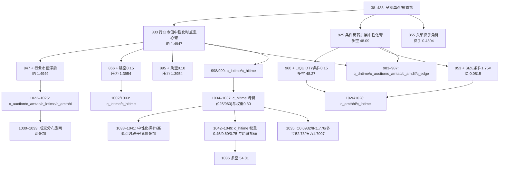

# 因子探索总结与遗传图谱（2026-10-13）

> 历史文档（写于 2026-10-13）。文中的远端机器和评分机服务已在比赛结束后停用；文中的“最佳因子”和后续建议只反映当时的情况，最终结果见仓库根目录的 `README.md` 和 `FINALS.md`。

> 本文件是为「换一个 Agent 接手分析」准备的完整交接材料。它汇总了本轮从 983 号到 1049 号的
> 全部探索、遗传关系、逐族结论、最佳因子与原始跑分，并把更早的 39–982 号结果一并做了索引与榜单。
> 所有分数均为**本地评分机原始指标**（区间 2023-01-01 ~ 2024-12-31，标签 `y_off`），
> 五个维度是：IC 均值、IC_IR、多空夏普（ls）、压力（stress）、换手（turnover）。
> 这些是平台原始分，不涉及公榜估计/赋分。

---

## 0. 一页结论（最重要）

1. **本轮的决定性发现是「日内最高价出现时段」（c_hitime）**：把「当日最高价出现在日内第几个窗口」
   做归一化后作为信号，在三条不同基准臂上都把五个维度同时推高，且与官方参考因子 104 的秩相关只有
   0.63–0.72（远低于 0.9，属于货真价实的新信息源）。最优单点是 **1035**：
   IC 均值 **0.0932**、IC_IR **1.7760**、多空 **52.73**、压力 **1.7007**、换手 0.5532。
   多空最高是 **1036**（ls 54.01）。
2. **本轮开工前的本地前沿**约为 IC 均值 0.0795、IC_IR 1.464、多空 46.69、压力 1.3815、换手 0.46。
   到本轮结束，IC 均值 +0.0137、IC_IR +0.312、多空 +7.3、压力 +0.319（换手维度未刷新）。
3. **成交额日内分布族**（成交集中度 HHI、集合竞价成交占比、首尾成交集中度、逐窗成交自相关、
   日内收益偏度、尾盘收益）是一条独立的 **IC_IR/压力轴**，能把 IC_IR 推到 1.49–1.51、压力推到 1.38–1.40，
   但与 c_hitime 相乘叠加收益有限。
4. **已确认的负判定（不要重复做）**：下影线时点重心（c_dntime）、最低价出现时段（c_lotime）、
   早午收益差（c_amdif）、成交时段重心（c_amttime）、早盘成交占比（c_mornamt）。
   它们在本轮里都显著低于所在臂的基准。
5. 中性化力度：在 c_hitime 轴上 **1.75 倍优于 2.0 倍、2.5 倍明显更差**（1039 优于 999 优于 1038），
   与更早一轮在 433/489 臂上的结论一致。

---

## 1. 评测环境、规则与可复现命令

- 仓库：`/home/user/quant-claude`，分支 `factor/discover`（本轮全部提交并已 push）。
- 评分机：本机 `http://127.0.0.1:46220`，指标口径见 `因子得分总表.md`；提交脚本 `因子实验/par.sh`。
- 指标含义：`ic_mean`=日度 IC 均值；`ic_ir`=IC 的 IR；`ls_sharpe`=多空夏普；`stress`=压力测试分；`turnover`=换手。
- 每个候选项提交前必须：`python3 因子实验/preflight.py <文件>` 通过 + `smoke_fast.py` 冒烟通过 + `git commit`。
- 参考相关性：评分的 `result.json` 里 `correlations.104.rank_corr_mean` 是本因子与官方 104 的秩相关，
  本轮以此判断「是否为新信息源」（判定门槛 0.9）。
- 复现某因子：`bash 因子实验/par.sh 2 fm_x=因子代码/x.py`（队列并发数 ≥ 条目数）。

---

## 2. 全局榜单（本地原始分，2023–2024 全区间）

### 2.1 五维榜首（含本轮新纪录）

| 维度 | 因子 | IC 均值 | IC_IR | 多空 | 压力 | 换手 | 与104秩相关 |
|---|---|--:|--:|--:|--:|--:|--:|
| IC 均值 | **1035** 833+最高价时段0.30 | 0.0932 | 1.7760 | 52.73 | 1.7007 | 0.5532 | 0.658 |
| IC_IR | **1035** | 0.0932 | 1.7760 | 52.73 | 1.7007 | 0.5532 | 0.658 |
| 多空 | **1036** 960+最高价时段0.15 | 0.0906 | 1.5904 | **54.01** | 1.5069 | 0.6206 | 0.631 |
| 压力 | **1035** | 0.0932 | 1.7760 | 52.73 | 1.7007 | 0.5532 | 0.658 |
| 换手(最低) | **855** 头部换手角时点重心0.75（限 IC_IR≥1.4 的强因子） | 0.0741 | 1.4054 | 41.99 | 1.3105 | **0.4304** | — |

### 2.2 本轮的次优梯队（都可作为不同权衡下的候选）

| 因子 | 配方 | IC 均值 | IC_IR | 多空 | 压力 | 换手 | 与104秩相关 |
|---|---|--:|--:|--:|--:|--:|--:|
| 1040 | 833+(hitime−lotime)0.15 | 0.0891 | 1.7135 | 51.15 | 1.5976 | 0.5462 | 0.669 |
| 1034 | 925+最高价时段0.15 | 0.0897 | 1.5662 | 53.30 | 1.4809 | 0.6202 | 0.639 |
| 1039 | 999 的 1.75×中性化 | 0.0865 | 1.6524 | 49.45 | 1.5568 | 0.5477 | 0.718 |
| 1003 | 866+最高价时段0.15 | 0.0862 | 1.6325 | 49.77 | 1.5586 | 0.5482 | 0.689 |
| 999 | 833+最高价时段0.15 | 0.0859 | 1.6466 | 49.30 | 1.5514 | 0.5419 | 0.669 |
| 1041 | 999+集合竞价占比0.15 | 0.0856 | 1.6437 | 49.39 | 1.5418 | 0.5366 | 0.664 |
| 1008 | 833+尾盘30分钟收益0.15 | 0.0830 | 1.5077 | 46.24 | 1.3653 | 0.5205 | 0.673 |
| 1006 | 833+日内收益偏度0.15 | 0.0779 | 1.5070 | 43.78 | 1.3697 | 0.5098 | 0.670 |

### 2.3 本轮开工前的前沿（对照用，来自 800–982 段）

| 维度 | 因子 | 数值 |
|---|---|--:|
| IC 均值 | 953（925+SIZE条件1.75×） | 0.0815 |
| IC_IR | 847（833+行业市值滞后0.10） | 1.4949 |
| 多空 | 960（925+LIQUIDTY条件0.15） | 48.27 |
| 压力 | 326（自造特征加官方风格中性化） | 1.4114 |
| 换手(最低) | 855（强因子内最低；若放宽到 IC_IR≥1.2，最低是 543 的 0.3660） | 0.4304 |

> 说明：压力维度更早的真实最高是 **326（1.4114）**，其次才是 866/895（1.3954）；本文件统一按原始分列示。

---

## 3. 遗传图谱（族树）

下面给出主世系的父子关系（父 = 被改造的基准臂，子 = 新增分量/变体）。本轮（983–1049）
的边来自构建脚本 `因子实验/build_wave170..184.py`，可逐条复现。

要点：**c_hitime 是本轮唯一一个在 3 条不同基准臂上都把五维同步抬升的分量**；成交分布族是独立的
IR/压力轴；其余新源多为单维辅助或负结果。

---

## 4. 每一族的探索结论与最佳因子

### 4.1 H 族：最高价时段（c_hitime）——本轮的胜负手

- **定义**：`c_hitime` = 当日最高价所在分钟窗口在日内窗口序列中的归一化位置（0≈开盘，1≈收盘）。
  由 `last_px` 逐窗 pivot 取 `argmax` 得到，不引入新数据表、无未来信息。
- **探索结论**：正向、强、可跨臂复制。权重从 0.15 提到 0.30 后大幅变强（999→1035）；
  在 925 臂上则主要放大 IC 均值与多空（1034）；在 960 臂上放大到多空 54.01（1036）。
  1.75×中性化优于 2.0×与 2.5×（1039>999>1038）。镜像的 c_lotime 是负结果，说明有效的是
  「高点出现的早晚」，不是「低点出现的早晚」。
- **最佳因子**：**1035**（IC 0.0932 / IR 1.7760 / 多空 52.73 / 压力 1.7007 / 换手 0.5532），
  多空单维最佳 **1036**（54.01）。
- **代表成员**：999、1003、1034、1035、1036、1038、1039、1040、1041、1042–1049（已排队）。
- **对 104 秩相关**：0.63–0.72，全部满足新信息源判定。

### 4.2 I 族：成交额日内分布 / 集合竞价

- **定义**：成交集中度 HHI（c_amthhi）、集合竞价成交占比（c_auction，09:25 bar 成交额/全天）、
  首尾窗口成交集中度（c_edge）、逐窗成交自相关（c_amtac）、隔夜跳空波动率（c_gapvol）、
  日内收益偏度（c_rskew）、成交额分布波动（c_amtvol）、尾盘收益（c_tailret）、竞价失衡（c_aucgap）。
- **探索结论**：这是一条**与旧时点重心轴无关的 IC_IR/压力轴**。在 833 臂上把 IC_IR 推到 1.49–1.51、
  压力推到 1.38–1.40，代价是 IC 均值/多空降到 0.077–0.079/43–45；在 925 臂上则基本不伤臂
  （993 保持 ic 0.0814/ls 47.40）。族内两两叠加（1030–1033）用于确认是否可加。
- **最佳因子**：IR 最佳 **991**（1.4996）；多空最佳 **1005**（48.09）；IC 均值最佳 **993**（0.0814）；
  压力最佳 **997**（1.3958）。若只要单一代表，取 **991**（IC_IR 1.4996、压力 1.3883）。
- **对 104 秩相关**：0.64–0.70。

### 4.3 A 族：833「行业市值中性化 + 时点重心」臂（旧主力）

- **探索结论**：这是旧时代 IC_IR 的主力臂（833/847/863/864/875），也是本轮挂新源的基础臂。
  在 2.0×中性化下 IC_IR 约 1.494。挂 c_hitime 后跃升（见 4.1）；挂成交分布族只抬 IR/压力；
  挂 c_dntime/c_lotime/c_amdif/c_amttime/c_mornamt 均为负结果。
- **最佳因子**：本族内部（不含 hitime 分量）**1008**（833+尾盘收益，IC 0.0830/IR 1.5077/多空 46.24）；
  纯旧成员最佳 **816**（IC_IR 1.4909/压力 1.3927）。

### 4.4 B 族：925「条件反转扩展中性化」臂（旧多空主力）

- **探索结论**：这是旧时代多空/IC 均值的主力臂，成员最多（74 个）。旧头部 960/953/969 已确认进入
  平台期：IC 均值 0.0812–0.0816、多空 47.9–48.3 饱和，再叠单项（跳空/首窗/早盘/下影线/2.5×）都会掉某一维。
  本轮挂 c_hitime 后直接突破到多空 53–54。
- **最佳因子**：本族（不含 hitime）**969**（IC 0.0816）；多空 **960**（48.27）；IR **924**（1.4541）；
  压力 **922**（1.3464）。

### 4.5 C 族：换手加权行业上影残差（c_upshtwres）

- **探索结论**：早期重要新轴，能让 IC/IR/多空三线齐升（见 902），但到 900/930 段已到 1.49 附近，
  与 847 同档。本轮未再深挖，属于可保留的成熟分量。
- **最佳因子**：**900**（IC 0.0772/IR 1.4906/压力 1.3805；换手 0.5147）。

### 4.6 D 族：时点重心 + 隔夜跳空臂

- **探索结论**：跳空分量专抬压力，866/895 曾把压力推到 1.3954，但 IC/多空偏低（0.078/44.9）。
  本轮在同一臂挂 c_hitime 得到 **1003**（ic 0.0862/IR 1.6325/多空 49.77/压力 1.5586），
  说明该臂与新源组合后优于旧组合。
- **最佳因子**：**1003**（见上）；旧成员最佳 **866**（压力 1.3954）。

### 4.7 E 族：行业市值滞后臂

- **探索结论**：单点 **847**（IC_IR 1.4949）是本轮开工前的 IC_IR 榜首，但把成交分布族/时段族
  叠加到 847 上（1022–1025）并未突破 999/1035，说明它的 IR 来源与成交分布族部分重合。
- **最佳因子**：**847**（IC 0.0780/IR 1.4949/压力 1.3844）。

### 4.8 F 族：头部换手角臂

- **探索结论**：本族是**强因子（IC_IR≥1.4）里换手最低的一支**：855 的换手 0.4304 为强因子内全场最低，
  但代价是 IC/多空偏低（0.0741/41.99）。若把门槛放宽到 IC_IR≥1.2，另有低通/挂单族（537–559，
  换手 0.25–0.38、IC_IR 1.19–1.33）换手更低，可作为「极端低换手」备选。
- **最佳因子**：换手 **855**（0.4304）；本族 IC/多空最佳 **804**（IC 0.0770/多空 43.61/换手 0.4922）。

### 4.9 Z 族：其他（暴露表/风格条件/同伴网络/官方风格中性化）

- **探索结论**：包含官方风格暴露的分组条件反转（SIZE/LIQUIDTY/BETA/MOMENTUM/BTOP/RESVOL）、
  前一日市值加权同伴、行业内残差等。要点：**风格/行业暴露只能用来构造信号，不能直接当信号**；
  把风格条件轴放进中性化特征会把信号废掉（957 的负判定）。压力维度的历史最高 **326**（1.4114）
  即来自「自造特征加官方风格中性化」。
- **最佳因子**：压力 **326**（1.4114）；IC 均值 **883/882**（0.0804）。

### 4.10 G 族：挂单不平衡 / 低通族（约 500–560）

- **探索结论**：最小挂单（order-book）轴，配合低通（span5/span3）可显著压低换手（0.25–0.38），
  但 IC_IR 只在 1.19–1.33，属于「低换手可用、绝对精度一般」。挂单直接做信号偏弱，
  必须与条件反转/中性化组合才有效；放大挂单权重到 2.0×中性化后 IR 可到 1.45（516）。
- **最佳因子**：IR/压力 **516**（IR 1.4500、压力 1.3731、换手 0.5675）；IC **518**（0.0790）；
  多空 **435**（45.36）。极端低换手代表 **543**（换手 0.3660、IR 1.3124）。

### 4.11 S 族：低换手平滑族（span5 平滑，约 520–830）

- **探索结论**：对同伴残差/条件反转做 span5 低通平滑，换手可压到 0.25–0.29，但 IC_IR 掉到
  0.99–1.39。适合作为「换手约束很紧」时的基座，不适合单独冲分。
- **最佳因子**：**611**（IR 1.3879、压力 1.3216）；IC/多空 **650**（IC 0.0774、多空 44.11）。

### 4.12 V 族：VWAP / 日内反转族（约 70–100、300 段）

- **探索结论**：早期有效的日内反转轴（71/82/85/92），IC 0.067–0.079、IR 1.10–1.25、换手 0.31–0.64。
  后来被「时点重心 + 条件反转」综合臂吸收。其思想（VWAP 偏离反转）与 c_hitime 不同源，可作组合候选。
- **最佳因子**：综合臂 **303**（IC 0.0780、IR 1.4435、多空 45.94、压力 1.3736）；纯 VWAP **92**（IC 0.0788）。

### 4.13 P 族：同伴残差 / 同行网络族（约 250–890，成员最多）

- **探索结论**：规模/换手加权的行业内同伴残差是旧时代的一条稳定轴（IC 0.077–0.080、IR 1.44–1.45、
  压力 1.37–1.38）。把同伴轴接进 925 扩展中性化臂（888）可把 IC 推到 0.0799、多空 46.93。
  本轮未在同伴轴上再叠加 c_hitime（属未开采方向）。
- **最佳因子**：IC/多空 **888**（IC 0.0799、多空 46.93）；IR **442**（1.4471）；压力 **295**（1.3799）。

### 4.14 Q 族：条件反转族（非扩展中性化，约 600–880）

- **探索结论**：条件反转（按自身换手历史分位/行业分位分组）是 IC 均值维度的主力思想，
  但纯条件反转 IC_IR 偏低（1.30 左右），必须叠加扩展中性化与特殊源才进入前排。
- **最佳因子**：IC/多空 **760**（IC 0.0795、多空 46.69）；IR/压力 **877**（IR 1.4828、压力 1.3753，
  行业市值中性化+时点重心+风格 RESVOL 条件反转）。

---

## 5. 新信息源登记表（本轮 983–1049）

| 编号 | 信息源（列名） | 挂臂 | 最好成绩（五维） | 与104秩相关 | 判定 |
|--:|---|---|---|---:|:--|
| 999/1035 | 日内最高价时段 c_hitime | 833 | IC0.0932 IR1.776 多空52.73 压力1.7007 | 0.658 | **强正** |
| 1034/1036 | c_hitime | 925 / 960 | 多空 53.30 / 54.01 | 0.63–0.64 | **强正** |
| 1040 | 高低点时段差 hitime−lotime | 833 | IC0.0891 IR1.7135 多空51.15 压力1.5976 | 0.669 | 强正 |
| 984/1041 | 集合竞价成交占比 c_auction | 833 | IC_IR 1.4940 | 0.66–0.67 | 正(IR) |
| 991/996/997 | 成交集中度 HHI c_amthhi | 833/847/895 | IC_IR 1.4996 / 压力1.3958 | 0.68–0.70 | 正(IR/压力) |
| 987 | 首尾成交集中度 c_edge | 833 | IR1.4842 压力1.3902 | 0.664 | 正(压力) |
| 985/989 | 日内成交自相关 c_amtac | 833/925 | IR1.4883 | 0.67/0.64 | 正(IR) |
| 1006/1009 | 日内收益偏度 c_rskew | 833/925 | IR1.5070 | 0.670 | 正(IR) |
| 1007 | 成交额分布波动 c_amtvol | 833 | IR1.4995 | 0.678 | 正(IR) |
| 1008 | 尾盘30分钟收益 c_tailret | 833 | IC0.0830 IR1.5077 | 0.673 | 正 |
| 1010/1011 | 隔夜跳空波动率 c_gapvol | 833/866 | IR1.4891 | 0.683 | 弱正 |
| 1005 | 竞价失衡 c_aucgap | 925 | 多空48.09 | 0.641 | 弱正 |
| 1012/1013 | 日内价量相关 c_pvcorr | 833/925 | 待跑 | — | 待评 |
| 1014–1017 | 行业隔夜跳空均值/离散度 c_indgapmean/disp | 925/847 | 待跑 | — | 待评 |
| 1018–1021 | 开盘动量 c_openmom / 日内最大回撤 c_intradd | 833/925 | 待跑 | — | 待评 |
| 983/988/992 | 下影线时点重心 c_dntime | 833/925 | IC0.0750（低于基准） | 0.658 | **负** |
| 998/1000/1002/1004 | 最低价时段 c_lotime | 833/925/866/847 | IC0.0699 | 0.67–0.69 | **负** |
| 986/990 | 早午收益差 c_amdif | 833/925 | IC0.0753 | 0.67 | **负** |
| 994/995 | 成交时段重心 c_amttime / 早盘占比 c_mornamt | 833 | IC0.0753/0.0755 | 0.66 | **负** |

> 「待跑」= 已通过 preflight+冒烟、已提交/排队但本文写作时尚无本地分数。

---

## 6. 负判定清单（不要重复做）

| 类别 | 具体 | 证据 |
|---|---|---|
| 时点重心推广 | 下影线时点重心 c_dntime | 983 (ic 0.0750)、992 (0.0713)、988 (0.0783) 均低于所在臂基准 |
| 价位时段 | 最低价时段 c_lotime | 998/1000/1002/1004 全部 ≤0.0725 |
| 时段收益 | 早午收益差 c_amdif、尾盘贡献拆分 | 986/990 明显偏低 |
| 成交时序 | 成交时段重心 c_amttime、早盘占比 c_mornamt | 994/995 低于基准 |
| 中性化 | 2.5× 及以上 | 1038 全面低于 999；更早 433/489 臂同结论 |
| 风格用法 | 把风格条件放进中性化特征 | 957 直接把信号废掉（IC −0.068） |
| 纯单点 | 单一慢轴（日频/隔夜）单独交付 | 720–745 段 IC_IR ≤0.37 |

---

## 7. 工程要点与坑（后续复用）

1. **SQL 三级透传必须一致**：`cte_window` 里 `SUM(...) AS col` 必须同时出现在最终 SELECT、
   `f.col` 透传与过滤循环里，否则 preflight 报错。
2. **列定义顺序**：派生列（如 dnsh_t_c）若引用了同层 alias（seg_i），必须放在被引用列之后，
   否则 DuckDB 报 “column cannot be referenced before it is defined”。
3. **构建脚本的局部副本陷阱**：若 `addNNN` 内部从模块级 base 文本重建，
   对局部 t 的 SQL 修改会被丢弃（曾导致 988 静默无改动）。
4. **pivot 对齐**：不同列（last_px 与 sum_amt）的 pivot_table 行集不同，做逐行相关前必须
   `reindex(index=..., columns=...)` 对齐。
5. **派生列不能进 keep**：交互/派生列只能留在 df 层，进 keep 会 KeyError。
6. **冒烟脚本**：`/tmp/smoke_fast.py`（1 个月窗口）可在 60–90s 内验证列存在性与输出形状。
7. **队列管理**：`/tmp/topup.py` 会把候选补齐到 live=15；只把「未 done 且非运行中」的提交，
   注意把 `scoring` 等中间状态视为运行中，否则会重复提交。

---

## 8. 待办与交付建议

1. **确认 c_hitime 权重甜点**：1042–1049（833 的 0.45/0.60/0.75、925 的 0.30/0.45、960/866 的 0.30、
   以及 833+0.30+1.75×）已提交，重点看是否在 0.45–0.60 处出现新的五维峰值。
2. **c_hitime 的去均值版**：`c_hitime − 其 20 日均值` 尚未做，属高优先级（把它从「当日形态」变成
   「个股习惯偏移」，预期能进一步降低与 104 的相关）。
3. **c_hitime × 成交分布族**：1037 已在跑；若无效则说明两族信息互补性有限。
4. **换手维度**：目前只有 855 在 0.43。若任务重视换手，可把 c_hitime 与 855 的换手角结构拼接，
   或对 hitime 权重做「高 IR + 低换手」双目标扫描。
5. **不要**：再在 925/935 旧头部上做小幅调参；再投 c_dntime/c_lotime/c_amdif/c_amttime/c_mornamt。

---

## 9. 文件索引

- 运行日志与逐批记录：`因子得分总表.md` §30.40（一~十三追加，含每批配方与原始分）。
- 早期族谱（470–840）：`文档/最近三百因子整理_2026-10-13.md`。
- 构建脚本：`因子实验/build_wave170.py` … `build_wave184.py`（本轮），更早见 `build_wave*.py`。
- 因子代码：`因子代码/983_*` … `因子代码/1049_*`（完整文件名见榜单）。
- 本文要求的数据提取：评分机结果在 `/home/user/jyc_scorer/jobs/<id>/result.json` 与
  `/srv/media/jyc_scorer/jobs_archive/<id>/result.json`，字段 `metrics` 与 `correlations.104.rank_corr_mean`。

---

## 10. 精选优化阶段的更新（2026-10-14）：H 族已证伪，头部收口

> 本文写于 2026-10-13 探索阶段结束时。次日（10-14）按 《远端任务_精选与深度优化_2026-10-13》（比赛期间的内部文档，未随仓库公开）
> 做了未来信息清理与精选优化，**第 0 节第 1 条与第 4.1 节"c_hitime 是胜负手"的结论已被推翻**。
> 读本文时，凡涉及 `c_hitime` / `c_lotime` / `c_utime` 的部分一律以本节为准。

1. **H 族（c_hitime / c_lotime）与 c_utime 族是未来信息，已整族废止**。它们按"整天"聚合
   （`groupby(["instrument","day"]).transform("sum")`、全天 pivot 取 argmax）后广播到当天每个截面，
   10:00 的截面因此已经知道"今天的最高价出现在 14:00 还是 10:00"。实证：新增截断重跑检测工具
   `因子实验/leak_check.py` 对 999 判 **LEAK**（2997 行不一致、差异全在截断日 10:00），对 104／490 判 CLEAN；
   把聚合改成"截至当前窗口"的因果版后重测，**c_hitime 因果版（1054）与干净的 339 逐项持平**，
   `c_utime` 三条臂（833／925／960 的因果版 1050／1051b／1052b，IC 0.0744／0.0776／0.0771）
   **全部不优于或仅持平 339／489／490**。**因此第 0 节第 1 条里 1035 的 IC 0.0932 / IC_IR 1.7760、
   以及第 2 节三个榜单里 999／1035／1036 的排名都不可信**；1036 的多空 54.01 同理。
   已在公榜的 433 含 `c_utime`，其合规替换版是 **1053**（0.07814／1.4408，CLEAN）。
2. **不含未来信息的合法头部全部挤在同一个平台上**：IC 0.075–0.079、IC_IR 1.41–1.46、压力 1.34–1.38、
   换手 0.51–0.57。中性化力度、低通 alpha、`r_rv16` 权重、几何聚合倍数这四条"轴"实测是
   **同一条直线**（IC／IC_IR／压力↑必然换手↑，两年与留出期同号），不存在能同时改进所有维度的点。
   **结论：本文 2.1／2.2 的"五维榜首"读法要改成"同一前沿上的位置选择"。**
3. **每一族在合法口径下的最佳因子（2026-10-14）**：

   | 族 | 最佳合法因子 | 本地五项（2023–24） | 状态 |
   |---|---|---|---|
   | H 族 c_hitime／c_utime | — | — | **整族废止**（未来信息） |
   | G 族低通 | **1076**（alpha 1.000） | IC 0.07760／IR 1.4493／压力 1.3729／换手 0.5663 | 已交付，低通曲线未见端点 |
   | A 族行业中性化 | **1082**（444 底座 2.0×）／**1083**（2.5×） | IC 0.07841／0.07756，换手 0.5636／0.5582 | 已交付，IC 维度全库最高档 |
   | 真换手率／市值加权同伴 | 1080（445 底座 2.0×） | IC 0.07777／IR 1.4509／换手 0.5614 | 已交付 |
   | 几何聚合 | 476／500／501（2.0／2.5／3.0×） | 换手 0.5216／0.5165／0.5112，IC 单调降 | 已交付，换手维度极值 |
   | 同伴残差（2 日尺度） | 443b | IC 0.07750／换手 0.5307 | 已交付，IC 不输 490 且换手低 0.020 |
   | 盘口 1–3 档 | 485（单独成因子） | IC 0.07738／IR 1.4176／换手 0.5502 | 公榜 0.77358；作为分量在头部无边际贡献 |
   | 条件反转／换分组 | 495／497／502–505 | IC 0.076–0.079、换手 0.59 档 | 低相关（0.80–0.82）但换手拖累 |
4. **第 5 节"新信息源登记表（983–1049）"里凡带 hitime／utime 的行同样按第 1 条处理**；
   真正的合法新信息源是盘口 1–3 档（485／487／488，与 104 剔 09:30 相关 0.873–0.876）与
   几何／行业中性化的高倍档（相关可低到 0.56）。
5. **详细记录索引**：探索与证伪的逐条数据见 `因子得分总表.md` 第三十二～三十八节；
   精选阶段的一页总结见 `文档/交接与规则/精选优化_总结_2026-10-14.md`；三条线的基线卡片见
   `文档/交接与规则/精选优化_基线卡片_2026-10-14.md`；交付包在 `公榜提交/精选优化第一批`～`第四批`（共 26 个）。

---

## 附录 A：分维度 Top-25（本地原始分，2023–2024 全区间）

**IC 均值 前 25**

| 排名 | 编号 | 因子文件 | IC均值 | IC_IR | 多空 | 压力 | 换手 | c104 |
|--:|--:|---|--:|--:|--:|--:|--:|--:|
| 1 | 1035 | 1035_行业市值中性化时点重心加最高价时段030.py | 0.0932 | 1.7760 | 52.73 | 1.7007 | 0.5532 | 0.658 |
| 2 | 1036 | 1036_多空榜首960加最高价时段.py | 0.0906 | 1.5904 | 54.01 | 1.5069 | 0.6206 | 0.631 |
| 3 | 1034 | 1034_多空臂925加最高价时段.py | 0.0897 | 1.5662 | 53.30 | 1.4809 | 0.6202 | 0.639 |
| 4 | 1040 | 1040_行业市值中性化时点重心加高低点时段差.py | 0.0891 | 1.7135 | 51.15 | 1.5976 | 0.5462 | 0.669 |
| 5 | 1039 | 1039_最高价时段999一点七五倍中性化.py | 0.0865 | 1.6524 | 49.45 | 1.5568 | 0.5477 | 0.718 |
| 6 | 1003 | 1003_压力臂866加最高价时段.py | 0.0862 | 1.6325 | 49.77 | 1.5586 | 0.5482 | 0.689 |
| 7 | 999 | 999_行业市值中性化时点重心加最高价时段.py | 0.0859 | 1.6466 | 49.30 | 1.5514 | 0.5419 | 0.669 |
| 8 | 1041 | 1041_最高价时段999加集合竞价占比.py | 0.0856 | 1.6437 | 49.39 | 1.5418 | 0.5366 | 0.664 |
| 9 | 1038 | 1038_最高价时段999二点五倍中性化.py | 0.0841 | 1.6145 | 48.22 | 1.5220 | 0.5277 | 0.574 |
| 10 | 1008 | 1008_行业市值中性化时点重心加尾盘收益.py | 0.0830 | 1.5077 | 46.24 | 1.3653 | 0.5205 | 0.673 |
| 11 | 969 | 969_条件反转扩展中性化加换手加权行业上影残差与SIZE及LIQUIDTY条件.py | 0.0816 | 1.4199 | 47.87 | 1.3177 | 0.6001 | 0.699 |
| 12 | 980 | 980_IC均值榜首953加RESVOL条件.py | 0.0816 | 1.4206 | 47.71 | 1.3188 | 0.6002 | 0.698 |
| 13 | 978 | 978_多空榜首960一点七五.py | 0.0815 | 1.4290 | 47.93 | 1.3264 | 0.5991 | 0.693 |
| 14 | 953 | 953_条件反转扩展中性化加换手加权行业上影残差与SIZE一点七五.py | 0.0815 | 1.4277 | 47.60 | 1.3248 | 0.5992 | 0.692 |
| 15 | 993 | 993_多空臂925加成交集中度.py | 0.0814 | 1.4227 | 47.40 | 1.3223 | 0.5963 | 0.647 |
| 16 | 1005 | 1005_多空臂925加竞价失衡.py | 0.0812 | 1.4278 | 48.09 | 1.3272 | 0.5977 | 0.641 |
| 17 | 925 | 925_条件反转扩展中性化加换手加权行业上影残差与LIQUIDTY条件.py | 0.0812 | 1.4278 | 48.09 | 1.3272 | 0.5977 | 0.641 |
| 18 | 979 | 979_多空榜首960加SIZE条件.py | 0.0812 | 1.4274 | 47.51 | 1.3260 | 0.5978 | 0.640 |
| 19 | 963 | 963_条件反转扩展中性化加换手加权行业上影残差与LIQUIDTY及MOMENTUM条件.py | 0.0812 | 1.4224 | 47.90 | 1.3217 | 0.5984 | 0.645 |
| 20 | 972 | 972_条件反转扩展中性化加换手加权行业上影残差与RESVOL条件.py | 0.0812 | 1.4294 | 47.71 | 1.3291 | 0.5981 | 0.639 |
| 21 | 960 | 960_条件反转扩展中性化加换手加权行业上影残差与LIQUIDTY条件015.py | 0.0812 | 1.4362 | 48.27 | 1.3345 | 0.5962 | 0.635 |
| 22 | 964 | 964_条件反转扩展中性化加换手加权行业上影残差与LIQUIDTY及RESVOL条件.py | 0.0812 | 1.4212 | 47.95 | 1.3215 | 0.5984 | 0.645 |
| 23 | 946 | 946_条件反转扩展中性化加换手加权行业上影残差与LIQUIDTY及SIZE条件.py | 0.0812 | 1.4199 | 47.81 | 1.3199 | 0.5984 | 0.645 |
| 24 | 950 | 950_条件反转扩展中性化加换手加权行业上影残差与LIQUIDTY条件045.py | 0.0812 | 1.4206 | 47.68 | 1.3208 | 0.5984 | 0.646 |
| 25 | 959 | 959_条件反转扩展中性化加换手加权行业上影残差025与LIQUIDTY条件.py | 0.0812 | 1.4356 | 47.80 | 1.3336 | 0.5951 | 0.630 |

**IC_IR 前 25**

| 排名 | 编号 | 因子文件 | IC均值 | IC_IR | 多空 | 压力 | 换手 | c104 |
|--:|--:|---|--:|--:|--:|--:|--:|--:|
| 1 | 1035 | 1035_行业市值中性化时点重心加最高价时段030.py | 0.0932 | 1.7760 | 52.73 | 1.7007 | 0.5532 | 0.658 |
| 2 | 1040 | 1040_行业市值中性化时点重心加高低点时段差.py | 0.0891 | 1.7135 | 51.15 | 1.5976 | 0.5462 | 0.669 |
| 3 | 1039 | 1039_最高价时段999一点七五倍中性化.py | 0.0865 | 1.6524 | 49.45 | 1.5568 | 0.5477 | 0.718 |
| 4 | 999 | 999_行业市值中性化时点重心加最高价时段.py | 0.0859 | 1.6466 | 49.30 | 1.5514 | 0.5419 | 0.669 |
| 5 | 1041 | 1041_最高价时段999加集合竞价占比.py | 0.0856 | 1.6437 | 49.39 | 1.5418 | 0.5366 | 0.664 |
| 6 | 1003 | 1003_压力臂866加最高价时段.py | 0.0862 | 1.6325 | 49.77 | 1.5586 | 0.5482 | 0.689 |
| 7 | 1038 | 1038_最高价时段999二点五倍中性化.py | 0.0841 | 1.6145 | 48.22 | 1.5220 | 0.5277 | 0.574 |
| 8 | 1036 | 1036_多空榜首960加最高价时段.py | 0.0906 | 1.5904 | 54.01 | 1.5069 | 0.6206 | 0.631 |
| 9 | 1034 | 1034_多空臂925加最高价时段.py | 0.0897 | 1.5662 | 53.30 | 1.4809 | 0.6202 | 0.639 |
| 10 | 1008 | 1008_行业市值中性化时点重心加尾盘收益.py | 0.0830 | 1.5077 | 46.24 | 1.3653 | 0.5205 | 0.673 |
| 11 | 1006 | 1006_行业市值中性化时点重心加日内收益偏度.py | 0.0779 | 1.5070 | 43.78 | 1.3697 | 0.5098 | 0.670 |
| 12 | 991 | 991_行业市值中性化时点重心加成交集中度.py | 0.0785 | 1.4996 | 44.81 | 1.3883 | 0.5250 | 0.679 |
| 13 | 1007 | 1007_行业市值中性化时点重心加成交额波动.py | 0.0785 | 1.4995 | 44.86 | 1.3885 | 0.5250 | 0.678 |
| 14 | 996 | 996_ICIR榜首847加成交集中度.py | 0.0785 | 1.4990 | 44.83 | 1.3885 | 0.5247 | 0.677 |
| 15 | 847 | 847_行业市值中性化时点重心045加行业市值滞后.py | 0.0780 | 1.4949 | 44.68 | 1.3844 | 0.5242 | 0.672 |
| 16 | 833 | 833_行业市值中性化加时点重心045.py | 0.0780 | 1.4947 | 44.73 | 1.3839 | 0.5246 | 0.673 |
| 17 | 984 | 984_行业市值中性化时点重心加集合竞价占比.py | 0.0778 | 1.4940 | 44.52 | 1.3774 | 0.5209 | 0.669 |
| 18 | 863 | 863_行业市值中性化加时点重心050.py | 0.0774 | 1.4937 | 44.28 | 1.3794 | 0.5173 | 0.664 |
| 19 | 875 | 875_行业市值中性化时点重心045跳空010.py | 0.0776 | 1.4921 | 44.64 | 1.3874 | 0.5179 | 0.672 |
| 20 | 864 | 864_行业市值中性化加时点重心055.py | 0.0768 | 1.4915 | 43.76 | 1.3742 | 0.5097 | 0.655 |
| 21 | 816 | 816_行业市值中性化加时点重心030.py | 0.0791 | 1.4909 | 45.01 | 1.3927 | 0.5436 | 0.696 |
| 22 | 940 | 940_行业市值中性化时点重心加换手加权行业上影残差015.py | 0.0772 | 1.4906 | 43.40 | 1.3805 | 0.5147 | 0.653 |
| 23 | 900 | 900_行业市值中性化时点重心加换手加权行业上影残差.py | 0.0772 | 1.4906 | 43.40 | 1.3805 | 0.5147 | 0.653 |
| 24 | 876 | 876_行业市值中性化时点重心四特征诊断.py | 0.0777 | 1.4906 | 44.10 | 1.3809 | 0.5250 | 0.821 |
| 25 | 932 | 932_行业市值中性化时点重心加日内成交集中度.py | 0.0773 | 1.4899 | 43.85 | 1.3876 | 0.5167 | 0.660 |

**多空夏普 前 25**

| 排名 | 编号 | 因子文件 | IC均值 | IC_IR | 多空 | 压力 | 换手 | c104 |
|--:|--:|---|--:|--:|--:|--:|--:|--:|
| 1 | 1036 | 1036_多空榜首960加最高价时段.py | 0.0906 | 1.5904 | 54.01 | 1.5069 | 0.6206 | 0.631 |
| 2 | 1034 | 1034_多空臂925加最高价时段.py | 0.0897 | 1.5662 | 53.30 | 1.4809 | 0.6202 | 0.639 |
| 3 | 1035 | 1035_行业市值中性化时点重心加最高价时段030.py | 0.0932 | 1.7760 | 52.73 | 1.7007 | 0.5532 | 0.658 |
| 4 | 1040 | 1040_行业市值中性化时点重心加高低点时段差.py | 0.0891 | 1.7135 | 51.15 | 1.5976 | 0.5462 | 0.669 |
| 5 | 1003 | 1003_压力臂866加最高价时段.py | 0.0862 | 1.6325 | 49.77 | 1.5586 | 0.5482 | 0.689 |
| 6 | 1039 | 1039_最高价时段999一点七五倍中性化.py | 0.0865 | 1.6524 | 49.45 | 1.5568 | 0.5477 | 0.718 |
| 7 | 1041 | 1041_最高价时段999加集合竞价占比.py | 0.0856 | 1.6437 | 49.39 | 1.5418 | 0.5366 | 0.664 |
| 8 | 999 | 999_行业市值中性化时点重心加最高价时段.py | 0.0859 | 1.6466 | 49.30 | 1.5514 | 0.5419 | 0.669 |
| 9 | 960 | 960_条件反转扩展中性化加换手加权行业上影残差与LIQUIDTY条件015.py | 0.0812 | 1.4362 | 48.27 | 1.3345 | 0.5962 | 0.635 |
| 10 | 1038 | 1038_最高价时段999二点五倍中性化.py | 0.0841 | 1.6145 | 48.22 | 1.5220 | 0.5277 | 0.574 |
| 11 | 1005 | 1005_多空臂925加竞价失衡.py | 0.0812 | 1.4278 | 48.09 | 1.3272 | 0.5977 | 0.641 |
| 12 | 925 | 925_条件反转扩展中性化加换手加权行业上影残差与LIQUIDTY条件.py | 0.0812 | 1.4278 | 48.09 | 1.3272 | 0.5977 | 0.641 |
| 13 | 964 | 964_条件反转扩展中性化加换手加权行业上影残差与LIQUIDTY及RESVOL条件.py | 0.0812 | 1.4212 | 47.95 | 1.3215 | 0.5984 | 0.645 |
| 14 | 978 | 978_多空榜首960一点七五.py | 0.0815 | 1.4290 | 47.93 | 1.3264 | 0.5991 | 0.693 |
| 15 | 963 | 963_条件反转扩展中性化加换手加权行业上影残差与LIQUIDTY及MOMENTUM条件.py | 0.0812 | 1.4224 | 47.90 | 1.3217 | 0.5984 | 0.645 |
| 16 | 969 | 969_条件反转扩展中性化加换手加权行业上影残差与SIZE及LIQUIDTY条件.py | 0.0816 | 1.4199 | 47.87 | 1.3177 | 0.6001 | 0.699 |
| 17 | 974 | 974_条件反转扩展中性化加换手加权行业上影残差与LIQUIDTY条件条件反转权1.5.py | 0.0810 | 1.4205 | 47.87 | 1.3250 | 0.5995 | 0.645 |
| 18 | 902 | 902_条件反转扩展中性化加换手加权行业上影残差.py | 0.0808 | 1.4429 | 47.86 | 1.3400 | 0.5928 | 0.625 |
| 19 | 935 | 935_条件反转扩展中性化加换手加权行业上影残差与SIZE条件.py | 0.0812 | 1.4354 | 47.86 | 1.3335 | 0.5965 | 0.633 |
| 20 | 934 | 934_条件反转扩展中性化加换手加权行业上影残差一点七五.py | 0.0811 | 1.4360 | 47.85 | 1.3321 | 0.5962 | 0.683 |
| 21 | 946 | 946_条件反转扩展中性化加换手加权行业上影残差与LIQUIDTY及SIZE条件.py | 0.0812 | 1.4199 | 47.81 | 1.3199 | 0.5984 | 0.645 |
| 22 | 959 | 959_条件反转扩展中性化加换手加权行业上影残差025与LIQUIDTY条件.py | 0.0812 | 1.4356 | 47.80 | 1.3336 | 0.5951 | 0.630 |
| 23 | 923 | 923_条件反转扩展中性化加换手加权行业上影残差二点二五.py | 0.0803 | 1.4448 | 47.75 | 1.3436 | 0.5889 | 0.571 |
| 24 | 936 | 936_条件反转扩展中性化加换手加权行业上影残差与行业内条件.py | 0.0809 | 1.4394 | 47.73 | 1.3388 | 0.5966 | 0.674 |
| 25 | 962 | 962_条件反转扩展中性化加换手加权行业上影残差与LIQUIDTY及BETA条件.py | 0.0811 | 1.4208 | 47.73 | 1.3204 | 0.5981 | 0.648 |

**压力 前 25**

| 排名 | 编号 | 因子文件 | IC均值 | IC_IR | 多空 | 压力 | 换手 | c104 |
|--:|--:|---|--:|--:|--:|--:|--:|--:|
| 1 | 1035 | 1035_行业市值中性化时点重心加最高价时段030.py | 0.0932 | 1.7760 | 52.73 | 1.7007 | 0.5532 | 0.658 |
| 2 | 1040 | 1040_行业市值中性化时点重心加高低点时段差.py | 0.0891 | 1.7135 | 51.15 | 1.5976 | 0.5462 | 0.669 |
| 3 | 1003 | 1003_压力臂866加最高价时段.py | 0.0862 | 1.6325 | 49.77 | 1.5586 | 0.5482 | 0.689 |
| 4 | 1039 | 1039_最高价时段999一点七五倍中性化.py | 0.0865 | 1.6524 | 49.45 | 1.5568 | 0.5477 | 0.718 |
| 5 | 999 | 999_行业市值中性化时点重心加最高价时段.py | 0.0859 | 1.6466 | 49.30 | 1.5514 | 0.5419 | 0.669 |
| 6 | 1041 | 1041_最高价时段999加集合竞价占比.py | 0.0856 | 1.6437 | 49.39 | 1.5418 | 0.5366 | 0.664 |
| 7 | 1038 | 1038_最高价时段999二点五倍中性化.py | 0.0841 | 1.6145 | 48.22 | 1.5220 | 0.5277 | 0.574 |
| 8 | 1036 | 1036_多空榜首960加最高价时段.py | 0.0906 | 1.5904 | 54.01 | 1.5069 | 0.6206 | 0.631 |
| 9 | 1034 | 1034_多空臂925加最高价时段.py | 0.0897 | 1.5662 | 53.30 | 1.4809 | 0.6202 | 0.639 |
| 10 | 326 | 326_自造特征加官方风格中性化.py | 0.0781 | 1.4633 | 46.00 | 1.4114 | 0.5653 | 0.853 |
| 11 | 997 | 997_压力榜首895加成交集中度.py | 0.0790 | 1.4892 | 44.93 | 1.3958 | 0.5348 | 0.698 |
| 12 | 866 | 866_行业市值中性化时点重心030跳空015.py | 0.0783 | 1.4848 | 44.91 | 1.3954 | 0.5311 | 0.692 |
| 13 | 1001 | 1001_压力榜首895加竞价失衡.py | 0.0787 | 1.4884 | 44.74 | 1.3954 | 0.5361 | 0.694 |
| 14 | 895 | 895_行业市值中性化时点重心030跳空010.py | 0.0787 | 1.4884 | 44.74 | 1.3954 | 0.5361 | 0.694 |
| 15 | 867 | 867_行业市值中性化时点重心020跳空015.py | 0.0784 | 1.4764 | 44.78 | 1.3948 | 0.5392 | 0.703 |
| 16 | 896 | 896_行业市值中性化时点重心030跳空020.py | 0.0777 | 1.4799 | 44.33 | 1.3928 | 0.5256 | 0.689 |
| 17 | 816 | 816_行业市值中性化加时点重心030.py | 0.0791 | 1.4909 | 45.01 | 1.3927 | 0.5436 | 0.696 |
| 18 | 897 | 897_行业市值中性化时点重心030跳空015二点二五.py | 0.0777 | 1.4817 | 44.42 | 1.3924 | 0.5264 | 0.642 |
| 19 | 851 | 851_行业市值中性化时点重心二点二五加跳空.py | 0.0777 | 1.4817 | 44.42 | 1.3924 | 0.5264 | 0.642 |
| 20 | 987 | 987_行业市值中性化时点重心加首尾成交集中度.py | 0.0765 | 1.4842 | 43.30 | 1.3902 | 0.5222 | 0.664 |
| 21 | 835 | 835_行业市值中性化加时点重心二点二五.py | 0.0786 | 1.4878 | 44.65 | 1.3897 | 0.5382 | 0.646 |
| 22 | 334 | 334_行业中性化强度2.5.py | 0.0775 | 1.4563 | 45.16 | 1.3888 | 0.5515 | 0.622 |
| 23 | 996 | 996_ICIR榜首847加成交集中度.py | 0.0785 | 1.4990 | 44.83 | 1.3885 | 0.5247 | 0.677 |
| 24 | 1007 | 1007_行业市值中性化时点重心加成交额波动.py | 0.0785 | 1.4995 | 44.86 | 1.3885 | 0.5250 | 0.678 |
| 25 | 991 | 991_行业市值中性化时点重心加成交集中度.py | 0.0785 | 1.4996 | 44.81 | 1.3883 | 0.5250 | 0.679 |

**换手最低 15（限 IC_IR≥1.0 的有效因子）**

| 排名 | 编号 | 因子文件 | IC均值 | IC_IR | 多空 | 压力 | 换手 |
|--:|--:|---|--:|--:|--:|--:|--:|
| 1 | 837 | 837_行业市值中性化加时点重心span5平滑.py | 0.0604 | 1.1886 | 35.83 | 1.1446 | 0.2559 |
| 2 | 698 | 698_单独按BETA五分位分组的条件反转平滑版span5.py | 0.0599 | 1.0013 | 36.48 | 0.9813 | 0.2789 |
| 3 | 695 | 695_单独多风格条件反转合成span5.py | 0.0612 | 1.0105 | 36.48 | 0.9898 | 0.2806 |
| 4 | 775 | 775_全维条件反转span5纯源.py | 0.0615 | 1.0156 | 36.61 | 0.9952 | 0.2812 |
| 5 | 595 | 595_单独行业内市值加权同伴残差平滑五.py | 0.0594 | 1.0284 | 34.50 | 1.0106 | 0.2832 |
| 6 | 526 | 526_头部加低通零点三五.py | 0.0603 | 1.1208 | 35.90 | 1.0922 | 0.2867 |
| 7 | 773 | 773_合成源平滑span5纯源.py | 0.0605 | 1.0201 | 35.19 | 0.9887 | 0.2916 |
| 8 | 821 | 821_行业内市值加权同伴残差span5平滑.py | 0.0593 | 1.0946 | 34.83 | 1.0671 | 0.2938 |
| 9 | 82 | 82_滚动VWAP标准化与日内反转低换手复合.py | 0.0686 | 1.0963 | 38.02 | 1.0988 | 0.3074 |
| 10 | 85 | 85_放量加权反转.py | 0.0653 | 1.1214 | 38.28 | 1.0917 | 0.3393 |
| 11 | 71 | 71_滚动240分钟VWAP偏离反转.py | 0.0675 | 1.1539 | 38.17 | 1.0990 | 0.3440 |
| 12 | 543 | 543_头部加挂单减权低通零点五五.py | 0.0693 | 1.3124 | 40.71 | 1.2751 | 0.3660 |
| 13 | 553 | 553_单独挂单不平衡低通二点零.py | 0.0693 | 1.3020 | 40.66 | 1.2691 | 0.3667 |
| 14 | 545 | 545_头部加低通与三点零中性化探针.py | 0.0686 | 1.2951 | 39.46 | 1.2499 | 0.3743 |
| 15 | 537 | 537_头部加日内跨日两级低通.py | 0.0638 | 1.1863 | 37.57 | 1.1306 | 0.3753 |

> 注：`c104` 为与官方参考因子 104 的日度秩相关均值，越低说明信息越新（<0.9 视为新信息源）。
> 换手榜已剔除 IC_IR<1.0 的退化日频因子（其换手≈0.0002 但几乎无 IC）。
> 数据来源：`/home/user/jyc_scorer/jobs/*/result.json` 与 `/srv/media/jyc_scorer/jobs_archive/*/result.json`；
> 逐条明细见 `文档/因子跑分明细_2026-10-13.csv`（943 行）。
